# EduBox — Rebuild It From Scratch

### A complete, mentor-style learning roadmap for juniors

> *"Don't memorize the files. Understand the decisions. Then the files write themselves."*

This guide reverse-engineers the **EduBox** platform (five Git repositories, ~25 Docker containers worth of ideas, Keycloak, Laravel, Next.js, Traefik, MariaDB, WebSockets, queues, and a mobile app) and turns it into an ordered checklist you can follow **from an empty folder to a finished, running system**.

It is written for a junior developer. Nothing is assumed. Every technology is introduced before it is used. Every file is explained: *why it exists, who uses it, when it runs, and what breaks without it.*

---

## How to use this guide

1. **Go in order.** The tasks are sequenced so that each one only depends on things you have already built. The order is *not* the order the original developers committed things in; it is the order an experienced tech lead would teach it.
2. **Do every Verification step.** A task is not "done" when the code is written — it is done when you have *proved* it works. Bugs found early are cheap.
3. **Answer the Knowledge check before opening the answers.** If you can't explain it, re-read the Background section. Being able to explain a decision is the real goal.
4. **Tick the Completion checklist.** This README is meant to be *your* working copy. Edit the `- [ ]` boxes into `- [x]` as you go.
5. **Read the callouts.**

> [!NOTE]
> Extra context that is useful but not strictly required.

> [!TIP]
> A shortcut, a habit, or a professional practice worth copying.

> [!WARNING]
> Something that commonly breaks, wastes hours, or is a security risk.

> [!IMPORTANT]
> A key design decision. If you only remember a few things, remember these.

### Every task has the same structure

| Section | What it gives you |
|---|---|
| **Goal** | What we're trying to achieve |
| **Why now?** | Why this task comes at this point and what depends on it |
| **Background knowledge** | The concepts you need *before* writing anything |
| **What should I create?** | Folders, files, services, env vars, routes… |
| **Purpose of every file** | Why each file exists, who uses it, when it runs, what breaks without it |
| **Implementation guide** | Idea → structure → important code → full code |
| **Technology explanation** | What / why / problem solved / why chosen / alternatives / when not to use |
| **Project architecture** | Where the task fits, usually with a Mermaid diagram |
| **Verification** | Commands, expected output, expected browser behavior, logs |
| **Common beginner mistakes** | Symptoms, debugging steps, fixes |
| **Knowledge check** | Questions (with hidden answers) |
| **Completion checklist** | Boxes to tick |

---

## Table of Contents

- [Part I — The Big Picture](#part-i)
  - [What is EduBox?](#what-is-edubox)
  - [The five repositories](#five-repos)
  - [The architecture in one diagram](#arch-diagram)
  - [Three journeys through the system](#journeys)
  - [The technology stack at a glance](#stack)
  - [How experienced developers think](#how-seniors-think)
- [Phase 0 — Your Workstation](#phase-0)
  - [Task 0.1 — Install and understand your tools](#task-0-1)
  - [Task 0.2 — The Linux concepts this project relies on](#task-0-2)
- [Phase 1 — Foundation](#phase-1)
  - [Task 1 — Design the system on paper first](#task-1)
  - [Task 2 — Create the workspace and the five repositories](#task-2)
  - [Task 3 — Git conventions and protecting `main` with Husky](#task-3)
  - [Task 4 — The environment-variable strategy](#task-4)
- [Phase 2 — Infrastructure](#phase-2)
  - [Task 5 — Docker fundamentals and your first `compose.yaml`](#task-5)
  - [Task 6 — The shared Docker network](#task-6)
  - [Task 7 — A local domain name](#task-7)
  - [Task 8 — Traefik, the reverse proxy](#task-8)
  - [Task 9 — HTTPS with SSL/TLS certificates](#task-9)
  - [Task 10 — MariaDB, Docker volumes, and Adminer](#task-10)
  - [Task 11 — MailHog, a fake mail server](#task-11)
  - [Task 12 — Automate everything with a Makefile](#task-12)
- [Phase 3 — Identity and Access (Keycloak)](#phase-3)
  - [Task 13 — Theory: authentication, authorization, OAuth2, OIDC, JWT](#task-13)
  - [Task 14 — Run Keycloak behind Traefik](#task-14)
  - [Task 15 — Realm as code with keycloak-config-cli](#task-15)
  - [Task 16 — The permission model: roles and groups](#task-16)
  - [Task 17 — Clients, the `roles` claim, and the backend service user](#task-17)
  - [Task 18 — Client scopes, authentication flows, and seed users](#task-18)
  - [Task 19 — Get and inspect a real token by hand](#task-19)
  - [Task 20 — A custom login and email theme](#task-20)
  - [Task 21 — Snapshotting identity data: dump and restore](#task-21)
- [Phase 4 — Backend Foundation (Laravel)](#phase-4)
  - [Task 22 — The Laravel container and its Traefik route](#task-22)
  - [Task 23 — Create the Laravel project and tour its folders](#task-23)
  - [Task 24 — Configure `.env`, connect MariaDB, run migrations](#task-24)
  - [Task 25 — Make it an API-only application (`bootstrap/app.php`)](#task-25)
  - [Task 26 — The API response contract](#task-26)
  - [Task 27 — A `users` table designed for an external identity provider](#task-27)
- [Phase 5 — Backend Authentication and Authorization](#phase-5)
  - [Task 28 — Validate Keycloak JWTs with a Laravel guard](#task-28)
  - [Task 29 — Role-based authorization middleware](#task-29)
  - [Task 30 — Talking to Keycloak's Admin API (`KeycloakHelper`)](#task-30)
  - [Task 31 — Bootstrap the first administrator](#task-31)
- [Phase 6 — Backend Features](#phase-6)
  - [Task 32 — Your first vertical slice: Grades](#task-32)
  - [Task 33 — Automatic authorship and an audit trail](#task-33)
  - [Task 34 — Generic list API: search, sort, paginate, filter](#task-34)
  - [Task 35 — Multilingual content: languages and translation tables](#task-35)
  - [Task 36 — Files, uploads, and platform settings](#task-36)
  - [Task 37 — User groups and admin users (keeping two systems in sync)](#task-37)
  - [Task 38 — Data scoping: which admin may see which subject](#task-38)
  - [Task 39 — The content catalogue: subjects, resources, activities, attachments](#task-39)
  - [Task 40 — The course builder: courses → modules → sessions → activities](#task-40)
  - [Task 41 — A configuration-driven dashboard](#task-41)
  - [Task 42 — UI translation strings and the import command](#task-42)
  - [Task 43 — Public endpoints and rate limiting](#task-43)
  - [Task 44 — The mobile API: teachers, devices, tracks, offline sync](#task-44)
- [Phase 7 — Asynchronous and Real-time Backend](#phase-7)
  - [Task 45 — Queues and a worker container](#task-45)
  - [Task 46 — Data exports](#task-46)
  - [Task 47 — Real-time with Laravel Reverb (WebSockets)](#task-47)
  - [Task 48 — Email and PDF generation](#task-48)
  - [Task 49 — Scheduled tasks](#task-49)
- [Phase 8 — Frontend Foundation (Next.js)](#phase-8)
  - [Task 50 — Run Next.js in Docker behind Traefik](#task-50)
  - [Task 51 — Project structure and TypeScript path aliases](#task-51)
  - [Task 52 — Code-quality tooling: ESLint, Prettier, `tsc`, Husky](#task-52)
  - [Task 53 — The styling system: Tailwind v4, HeroUI, fonts, dark mode](#task-53)
  - [Task 54 — The root layout and the provider tree](#task-54)
- [Phase 9 — Frontend Authentication](#phase-9)
  - [Task 55 — Login with NextAuth and Keycloak](#task-55)
  - [Task 56 — Protecting every page by default](#task-56)
  - [Task 57 — Role-aware navigation and the `proxy.ts` route guard](#task-57)
  - [Task 58 — Session lifecycle: idle timeout, expiry, logout](#task-58)
- [Phase 10 — Frontend Data Layer and Features](#phase-10)
  - [Task 59 — An Axios instance that attaches the token](#task-59)
  - [Task 60 — React Query service hooks and global toasts](#task-60)
  - [Task 61 — Internationalization (English and Khmer)](#task-61)
  - [Task 62 — Reusable UI building blocks](#task-62)
  - [Task 63 — Your first full page: Grade management](#task-63)
  - [Task 64 — The remaining admin pages](#task-64)
  - [Task 65 — Real-time in the browser: Echo and the export page](#task-65)
  - [Task 66 — The dashboard page](#task-66)
- [Phase 11 — The Mobile Client (orientation)](#phase-11)
  - [Task 67 — Understand the mobile app's architecture](#task-67)
- [Phase 12 — Testing](#phase-12)
  - [Task 68 — Backend tests with Pest](#task-68)
- [Phase 13 — Deployment](#phase-13)
  - [Task 69 — The production image for the web client](#task-69)
  - [Task 70 — Staging and production Compose files](#task-70)
  - [Task 71 — Final end-to-end verification](#task-71)
- [Appendices](#appendices)
  - [A — Environment variable reference](#appendix-a)
  - [B — Ports and URLs](#appendix-b)
  - [C — Command cheat sheet](#appendix-c)
  - [D — Troubleshooting index](#appendix-d)
  - [E — A tech lead's review: what I would improve](#appendix-e)
  - [F — Glossary](#appendix-f)

---

<a id="part-i"></a>

# Part I — The Big Picture

Before laying a single brick, a senior engineer builds a mental model of the whole house. This part gives you that model. Read it twice. You will come back to it often.

<a id="what-is-edubox"></a>

## What is EduBox?

EduBox is a platform built for an education NGO (TDSO) in Cambodia. It has two kinds of users:

| User | Uses | Does what |
|---|---|---|
| **Administrators** (content managers, super admins) | The **web admin portal** (Next.js) | Build the curriculum: subjects, grades, languages, resources, activities, and **courses** made of **modules → sessions → activities**. Approve teachers' subject requests. Manage admin users and their permissions. Translate the interface into Khmer. Export reports. |
| **Teachers** | The **mobile app** (Expo / React Native) | Register, request access to subjects, create a **track** (their own run of a course for a class), prepare and deliver sessions — **offline**, in schools without internet — then sync results (session reports, activity ratings) back. |

Both clients talk to one **backend API** (Laravel), and both log in through one **identity server** (Keycloak).

<a id="five-repos"></a>

## The five repositories

EduBox is a **polyrepo**: one Git repository per deployable piece, all cloned side-by-side in one workspace folder.

```text
~/dev/docker-projects/edu-box/
├── edubox-config/      ← Infrastructure: docker compose files, Traefik, Keycloak realm config, Makefile
├── edubox-keycloak/    ← Keycloak image + custom login/email theme
├── edubox-core/        ← Laravel 13 API (PHP): business logic, database, queues, websockets
├── edubox-webclient/   ← Next.js 16 admin portal (TypeScript/React)
└── edubox-app/         ← Expo (React Native) mobile app for teachers
```

| Repo | Language | Runs as | Owns |
|---|---|---|---|
| `edubox-config` | YAML, Make | *orchestrates everything* | How services are wired together |
| `edubox-keycloak` | FreeMarker, CSS | `keycloak` container | What the login page looks like |
| `edubox-core` | PHP | `core` + `reverb` containers | Data and business rules |
| `edubox-webclient` | TypeScript | `webclient` container | Admin user interface |
| `edubox-app` | TypeScript | a phone | Teacher user interface |

> [!IMPORTANT]
> `edubox-config` is the **conductor**. It does not contain application code. It knows where the other repos are (via relative paths like `../edubox-core`) and how to start them together. This is the first repo you build.

<a id="arch-diagram"></a>

## The architecture in one diagram

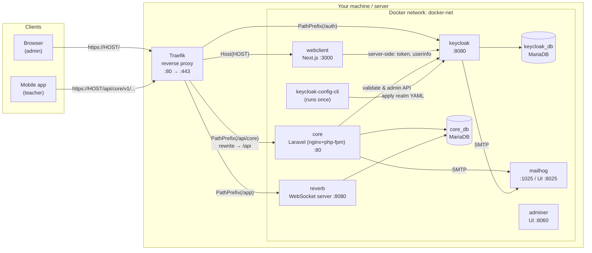

Read it like this:

1. **Everything enters through Traefik** on ports 80/443. Traefik is the only thing exposed to the outside world (plus a few dev tools).
2. **Traefik routes by URL path** on a single domain:
   - `/auth/*` → Keycloak
   - `/api/core/*` → Laravel (rewritten to `/api/*`)
   - `/app/*` → Reverb (WebSockets)
   - everything else → Next.js
3. **Services talk to each other by container name** on the private Docker network (`http://keycloak:8080`, `core_db:3306`).
4. **Each stateful service has its own database** (Keycloak's data is separate from the app's data).

> [!IMPORTANT]
> **One domain, path-based routing.** Because the browser sees *one* origin (`https://local-edubox.wehost.asia`) for the UI, the API, the login server and the WebSocket, you avoid most CORS and cookie problems. This is one of the most important decisions in the whole architecture. You'll see why in Task 8.

<a id="journeys"></a>

## Three journeys through the system

### Journey 1 — An admin logs in

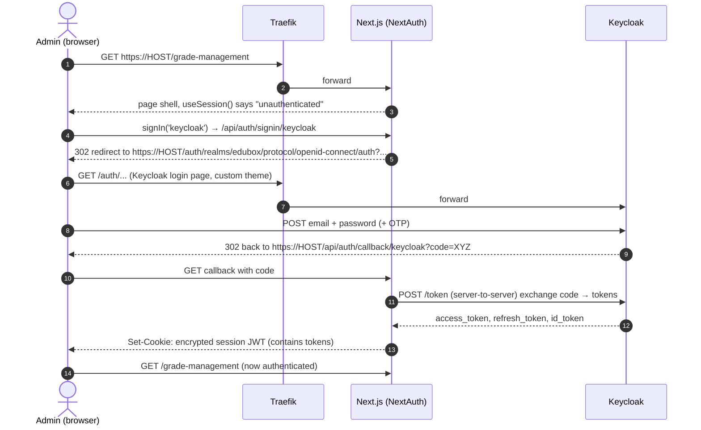

### Journey 2 — The admin portal loads a list of grades

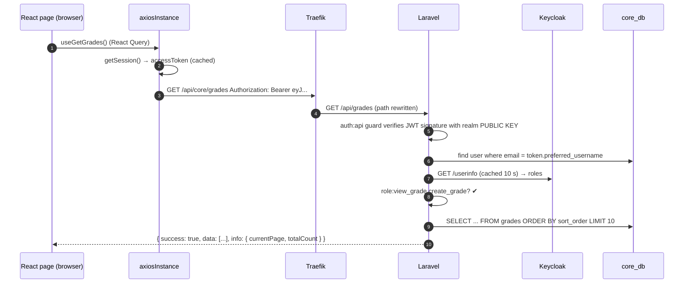

### Journey 3 — An export finishes and the page updates live

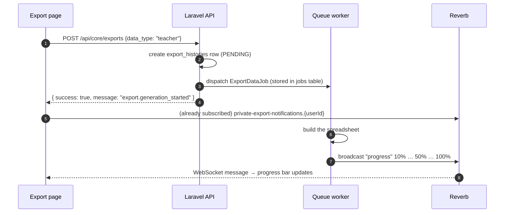

Keep these three diagrams in mind. Every task in this guide builds one of the boxes or one of the arrows.

<a id="stack"></a>

## The technology stack at a glance

| Layer | Technology | Version (in the project) | One-line reason |
|---|---|---|---|
| Containers | Docker + Docker Compose | Compose v2 | Same environment on every laptop and server |
| Reverse proxy | Traefik | v3.7 | Auto-discovers containers via labels; TLS; path routing |
| Identity | Keycloak | 26.6.3 | Off-the-shelf login, MFA, password policies, roles |
| Identity config | keycloak-config-cli | latest-26 | Keycloak settings as code (YAML) |
| Databases | MariaDB | 11.4 | Open-source MySQL-compatible relational DB |
| Backend | Laravel (PHP) | 13 / PHP 8.5 | Batteries-included API framework |
| JWT validation | robsontenorio/laravel-keycloak-guard | 2.x | Turns a Keycloak token into a Laravel user |
| Realtime | Laravel Reverb | 1.x | First-party WebSocket server (Pusher protocol) |
| Spreadsheets / PDF | PhpSpreadsheet, mPDF | 5.x / 8.x | Export reports, lesson plans |
| Frontend | Next.js (App Router) + React | 16.2 / 19.2 | React framework with routing, SSR, server routes |
| Frontend auth | NextAuth (Auth.js v4) | 4.24 | OIDC login flow + session cookie |
| Server state | TanStack React Query | 5.x | Fetching, caching, invalidation |
| Client state | Zustand | 5.x | Tiny global stores (filters, page title) |
| HTTP | Axios | 1.x | Interceptors to attach tokens |
| UI kit | HeroUI v3 + Tailwind CSS v4 | — | Accessible components + utility CSS |
| Forms | react-hook-form | 7.x | Performant forms with validation |
| i18n | i18next + react-i18next | — | English + Khmer |
| WebSocket client | laravel-echo + pusher-js | — | Subscribe to Reverb channels |
| Mobile | Expo / React Native | SDK 56 | Teacher app, offline-first |
| Git hooks | Husky | 9 | Lint before commit, block pushes to `main` |
| Package managers | Composer (PHP), pnpm (JS) | — | Dependency management |

<a id="how-seniors-think"></a>

## How experienced developers think

These principles explain *most* of the decisions you will see. When you are unsure why something was done, check this list.

1. **Make the environment reproducible.** "Works on my machine" is a bug. Docker + a Makefile means a new teammate runs `make setup` and gets the same system.
2. **Don't build what you can borrow — especially security.** Writing your own login, password reset, MFA, and brute-force protection is a classic mistake. Keycloak does it, audited by thousands of companies.
3. **Configuration is code.** Realm settings in YAML, infrastructure in `compose.yaml`, translation keys in JSON — all versioned in Git, reviewable in pull requests.
4. **Separate what changes for different reasons.** Login UI (Keycloak theme) changes for different reasons than business logic (core) or admin UI (webclient). Hence separate repos.
5. **One entry point.** All traffic through one proxy on one domain simplifies TLS, CORS, cookies and deployment.
6. **Secure by default.** Every API route requires a token unless explicitly public. Every page requires login unless it's in the `(public)` folder.
7. **Least privilege.** Fine-grained permissions (`view_grade`, `edit_grade`…) bundled into groups, checked on *both* the frontend (for UX) and the backend (for security).
8. **Fail loudly, in a consistent shape.** Every error becomes JSON with a predictable structure the frontend knows how to display.
9. **Build vertical slices.** Don't build "all migrations, then all models, then all controllers." Build *one feature* end-to-end (DB → API → UI), verify it, then repeat the pattern.
10. **Leave a trail.** Who created this? Who changed it last? Audit logs and `author_id` / `last_modifier_id` everywhere.

---

<a id="phase-0"></a>

# Phase 0 — Your Workstation

Before you build anything, you need tools — and you need to understand what each one is for. Juniors often install tools blindly and then can't debug them. Let's not do that.

---

<a id="task-0-1"></a>

## Task 0.1 — Install and understand your tools

#### Goal

Have a working Linux development machine with Git, Docker, Docker Compose, Make, Node.js (with corepack/pnpm), and a few command-line helpers — and know what each tool is for.

#### Why now?

Every later task runs at least one of these commands. If Docker isn't installed correctly (for example, if your user can't run `docker` without `sudo`), *every* later verification step fails in confusing ways.

#### Background knowledge

**What is a "toolchain"?** The set of programs a developer uses to write, build, run and ship code. In EduBox you'll use:

| Tool | What it is | Why EduBox needs it |
|---|---|---|
| **Git** | Version control: records every change to your files | Five repos, pull requests, history |
| **Docker Engine** | Runs *containers*: isolated processes with their own filesystem | Every service (DB, Keycloak, Laravel, Next.js) runs in a container |
| **Docker Compose** (v2, the `docker compose` plugin) | Describes many containers in one YAML file and starts them together | `compose.yaml` is the heart of `edubox-config` |
| **GNU Make** | Runs named recipes from a `Makefile` | `make setup`, `make up` — short commands for long ones |
| **Node.js** | JavaScript runtime outside the browser | Running pnpm/husky on the host; Next.js runs *inside* Docker |
| **corepack** | Ships with Node; installs the exact package-manager version a project declares | Each `package.json` says `"packageManager": "pnpm@10.17.1"` |
| **pnpm** | Fast, disk-efficient JS package manager | Used by all JS repos |
| **curl**, **jq** | Make HTTP requests / pretty-print JSON from the terminal | Testing APIs and tokens by hand |
| **wget** | Downloads files | The Makefile downloads certificates and DB dumps |
| **An editor** (VS Code / PhpStorm) | Where you write code | The original team uses JetBrains IDEs (there's a `.idea` folder) |

> [!NOTE]
> **You do *not* need PHP, Composer, or MariaDB installed on your machine.** They live inside containers. This is one of the big wins of Docker: your laptop stays clean, and everyone runs the exact same versions.

#### What should I create?

Nothing in a repo yet. Just install:

- Git ≥ 2.37
- Docker Engine ≥ 20.10 with the Compose v2 plugin
- GNU Make
- Node.js 24 (LTS) — includes corepack
- curl, wget, jq

#### Purpose of every file

No project files yet. Two machine-level files matter:

| File | Why it exists | Who uses it | What if it's missing |
|---|---|---|---|
| `~/.gitconfig` | Your name/email for commits | Git on every commit | Commits are attributed to "unknown" or Git refuses to commit |
| `/var/run/docker.sock` | The socket the Docker CLI uses to talk to the Docker daemon | `docker` CLI, and later **Traefik** (Task 8) | Docker commands fail: "Cannot connect to the Docker daemon" |

#### Implementation guide

**Idea:** install from official sources, then let your normal user run Docker without `sudo`.

**Steps (Ubuntu/Debian; Arch is similar with `pacman`):**

```bash
# 1. Basic tools
sudo apt update
sudo apt install -y git make curl wget jq

# 2. Docker Engine + Compose plugin (official convenience script)
curl -fsSL https://get.docker.com | sudo sh

# 3. Let your user talk to Docker without sudo
sudo usermod -aG docker "$USER"
# Log out and back in (or reboot) so the new group applies!

# 4. Node.js 24 via nvm (keeps Node in your home folder, no sudo)
curl -o- https://raw.githubusercontent.com/nvm-sh/nvm/v0.40.1/install.sh | bash
source ~/.bashrc     # or ~/.zshrc
nvm install 24
corepack enable      # makes `pnpm` available, at the version each project pins

# 5. Git identity
git config --global user.name  "Your Name"
git config --global user.email "you@example.com"
```

> [!WARNING]
> Adding yourself to the `docker` group is effectively giving yourself root on that machine (a container can mount `/`). That's normal on a dev laptop; think twice on shared servers.

#### Technology explanation

**Docker**
- *What:* a tool that packages an application with everything it needs (OS libraries, runtime, config) into an **image**, and runs that image as an isolated process called a **container**.
- *Why we need it:* EduBox needs PHP 8.5, Node 24, Java (for Keycloak), two MariaDB servers, Traefik… Installing all that natively, at the right versions, on every developer's laptop and on servers, is painful and fragile.
- *Problem it solves:* "It works on my machine." With Docker, *the machine is part of the code*.
- *Why this project chose it:* multiple services in different languages; small team; needs identical local, staging and production setups.
- *Alternatives:* native installs (fragile), Vagrant/VMs (heavy, slow), Laravel Sail (Laravel-only), Kubernetes (far more complex — for large-scale orchestration), Podman (Docker-compatible, daemonless).
- *When not to use it:* tiny single-language scripts; when your team has zero container knowledge and no time to learn; some GUI/desktop apps.

**Make**
- *What:* a 1970s build tool that runs "targets" (named recipes) from a `Makefile`.
- *Why:* turns `docker-compose run --no-deps --rm core composer install --prefer-dist -vvv --ignore-platform-reqs` into `make setup-service`. Self-documenting, available on every Linux box.
- *Alternatives:* shell scripts, `just`, npm scripts, Taskfile.
- *When not to use:* on Windows-heavy teams (Make is awkward there).

**pnpm + corepack**
- *What:* pnpm installs JavaScript dependencies using a content-addressed store and symlinks — faster and smaller than npm. Corepack pins the exact pnpm version per project.
- *Alternatives:* npm, yarn, bun.

#### Project architecture

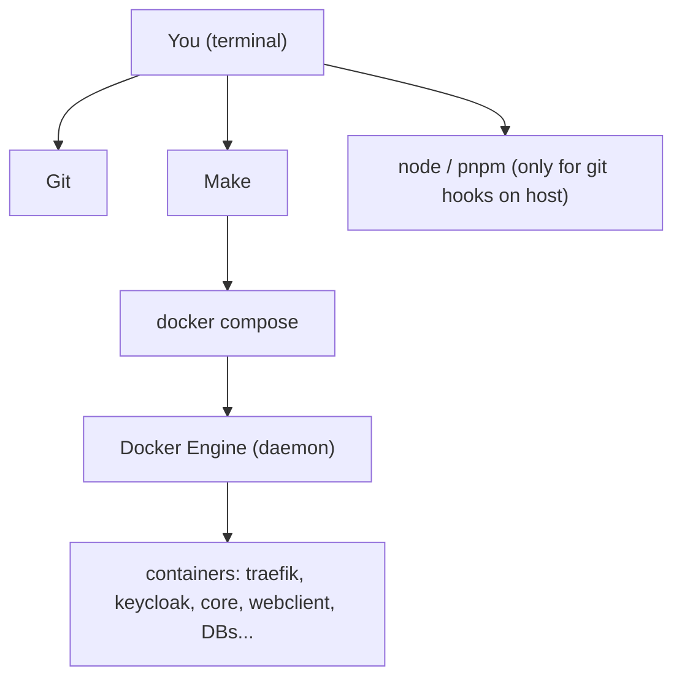

#### Verification

```bash
git --version            # git version 2.4x.x
docker --version         # Docker version 2x.x.x
docker compose version   # Docker Compose version v2.x.x
make --version           # GNU Make 4.x
node --version           # v24.x.x
pnpm --version           # 10.x.x  (corepack downloads it on first use)
jq --version             # jq-1.7
docker run --rm hello-world
```

Expected output of the last command includes:

```text
Hello from Docker!
This message shows that your installation appears to be working correctly.
```

#### Common beginner mistakes

| Mistake | Symptom | Fix |
|---|---|---|
| Didn't log out after `usermod -aG docker` | `permission denied while trying to connect to the Docker daemon socket` | Log out/in or `newgrp docker` |
| Using old `docker-compose` v1 (Python) only | Some YAML features fail (`depends_on.condition`) | Install Compose v2 plugin. The project's Makefile uses both `docker-compose` and `docker compose`; if `docker-compose` is missing, create an alias: `alias docker-compose='docker compose'` or install the `docker-compose` standalone v2 binary |
| Installing Node with `sudo apt install nodejs` | Very old Node, global installs need sudo | Use nvm |
| `pnpm: command not found` | — | `corepack enable` |

> [!TIP]
> The original Makefile mixes `docker-compose` (hyphen) and `docker compose` (space). Modern Docker only ships the space version. When you write your own Makefile, use `docker compose` consistently.

#### Knowledge check

1. Why don't you need PHP installed on your laptop to develop the Laravel backend?
2. What is the difference between a Docker **image** and a Docker **container**?
3. What does `corepack enable` do, and why does it matter that `package.json` declares `"packageManager": "pnpm@10.17.1"`?

<details>
<summary>Show answers</summary>

1. PHP runs inside the `core` container (image `wehostasia/laravel:nginx-php-8.5`). Your source code is *mounted* into it; the container provides PHP.
2. An image is a read-only template (like a class). A container is a running instance of an image (like an object), with its own writable layer.
3. It activates shims so `pnpm` runs at exactly the version the project declares, so every developer and every CI machine resolves dependencies identically.
</details>

#### Completion checklist

- [ ] `docker run --rm hello-world` works **without** sudo
- [ ] `docker compose version` prints v2.x
- [ ] `make`, `git`, `node`, `pnpm`, `curl`, `jq`, `wget` are all installed
- [ ] Git name and email configured

---

<a id="task-0-2"></a>

## Task 0.2 — The Linux concepts this project relies on

#### Goal

Understand five Linux ideas that EduBox's setup uses directly: **users & UIDs**, **file permissions**, **`/etc/hosts`**, **ports**, and **processes/PID 1**.

#### Why now?

- The Makefile writes your **UID** into `.env` (`USER_ID=1001`) so files created inside containers are owned by *you* (Task 4, Task 22).
- The Makefile adds a line to **`/etc/hosts`** (Task 7).
- Traefik binds **ports** 80 and 443 (Task 8).
- Production containers use **supervisord** as PID 1 (Task 69).

If you skip this, you'll hit "permission denied" errors in Laravel's `storage/` folder and not understand why.

#### Background knowledge

**Users and UIDs.** Linux identifies users by number (UID). Your user might be `siven` with UID `1001`. Inside a container, the PHP process runs as `www-data` — which has its *own* UID (often 33). When a container writes a file into a folder mounted from your laptop, the file's owner is a *number*. If the numbers don't match, you can't edit the file, or PHP can't write to `storage/logs`.

```bash
id -u        # your UID, e.g. 1001
id           # uid=1001(siven) gid=1001(siven) groups=...,docker
```

**File permissions.** `ls -l` shows `rwxr-xr-x` = read/write/execute for owner, group, others. Laravel needs to *write* to `storage/` and `bootstrap/cache/`.

**`/etc/hosts`.** Before asking DNS, your machine looks in `/etc/hosts`. A line like `0.0.0.0 local-edubox.wehost.asia` (or `127.0.0.1 …`) makes that name point to your own machine. That's how we get a realistic domain for local development.

**Ports.** A port is a numbered "door" on an IP address. Only one process can listen on a port at a time. Ports below 1024 are privileged. Traefik listens on 80 (HTTP) and 443 (HTTPS). If Apache/nginx is already running on your laptop, Traefik can't start.

```bash
sudo ss -tlnp | grep -E ':80|:443'   # who is listening on 80/443?
```

**Processes and PID 1.** In a container, the first process (PID 1) *is* the container: when it exits, the container stops. That's why production images use **supervisord** — a small process manager that runs as PID 1 and keeps both nginx and Node.js alive.

#### What should I create?

Nothing. This is a knowledge task.

#### Purpose of every file

| File | Why it exists | Who uses it | When | If missing |
|---|---|---|---|---|
| `/etc/hosts` | Local name → IP overrides | Your OS resolver, your browser | Every hostname lookup | Your local domain doesn't resolve; browser shows "site can't be reached" |
| `/etc/passwd` | Maps usernames ↔ UIDs | `id`, `ls -l`, Docker `--chown` | Always | — |

#### Implementation guide

Try these commands and make sure you understand the output:

```bash
id -u
ls -ln ~                      # -n shows numeric UIDs instead of names
cat /etc/hosts
sudo ss -tlnp | head
ps -ef | head
```

#### Technology explanation

**Why the project passes `LOCAL_USER_ID` into the Laravel container:** the base image `wehostasia/laravel:nginx-php-8.5` has an entrypoint script that (very likely) changes the UID of `www-data` inside the container to match `LOCAL_USER_ID`. Result: files PHP writes into your mounted `edubox-core` folder are owned by *you*. The alternatives are running containers as root (files become root-owned and you need `sudo` to delete them) or constant `chmod 777` (insecure, sloppy).

#### Project architecture

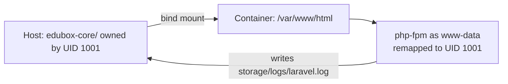

#### Verification

- You can explain what `id -u` prints and why the Makefile stores it.
- `sudo ss -tlnp | grep -E ':80 |:443 '` prints **nothing** (ports free). If something is listening, stop it (`sudo systemctl stop apache2 nginx`).

#### Common beginner mistakes

| Mistake | Symptom | Fix |
|---|---|---|
| Local Apache/nginx running | Traefik container exits: `bind: address already in use` | `sudo systemctl disable --now apache2` |
| Files created by a root container | `Permission denied` when editing in your IDE | `sudo chown -R $(id -u):$(id -g) <folder>`, and fix the root cause (UID mapping) |

#### Knowledge check

1. A container writes `storage/logs/laravel.log` into a mounted folder. Why might you be unable to delete that file afterwards?
2. Why does a production container need a process manager if it runs both nginx and Node?

<details>
<summary>Show answers</summary>

1. The file is owned by the container process's UID (e.g. root or 33), not yours. Without matching UIDs you lack write permission on it.
2. A container lives as long as PID 1 lives, and Docker only starts one command. supervisord is that one command; it starts and restarts both nginx and Node.
</details>

#### Completion checklist

- [ ] I know my UID
- [ ] Ports 80 and 443 are free
- [ ] I can explain `/etc/hosts`

---

<a id="phase-1"></a>

# Phase 1 — Foundation

---

<a id="task-1"></a>

## Task 1 — Design the system on paper first

#### Goal

Write down — before any code — *what* we are building, *who* uses it, and *which big pieces* the system needs. Produce a one-page architecture sketch.

#### Why now?

Every structural decision later (five repos, Keycloak, Traefik paths, separate databases) follows from these requirements. Seniors spend an hour here to save weeks later. Juniors skip it and end up rewriting.

#### Background knowledge

**Requirements → architecture.** Look at what EduBox must do and notice how each requirement *forces* a design choice:

| Requirement | Consequence |
|---|---|
| Admins manage content in a browser | A **web app** (Next.js) |
| Teachers work in schools **without internet** | A **native mobile app** with local storage and later sync (Expo + SQLite) |
| Both must log in, with MFA (OTP) for admins, password policy, brute-force protection, password reset by email | An **identity provider** (Keycloak) — don't hand-roll this |
| Both apps share the same data and rules | **One API** (Laravel) that both call |
| Admins have very different permissions | **Fine-grained roles** grouped into **groups** |
| Content is translated (English, Khmer, …) | **Translation tables** and an i18n system |
| Long-running reports | **Background jobs** (queues) + **live progress** (WebSockets) |
| Must run identically on laptops, staging and production | **Docker** + compose files |
| Several services must be reachable under one URL | A **reverse proxy** (Traefik locally, nginx in the webclient image for staging/prod) |

**Monolith vs. microservices vs. "a few services".** The config README calls EduBox "microservice architecture", but honestly it's a *small service-oriented system*: one main backend (core), one identity server, two clients. That's a sensible middle ground — you don't split business logic into dozens of services until you have to.

**Polyrepo vs. monorepo.**

| | Polyrepo (EduBox) | Monorepo |
|---|---|---|
| Structure | One Git repo per deployable | One Git repo for everything |
| Pros | Independent history, permissions and CI per repo; small clones; clear ownership | Atomic cross-project changes; one PR for API+UI change; shared tooling |
| Cons | Cross-repo changes need several PRs; need a "glue" repo (`edubox-config`) | Tooling complexity (Nx/Turborepo), bigger clones |
| Good when | Different tech stacks, different release cycles, separate teams | Shared TypeScript code, one team, many packages |

EduBox chose polyrepo because the stacks are completely different (PHP, Java/FreeMarker, TypeScript web, TypeScript mobile) and they share almost no code.

#### What should I create?

A document (paper, Markdown, or a whiteboard photo) containing:

- The list of user types and what each does
- The list of services (proxy, identity, API, web, mobile, databases, mail, websockets)
- One diagram like the one in [Part I](#arch-diagram)
- The URL plan: which path goes where

#### Purpose of every file

| File | Why |
|---|---|
| `docs/architecture.md` (optional, yours) | So future-you and teammates know *why*. EduBox doesn't have one — the README you're reading now fills that gap. |

#### Implementation guide

Write the **URL plan** — it's the contract between infrastructure and applications:

| Public URL | Goes to | Internal address |
|---|---|---|
| `https://HOST/` | Next.js admin portal | `webclient:3000` |
| `https://HOST/auth/...` | Keycloak | `keycloak:8080` |
| `https://HOST/api/core/...` | Laravel API (path becomes `/api/...`) | `core:80` |
| `https://HOST/api/core/v1/...` | Laravel *mobile* API | `core:80` |
| `https://HOST/app/...` | Reverb WebSockets | `reverb:8080` |

> [!IMPORTANT]
> Why `/api/core` and not just `/api`? Because Next.js *also* has API routes at `/api/...` (NextAuth lives at `/api/auth/...`). Prefixing the Laravel API with `/api/core` avoids a collision, and leaves room for other backends later (`/api/reports`, …). Traefik strips the extra segment before Laravel sees it.

#### Technology explanation

This task introduces no technology — it introduces a habit: **design before you build**.

#### Project architecture

You are drawing it. Compare yours with [the diagram in Part I](#arch-diagram).

#### Verification

- Can you explain to a friend, in two minutes, why EduBox needs Keycloak *and* Laravel?
- Is every URL in your plan unambiguous (no two services claim the same path)?

#### Common beginner mistakes

| Mistake | Consequence |
|---|---|
| Putting API at `/api` with Next.js also using `/api` | Login callback (`/api/auth/callback`) gets sent to Laravel → 404 |
| Planning different subdomains (`api.`, `auth.`) without thinking about CORS/cookies | Lots of CORS configuration and cross-site cookie issues |
| Starting with microservices for every feature | Huge operational overhead for a small team |

#### Knowledge check

1. Name two requirements that forced the use of Keycloak.
2. Why does the Laravel API live under `/api/core` rather than `/api`?
3. Why is a polyrepo reasonable here?

<details>
<summary>Show answers</summary>

1. MFA/OTP, password policies, brute-force lockout, password reset by email, a single login for web and mobile.
2. Next.js owns `/api/*` routes (NextAuth uses `/api/auth/*`). The extra segment avoids collisions; Traefik rewrites `/api/core/x` → `/api/x`.
3. The pieces use different languages and share almost no code; each can be versioned and deployed independently; `edubox-config` provides the glue.
</details>

#### Completion checklist

- [ ] User types and responsibilities written down
- [ ] Service list written down
- [ ] URL plan written down
- [ ] Architecture diagram drawn

---

<a id="task-2"></a>

## Task 2 — Create the workspace and the five repositories

#### Goal

Create the folder layout and initialize five empty Git repositories with sensible `.gitignore` files and READMEs.

#### Why now?

`compose.yaml` (Task 5) will refer to sibling folders by **relative path** (`../edubox-core`, `../edubox-webclient`, `../edubox-keycloak`). Those paths must exist and be stable before you write any infrastructure.

#### Background knowledge

**Why a fixed workspace path?** The config repo's README tells everyone to clone into `~/dev/docker-projects/edu-box/edubox-config`. A fixed convention means relative paths, docs and scripts all work for every developer.

**`.gitignore`.** A list of patterns Git must never track. You ignore three kinds of things:
1. **Generated files** (`node_modules/`, `vendor/`, `.next/`) — they can be recreated from lock files.
2. **Secrets and machine-specific config** (`.env`, `*.pem`, `*.sql.gz`).
3. **Editor junk** (`.idea/`, `.vscode/`, `.DS_Store`).

**Lock files** (`pnpm-lock.yaml`, `composer.lock`) *are* committed. They pin exact dependency versions so everyone installs the same thing.

#### What should I create?

```text
~/dev/docker-projects/edu-box/
├── edubox-config/
│   ├── .gitignore
│   └── README.md
├── edubox-keycloak/
│   ├── .gitignore
│   └── README.md
├── edubox-core/          (Laravel will be created into it in Task 23)
├── edubox-webclient/     (Next.js will be created into it in Task 50)
└── edubox-app/           (Phase 11 — optional for this guide)
```

#### Purpose of every file

| File | Why it exists | Who uses it | When | If missing |
|---|---|---|---|---|
| `edubox-config/.gitignore` | Keep `.env`, certificates (`*.pem`), DB dumps (`*.sql`, `*.gz`), `node_modules` out of Git | Git | Every `git add` | You'd commit secrets and huge binary dumps |
| `edubox-config/README.md` | Onboarding: prerequisites, clone path, URLs, dev credentials | New developers | Day one | Every newcomer asks the same questions |
| `edubox-keycloak/.gitignore` | Ignore `node_modules`, `.pnpm-store` | Git | — | — |

#### Implementation guide

```bash
mkdir -p ~/dev/docker-projects/edu-box
cd ~/dev/docker-projects/edu-box

for repo in edubox-config edubox-keycloak edubox-core edubox-webclient edubox-app; do
  mkdir -p "$repo"
  git -C "$repo" init -b main
done
```

`edubox-config/.gitignore` — this is the real one from the project, explained line by line:

```gitignore
/.phpunit.cache          # leftover from a template; harmless
.env                     # real secrets / per-developer values
.env.backup
.env.production
/.fleet
/.idea                   # JetBrains IDE settings
/.vscode
/config/docker/ssl/fullchain.pem   # TLS certificate (downloaded, not committed)
/config/docker/ssl/privkey.pem     # TLS private key — NEVER commit
config/docker/keycloak_db.sql.gz   # database dumps (big, contain user data)
config/docker/core_users.sql.gz
.cache
*.pem
*.sql
*.gz
/node_modules
```

`edubox-config/README.md` — start small; you'll extend it:

```markdown
# Overview
This repository orchestrates the EduBox system with docker compose.

# Required dependencies
* Git >= 2.37, Docker >= 20.10, docker compose v2, pnpm >= 10

# Local environment
    git clone git@github.com:<org>/edubox-config.git ~/dev/docker-projects/edu-box/edubox-config
    cd ~/dev/docker-projects/edu-box/edubox-config
    make setup
```

Then make the first commit in each repo:

```bash
cd edubox-config && git add . && git commit -m "[TASK] Initial commit"
```

#### Technology explanation

**Git**
- *What:* a distributed version-control system.
- *Why:* history, collaboration via branches and pull requests, ability to roll back.
- *Alternatives:* Mercurial, SVN (centralized) — rarely chosen today.

#### Project architecture

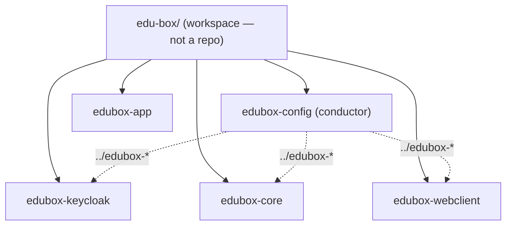

#### Verification

```bash
cd ~/dev/docker-projects/edu-box
for r in edubox-*; do echo "$r: $(git -C $r rev-parse --abbrev-ref HEAD)"; done
```

Expected: five lines, each ending in `main`.

```bash
cd edubox-config && echo "SECRET=1" > .env && git status --short
```

Expected: `.env` does **not** appear (it's ignored). Delete it afterwards.

#### Common beginner mistakes

| Mistake | Symptom | Fix |
|---|---|---|
| Making `edu-box/` itself a Git repo | Nested repos confuse Git ("embedded repository") | Only the five subfolders are repos |
| Committing `.env` "just once" | Secret is in history forever | Rotate the secret; remove with `git filter-repo` |
| Different folder names (`core` instead of `edubox-core`) | Compose can't find `../edubox-core` | Keep names exact |

#### Knowledge check

1. Why are lock files committed but `node_modules/` ignored?
2. What would break if a teammate cloned `edubox-core` into `~/projects/core`?

<details>
<summary>Show answers</summary>

1. Lock files are small and define exact versions (reproducibility). `node_modules/` is large and regenerated from the lock file.
2. `compose.yaml` mounts `../edubox-core`; that path wouldn't exist relative to `edubox-config`, so the container would start with an empty (or auto-created) folder.
</details>

#### Completion checklist

- [ ] Five folders, each a Git repo on `main`
- [ ] `.gitignore` in `edubox-config` ignores `.env`, `*.pem`, dumps
- [ ] README with clone path
- [ ] First commit made

---

<a id="task-3"></a>

## Task 3 — Git conventions and protecting `main` with Husky

#### Goal

Adopt the team's Git workflow (feature branches + pull requests + prefixed commit messages) and **enforce** it locally with a Husky `pre-push` hook that blocks direct pushes to `main`.

#### Why now?

From this point on, you'll commit a lot. Good habits from day one are free; fixing a messy history later is not. Every EduBox repo has the same `pre-push` hook — it was literally the *second* commit in each repo.

#### Background knowledge

**The workflow EduBox uses** (read from the commit history):

```text
8c08e22 [TASK] Initial commit
2655cec [TASK] Restrict pushing to branch main
e6887f2 Merge pull request #1 from tdso-ngo/TDSO-00
...
d57f274 [TASK] Implement create user groups
09262a4 Merge pull request #117 from tdso-ngo/Add-privacy-url
```

- **Branch per ticket**, named after the issue key: `TDSO-182`, `TDSO-14-Fix`.
- **Pull request** to merge into `main` (never push to `main` directly).
- **Commit message prefixes**:

| Prefix | Meaning |
|---|---|
| `[TASK]` | General work, setup, chores |
| `[FEATURE]` | New user-visible functionality |
| `[BUGFIX]` / `[FIX]` | Fixing a defect |
| `[IMP]` | Improvement/refactor of existing behavior |

**Git hooks.** Git can run scripts at certain moments: `pre-commit` (before a commit is created), `pre-push` (before pushing), etc. They live in `.git/hooks/` — which is *not* versioned. **Husky** solves that: hooks live in a versioned `.husky/` folder, and `husky` (run via the `prepare` npm script) points Git's `core.hooksPath` at it.

> [!NOTE]
> Hooks run on the developer's machine and can be bypassed (`git push --no-verify`). They are a safety net, not security. The real protection is **branch protection rules** on GitHub. Use both.

#### What should I create?

In **each** repo (config, keycloak, core, webclient, app):

- `package.json` with `husky` as a dev dependency and a `prepare` script
- `.husky/pre-push`
- `pnpm-lock.yaml` (generated)

#### Purpose of every file

| File | Why it exists | Who uses it | When it runs | If missing |
|---|---|---|---|---|
| `package.json` | Declares husky + `prepare` script; pins pnpm version | pnpm | `pnpm install` triggers `prepare` | Hooks never installed |
| `.husky/pre-push` | Refuses pushes from `main`/`master` | Git (via `core.hooksPath=.husky/_`) | On every `git push` | You can accidentally push to `main` |
| `.husky/_/` | Husky's generated shims | Git | — | Generated; don't edit |
| `pnpm-lock.yaml` | Exact husky version | pnpm | install | Different husky versions per dev |

#### Implementation guide

**Idea:** a tiny Node project whose only job is to install Husky.

`package.json` (from `edubox-config` — identical in `edubox-keycloak`):

```json
{
  "name": "edubox-config",
  "version": "1.0.0",
  "scripts": {
    "prepare": "husky"
  },
  "packageManager": "pnpm@10.17.1",
  "devDependencies": {
    "husky": "^9.1.7"
  }
}
```

- `"prepare": "husky"` — npm/pnpm automatically run `prepare` after `install`. `husky` sets `git config core.hooksPath .husky/_`.
- `"packageManager"` — corepack uses this to pick pnpm 10.17.1.

`.husky/pre-push`:

```sh
#!/bin/sh

# Get the name of the current active branch
current_branch=$(git rev-parse --abbrev-ref HEAD)

# Check for master or main using standard POSIX matching
if [ "$current_branch" = "master" ] || [ "$current_branch" = "main" ]; then
    echo "❌ ERROR: Direct pushes to '$current_branch' are prohibited!"
    echo "Please check out into a new branch and submit a Pull Request instead."
    exit 1
fi

exit 0
```

How it works: Git runs the hook before pushing; a non-zero exit code aborts the push.

Install it:

```bash
cd ~/dev/docker-projects/edu-box/edubox-config
pnpm install            # runs "prepare" → husky
chmod +x .husky/pre-push
git add . && git commit -m "[TASK] Restrict pushing to branch main"
```

> [!TIP]
> Later, the Makefile target `enable-husky` runs `pnpm --dir ../edubox-xxx install` for every repo, so a new developer gets all hooks with one command.

#### Technology explanation

**Husky**
- *What:* a tiny tool that makes Git hooks part of the repository.
- *Why:* every developer gets the same hooks automatically.
- *Problem solved:* `.git/hooks` isn't versioned.
- *Alternatives:* `lefthook`, `pre-commit` (Python), `simple-git-hooks`, CI-only checks.
- *When not to use:* repos where contributors have no Node.js (a pure PHP shop might prefer `captainhook` or `pre-commit`). EduBox accepts Node as a requirement because three repos are already JS.

#### Project architecture

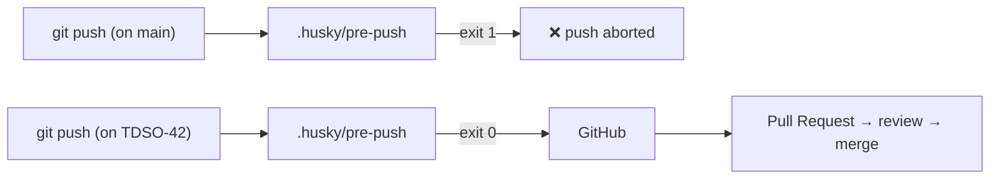

#### Verification

```bash
git checkout main
git push origin main
```

Expected:

```text
❌ ERROR: Direct pushes to 'main' are prohibited!
Please check out into a new branch and submit a Pull Request instead.
error: failed to push some refs to ...
```

```bash
git checkout -b TDSO-00
git push -u origin TDSO-00     # succeeds (if a remote exists)
git config core.hooksPath      # → .husky/_
```

#### Common beginner mistakes

| Mistake | Symptom | Fix |
|---|---|---|
| Hook not executable | Hook silently ignored | `chmod +x .husky/pre-push` |
| Never ran `pnpm install` | `core.hooksPath` unset; hook never runs | `pnpm install` |
| Windows line endings (CRLF) in hook | `/bin/sh^M: bad interpreter` | Save with LF |

#### Knowledge check

1. Why is a hook not enough to *guarantee* nobody pushes to `main`?
2. What triggers Husky to install the hooks?
3. Which prefix would you use for "Show OTP locked message on login page"?

<details>
<summary>Show answers</summary>

1. Hooks are local and can be skipped with `--no-verify`, or never installed. Server-side branch protection is the real guarantee.
2. The `prepare` lifecycle script, which pnpm runs after `pnpm install`.
3. `[TASK]` or `[FEATURE]` — the real commit was `[TASK] Show otp lock message`.
</details>

#### Completion checklist

- [ ] `package.json` with husky in every repo
- [ ] `.husky/pre-push` blocks `main`/`master`
- [ ] Verified the push is rejected on `main`
- [ ] (Recommended) Branch protection enabled on GitHub

---

<a id="task-4"></a>

## Task 4 — The environment-variable strategy

#### Goal

Understand and set up the pattern used in every EduBox repo: a committed **`.env.example`** with safe defaults and documentation, and an uncommitted **`.env`** with the real values.

#### Why now?

`compose.yaml` (Task 5) reads `${HOST_NAME}`, `${CORE_DB_PASSWORD}` etc. from `edubox-config/.env`. Laravel reads its own `.env`. Next.js reads its own `.env`. If you understand this once, you understand it everywhere.

#### Background knowledge

**What is an environment variable?** A key=value pair given to a process by whoever starts it. Programs read them at runtime (`process.env.X` in Node, `env('X')` in Laravel). They're the standard way to give the *same code* different configuration in dev, staging and production. (This is factor III of "The Twelve-Factor App".)

**Three different `.env` consumers in EduBox — don't confuse them:**

| File | Read by | When |
|---|---|---|
| `edubox-config/.env` | **Docker Compose** — substitutes `${VAR}` inside `compose.yaml`; also read by the **Makefile** (`-include .env`) | `docker compose up`, `make …` |
| `edubox-core/.env` | **Laravel** (`env()` in `config/*.php`) | Every PHP request / artisan command |
| `edubox-webclient/.env` | **Next.js** (`process.env.*`) | `next dev` start, and **at build time** for `NEXT_PUBLIC_*` |

**`.env.example` vs `.env`:**
- `.env.example` is committed. It lists *every* variable the app needs, with development defaults and comments. It's documentation.
- `.env` is ignored. It's a copy of `.env.example` with real values. The Makefile creates it automatically: `test -f .env || cp .env.example .env`.

> [!WARNING]
> In EduBox, `.env.example` files contain *development* secrets (DB passwords like `edubox_core`, the Keycloak client secret, Reverb keys). That's acceptable **only** because they are dev-only throwaway values. Production values must never be committed — they live only on the server's `.env`.

#### What should I create?

`edubox-config/.env.example`:

```dotenv
USER_ID=1001
HOST_NAME=local-edubox.wehost.asia

# Core Database
CORE_DB_ROOT_PASSWORD=root
CORE_DB_USERNAME=edubox_core
CORE_DB_PASSWORD=edubox_core
CORE_DB_DATABASE=edubox_core

# Keycloak
KC_DB_ROOT_PASSWORD=root
KC_DB_DRIVER=mariadb
KC_DB_HOST=keycloak_db
KC_DB_PORT=3306
KC_DB_USER=keycloak
KC_DB_PASSWORD=keycloak
KC_DB_DATABASE=keycloak
KC_BOOTSTRAP_ADMIN_PASSWORD=Pa55w0rd
KC_EDUBOX_BACKEND_SECRET=wJrfWZEDTw6ADr2upYIgMQBAh2nORpow

SMTP_HOST=mailhog
SMTP_PORT=1025
SMTP_FROM=no-reply@tdso.ngo
SMTP_FROM_NAME=EduBox
SMTP_AUTH=false
SMTP_SSL=false
SMTP_STARTTLS=false
SMTP_USER=
SMTP_KEY=

MOBILE_APP_DEEP_LINK_LOGIN=eduboxapp://login

## Environment Variables for staging and production
FRONTEND_URL=http://127.0.0.1:3000
FRONTEND_EXTERNAL_PORT=2090
CORE_URL=http://staging-core/api/
REVERB_URL=http://staging-reverb:8080
KEYCLOAK_URL=http://staging-keycloak:8080/auth/
```

You'll add variables gradually as each task needs them, but here is the final file so you see the shape.

#### Purpose of every file

| File | Why it exists | Who uses it | When | If missing |
|---|---|---|---|---|
| `.env.example` | Documents all variables; template for `.env` | Developers, Makefile `setup` | Onboarding | Nobody knows which variables exist |
| `.env` | Actual values | Compose, Makefile | Every `docker compose` / `make` call | Compose warns `The "HOST_NAME" variable is not set. Defaulting to a blank string.` and Traefik rules become `Host(\`\`)` |

**What each variable means:**

| Variable | Meaning |
|---|---|
| `USER_ID` | Your UID; passed to PHP containers as `LOCAL_USER_ID` (Task 0.2). The Makefile overwrites it with `id -u` |
| `HOST_NAME` | The domain everything is served from; used in Traefik rules and Keycloak redirect URIs |
| `CORE_DB_*` | Credentials MariaDB creates on first start for the core DB |
| `KC_DB_*` | Same for Keycloak's DB, plus driver/host/port to build Keycloak's JDBC URL |
| `KC_BOOTSTRAP_ADMIN_PASSWORD` | Password of Keycloak's initial `admin` (master realm) |
| `KC_EDUBOX_BACKEND_SECRET` | Client secret of the `edubox-backend` Keycloak client; must equal `KEYCLOAK_BACKEND_SECRET` in core's `.env` |
| `SMTP_*` | Where Keycloak sends emails (password reset). `mailhog` locally |
| `MOBILE_APP_DEEP_LINK_LOGIN` | Deep link Keycloak may redirect to after mobile flows |
| `FRONTEND_URL`, `CORE_URL`, `REVERB_URL`, `KEYCLOAK_URL`, `FRONTEND_EXTERNAL_PORT` | Only for staging/production compose files (Task 70) |

#### Implementation guide

```bash
cd ~/dev/docker-projects/edu-box/edubox-config
# write .env.example (above)
cp .env.example .env
sed -i "s/^USER_ID=.*/USER_ID=$(id -u)/" .env
git add .env.example && git commit -m "[TASK] Add env example"
```

**How Compose substitutes variables:** in `compose.yaml`, `${HOST_NAME}` is replaced with the value from (1) your shell environment, else (2) the `.env` file next to the compose file. Inside labels you'll see `$$1` — a **double** dollar is how you write a literal `$` that Compose must *not* substitute (Task 22).

#### Technology explanation

**Environment variables / dotenv**
- *Problem solved:* separate configuration from code; same image/code everywhere.
- *Alternatives:* config files per environment (`config.prod.json`), secret managers (Vault, AWS Secrets Manager, Docker secrets), Kubernetes ConfigMaps/Secrets.
- *When not to use plain `.env`:* production at scale — prefer a secret manager so secrets aren't in plain text on disk.

#### Project architecture

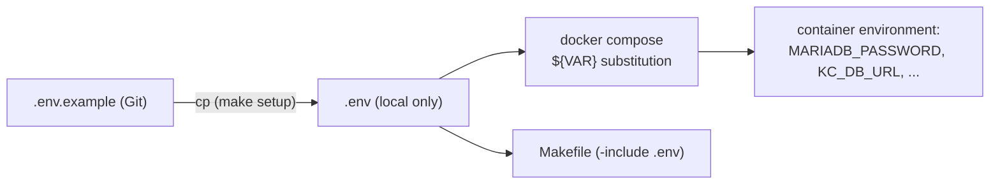

#### Verification

```bash
cd ~/dev/docker-projects/edu-box/edubox-config
docker compose config 2>/dev/null | grep -m3 -E 'local-edubox|MARIADB'   # works once compose.yaml exists (Task 5+)
git check-ignore -v .env      # → .gitignore:2:.env  .env
```

#### Common beginner mistakes

| Mistake | Symptom | Fix |
|---|---|---|
| Editing `.env.example` instead of `.env` | Changes don't apply | Edit `.env`; update `.env.example` only to document new variables |
| Spaces around `=` (`HOST_NAME = x`) | Variable empty or name includes a space | No spaces |
| Changing `CORE_DB_PASSWORD` after the DB was created | "Access denied for user" | MariaDB only reads these on **first** start (empty volume). Change the password inside the DB, or delete the volume |
| Mismatched secrets between repos | Laravel can't get an admin token from Keycloak | `KC_EDUBOX_BACKEND_SECRET` (config) must equal `KEYCLOAK_BACKEND_SECRET` (core) |

#### Knowledge check

1. Which program reads `edubox-config/.env`? Which reads `edubox-core/.env`?
2. Why does `.env.example` exist if `.env` has the same keys?
3. What does `$$1` mean inside `compose.yaml`?

<details>
<summary>Show answers</summary>

1. Docker Compose and the Makefile read `edubox-config/.env`; Laravel reads `edubox-core/.env`.
2. It's committed documentation and a template; `.env` is private and per machine.
3. An escaped `$`: Compose outputs a literal `$1` instead of trying to substitute a variable named `1`.
</details>

#### Completion checklist

- [ ] `.env.example` committed
- [ ] `.env` created and ignored
- [ ] `USER_ID` matches `id -u`
- [ ] I can explain the three `.env` consumers

---

<a id="phase-2"></a>

# Phase 2 — Infrastructure

In this phase you build the "roads and plumbing": containers, a private network, a domain name, a reverse proxy, HTTPS, databases and a mail catcher. No application code yet. At the end, you'll have an empty-but-real platform into which applications can be plugged.

---

<a id="task-5"></a>

## Task 5 — Docker fundamentals and your first `compose.yaml`

#### Goal

Learn the core Docker concepts (image, container, layer, bind mount, volume, network, port mapping, environment) by writing the first version of `edubox-config/compose.yaml` and running a throwaway service.

#### Why now?

Every service in EduBox is a block in `compose.yaml`. You need to read and write that file fluently before adding Traefik, MariaDB and Keycloak.

#### Background knowledge

| Concept | Meaning | EduBox example |
|---|---|---|
| **Image** | Read-only template: filesystem + default command | `traefik:v3.7`, `mariadb:11.4`, `node:24.16` |
| **Tag** | Version label of an image | `:11.4`. Never rely on `:latest` in real projects (EduBox does for `adminer` and `mailhog`, which are dev-only tools) |
| **Container** | A running instance of an image | `edubox-config-core_db-1` |
| **Bind mount** | A host folder appears inside the container | `../edubox-core:/var/www/html` — edit on host, PHP sees it instantly |
| **Named volume** | Docker-managed storage that survives container deletion | `edubox_core_db_data:/var/lib/mysql` |
| **Port mapping** | `host:container` — expose a container port on your machine | `'8060:8080'` for Adminer |
| **Network** | Virtual LAN between containers; containers resolve each other **by service name** | `core` connects to `core_db:3306` |
| **Environment** | Variables given to the container | `MARIADB_ROOT_PASSWORD` |
| **Compose project** | All services in one compose file; named after the folder (`edubox-config`) | Containers are named `edubox-config-<service>-1` |

**`docker compose` lifecycle commands:**

| Command | Does |
|---|---|
| `docker compose up -d` | Create & start all services in the background (`-d` = detached) |
| `docker compose ps` | List this project's containers |
| `docker compose logs -f <svc>` | Follow a service's logs |
| `docker compose exec <svc> sh` | Open a shell in a *running* container |
| `docker compose run --rm <svc> <cmd>` | Start a *new one-off* container, run a command, delete it |
| `docker compose stop` | Stop containers (keep them) |
| `docker compose down` | Stop and remove containers + default network (volumes kept unless `-v`) |

> [!TIP]
> `run --no-deps --rm` is used all over the EduBox Makefile: "start a fresh container of this service **without** starting its `depends_on` services, run one command, then delete it." Perfect for `composer install` or `php artisan migrate`.

#### What should I create?

`edubox-config/compose.yaml` — first version with one test service:

```yaml
services:
  whoami:
    image: traefik/whoami:v1.10
    ports:
      - '8081:80'
```

#### Purpose of every file

| File | Why it exists | Who uses it | When | If missing |
|---|---|---|---|---|
| `compose.yaml` | Declares every service, network and volume of the dev environment | `docker compose`, Makefile | Every `up`, `run`, `exec` | Nothing can be started consistently |

> [!NOTE]
> `compose.yaml` is the modern default filename (older projects use `docker-compose.yml`). Compose finds it automatically in the current directory.

#### Implementation guide

1. Write the file above.
2. Start it: `docker compose up -d`.
3. Visit `http://localhost:8081`.
4. Remove it: `docker compose down`.

`traefik/whoami` is a tiny web server that prints information about the request it receives — perfect to test routing in Task 8.

#### Technology explanation

**Docker Compose**
- *What:* a tool to define multi-container apps in YAML and manage them as a unit.
- *Why we need it:* EduBox has ~10 containers with dependencies, networks, volumes and env vars. Typing `docker run` for each is impossible to maintain.
- *Why chosen:* simple, built into Docker, great for dev and small production setups.
- *Alternatives:* Kubernetes (Helm charts), Docker Swarm, Nomad, plain `docker run` scripts.
- *When not to use:* multi-server clusters needing auto-scaling and self-healing → Kubernetes.

#### Project architecture

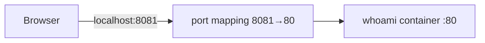

#### Verification

```bash
docker compose up -d
docker compose ps
```

Expected:

```text
NAME                      IMAGE                  SERVICE   STATUS         PORTS
edubox-config-whoami-1    traefik/whoami:v1.10   whoami    Up 2 seconds   0.0.0.0:8081->80/tcp
```

```bash
curl -s http://localhost:8081 | head -3
# Hostname: 3f2a9c...
# IP: 127.0.0.1
# IP: 172.18.0.2
docker compose down
```

#### Common beginner mistakes

| Mistake | Symptom | Fix |
|---|---|---|
| YAML indentation with tabs | `yaml: line 3: found character that cannot start any token` | Spaces only, 2 per level |
| Port already used | `Bind for 0.0.0.0:8081 failed: port is already allocated` | Choose another host port |
| Running `docker compose` in the wrong folder | `no configuration file provided: not found` | `cd edubox-config` or use `-f path/compose.yaml` |
| Confusing `exec` and `run` | `exec` fails "service is not running" | `exec` needs a running container; `run` creates a new one |

#### Knowledge check

1. What's the difference between a bind mount and a named volume? When does EduBox use each?
2. What does `docker compose run --no-deps --rm core php artisan migrate` do, step by step?
3. How does one container reach another?

<details>
<summary>Show answers</summary>

1. A bind mount maps a specific host path (source code: `../edubox-core:/var/www/html`) — great for live editing. A named volume is managed by Docker and persists data independent of host paths (database files: `edubox_core_db_data`).
2. Creates a new container from the `core` service definition, does not start `core_db`/`keycloak` dependencies, runs `php artisan migrate`, then deletes the container.
3. Through a shared Docker network, by service name (Docker runs an internal DNS).
</details>

#### Completion checklist

- [ ] `compose.yaml` exists
- [ ] whoami reachable on `localhost:8081`
- [ ] I can explain image/container/volume/bind mount/network

---

<a id="task-6"></a>

## Task 6 — The shared Docker network

#### Goal

Create one long-lived Docker network named **`docker-net`** and attach every service to it as an **external** network.

#### Why now?

Traefik (next tasks) can only route traffic to containers it can reach. Putting everything on one known network is the simplest way to guarantee that.

#### Background knowledge

By default Compose creates a network per project (`edubox-config_default`). EduBox instead declares:

```yaml
networks:
  docker-net:
    name: docker-net
    external: true
```

- **`external: true`** means "this network is *not* owned by this compose project. Don't create it, don't delete it on `down`; it must already exist."
- **Why external?** Because a network that lives outside any single project can be shared by *several* compose projects. For example, you could run a second project (another app) whose containers Traefik also routes to. It also survives `docker compose down`.

The Makefile creates it idempotently (only if it doesn't exist):

```make
docker-network:
	@if [ `docker network ls | grep -o "docker-net" | wc -l` = 0 ]; then\
		docker network create docker-net;\
	else\
		echo "==> Skip: network already existed.";\
	fi
```

> [!NOTE]
> Staging/production compose files use a different external network, `edubox_network` (Task 70). Same idea, different name, so they don't collide with dev on a shared server.

#### What should I create?

- The Docker network `docker-net` (command)
- A `networks:` block at the top of `compose.yaml`
- `networks: [docker-net]` on every service

#### Purpose of every file

| Item | Why | If missing |
|---|---|---|
| `networks.docker-net` in `compose.yaml` | Declares the external network | Services land on a private default network that Traefik may not see |
| `docker network create docker-net` | Network must pre-exist because it's external | `network docker-net declared as external, but could not be found` |

#### Implementation guide

```bash
docker network create docker-net
```

```yaml
networks:
  docker-net:
    name: docker-net
    external: true

services:
  whoami:
    image: traefik/whoami:v1.10
    networks:
      - docker-net
    ports:
      - '8081:80'
```

#### Technology explanation

**Docker networks (bridge driver)**
- *What:* a virtual switch; each container gets an IP; Docker's embedded DNS resolves service names.
- *Problem solved:* containers find each other without hard-coded IPs.
- *Alternatives:* `network_mode: host` (container shares host's network — no isolation), overlay networks (multi-host, Swarm).
- *When not to use a shared external network:* when you want strict isolation between projects — then use per-project networks and attach Traefik to each.

#### Project architecture

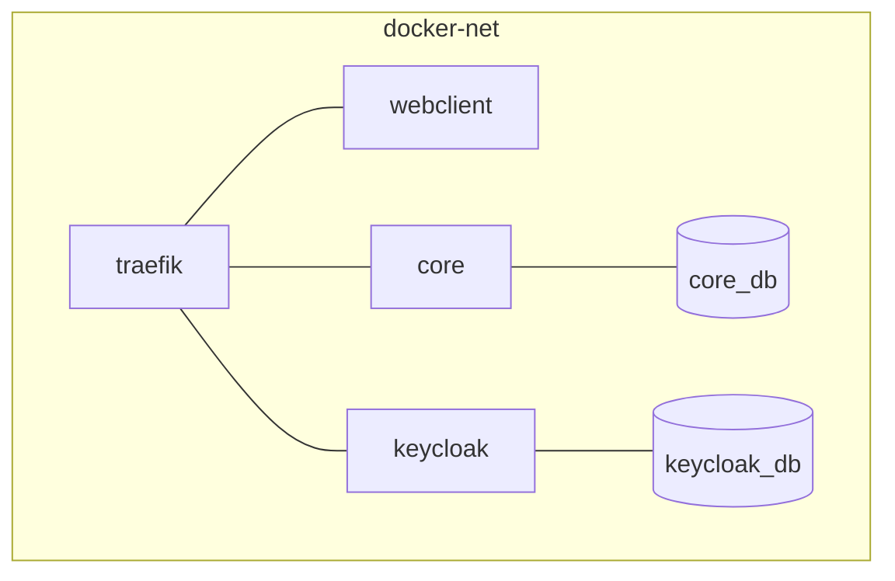

#### Verification

```bash
docker network ls | grep docker-net
docker compose up -d
docker network inspect docker-net --format '{{range .Containers}}{{.Name}} {{end}}'
# → edubox-config-whoami-1
docker run --rm --network docker-net curlimages/curl -s http://whoami | head -1
# → Hostname: ...
```

#### Common beginner mistakes

| Mistake | Symptom | Fix |
|---|---|---|
| Forgetting `docker network create` | `network docker-net declared as external, but could not be found` | `make docker-network` |
| A service without `networks:` | Traefik returns **Bad Gateway / 504** for it | Add `networks: [docker-net]` |

#### Knowledge check

1. What does `external: true` change about the network's lifecycle?
2. How would a container named `core` reach MariaDB?

<details>
<summary>Show answers</summary>

1. Compose won't create or delete it; it must exist beforehand and outlives `docker compose down`.
2. Hostname `core_db` (the service name), port 3306, over `docker-net`.
</details>

#### Completion checklist

- [ ] `docker-net` exists
- [ ] All services attached to it
- [ ] Name resolution between containers verified

---

<a id="task-7"></a>

## Task 7 — A local domain name

#### Goal

Make `local-edubox.wehost.asia` resolve to your own machine.

#### Why now?

- Traefik routes by **Host** header (Task 8).
- TLS certificates are issued for a **domain**, not for `localhost` (Task 9).
- Keycloak and NextAuth care about the exact public URL (redirect URIs, cookie domains, issuer).

Using a real-looking domain from day one means your local setup behaves like production.

#### Background knowledge

**Why `wehost.asia`?** The company owns this domain and has a real, publicly trusted **wildcard certificate** for `*.wehost.asia` (Task 9). By pointing `local-edubox.wehost.asia` at your own machine, your browser shows a green padlock without any certificate warnings. Clever and convenient.

**Why `0.0.0.0` in the Makefile?** On Linux, connecting to `0.0.0.0` reaches local listening sockets, like `127.0.0.1`. `127.0.0.1` is the more conventional and portable choice; either works on Linux.

#### What should I create?

One line in `/etc/hosts`, added idempotently by a Makefile target:

```make
add-hosts:
	$(call echo_title, "Add host to /etc/hosts")
	@if [ `grep -o "${HOST_NAME}" /etc/hosts | wc -l` = 0 ]; then\
		sudo bash -c "echo 0.0.0.0 ${HOST_NAME} >> /etc/hosts";\
	else\
		echo "==> Skip: host already existed.";\
	fi
```

#### Purpose of every file

| File | Why | When | If missing |
|---|---|---|---|
| `/etc/hosts` entry | Resolves `HOST_NAME` locally | Every request your browser makes | `DNS_PROBE_FINISHED_NXDOMAIN` or the real internet IP is used |

> [!NOTE]
> Only your **host** uses `/etc/hosts`. Containers do *not* read your host's `/etc/hosts`. Inside `docker-net` the domain resolves only because of a trick you'll meet in Task 8 (`hostname: ${HOST_NAME}` on the Traefik container). Even so, containers talk to each other **directly** by service name (`http://keycloak:8080`) for server-to-server calls: no TLS, no extra proxy hop, and it still works in staging/production where there is no Traefik. You'll see this in Phase 5 and Phase 9.

#### Implementation guide

```bash
echo "127.0.0.1 local-edubox.wehost.asia" | sudo tee -a /etc/hosts
```

#### Technology explanation

**`/etc/hosts`**
- *What:* the static name table checked before DNS.
- *Alternatives:* a local DNS server (dnsmasq), `*.localhost` names (resolve automatically in modern browsers), `nip.io`/`sslip.io` (wildcard DNS that maps `127.0.0.1.nip.io` → 127.0.0.1).
- *When not to use:* teams with many dynamic subdomains → dnsmasq.

#### Project architecture

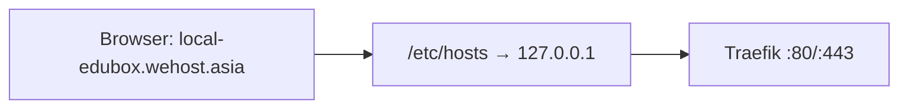

#### Verification

```bash
getent hosts local-edubox.wehost.asia
# 127.0.0.1       local-edubox.wehost.asia
ping -c1 local-edubox.wehost.asia
```

#### Common beginner mistakes

| Mistake | Symptom | Fix |
|---|---|---|
| Browser uses DNS-over-HTTPS and ignores `/etc/hosts` | Domain resolves to a public IP | Disable "secure DNS" in the browser for dev |
| Typo in the domain | Traefik returns `404 page not found` (no router matched) | Must equal `HOST_NAME` exactly |

#### Knowledge check

1. Why does the Laravel container talk to Keycloak as `http://keycloak:8080` rather than `https://local-edubox.wehost.asia/auth`?

<details>
<summary>Show answers</summary>

1. Your host's `/etc/hosts` is invisible to containers. The domain only resolves inside `docker-net` because of the `hostname:` trick on Traefik (Task 8), and going through Traefik adds TLS and a hop for nothing. The direct internal name is faster, has no dependency on Traefik, and matches staging/production where Traefik doesn't exist.
</details>

#### Completion checklist

- [ ] `getent hosts local-edubox.wehost.asia` returns 127.0.0.1 (or 0.0.0.0)

---

<a id="task-8"></a>

## Task 8 — Traefik, the reverse proxy

#### Goal

Run Traefik v3 as the single entry point. It should discover containers automatically through Docker **labels** and route `http://local-edubox.wehost.asia` to the `whoami` test service. Open the Traefik dashboard.

#### Why now?

Every application (Keycloak, Laravel, Next.js, Reverb) will be exposed through Traefik. Learn it with a trivial service before you put complex apps behind it.

#### Background knowledge

**What is a reverse proxy?** A server that sits in front of your applications, receives *all* client requests, and forwards each to the right backend. Clients only ever talk to the proxy.

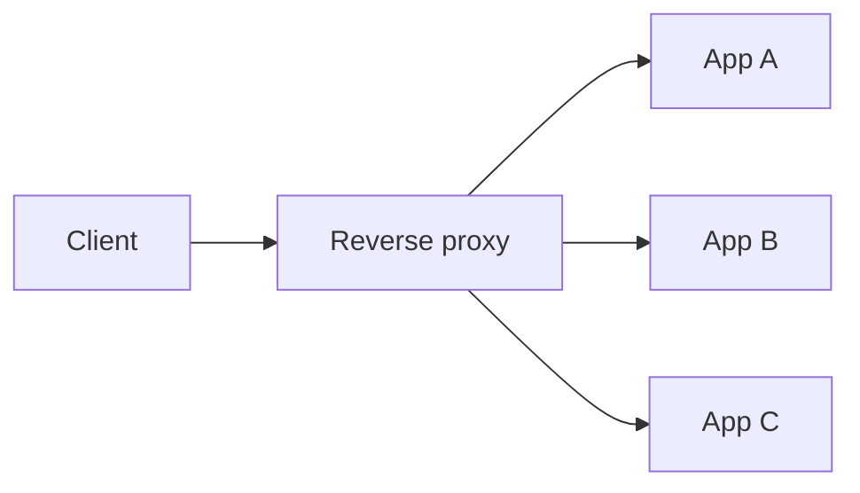

Why you want one:
- **One public entry point** (only ports 80/443 open).
- **TLS termination** in one place (apps speak plain HTTP internally).
- **Routing** by host name and path.
- **Middlewares**: redirects, path rewriting, headers, auth, rate limits.

**Traefik vocabulary:**

| Term | Meaning | EduBox example |
|---|---|---|
| **Entrypoint** | A port Traefik listens on | `web` = :80, `websecure` = :443 |
| **Provider** | Where Traefik reads its routing config from | `docker` (container labels), `file` (`tls.yaml`) |
| **Router** | A rule that matches requests | `Host(\`local-edubox.wehost.asia\`) && PathPrefix(\`/auth\`)` |
| **Service** | Where matched requests go (container + port) | `loadbalancer.server.port=8080` |
| **Middleware** | Transformation on the way | `replacepathregex` for `/api/core` → `/api` |

**How labels work:** you put key/value labels on a container. Traefik watches Docker (through `/var/run/docker.sock`), reads the labels, and builds routes **live** — no restart needed when containers come and go.

**Router priority:** when several routers match, Traefik picks the one with the **longest rule string** by default. `Host(x) && PathPrefix(/api/core)` is longer than `Host(x)`, so `/api/core/...` goes to Laravel and everything else falls through to Next.js. This is *why* the webclient can claim the whole host without stealing API traffic.

> [!IMPORTANT]
> The default priority is "rule length". That's convenient but implicit. If you ever write two rules of similar length, set `traefik.http.routers.<name>.priority=<n>` explicitly.

**`exposedbydefault=true`** means every container on the Docker provider gets a router automatically, even without labels (default rule: `Host(\`<service>-<project>\`)`). EduBox leaves this on for simplicity. Production setups usually set it to `false` and opt in with `traefik.enable=true`.

#### What should I create?

The `proxy` service in `compose.yaml` and labels on `whoami`.

#### Purpose of every file

| Item | Why it exists | Who uses it | If missing |
|---|---|---|---|
| `proxy` service | Single entry point | Every browser/mobile request | Nothing reachable on 80/443 |
| `/var/run/docker.sock:ro` mount | Lets Traefik read container labels (read-only) | Traefik's docker provider | Traefik sees no containers → 404 for everything |
| `labels` on each app | Per-app routing rules | Traefik | App not routed (or routed with a default rule) |

#### Implementation guide

**Idea:** start with HTTP only. Add HTTPS in Task 9.

```yaml
networks:
  docker-net:
    name: docker-net
    external: true

services:
  proxy:
    image: 'traefik:v3.7'
    hostname: ${HOST_NAME}
    volumes:
      - '/var/run/docker.sock:/var/run/docker.sock:ro'
    networks:
      - docker-net
    ports:
      - '80:80'
      - '8090:8080'       # Traefik dashboard (dev only!)
    command:
      - '--log.level=DEBUG'
      - '--api.insecure=true'                 # dashboard on :8080 without auth (dev only)
      - '--providers.docker=true'
      - '--providers.docker.exposedbydefault=true'
      - '--entrypoints.web.address=:80'

  whoami:
    image: traefik/whoami:v1.10
    networks:
      - docker-net
    labels:
      - 'traefik.http.routers.whoami.rule=Host(`${HOST_NAME}`)'
      - 'traefik.http.services.whoami.loadbalancer.server.port=80'
```

Line by line:

- `hostname: ${HOST_NAME}` — a subtle, important trick. Docker's embedded DNS resolves a container's *hostname* for other containers on the same user-defined network. So every container on `docker-net` that looks up `local-edubox.wehost.asia` gets **Traefik's** IP. That lets a container call the public URL and still go through Traefik with the valid certificate. Laravel relies on this when it publishes events to Reverb at `https://local-edubox.wehost.asia:443` (Task 47). You can prove it: `docker run --rm --network docker-net alpine getent hosts local-edubox.wehost.asia`.
- `--providers.docker=true` — read configuration from Docker labels.
- `--api.insecure=true` — serve the dashboard on port 8080 inside the container, which we map to **8090** on the host.
- `--entrypoints.web.address=:80` — listen on port 80 and call this entrypoint `web`.
- `traefik.http.routers.whoami.rule` — "requests whose Host header equals HOST_NAME go to router `whoami`."
- `traefik.http.services.whoami.loadbalancer.server.port=80` — the container port to forward to (needed when an image exposes several ports or none).

> [!WARNING]
> `--api.insecure=true` and `--log.level=DEBUG` are fine on your laptop. **Never** in production: the dashboard reveals your whole routing table.

#### Technology explanation

**Traefik**
- *What:* a cloud-native reverse proxy and load balancer that configures itself from Docker/Kubernetes metadata.
- *Why we need it:* path-based routing of four apps on one domain + TLS.
- *Problem solved:* no hand-edited nginx config to reload every time a container changes.
- *Why this project chose it:* zero-config discovery via labels; each app's routing lives next to its service definition in `compose.yaml`.
- *Alternatives:* **nginx** (fast, ubiquitous, manual config — EduBox actually uses nginx inside the production webclient image, Task 69), **Caddy** (automatic HTTPS, simple config), **HAProxy** (high-performance TCP/HTTP LB), cloud load balancers.
- *When not to use:* if you need very fine-grained caching or complex rewrite logic, nginx may be simpler; for a single static site, a proxy is overkill.

#### Project architecture

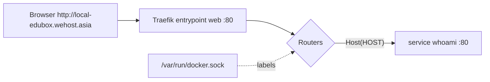

#### Verification

```bash
docker compose up -d
curl -s http://local-edubox.wehost.asia | grep -E 'Hostname|X-Forwarded'
```

Expected (note Traefik added `X-Forwarded-*` headers):

```text
Hostname: 9b1c...
X-Forwarded-For: 172.18.0.1
X-Forwarded-Host: local-edubox.wehost.asia
X-Forwarded-Port: 80
X-Forwarded-Proto: http
X-Forwarded-Server: local-edubox.wehost.asia
```

Open **http://localhost:8090** → Traefik dashboard. Under *HTTP → Routers* you should see `whoami@docker` with rule `Host(\`local-edubox.wehost.asia\`)`.

```bash
docker compose logs proxy | grep -i whoami | head -3   # DEBUG lines about the new router
```

#### Common beginner mistakes

| Mistake | Symptom | Debug / Fix |
|---|---|---|
| Forgot docker.sock mount | Dashboard shows no `@docker` routers | Add the volume |
| Backticks replaced by quotes in rule | Router error in dashboard: `invalid rule` | Traefik rules use **backticks** inside the label string |
| Service on a different network | `Bad Gateway` / `Gateway Timeout` | Put it on `docker-net` |
| `HOST_NAME` empty in `.env` | Rule `Host(\`\`)` never matches → 404 | Check `docker compose config` |
| Something else on port 80 | `proxy` exits immediately | `sudo ss -tlnp | grep :80` |

#### Knowledge check

1. What's the difference between a Traefik *router* and *service*?
2. Two routers match `/api/core/grades`: `Host(h)` and `Host(h) && PathPrefix(/api/core)`. Which wins, and why?
3. Why does Traefik need the Docker socket?

<details>
<summary>Show answers</summary>

1. A router decides *which requests* match (rule, TLS, middlewares); a service decides *where* they go (backend address/port).
2. The second one — Traefik's default priority is the rule string length, and the longer, more specific rule wins.
3. To list containers and read their labels in real time (docker provider).
</details>

#### Completion checklist

- [ ] `proxy` container running
- [ ] `curl http://local-edubox.wehost.asia` reaches whoami
- [ ] Dashboard reachable on `localhost:8090`
- [ ] I can explain entrypoint/router/service/middleware

---

<a id="task-9"></a>

## Task 9 — HTTPS with SSL/TLS certificates

#### Goal

Serve everything over **HTTPS** on port 443 using a certificate loaded through Traefik's **file provider**, and permanently redirect HTTP → HTTPS.

#### Why now?

- Keycloak and OIDC strongly expect HTTPS (secure cookies, `sslRequired: external`).
- Browsers block "secure context" features (and `SameSite=None` cookies) over HTTP.
- Mixed-content errors appear if the page is HTTPS but WebSockets/API are HTTP.

Doing HTTPS now means every later service is born secure.

#### Background knowledge

**SSL vs TLS.** SSL is the old name; TLS is the modern protocol. People still say "SSL certificate".

**What a certificate does.** It proves "this server really is `local-edubox.wehost.asia`" (signed by a Certificate Authority your browser trusts), and enables encryption. A certificate comes with a **private key** that must stay secret.

| File | Contains | Secret? |
|---|---|---|
| `fullchain.pem` | Your certificate + intermediate CA certificates | No (sent to every client) |
| `privkey.pem` | The private key | **Yes — never commit it** |

**TLS termination.** Traefik decrypts HTTPS and forwards plain HTTP to containers on the private network. Apps behind it don't handle certificates — but they must know the original request was HTTPS (via `X-Forwarded-Proto: https`), or they'll generate `http://` links. (You'll fix that in Laravel with `trustProxies`, Task 25, and in Keycloak with `KC_PROXY_HEADERS`, Task 14.)

**Where does EduBox get a certificate for a local domain?** The company publishes a real wildcard cert for `*.wehost.asia` on an internal package server; the Makefile downloads it:

```make
add-ssl:
	wget https://packages.web-essentials.asia/boxes/devssl/wehost.asia/fullchain.pem -O config/docker/ssl/fullchain.pem
	wget https://packages.web-essentials.asia/boxes/devssl/wehost.asia/privkey.pem -O config/docker/ssl/privkey.pem
```

> [!TIP]
> **If you're rebuilding this for yourself** you won't have that wildcard cert. Use **mkcert**: it creates a local Certificate Authority, installs it in your browser trust store, and issues certs for any name:
> ```bash
> mkcert -install
> mkcert -cert-file config/docker/ssl/fullchain.pem -key-file config/docker/ssl/privkey.pem local-edubox.test
> ```
> Then use `local-edubox.test` as `HOST_NAME`. (Containers won't trust mkcert's CA — but they talk to each other over internal HTTP anyway.)

**Traefik's file provider.** Certificates aren't container labels, so Traefik reads them from a YAML file:

```yaml
# config/docker/ssl/tls.yaml
tls:
  certificates:
    - certFile: /certs/fullchain.pem
      keyFile: /certs/privkey.pem
```

Traefik picks the right certificate per request by **SNI** (the hostname the client asks for during the TLS handshake).

#### What should I create?

```text
edubox-config/
└── config/
    └── docker/
        └── ssl/
            ├── tls.yaml          (committed)
            ├── fullchain.pem     (downloaded/generated, ignored)
            └── privkey.pem       (downloaded/generated, ignored)
```

Plus updated `proxy` command flags and `tls=true` on routers.

#### Purpose of every file

| File | Why | Who uses it | When | If missing |
|---|---|---|---|---|
| `tls.yaml` | Tells Traefik which cert/key files to load | Traefik file provider | Startup + on change (`watch=true`) | Traefik serves its self-signed default cert → browser warning |
| `fullchain.pem` | Public certificate chain | Traefik | Each TLS handshake | Same as above |
| `privkey.pem` | Private key | Traefik | Each TLS handshake | Same as above |

#### Implementation guide

Update the `proxy` service (this is the final version from the project):

```yaml
  proxy:
    image: 'traefik:v3.7'
    hostname: ${HOST_NAME}
    volumes:
      - '/var/run/docker.sock:/var/run/docker.sock:ro'
      - ./config/docker/ssl:/certs/
    networks:
      - docker-net
    ports:
      - '80:80'
      - '443:443'
      - '8090:8080'
    command:
      - '--log.level=DEBUG'
      - '--api.insecure=true'
      - '--providers.docker=true'
      - '--providers.file.watch=true'
      - '--providers.docker.exposedbydefault=true'
      - '--entrypoints.web.address=:80'
      - '--entrypoints.web.http.redirections.entryPoint.to=websecure'
      - '--entrypoints.web.http.redirections.entryPoint.scheme=https'
      - '--entrypoints.web.http.redirections.entryPoint.permanent=true'
      - '--entrypoints.websecure.address=:443'
      - '--providers.file.filename=/certs/tls.yaml'
```

New flags explained:

| Flag | Effect |
|---|---|
| `./config/docker/ssl:/certs/` | Mount the cert folder into Traefik |
| `--providers.file.filename=/certs/tls.yaml` | Load TLS config from the file |
| `--providers.file.watch=true` | Reload when the file changes (replace certs without restart) |
| `--entrypoints.websecure.address=:443` | New entrypoint for HTTPS |
| `...redirections.entryPoint.to=websecure` + `scheme=https` + `permanent=true` | Any request on :80 gets a **301** to `https://…` |

On every router, add `tls=true`:

```yaml
    labels:
      - 'traefik.http.routers.whoami.rule=Host(`${HOST_NAME}`)'
      - 'traefik.http.routers.whoami.tls=true'
```

`tls=true` attaches the router to TLS (and, since no entrypoint is specified, Traefik uses all entrypoints; HTTP ones are redirected anyway).

#### Technology explanation

**TLS / HTTPS**
- *Problem solved:* confidentiality, integrity, and server identity.
- *Alternatives for obtaining certs:* **Let's Encrypt** via Traefik's ACME resolver (automatic, free — the usual choice for public servers), company-issued wildcard certs (EduBox dev), mkcert (local only), self-signed (always warns).
- *When not to terminate at the proxy:* when compliance requires end-to-end encryption to each service (then use TLS passthrough or mTLS).

#### Project architecture

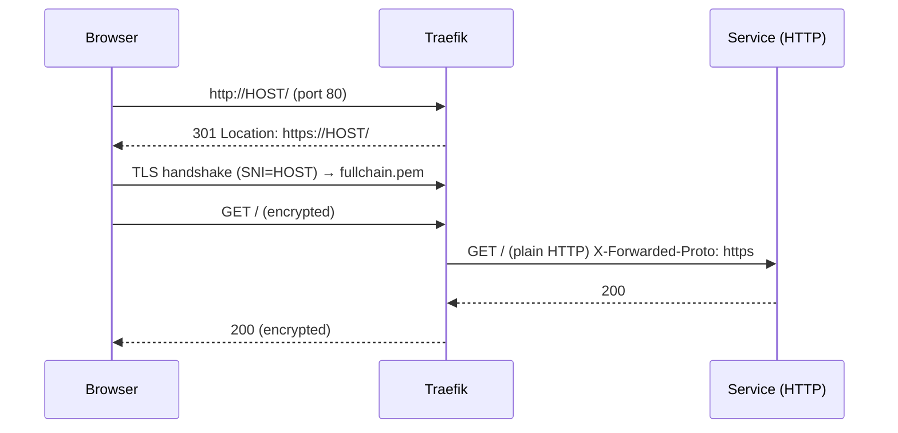

#### Verification

```bash
curl -sI http://local-edubox.wehost.asia | head -3
# HTTP/1.1 301 Moved Permanently
# Location: https://local-edubox.wehost.asia/

curl -s https://local-edubox.wehost.asia | grep X-Forwarded-Proto
# X-Forwarded-Proto: https

echo | openssl s_client -connect local-edubox.wehost.asia:443 -servername local-edubox.wehost.asia 2>/dev/null \
  | openssl x509 -noout -subject -issuer -dates
```

Browser: `https://local-edubox.wehost.asia` shows a padlock (no warning).

#### Common beginner mistakes

| Mistake | Symptom | Fix |
|---|---|---|
| Cert files not downloaded | Browser warning "TRAEFIK DEFAULT CERT" | `make add-ssl` or mkcert |
| Wrong path in `tls.yaml` (host path instead of container path) | Same as above; Traefik log: `unable to read certFile` | Use `/certs/...` (inside container) |
| Cert doesn't cover the domain | `NET::ERR_CERT_COMMON_NAME_INVALID` | A `*.wehost.asia` cert covers `local-edubox.wehost.asia` but **not** `a.b.wehost.asia` |
| Forgot `tls=true` on a router | HTTPS requests to that app → 404 | Add the label |
| Committed `privkey.pem` | Security incident | It's in `.gitignore`; if leaked, revoke the cert |

#### Knowledge check

1. Which file must never be shared, and why?
2. Traefik terminates TLS. How does Laravel know the original request was HTTPS?
3. Why does HTTP→HTTPS use a **permanent** (301) redirect?

<details>
<summary>Show answers</summary>

1. `privkey.pem` — anyone with it can impersonate your server.
2. Traefik sets `X-Forwarded-Proto: https`; Laravel trusts it via `trustProxies` (Task 25).
3. Browsers cache 301s, so later visits go straight to HTTPS. (Be careful when experimenting — the cache can surprise you.)
</details>

#### Completion checklist

- [ ] `tls.yaml` committed, `.pem` files ignored
- [ ] HTTP returns 301 to HTTPS
- [ ] Valid padlock in the browser
- [ ] `X-Forwarded-Proto: https` reaches the backend

---

<a id="task-10"></a>

## Task 10 — MariaDB, Docker volumes, and Adminer

#### Goal

Add the application database **`core_db`** (MariaDB 11.4) with a **named volume** for persistence, plus **Adminer**, a web UI to browse databases. (Keycloak's database `keycloak_db` is added in Task 14 with the same pattern.)

#### Why now?

Laravel (Phase 4) needs a database to run migrations. Keycloak needs one too. Learn the database pattern once here.

#### Background knowledge

**Relational database.** Data in tables with rows and columns, linked by foreign keys, queried with SQL. EduBox's domain (courses → modules → sessions → activities) is highly relational, so a relational DB is the natural fit.

**MariaDB vs MySQL vs PostgreSQL.**

| | MariaDB | MySQL | PostgreSQL |
|---|---|---|---|
| Origin | Community fork of MySQL (by MySQL's creator) | Oracle | Independent |
| Compatibility | Drop-in MySQL replacement | — | Different SQL dialect |
| Strengths | Open-source, fast, familiar, good Laravel support | Ubiquitous | Advanced features (JSONB, CTEs, strict types) |

EduBox uses MariaDB for **both** core and Keycloak. Reasons: the team's familiarity, MySQL-compatibility, and Keycloak supports it natively (`KC_DB=mariadb`). PostgreSQL would be an equally good choice.

**Why two separate database servers?** Keycloak's schema is owned by Keycloak (it migrates it itself on upgrades). Mixing it with your app's tables would couple upgrades, backups and permissions. Separate containers = separate lifecycles. (Two databases in one server would also work; separate containers keep them fully independent.)

**Docker volumes for databases.** A container's filesystem is disposable. If MariaDB wrote data inside the container, `docker compose down` would wipe your database. A **named volume** mounted at `/var/lib/mysql` keeps the data.

**How the official MariaDB image initializes.** On first start with an **empty** data dir it:
1. Creates the root user with `MARIADB_ROOT_PASSWORD`
2. Creates database `MARIADB_DATABASE`
3. Creates user `MARIADB_USER`/`MARIADB_PASSWORD` with full rights on that DB
4. Runs any `*.sql`, `*.sql.gz`, `*.sh` in `/docker-entrypoint-initdb.d/` (used for `keycloak_db` restore, Task 21)

On later starts (volume not empty) **none of this runs**.

**Character set `utf8mb4`.** MySQL's old `utf8` stores at most 3 bytes per character — it can't store emoji or some scripts. `utf8mb4` is real UTF-8. EduBox stores Khmer text, so `--character-set-server=utf8mb4 --collation-server=utf8mb4_unicode_ci` is essential.

#### What should I create?

```yaml
volumes:
  edubox_core_db_data:
    name: edubox_core_db_data

services:
  # ...

  core_db:
    image: docker.io/mariadb:11.4
    networks:
      - docker-net
    command: --character-set-server=utf8mb4 --collation-server=utf8mb4_unicode_ci
    volumes:
      - edubox_core_db_data:/var/lib/mysql
    environment:
      MARIADB_ROOT_PASSWORD: ${CORE_DB_ROOT_PASSWORD}
      MARIADB_USER: ${CORE_DB_USERNAME}
      MARIADB_PASSWORD: ${CORE_DB_PASSWORD}
      MARIADB_DATABASE: ${CORE_DB_DATABASE}

  adminer:
    image: adminer
    networks:
      - docker-net
    ports:
      - 8060:8080
```

#### Purpose of every file

| Item | Why | Who uses it | If missing |
|---|---|---|---|
| `volumes.edubox_core_db_data` | Persistent DB storage with a fixed name (`name:` avoids the project prefix) | MariaDB | Data lost when the container is recreated |
| `core_db` service | The app database | Laravel (`DB_HOST=core_db`) | Laravel can't start queries |
| `command: --character-set-server=…` | Khmer/emoji-safe storage | MariaDB | Garbled text, `Incorrect string value` errors |
| `adminer` | Browse/edit tables in a browser | Developers | You'd need a desktop SQL client |

> [!NOTE]
> **No `ports:` on `core_db`.** The database is *not* exposed on your host — only containers on `docker-net` can reach it. Adminer, being on the same network, can. That's good security hygiene even in dev.

#### Implementation guide

Add the blocks above, then `docker compose up -d core_db adminer`.

#### Technology explanation

**Adminer**
- *What:* a single-PHP-file database manager (like phpMyAdmin, lighter).
- *Alternatives:* phpMyAdmin, DBeaver, TablePlus, DataGrip; the `mariadb` CLI via `docker compose exec core_db mariadb -u root -p`.
- *When not to use:* never expose it in production.

#### Project architecture

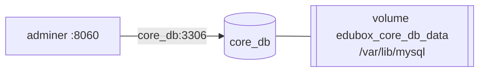

#### Verification

```bash
docker compose up -d core_db adminer
docker compose logs core_db | grep -i "ready for connections"
docker compose exec core_db mariadb -uedubox_core -pedubox_core -e "SHOW DATABASES; SELECT @@character_set_server;"
```

Expected includes `edubox_core` and `utf8mb4`.

Browser: `http://localhost:8060` → System **MySQL / MariaDB**, Server **`core_db`**, user `edubox_core`, password `edubox_core`, database `edubox_core` → you see an empty database.

Persistence test:

```bash
docker compose exec core_db mariadb -uroot -proot edubox_core -e "CREATE TABLE t(x int); INSERT INTO t VALUES (42);"
docker compose rm -sf core_db && docker compose up -d core_db
sleep 5; docker compose exec core_db mariadb -uroot -proot edubox_core -e "SELECT * FROM t; DROP TABLE t;"
# → 42  (data survived container deletion)
docker volume ls | grep edubox_core_db_data
```

#### Common beginner mistakes

| Mistake | Symptom | Fix |
|---|---|---|
| Changing env passwords after first start | `Access denied` | Env only applies on an empty volume. `docker volume rm edubox_core_db_data` (destroys data) or `ALTER USER` |
| Using `localhost` as DB host from another container | `Connection refused` | Use `core_db` |
| Expecting to connect from host tools on 3306 | Connection refused | Not exposed — add `ports: ['3307:3306']` temporarily if you really need it |
| Forgetting utf8mb4 | Khmer stored as `????` | Set server charset before data is created |

#### Knowledge check

1. Why doesn't `core_db` have a `ports:` section?
2. When exactly does `MARIADB_PASSWORD` take effect?
3. Why does EduBox need `utf8mb4` specifically?

<details>
<summary>Show answers</summary>

1. Only containers need it; not exposing it reduces attack surface. Containers reach it over `docker-net`.
2. Only on first initialization, when the data volume is empty.
3. Khmer text (and emoji) need real 4-byte UTF-8; legacy `utf8` is 3-byte only.
</details>

#### Completion checklist

- [ ] `core_db` running with utf8mb4
- [ ] Adminer can log in
- [ ] Data survives container recreation

---

<a id="task-11"></a>

## Task 11 — MailHog, a fake mail server

#### Goal

Add **MailHog**, an SMTP server that catches all outgoing mail and shows it in a web UI, so Keycloak and Laravel can send emails safely in development.

#### Why now?

Keycloak sends password-setup and reset emails (Task 15 sets `smtpServer.host=mailhog`). Laravel sends subject-approval, lesson-plan and email-change emails. You must be able to *see* these emails without spamming real people.

#### Background knowledge

**SMTP** (Simple Mail Transfer Protocol) is how programs send email, usually on port 25/465/587. MailHog listens on **1025** for SMTP and serves a UI on **8025**. It never delivers anything — it just stores messages in memory.

#### What should I create?

```yaml
  mailhog:
    image: mailhog/mailhog
    logging:
      driver: 'none'
    ports:
      - 8025:8025
    networks:
      - docker-net
```

#### Purpose of every file

| Item | Why | If missing |
|---|---|---|
| `mailhog` service | Catch emails | Keycloak "Failed to send email"; Laravel mail exceptions |
| `logging.driver: none` | MailHog is chatty; silence its logs | Noisy `docker compose logs` |
| `8025:8025` | View caught mail at `http://localhost:8025` | Can't read the emails |

#### Implementation guide

Add the service, `docker compose up -d mailhog`.

#### Technology explanation

**MailHog**
- *Problem solved:* safe email testing.
- *Alternatives:* **Mailpit** (actively maintained successor — recommended for new projects), Mailtrap (hosted), Laravel's `log` mail driver.
- *When not to use:* production (use a real SMTP provider: SES, Mailgun, Postmark…).

#### Project architecture

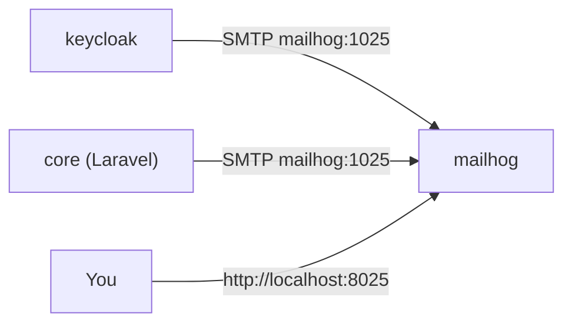

#### Verification

```bash
docker compose up -d mailhog
docker run --rm --network docker-net alpine sh -c \
 "apk add -q swaks >/dev/null 2>&1 || true; printf 'HELO x\r\nMAIL FROM:<a@b.c>\r\nRCPT TO:<d@e.f>\r\nDATA\r\nSubject: hi\r\n\r\ntest\r\n.\r\nQUIT\r\n' | nc mailhog 1025"
```

Open `http://localhost:8025` → one email "hi".

#### Common beginner mistakes

| Mistake | Symptom | Fix |
|---|---|---|
| Using port 8025 for SMTP | Connection error | SMTP is **1025**, UI is **8025** |
| Expecting mails to survive restart | Inbox empty | MailHog stores in memory |

#### Knowledge check

1. Which port do applications send to, and which port do you open in the browser?

<details>
<summary>Show answers</summary>

1. Apps send SMTP to `mailhog:1025`; you browse `localhost:8025`.
</details>

#### Completion checklist

- [ ] MailHog UI reachable
- [ ] A test email appears

---

<a id="task-12"></a>

## Task 12 — Automate everything with a Makefile

#### Goal

Write the `edubox-config/Makefile` skeleton: colored output helpers, a `help` target, `setup`, `up`, `stop`, `ps`, `remove`, `docker-network`, `add-hosts`, `add-ssl`, `git-clone`. You'll add more targets as later tasks need them.

#### Why now?

You already have six manual steps (create network, edit hosts, download certs, copy `.env`, start containers…). A new teammate should be able to run **one command**. Automating now also documents the steps.

#### Background knowledge

**Makefile basics:**

```make
target: prerequisites
	recipe line (must start with a TAB, not spaces)
```

- `make target` runs that recipe.
- Variables: `HOST_NAME` from `-include .env` becomes `$(HOST_NAME)`/`${HOST_NAME}`.
- `$(shell id -u)` runs a shell command.
- `define … endef` creates a reusable macro, called with `$(call name,arg)`.
- `@` before a command hides the command echo.
- `$(MAKE) other-target` calls another target (recursively).
- In recipes, `$$` is a literal `$` for the shell.
- `-include .env` includes the file if it exists, silently skips if not — so `make setup` works before `.env` exists.

**Idempotency.** A good setup target can be run twice safely. That's why the targets check before acting: "if the network doesn't exist, create it", "if `.env` doesn't exist, copy it", "if hosts entry missing, add it".

#### What should I create?

`edubox-config/Makefile` (core parts shown; the full file grows through the guide):

```make
SHELL=/bin/bash
ENV_FILE := .env
-include .env
UID := $(shell id -u)

colorOff=\033[0m
colorGreen=\033[92m
colorYellow=\033[33m
coloreRed=\033[31m

appPath=../edubox-app
webclientPath=../edubox-webclient
corePath=../edubox-core
keycloakPath=../edubox-keycloak

define echo_title
	@echo -e "${colorGreen}*** ${1} ***${colorOff}"
endef
define echo_section
	@echo -e "${colorYellow}${1}${colorOff}"
endef

GIT_HOST ?= git@github.com:tdso-ngo

all: help

help:
	$(call echo_section,"=========== SETUP PROJECT ===========")
	$(call echo_section,"https://$(HOST_NAME)")
	$(call echo_title, "Setup projects")
	@echo "  make setup"
	$(call echo_title, "Docker up all services")
	@echo "  make up"
	$(call echo_title, "Stop all services")
	@echo "  make stop"
	$(call echo_title, "Remove all services")
	@echo "  make remove"

setup:
	$(call echo_title, "Create .env file from dot-env.example")
	@test -f $(ENV_FILE) || cp .env.example .env
	sed -i 's/^USER_ID=.*/USER_ID=${UID}/' .env
	exec $(MAKE) project-setup;

docker-network:
	@if [ `docker network ls | grep -o "docker-net" | wc -l` = 0 ]; then\
		docker network create docker-net;\
	else\
		echo "==> Skip: network already existed.";\
	fi

git-clone:
	$(call echo_title, "Clone dependency repositories")
	git -C ${appPath} pull || git clone $(GIT_HOST)/edubox-app.git ${appPath}
	git -C ${webclientPath} pull || git clone $(GIT_HOST)/edubox-webclient.git ${webclientPath}
	git -C ${keycloakPath} pull || git clone $(GIT_HOST)/edubox-keycloak.git ${keycloakPath}
	git -C ${corePath} pull || git clone $(GIT_HOST)/edubox-core.git ${corePath}

add-hosts:
	@if [ `grep -o "${HOST_NAME}" /etc/hosts | wc -l` = 0 ]; then\
		sudo bash -c "echo 0.0.0.0 ${HOST_NAME} >> /etc/hosts";\
	else\
		echo "==> Skip: host already existed.";\
	fi

add-ssl:
	wget https://packages.web-essentials.asia/boxes/devssl/wehost.asia/fullchain.pem -O config/docker/ssl/fullchain.pem
	wget https://packages.web-essentials.asia/boxes/devssl/wehost.asia/privkey.pem -O config/docker/ssl/privkey.pem

host_url:
	$(call echo_title, "READY")
	$(call echo_section, "https://${HOST_NAME}/")

up:
	$(MAKE) add-hosts
	docker compose up -d
	$(MAKE) host_url

ps:
	docker compose ps

stop:
	docker compose stop

remove:
	docker compose kill || true
	docker compose rm -f || true
	@prefix=$$(basename $$PWD | tr -d '.'); \
	docker volume ls -q | grep "^$${prefix}_" | xargs -r docker volume rm
```

#### Purpose of every file

| Target | Why it exists | When you run it |
|---|---|---|
| `help` (default) | Self-documentation | `make` with no args |
| `setup` | Create `.env`, inject UID, then run `project-setup` | Once per machine |
| `project-setup` | The full bootstrap sequence (grows in later tasks) | Called by `setup` |
| `docker-network` | Idempotently create `docker-net` | Setup |
| `git-clone` | Clone or pull all sibling repos (`git -C path pull` fails if not cloned → falls back to `clone`) | Setup, deployments |
| `add-hosts` | Idempotent `/etc/hosts` entry | Setup, every `up` |
| `add-ssl` | Download certs | Setup |
| `up` / `stop` / `ps` | Daily lifecycle | Daily |
| `remove` | Kill + remove containers and project-prefixed volumes | When you want a clean slate |

> [!WARNING]
> `remove` deletes volumes whose names start with the project prefix (`edubox-config_…`). The DB volumes have **explicit** names (`edubox_core_db_data`) so they are **not** matched by this prefix and survive. That's subtle: if you want to wipe the databases, `docker volume rm edubox_core_db_data edubox_keycloak_db_data` explicitly.

#### Implementation guide

The final `project-setup` sequence (you'll fill in targets as you build them — this is your roadmap within the roadmap):

```make
project-setup:
	$(MAKE) docker-network
	$(MAKE) git-clone
	$(MAKE) download-core-db          # Task 21
	$(MAKE) download-keycloak-db      # Task 21
	docker compose up -d keycloak_db core_db
	$(MAKE) add-hosts
	$(MAKE) add-ssl
	$(MAKE) setup-service             # Task 24 (core .env + composer install)
	$(MAKE) setup-webclient           # Task 50 (webclient .env + pnpm install)
	$(MAKE) up
	sleep 15
	$(MAKE) restore-core-db           # Task 21
	$(MAKE) restore-keycloak-db       # Task 21
	docker compose run --no-deps --rm core /usr/bin/php /var/www/html/artisan migrate --force
	$(MAKE) apply-keycloak-config     # Task 15
	$(MAKE) db-seed                   # Task 32+
	$(MAKE) import-translation        # Task 42
	$(MAKE) enable-husky              # Task 3
	$(call echo_title, "READY")
	@echo "* https://${HOST_NAME}/";
```

> [!NOTE]
> Notice the order: databases first (they take time to initialize), then dependencies, then everything up, then wait, then restore/migrate/configure. `sleep 15` is a crude "wait until ready" — a healthcheck-based wait would be more robust (see Appendix E).

#### Technology explanation

**GNU Make** (see Task 0.1). Here it's used as a *task runner*, not a build system.

#### Project architecture

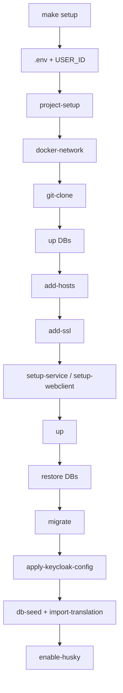

#### Verification

```bash
make            # prints help with colors
make docker-network   # "==> Skip: network already existed."
make up
make ps
```

#### Common beginner mistakes

| Mistake | Symptom | Fix |
|---|---|---|
| Spaces instead of TAB in a recipe | `Makefile:12: *** missing separator. Stop.` | Configure your editor to keep tabs in Makefiles |
| Using `$var` in recipe for shell vars | Variable empty | Use `$$var` |
| Expecting `cd` to persist between lines | Next line runs in original dir | Each line is a new shell; chain with `&&` or use `-C`/`--dir` options |

#### Knowledge check

1. Why does `setup` use `test -f .env || cp .env.example .env` instead of a plain `cp`?
2. Why would `remove` not delete the database volumes?
3. What does `-include .env` do if `.env` doesn't exist?

<details>
<summary>Show answers</summary>

1. Idempotency — re-running setup must not overwrite a developer's customized `.env`.
2. Their names (`edubox_core_db_data`) are explicitly set and don't start with the project prefix `edubox-config_`.
3. Nothing — the leading `-` tells Make to ignore a missing file.
</details>

#### Completion checklist

- [ ] `make` shows help
- [ ] `make up`, `make stop`, `make ps` work
- [ ] All helper targets are idempotent

---

<a id="phase-3"></a>

# Phase 3 — Identity and Access (Keycloak)

Identity comes **before** the backend. Why? Because the backend's very first protected route needs a way to know *who is calling*. If you build the API first, you'll be tempted to write a temporary login system — and temporary code has a way of becoming permanent.

---

<a id="task-13"></a>

## Task 13 — Theory: authentication, authorization, OAuth2, OIDC, JWT

#### Goal

Understand the vocabulary and protocols behind EduBox's login before touching Keycloak. This is a pure theory task — but the most important one in the guide.

#### Why now?

Tasks 14–31 and 55–58 are *applications* of these ideas. Without them, Keycloak's admin console looks like a wall of random switches.

#### Background knowledge

##### Authentication vs. authorization

| | Authentication (AuthN) | Authorization (AuthZ) |
|---|---|---|
| Question | *Who are you?* | *What are you allowed to do?* |
| EduBox | Keycloak login → token; Laravel verifies the token | Roles (`edit_grade`) checked by `role:` middleware and by the UI |
| HTTP error | **401 Unauthorized** (really "unauthenticated") | **403 Forbidden** |

##### Identity Provider (IdP)

A dedicated server that authenticates users and issues **tokens**. Applications trust the IdP instead of handling passwords themselves. Keycloak is EduBox's IdP. Benefits: one login for web and mobile, MFA, password policy, brute-force protection, password reset, account lockout — all solved once.

##### OAuth 2.0

A standard for **delegated authorization**: a client application gets an **access token** that lets it call an API on behalf of a user. Key roles:

| OAuth role | EduBox |
|---|---|
| **Resource owner** | The admin or teacher |
| **Client** | `edubox-frontend` (Next.js), `edubox-mobile` (Expo app), `edubox-backend` (Laravel) |
| **Authorization server** | Keycloak (realm `edubox`) |
| **Resource server** | Laravel API (`/api/core/...`) |

OAuth defines **grant types** (ways to obtain tokens):

| Grant | How it works | Who uses it in EduBox |
|---|---|---|
| **Authorization Code** ("standard flow") | Browser is redirected to the IdP's login page; IdP redirects back with a one-time `code`; the client exchanges the code for tokens server-to-server | **Web admin portal** via NextAuth |
| **Resource Owner Password Credentials** ("direct access grant") | Client sends username+password directly to the token endpoint | **Mobile app** (custom native login screen); **Laravel** to get an admin-API token for its technical user |
| **Refresh Token** | Exchange a refresh token for a new access token | Web (NextAuth `refreshAccessToken`) and mobile |
| **Client Credentials** | A machine authenticates as itself (no user) | Not used, though `edubox-backend` has `serviceAccountsEnabled: true` — see Appendix E |

> [!NOTE]
> The password grant is **deprecated** in OAuth 2.1 because the client sees the user's password. EduBox uses it for the mobile app to have a fully native, offline-friendly login. The modern alternative is Authorization Code + PKCE through the system browser (e.g. `expo-auth-session`). Keep this trade-off in mind.

##### OpenID Connect (OIDC)

OAuth 2.0 answers "may this app call the API?" but not "who is the user?". **OIDC** is a thin identity layer on top of OAuth 2.0 that adds:

- the **ID token** (a JWT describing the user),
- the **`/userinfo`** endpoint (returns user claims for a valid access token),
- **discovery** at `/.well-known/openid-configuration` (all endpoint URLs and public keys in one JSON),
- standard **scopes** (`openid`, `profile`, `email`, `offline_access`) and **claims** (`sub`, `email`, `preferred_username`, `given_name`…).

##### JWT (JSON Web Token)

A compact, signed token: `header.payload.signature`, each part base64url-encoded.

```text
eyJhbGciOiJSUzI1NiIsInR5cCI6IkpXVCJ9 . eyJzdWIiOiI0ZjM...In0 . kXb3s...Q
        header (alg, kid)                       payload (claims)          signature
```

A decoded EduBox **access token** payload looks roughly like:

```json
{
  "exp": 1761470000,
  "iat": 1761469700,
  "iss": "https://local-edubox.wehost.asia/auth/realms/edubox",
  "aud": "account",
  "sub": "4f3c2a1e-...-keycloak-user-uuid",
  "azp": "edubox-frontend",
  "realm_access": { "roles": ["view_grade", "edit_grade", "..."] },
  "resource_access": { "account": { "roles": ["manage-account"] } },
  "scope": "openid profile email",
  "email": "edubox@wehost.asia",
  "preferred_username": "edubox@wehost.asia",
  "status": true
}
```

How verification works:

1. Keycloak signs the token with its **private key** (RS256).
2. Anyone holding Keycloak's **public key** can verify the signature — no network call needed.
3. The verifier also checks `exp` (expiry) and other claims.

> [!IMPORTANT]
> **Signed ≠ encrypted.** Anyone can base64-decode a JWT and read it. Never put secrets in a token. The signature only guarantees it wasn't modified and was issued by Keycloak.

##### Access token vs refresh token vs ID token

| Token | Lifetime in EduBox | Used for |
|---|---|---|
| Access token | **5 minutes** (`accessTokenLifespan: 300`) | `Authorization: Bearer …` on every API call |
| Refresh token | Bound to the SSO session (30 min idle / 10 h max); **offline** tokens: 30 days idle | Getting new access tokens without re-login |
| ID token | Short | Telling the client who logged in |

Short access tokens limit damage if one leaks; refresh tokens keep the user logged in.

##### Keycloak vocabulary

| Term | Meaning | EduBox |
|---|---|---|
| **Realm** | An isolated tenant: its own users, clients, roles, settings | `master` (Keycloak admin only) and **`edubox`** |
| **Client** | An application that uses Keycloak | `edubox-frontend`, `edubox-backend`, `edubox-mobile` |
| **Public client** | Can't keep a secret (browser JS, mobile app) | frontend, mobile |
| **Confidential client** | Has a client secret (server) | backend |
| **Realm role** | A named permission | `view_grade`, `teacher`, … |
| **Group** | A set of users that share roles | `super_admin`, `teacher`, plus admin-defined groups |
| **Client scope** | A reusable bundle of protocol mappers attached to clients | `profile`, `email`, `roles` |
| **Protocol mapper** | Puts data into tokens/userinfo | "realm roles → `roles` claim" |
| **Required action** | Something a user must do at next login | `UPDATE_PASSWORD`, `CONFIGURE_TOTP` |
| **Authentication flow** | The sequence of steps of a login/reset | "Custom Reset Credentials" |
| **Theme** | Look & feel of login/email pages | `edubox` |

#### What should I create?

Nothing — but write your own one-paragraph explanation of each grant type EduBox uses.

#### Purpose of every file

No files. (Next task creates them.)

#### Implementation guide

Draw the Authorization Code flow from memory. Compare with Journey 1 in [Part I](#journeys).

#### Technology explanation

**Keycloak**
- *What:* open-source Identity and Access Management server (Red Hat / CNCF).
- *Why we need it:* login, MFA (TOTP), password policies, brute-force detection, password reset emails, user/role/group admin, OIDC endpoints for web and mobile.
- *Problem solved:* security-critical code you shouldn't write yourself.
- *Why chosen:* self-hosted (data stays with the NGO), free, standard OIDC, customizable themes, Admin REST API.
- *Alternatives:* Auth0/Okta/Cognito/Firebase Auth/Clerk (hosted SaaS, easy, cost and data location), Authentik/Zitadel/Ory (self-hosted alternatives), Laravel Sanctum/Passport (in-app auth — simpler but you build MFA/reset/lockout yourself, and the mobile + web share less).
- *When not to use:* a tiny app with one user type and no MFA needs — Keycloak is heavy (Java, ~500 MB RAM).

**JWT**
- *Alternatives:* opaque tokens + introspection endpoint (the API asks the IdP "is this token valid?" every time — revocable instantly but needs a network call).
- *When not to use:* when instant revocation is mandatory and you can't accept up to `exp` of lag. EduBox mitigates this: short 5-min tokens, and the `role` middleware re-checks `/userinfo` (cached 10 s) — Task 29.

#### Project architecture

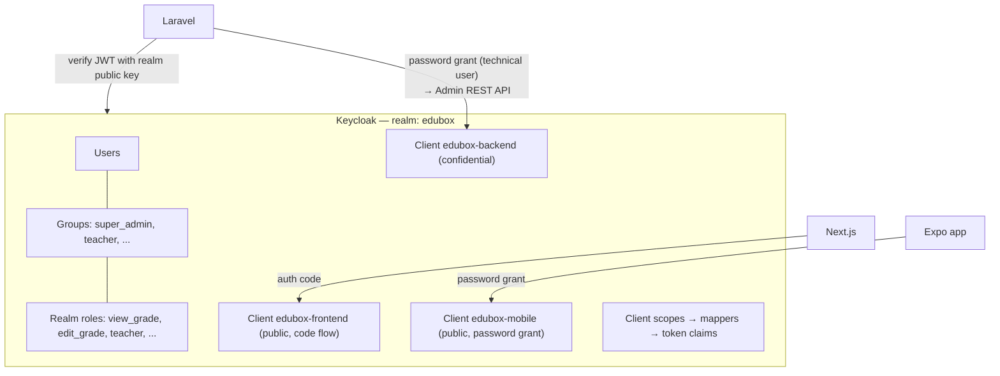

#### Verification

You can answer the knowledge check without looking.

#### Common beginner mistakes

| Misconception | Reality |
|---|---|
| "JWTs are encrypted" | They're signed; anyone can read them |
| "401 and 403 are the same" | 401 = who are you? 403 = I know you, but no |
| "The frontend checks roles, so the API is safe" | Frontend checks are UX only; the API must enforce |
| "OAuth is for login" | OAuth is for authorization; OIDC adds login/identity |

#### Knowledge check

1. Which grant type does the web portal use, and which does the mobile app use? Why different?
2. Laravel verifies a token without calling Keycloak. How?
3. Why is the access token only 5 minutes long?
4. What is the difference between a realm role and a group?

<details>
<summary>Show answers</summary>

1. Web: Authorization Code (standard flow) — the browser goes to Keycloak's login page. Mobile: password grant (direct access grant) — native login screen sends credentials directly, which suits a custom offline-first UX (at a security trade-off).
2. It checks the RS256 signature with the realm's public key (`KEYCLOAK_REALM_PUBLIC_KEY`) and checks `exp`.
3. To limit the damage window if a token leaks, and so permission changes propagate quickly.
4. A role is a single permission; a group is a collection of users that grants a set of roles. Users get roles via group membership.
</details>

#### Completion checklist

- [ ] I can explain AuthN vs AuthZ
- [ ] I can explain OAuth2 vs OIDC
- [ ] I can decode a JWT and name 5 standard claims
- [ ] I know which grant each EduBox client uses

---

<a id="task-14"></a>

## Task 14 — Run Keycloak behind Traefik

#### Goal

Create the `edubox-keycloak` repo (a Dockerfile), add the `keycloak_db` and `keycloak` services, route `https://HOST/auth` to Keycloak, and log into the admin console.

#### Why now?

Every later Keycloak task (realm config, theme, clients) needs a running Keycloak.

#### Background knowledge

**Why a custom image instead of `quay.io/keycloak/keycloak` directly?** To bake the custom theme into the image for staging/production and to run Keycloak's **build** step (`kc.sh build`) at image-build time, which makes container start faster in production mode.

**`start-dev` vs `start`:**

| | `start-dev` (local) | `start` (staging/prod) |
|---|---|---|
| HTTP allowed | yes | only if `KC_HTTP_ENABLED=true` |
| Theme caching | **off** — edit `.ftl` files and refresh | on |
| Hostname strictness | relaxed | strict unless configured |
| Use | development | production |

**Relative path `/auth`.** Old Keycloak versions served everything under `/auth`. New versions serve at `/`. EduBox sets `KC_HTTP_RELATIVE_PATH=/auth` so Keycloak's URLs are `/auth/realms/...`, `/auth/admin/...` — which matches the Traefik rule `PathPrefix(/auth)` and leaves `/` free for Next.js.

**Running behind a proxy.** Keycloak receives plain HTTP from Traefik, but must generate `https://local-edubox.wehost.asia/auth/...` URLs (redirects, issuer, links in emails). `KC_PROXY_HEADERS=xforwarded` tells Keycloak to trust `X-Forwarded-Proto/Host/Port` headers.

**Healthcheck.** Other services must wait until Keycloak is *ready*, not just *started* (Java takes ~20–40 s). The Keycloak image has no `curl`, so the healthcheck uses a bash trick: `exec 3<>/dev/tcp/localhost/8080` opens a TCP connection; it succeeds only once the port is listening.

#### What should I create?

```text
edubox-keycloak/
├── Dockerfile
├── package.json + .husky/pre-push      (Task 3)
├── README.md
└── src/resource/theme/                 (Task 20 — create the empty folder now)
```

And in `edubox-config/compose.yaml`: volume `edubox_keycloak_db_data`, services `keycloak_db` and `keycloak`.

#### Purpose of every file

| File / item | Why it exists | Who uses it | When | If missing |
|---|---|---|---|---|
| `edubox-keycloak/Dockerfile` | Builds Keycloak + theme | `docker compose build keycloak` | Build time | Can't build the custom image |
| `keycloak_db` service | Keycloak's own database | Keycloak | Always | Keycloak falls back to… nothing — it fails to start (`KC_DB=mariadb`) |
| `keycloak` service | The IdP | Everyone | Always | No login |
| theme volume mount | Live-edit theme in dev | Keycloak (dev) | Runtime | Theme changes need an image rebuild |
| healthcheck | Signals readiness | `keycloak-config-cli` (`condition: service_healthy`) | Every 10 s | config-cli runs too early and fails |

#### Implementation guide

**`edubox-keycloak/Dockerfile`** (the real one):

```dockerfile
FROM quay.io/keycloak/keycloak:26.6.3

COPY src/resource/theme /opt/keycloak/themes

RUN /opt/keycloak/bin/kc.sh build
```

- `FROM … :26.6.3` — always pin the version; Keycloak major upgrades migrate the DB schema.
- `COPY … /opt/keycloak/themes` — themes live in this folder.
- `kc.sh build` — Quarkus "build-time" optimization (DB driver, features). Done once in the image instead of at each start.

**`compose.yaml` additions:**

```yaml
volumes:
  edubox_core_db_data:
    name: edubox_core_db_data
  edubox_keycloak_db_data:
    name: edubox_keycloak_db_data

services:
  # ... proxy, core_db, adminer, mailhog ...

  keycloak:
    build:
      context: ../edubox-keycloak
      dockerfile: Dockerfile
    networks:
      - docker-net
    volumes:
      - ../edubox-keycloak/src/resource/theme:/opt/keycloak/themes
    environment:
      KC_DB: ${KC_DB_DRIVER}
      KC_DB_URL: jdbc:${KC_DB_DRIVER}://${KC_DB_HOST}:${KC_DB_PORT}/${KC_DB_DATABASE}
      KC_DB_USERNAME: ${KC_DB_USER}
      KC_DB_PASSWORD: ${KC_DB_PASSWORD}
      KC_BOOTSTRAP_ADMIN_USERNAME: admin
      KC_BOOTSTRAP_ADMIN_PASSWORD: ${KC_BOOTSTRAP_ADMIN_PASSWORD}
      KC_HOSTNAME_STRICT: "false"
      KC_HTTP_RELATIVE_PATH: "/auth"
      KC_PROXY: "edge"
      KC_HTTP_ENABLED: 'true'
      KC_PROXY_HEADERS: 'xforwarded'
      PROXY_ADDRESS_FORWARDING: "true"
      JAVA_OPTS: '-Dkeycloak.profile.feature.scripts=enabled
                  -Dkeycloak.profile.feature.upload_scripts=enabled -server -Xms64m -Xmx512m
                  -XX:MetaspaceSize=96M -XX:MaxMetaspaceSize=256m
                  -XX:+UseContainerSupport -XX:MaxRAMPercentage=75.0
                  -Djava.net.preferIPv4Stack=true
                  -Djboss.modules.system.pkgs=org.jboss.byteman -Djava.awt.headless=true'
    depends_on:
      - proxy
      - keycloak_db
    command:
      - start-dev
    healthcheck:
      test: ["CMD-SHELL", "exec 3<>/dev/tcp/localhost/8080 || exit 1"]
      interval: 10s
      timeout: 5s
      retries: 15
      start_period: 30s
    labels:
      - 'traefik.http.routers.keycloak.tls=true'
      - 'traefik.http.services.keycloak.loadbalancer.server.port=8080'
      - 'traefik.http.routers.keycloak.rule=Host(`${HOST_NAME}`) && PathPrefix(`/auth`)'

  keycloak_db:
    image: docker.io/mariadb:11.4
    networks:
      - docker-net
    command: --character-set-server=utf8mb4 --collation-server=utf8mb4_unicode_ci
    volumes:
      - edubox_keycloak_db_data:/var/lib/mysql
      - ./config/docker/keycloak_db.sql.gz:/docker-entrypoint-initdb.d/keycloak_db.sql.gz
    environment:
      MARIADB_ROOT_PASSWORD: ${KC_DB_ROOT_PASSWORD}
      MARIADB_USER: ${KC_DB_USER}
      MARIADB_PASSWORD: ${KC_DB_PASSWORD}
      MARIADB_DATABASE: ${KC_DB_DATABASE}
```

**Every Keycloak environment variable explained:**

| Variable | Purpose | Notes |
|---|---|---|
| `KC_DB` | DB vendor (`mariadb`) | |
| `KC_DB_URL` | JDBC URL `jdbc:mariadb://keycloak_db:3306/keycloak` | Built from `.env` pieces |
| `KC_DB_USERNAME/PASSWORD` | DB credentials | Match `MARIADB_USER/PASSWORD` |
| `KC_BOOTSTRAP_ADMIN_USERNAME/PASSWORD` | Creates the `master` realm admin on first start | Only if no admin exists yet |
| `KC_HOSTNAME_STRICT=false` | Derive hostname from the request instead of requiring `KC_HOSTNAME` | Convenient; production should set `KC_HOSTNAME` |
| `KC_HTTP_RELATIVE_PATH=/auth` | Serve under `/auth` | Must match the Traefik rule |
| `KC_HTTP_ENABLED=true` | Allow plain HTTP (Traefik terminates TLS) | |
| `KC_PROXY_HEADERS=xforwarded` | Trust `X-Forwarded-*` | **The modern, effective setting** |
| `KC_PROXY=edge` | Old (pre-v24) way to say "behind a TLS-terminating proxy" | Legacy, deprecated in 26 — kept for compatibility |
| `PROXY_ADDRESS_FORWARDING=true` | WildFly-era (pre-v17) setting | Legacy, ignored by Quarkus Keycloak |
| `JAVA_OPTS` | JVM memory limits (`-Xmx512m`, `MaxRAMPercentage`), IPv4, legacy feature flags | `scripts`/`upload_scripts` flags are legacy too |

> [!TIP]
> Real projects accumulate leftovers like `KC_PROXY` and `PROXY_ADDRESS_FORWARDING`. When you rebuild, try removing legacy settings one at a time and verify nothing breaks. Understanding *which* line actually does the work is a senior skill.

**`depends_on`** only controls *start order*, not readiness. That's why we also need the healthcheck.

> [!NOTE]
> The `keycloak_db` service mounts `keycloak_db.sql.gz` into `/docker-entrypoint-initdb.d/`. On the very first start, MariaDB imports it, so you get a pre-configured realm. For now, if you don't have a dump, create an empty placeholder (`touch config/docker/keycloak_db.sql.gz` won't work — gzip needs valid data; instead temporarily comment out that line). Task 21 explains dumps.

#### Technology explanation

**JDBC URL** — Java's standard DB connection string format: `jdbc:<vendor>://<host>:<port>/<db>`.

**Healthchecks**
- *Problem solved:* "started" ≠ "ready".
- *Alternatives:* wait-for-it scripts, retries in the dependent app.

#### Project architecture

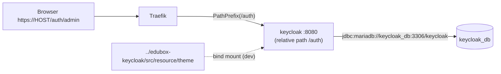

#### Verification

```bash
docker compose up -d --build keycloak
docker compose ps keycloak          # STATUS: Up (healthy) after ~30-60 s
docker compose logs -f keycloak | grep -E "Listening on|started in"
# Keycloak 26.6.3 on JVM (powered by Quarkus) started in 12.3s. Listening on: http://0.0.0.0:8080
curl -s https://local-edubox.wehost.asia/auth/realms/master/.well-known/openid-configuration | jq .issuer
# "https://local-edubox.wehost.asia/auth/realms/master"
```

Note the issuer is **https** with your domain → proxy headers work.

Browser: `https://local-edubox.wehost.asia/auth/admin` → log in with `admin` / `Pa55w0rd`.

#### Common beginner mistakes

| Mistake | Symptom | Fix |
|---|---|---|
| Missing `KC_HTTP_RELATIVE_PATH` | Traefik routes `/auth/...` but Keycloak serves at `/` → 404 | Set it |
| Missing proxy headers config | Issuer shows `http://keycloak:8080`; redirect loops; "HTTPS required" | `KC_PROXY_HEADERS=xforwarded` |
| Admin password env changed later | Old password still works / new doesn't | Bootstrap admin is created only once (stored in DB) |
| Not enough RAM | Container killed (exit 137) | Give Docker ≥ 4 GB |
| `depends_on` without healthcheck | Dependent tool fails with connection refused | Use `condition: service_healthy` |

#### Knowledge check

1. Why is the theme both `COPY`'d in the Dockerfile and bind-mounted in compose?
2. Which env var actually makes Keycloak produce `https://` URLs behind Traefik?
3. Why `/auth`?

<details>
<summary>Show answers</summary>

1. COPY bakes it into the image for staging/production; the bind mount overrides it in dev so you can edit `.ftl`/CSS and see changes instantly (theme cache is off in `start-dev`).
2. `KC_PROXY_HEADERS=xforwarded` (Traefik sends `X-Forwarded-Proto: https`).
3. So Keycloak lives under a path prefix on the shared domain; `/` belongs to Next.js.
</details>

#### Completion checklist

- [ ] `edubox-keycloak/Dockerfile` committed
- [ ] `keycloak` is **healthy**
- [ ] Issuer URL is `https://HOST/auth/realms/master`
- [ ] Admin console login works

---

<a id="task-15"></a>

## Task 15 — Realm as code with keycloak-config-cli

#### Goal

Create the `edubox` realm and its security settings from a YAML file in Git, applied automatically by **keycloak-config-cli**.

#### Why now?

Clicking through the admin console is not reproducible: no review, no history, and every developer's Keycloak drifts. Before creating roles, clients and users, set up the *mechanism* that creates them.

#### Background knowledge

**keycloak-config-cli** (by adorsys) is a container that reads YAML/JSON realm definitions and applies them to Keycloak via its Admin REST API. It runs once and exits. It's **declarative**: you describe the desired state; it creates or updates to match.

Key behaviors:
- Files are applied in **alphabetical order** → the `01-`, `02-` … prefixes.
- Each file starts with `realm: edubox`, so they merge into one realm.
- **Variable substitution** with `$(VAR)` syntax when `IMPORT_VAR_SUBSTITUTION_ENABLED=true` → secrets and hostnames come from env, not hard-coded.

#### What should I create?

```text
edubox-config/config/keycloak/
├── 01-edubox-realm.yaml          ← this task
├── 02-roles-and-groups.yaml      ← Task 16
├── 03-clients.yaml               ← Task 17
├── 04-users.yaml                 ← Task 18
├── 05-clientScopes.yaml          ← Task 18
└── 06-authentication.yaml        ← Task 18
```

Plus the `keycloak-config-cli` service and the Makefile target `apply-keycloak-config`.

#### Purpose of every file

| File | Why | Who uses it | When | If missing |
|---|---|---|---|---|
| `01-edubox-realm.yaml` | Realm + login/security policies + SMTP + required actions | config-cli | `make apply-keycloak-config` | No `edubox` realm |
| `keycloak-config-cli` service | Applies YAML | You (via Makefile) | Setup, after config changes | Manual clicking |

#### Implementation guide

**`01-edubox-realm.yaml`** (real file, annotated):

```yaml
realm: edubox
enabled: true
sslRequired: external            # HTTPS required except from private IPs (containers talk HTTP)
registrationAllowed: false       # no self sign-up on the web login page (teachers register via the API)
registrationEmailAsUsername: true # username == email
rememberMe: false
verifyEmail: false
loginWithEmailAllowed: true
duplicateEmailsAllowed: false
resetPasswordAllowed: true       # shows "Forgot password?"
editUsernameAllowed: true        # needed because email changes rename the user

loginTheme: edubox               # Task 20
emailTheme: edubox

smtpServer:
  host: $(SMTP_HOST)
  port: $(SMTP_PORT)
  from: $(SMTP_FROM)
  fromDisplayName: $(SMTP_FROM_NAME)
  auth: $(SMTP_AUTH)
  ssl: $(SMTP_SSL)
  starttls: $(SMTP_STARTTLS)
  user: $(SMTP_USER)
  password: $(SMTP_KEY)

passwordPolicy: "length(8) and upperCase(1) and lowerCase(1) and digits(1) and specialChars(1)"

# Brute Force Detection
bruteForceProtected: true
failureFactor: 5                 # lock after 5 failures
maxFailureWaitSeconds: 900
waitIncrementSeconds: 900        # 15-minute lockout

# OTP (TOTP) Configuration
otpPolicyType: totp
otpPolicyAlgorithm: HmacSHA1     # what Google Authenticator & co. support
otpPolicyDigits: 6
otpPolicyPeriod: 30
otpPolicyLookAheadWindow: 1      # tolerate clock drift of one window

accessTokenLifespan: 300         # 5 minutes
ssoSessionIdleTimeout: 1800      # 30 minutes
ssoSessionMaxLifespan: 36000     # 10 hours
offlineSessionIdleTimeout: 2592000   # 30 days (mobile, offline_access)
offlineSessionMaxLifespanEnabled: false
offlineSessionMaxLifespan: 5184000   # 60 days

# Action Tokens (links in emails)
actionTokenGeneratedByUserLifespan: 86400     # 24 h (forgot password)
actionTokenGeneratedByAdminLifespan: 172800   # 48 h (admin-created account setup)

requiredActions:
  - alias: CONFIGURE_TOTP
    name: Configure OTP
    providerId: CONFIGURE_TOTP
    enabled: true
    defaultAction: false
    priority: 10                 # OTP setup before…
  - alias: UPDATE_PASSWORD
    name: Update Password
    providerId: UPDATE_PASSWORD
    enabled: true
    defaultAction: false
    priority: 20                 # …password update (fixed in a "required action order" bugfix)
```

> [!IMPORTANT]
> **Recommended addition — the realm's Frontend URL.** The original project stores this setting only in the Keycloak database dump, not in YAML. Add it so your realm is fully reproducible:
> ```yaml
> attributes:
>   frontendUrl: https://$(HOST_NAME)/auth
> ```
> Why it matters: Next.js talks to Keycloak *internally* as `http://keycloak:8080/auth/realms/edubox` (Task 55). Without a frontend URL, Keycloak's discovery document would tell NextAuth to send the browser to `http://keycloak:8080/...` — a host the browser can't reach. With `frontendUrl`, browser-facing URLs (login page, issuer) are always `https://HOST/auth/...` regardless of which internal hostname was used to ask.

**The config-cli service:**

```yaml
  keycloak-config-cli:
    image: adorsys/keycloak-config-cli:latest-26
    networks:
      - docker-net
    depends_on:
      keycloak:
        condition: service_healthy
    volumes:
      - ./config/keycloak:/config
    environment:
      KEYCLOAK_URL: http://keycloak:8080/auth
      KEYCLOAK_USER: admin
      KEYCLOAK_PASSWORD: ${KC_BOOTSTRAP_ADMIN_PASSWORD}
      KEYCLOAK_AVAILABILITYCHECK_ENABLED: "true"
      KEYCLOAK_AVAILABILITYCHECK_TIMEOUT: 120s
      IMPORT_FILES_LOCATIONS: /config/*.yaml
      IMPORT_VAR_SUBSTITUTION_ENABLED: "true"
      KC_EDUBOX_BACKEND_SECRET: ${KC_EDUBOX_BACKEND_SECRET}
      HOST_NAME: ${HOST_NAME}
      MOBILE_APP_DEEP_LINK_LOGIN: ${MOBILE_APP_DEEP_LINK_LOGIN}
      SMTP_HOST: ${SMTP_HOST}
      SMTP_PORT: ${SMTP_PORT}
      SMTP_FROM: ${SMTP_FROM}
      SMTP_FROM_NAME: ${SMTP_FROM_NAME}
      SMTP_AUTH: ${SMTP_AUTH}
      SMTP_SSL: ${SMTP_SSL}
      SMTP_STARTTLS: ${SMTP_STARTTLS}
      SMTP_USER: ${SMTP_USER}
      SMTP_KEY: ${SMTP_KEY}
```

Two-level variable flow: Compose substitutes `${SMTP_HOST}` from `.env` into the *container's* environment; config-cli then substitutes `$(SMTP_HOST)` inside the YAML from *its* environment.

**Makefile:**

```make
apply-keycloak-config:
	docker compose up -d --force-recreate keycloak-config-cli
```

`--force-recreate` because the container already exited from the last run — we want a fresh run.

> [!WARNING]
> `latest-26` is a moving tag. Pin an exact version (e.g. `6.x.x-26.x`) in real projects so a new config-cli release doesn't change behavior silently.

#### Technology explanation

**keycloak-config-cli**
- *Problem solved:* configuration drift and un-reviewable click-ops.
- *Alternatives:* Keycloak's built-in realm import (`--import-realm` with a JSON export — only creates, doesn't update), **Terraform** Keycloak provider (powerful, state file), manual admin console.
- *When not to use:* if your org already standardizes on Terraform for all infra.

#### Project architecture

```mermaid
flowchart LR
    Y["config/keycloak/*.yaml (Git)"] -- "volume /config" --> CLI["keycloak-config-cli<br/>(runs once)"]
    ENV[".env → container env"] --> CLI
    CLI -- "Admin REST API (admin/Pa55w0rd)" --> K["keycloak"]
    K --> KDB[("keycloak_db")]
```

#### Verification

```bash
make apply-keycloak-config
docker compose logs keycloak-config-cli | tail -5
# ... Importing file '/config/01-edubox-realm.yaml'
# ... keycloak-config-cli ran in 00:05.123.
docker compose ps -a keycloak-config-cli   # STATUS: Exited (0)
curl -s https://local-edubox.wehost.asia/auth/realms/edubox/.well-known/openid-configuration | jq '.issuer, .authorization_endpoint'
```

Expected: `"https://local-edubox.wehost.asia/auth/realms/edubox"`. In the admin console, realm dropdown shows **edubox**; *Realm settings → Security defenses → Brute force detection* is ON.

#### Common beginner mistakes

| Mistake | Symptom | Fix |
|---|---|---|
| Using `${VAR}` instead of `$(VAR)` in YAML | Literal `${SMTP_HOST}` stored, or Compose tries to substitute it | Use `$(VAR)` in config-cli files |
| Variable not passed into the container env | `$(KC_EDUBOX_BACKEND_SECRET)` stays literal / error | Add it to `environment:` |
| Exit code 1 | YAML error or wrong admin password | `docker compose logs keycloak-config-cli` |
| Expecting manual changes to persist | Next apply overwrites them | Change the YAML, not the console |

#### Knowledge check

1. Why the numeric prefixes on file names?
2. Trace `SMTP_HOST` from `.env` to Keycloak.
3. Why does config-cli wait for `service_healthy`?

<details>
<summary>Show answers</summary>

1. Files are applied alphabetically; roles must exist before groups/clients/users reference them.
2. `.env` → Compose substitutes `${SMTP_HOST}` into config-cli's environment → config-cli substitutes `$(SMTP_HOST)` in `01-edubox-realm.yaml` → sent to Keycloak's Admin API → stored in `keycloak_db`.
3. Keycloak's REST API isn't available until it's fully started.
</details>

#### Completion checklist

- [ ] `01-edubox-realm.yaml` committed (with `frontendUrl` attribute)
- [ ] config-cli exits with code 0
- [ ] `edubox` realm visible, issuer is `https://HOST/auth/realms/edubox`
- [ ] Password policy, brute force, OTP and token lifespans visible in the console

---

<a id="task-16"></a>

## Task 16 — The permission model: roles and groups

#### Goal

Define EduBox's fine-grained **realm roles** and the default **groups** (`super_admin`, `teacher`) in `02-roles-and-groups.yaml`.

#### Why now?

Clients (Task 17) and users (Task 18) reference groups; the backend's `role:` middleware (Task 29) and the frontend's route table (Task 57) reference role names. The vocabulary must exist first.

#### Background knowledge

**RBAC — Role-Based Access Control.** Permissions are attached to roles, roles to users (here: via groups). EduBox's naming convention is **`verb_noun`**:

| Pattern | Examples |
|---|---|
| `view_*` | `view_grade`, `view_course`, `view_teacher` |
| `create_*` | `create_grade`, `create_course` |
| `edit_*` | `edit_grade`, `edit_platform_setting` |
| `delete_*` | `delete_course`, `delete_activity` |
| special actions | `unregister_teacher_device`, `reset_2fa`, `revoke_access_subject` |
| dashboard widgets | `view_number_of_users`, `view_pending_subject_requests` |
| data scope | `view_all_data` (see all subjects, Task 38) |
| persona | `teacher` |

**Why fine-grained roles + groups?**
- The product owner can create new admin groups ("Content editors", "Report viewers") in the **web UI** (Roles & Permissions page) and tick which roles they get — no code change. The backend syncs these groups to Keycloak (Task 37).
- Code checks *permissions* (`edit_grade`), never *group names*. Groups can be renamed or reorganized freely.

> [!IMPORTANT]
> **Check permissions, not roles-as-job-titles.** `if (user.isSuperAdmin)` scattered through code is a maintenance nightmare. `role:edit_grade` on a route is explicit and flexible.

#### What should I create?

`config/keycloak/02-roles-and-groups.yaml`:

```yaml
realm: edubox
roles:
  realm:
    - name: view_grade
    - name: create_grade
    - name: edit_grade
    - name: delete_grade
    - name: view_teacher
    - name: view_activity
    - name: create_activity
    - name: edit_activity
    - name: delete_activity
    - name: view_teachers_report
    - name: view_sessions_delivered_report
    - name: view_activity_ratings_report
    - name: view_language
    - name: edit_language
    - name: view_resource
    - name: create_resource
    - name: edit_resource
    - name: view_user_group
    - name: create_user_group
    - name: edit_user_group
    - name: delete_user_group
    - name: view_user
    - name: create_user
    - name: edit_user
    - name: view_platform_setting
    - name: edit_platform_setting
    - name: view_subject
    - name: create_subject
    - name: edit_subject
    - name: unregister_teacher_device
    - name: view_all_data
    - name: reset_2fa
    - name: view_role
    - name: view_subject_request
    - name: edit_subject_request
    - name: revoke_access_subject
    - name: view_course
    - name: create_course
    - name: edit_course
    - name: delete_course
    - name: view_number_of_active_languages
    - name: view_number_of_users
    - name: view_number_of_teachers
    - name: view_assigned_subjects
    - name: view_pending_subject_requests
    - name: teacher

groups:
  - name: super_admin
    realmRoles:
      - view_grade
      - create_grade
      # ... every admin role listed above (all except `teacher`) ...
      - view_pending_subject_requests
  - name: teacher
    realmRoles:
      - teacher
```

(In the real file, `super_admin` lists every role except `teacher` explicitly.)

#### Purpose of every file

| File | Why | Who uses it | If missing |
|---|---|---|---|
| `02-roles-and-groups.yaml` | Single source of truth for permission names | config-cli; humans reading permissions | Roles referenced by groups/routes don't exist → every role check fails → 403 everywhere |

#### Implementation guide

1. List every screen and action in the product.
2. For each, decide `view/create/edit/delete` permissions.
3. Write them as realm roles.
4. Create `super_admin` with all admin roles, `teacher` with only `teacher`.
5. `make apply-keycloak-config`.

> [!TIP]
> Keep the role list in sync with `edubox-webclient/variables/users.ts` (`ROLES` constant) and the backend routes. When adding a feature, you add the role in **three** places: Keycloak YAML, backend route middleware, frontend `ROLES`/route table. A checklist item in your PR template helps.

#### Technology explanation

**RBAC**
- *Alternatives:* ABAC (attribute-based: "can edit if `subject_id` in user's subjects"), ReBAC (relationship-based, e.g. OpenFGA/Zanzibar), Keycloak Authorization Services (policies/permissions — enabled on `edubox-backend` but not used by the code).
- EduBox actually uses **RBAC + a bit of ABAC**: roles decide *which actions*, and `assignedTo()` scopes decide *which rows* (Task 38).

#### Project architecture

```mermaid
flowchart LR
    U1["user: edubox@wehost.asia"] --> G1["group super_admin"]
    U2["teacher@school"] --> G2["group teacher"]
    U3["content editor"] --> G3["group content_editors (created in web UI)"]
    G1 --> R1["view_grade, edit_grade, ... (45 roles)"]
    G2 --> R2["teacher"]
    G3 --> R3["view_course, edit_course"]
```

#### Verification

```bash
make apply-keycloak-config
```

Admin console → realm `edubox` → *Realm roles*: ~46 roles. *Groups*: `super_admin` → *Role mapping* shows the admin roles; `teacher` shows `teacher`.

#### Common beginner mistakes

| Mistake | Symptom | Fix |
|---|---|---|
| Typo in role name between YAML and code | 403 for a user who "should" have access | Grep the role name across all three repos |
| Assigning roles directly to users | Hard to audit/maintain | Assign groups |
| Using client roles when code checks realm roles | Roles missing from the `roles` claim | EduBox uses **realm** roles |

#### Knowledge check

1. Why are permissions checked by name (`edit_grade`) instead of by group (`super_admin`)?
2. Where else must a new role be added besides this YAML?

<details>
<summary>Show answers</summary>

1. Groups are created dynamically in the web UI and may be reorganized; code depending on group names would break. Permission names are stable.
2. Backend route middleware (`role:new_role`) and frontend `variables/users.ts` + `variables/routes.ts`; also the permission tree in the Roles & Permissions page.
</details>

#### Completion checklist

- [ ] All roles exist in Keycloak
- [ ] `super_admin` and `teacher` groups have correct role mappings

---

<a id="task-17"></a>

## Task 17 — Clients, the `roles` claim, and the backend service user

#### Goal

Register the three applications as Keycloak **clients**, make realm roles appear in a top-level **`roles` claim**, and create the **technical user** Laravel uses to call Keycloak's Admin API.

#### Why now?

No application can obtain a token until its client exists. The backend's role checks and the frontend's menu depend on the `roles` claim.

#### Background knowledge

**Client settings that matter:**

| Setting | Meaning |
|---|---|
| `publicClient` | `true` = no secret (browser/mobile). `false` = confidential (has `secret`) |
| `standardFlowEnabled` | Allows Authorization Code flow |
| `directAccessGrantsEnabled` | Allows password grant |
| `serviceAccountsEnabled` | Allows client-credentials grant (client acts as itself) |
| `redirectUris` | Where Keycloak may send the browser back after login. **Security-critical** |
| `webOrigins` | Allowed CORS origins for browser calls to Keycloak |
| `defaultClientScopes` | Scopes always included in tokens |
| `optionalClientScopes` | Scopes included only when requested (`scope=offline_access`) |

**Why three clients?** Each app has different capabilities and risks, and Keycloak can show *which* app a token came from (`azp` claim). One client per app is standard practice.

**The `roles` claim.** By default Keycloak puts realm roles at `realm_access.roles` in the access token, and **not** in `/userinfo`. EduBox's frontend (`session.roles = userInfo.roles`) and backend (`KeycloakHelper::hasRealmRole` reads `userinfo['roles']`) both expect a flat **`roles`** array from `/userinfo`. That requires a **protocol mapper** of type *User Realm Role* with `claim.name = roles` and "Add to userinfo" on.

> [!WARNING]
> In the original project this mapper exists only in the **Keycloak database dump** (in the realm's `roles` client scope), not in the YAML files. If you build Keycloak from YAML only, `/userinfo` won't contain `roles`, and **every permission check fails with 403**. Add it to YAML (below).

**The backend's technical user.** Laravel must create users, assign groups, send "set your password" emails, reset OTP… via Keycloak's **Admin REST API**. For that it needs an admin token. EduBox's `KeycloakHelper::getKeycloakAccessToken()` uses the **password grant** on client `edubox-backend` with a technical user `edubox_backend` / `edubox_backend_pwd` (from core's `.env`). That user needs **realm-management** client roles.

#### What should I create?

`config/keycloak/03-clients.yaml` (real file):

```yaml
realm: edubox
clients:
  - clientId: edubox-backend
    enabled: true
    publicClient: false
    clientAuthenticatorType: client-secret
    secret: $(KC_EDUBOX_BACKEND_SECRET)
    baseUrl: https://$(HOST_NAME)
    standardFlowEnabled: true
    directAccessGrantsEnabled: true
    serviceAccountsEnabled: true
    authorizationServicesEnabled: true
    redirectUris:
      - '*'
      # the * scheme only cover link start with https:// or http://, so we need to
      # add the deep link scheme for mobile app login
      - $(MOBILE_APP_DEEP_LINK_LOGIN)
    defaultClientScopes:
      [web-origins, service_account, acr, roles, profile, basic, email]
    optionalClientScopes:
      [address, phone, organization, offline_access, microprofile-jwt]

  - clientId: edubox-frontend
    enabled: true
    publicClient: true
    baseUrl: https://$(HOST_NAME)
    standardFlowEnabled: true
    directAccessGrantsEnabled: true
    redirectUris:
      - '*'
    webOrigins:
      - '*'
    defaultClientScopes: [web-origins, acr, roles, profile, basic, email]
    optionalClientScopes:
      [address, phone, organization, offline_access, microprofile-jwt]

  - clientId: edubox-mobile
    enabled: true
    publicClient: true
    standardFlowEnabled: false
    directAccessGrantsEnabled: true
    redirectUris:
      - '/*'
    webOrigins:
      - '/*'
    defaultClientScopes:
      [web-origins, acr, roles, offline_access, profile, basic, email]
    optionalClientScopes: [address, phone, organization, microprofile-jwt]
```

Why each client looks the way it does:

| Client | Type | Flows | Reason |
|---|---|---|---|
| `edubox-backend` | confidential (secret) | standard + password + service account | Laravel is a server, can keep a secret; password grant for the technical user; service account available for a future client-credentials switch. Its redirect URIs also allow the mobile deep link so Keycloak emails (set-password) can redirect into the app |
| `edubox-frontend` | public | standard (+ password for testing) | NextAuth does the code flow. *Note:* NextAuth runs on the server and *could* be confidential (more secure) — see Appendix E |
| `edubox-mobile` | public | password only; `offline_access` default | Native login screen; offline tokens last 30 days so teachers stay logged in offline |

> [!WARNING]
> `redirectUris: ['*']` and `webOrigins: ['*']` accept **any** redirect target. Convenient in dev; in production it enables open-redirect and token-theft attacks. Use exact URIs: `https://$(HOST_NAME)/api/auth/callback/keycloak` for the frontend.

**Recommended addition — the `roles` mapper** (append to `05-clientScopes.yaml`, Task 18):

```yaml
  - name: roles
    protocol: openid-connect
    protocolMappers:
      - name: realm roles
        protocol: openid-connect
        protocolMapper: oidc-usermodel-realm-role-mapper
        config:
          claim.name: roles
          multivalued: "true"
          jsonType.label: String
          access.token.claim: "true"
          id.token.claim: "false"
          userinfo.token.claim: "true"
          introspection.token.claim: "true"
```

> [!NOTE]
> Redefining the built-in `roles` scope replaces its default mapper (`realm_access.roles`). The mobile app decodes roles from `realm_access.roles` in the JWT. If you redefine the scope, keep both mappers (`realm_access.roles` *and* `roles`) so neither client breaks.

**Recommended addition — the technical user** (in `04-users.yaml`):

```yaml
  - username: edubox_backend
    enabled: true
    credentials:
      - type: password
        value: $(KC_EDUBOX_BACKEND_PASSWORD)
    clientRoles:
      realm-management:
        - manage-users
        - view-users
        - query-groups
        - view-realm
        - manage-realm
        - view-clients
```

(…and pass `KC_EDUBOX_BACKEND_PASSWORD` into config-cli's environment.) In the original, this user also lives only in the DB dump.

#### Purpose of every file

| File | Why | Who uses it | If missing |
|---|---|---|---|
| `03-clients.yaml` | Declares apps allowed to get tokens | Keycloak at every login/token request | `invalid_client` / `Client not found` |
| `roles` mapper | Flat `roles` claim in userinfo | Laravel role middleware, NextAuth session, `proxy.ts` | Everything returns 403 / empty menu |
| `edubox_backend` user | Admin API access for Laravel | `KeycloakHelper` | Creating users/groups fails silently (`return false`) |

#### Implementation guide

1. Write `03-clients.yaml`.
2. Add the mapper and technical user as shown.
3. `make apply-keycloak-config`.
4. Verify in the console: *Clients* lists three; `edubox-backend` → *Credentials* shows the secret.

#### Technology explanation

**Public vs. confidential clients** — the defining question is: *can this program keep a secret?* JavaScript in a browser and an app on a phone cannot (users can inspect them). A server can.

**Service accounts / client credentials** — the clean way for a backend to call an API as itself. EduBox uses a technical *user* with a password instead (works, but it's one more credential to manage). Alternative: give `edubox-backend`'s service account the realm-management roles and use `grant_type=client_credentials`.

#### Project architecture

```mermaid
flowchart TB
    W["Next.js (NextAuth)"] -- "code flow, client_id=edubox-frontend" --> K["Keycloak"]
    M["Mobile"] -- "password grant, client_id=edubox-mobile, scope offline_access" --> K
    L["Laravel"] -- "password grant, client_id=edubox-backend + secret,<br/>user=edubox_backend" --> K
    L -- "Bearer admin token → /auth/admin/realms/edubox/users ..." --> K
```

#### Verification

```bash
# Backend technical user can get a token:
curl -s -X POST https://local-edubox.wehost.asia/auth/realms/edubox/protocol/openid-connect/token \
  -d grant_type=password -d client_id=edubox-backend \
  -d client_secret=wJrfWZEDTw6ADr2upYIgMQBAh2nORpow \
  -d username=edubox_backend -d password=edubox_backend_pwd | jq '.access_token | length'
# → a number (token length), not null
```

The `roles` claim is verified in Task 19.

#### Common beginner mistakes

| Mistake | Symptom | Fix |
|---|---|---|
| Secret mismatch between config and core | `{"error":"unauthorized_client"}` | `KC_EDUBOX_BACKEND_SECRET` == core `KEYCLOAK_BACKEND_SECRET` |
| Redirect URI not allowed | Keycloak page "Invalid parameter: redirect_uri" | Add the exact callback URL |
| No `roles` mapper | userinfo lacks `roles` | Add mapper |
| Technical user lacks realm-management roles | Admin API returns 403 | Assign roles |

#### Knowledge check

1. Why is `edubox-mobile` public with `standardFlowEnabled: false`?
2. Why does `edubox-backend` list the mobile deep link as a redirect URI?
3. What breaks if the `roles` mapper is missing?

<details>
<summary>Show answers</summary>

1. A phone app can't keep a secret (public); it uses only the password grant via its own native screen, so the browser-based code flow is disabled.
2. When the backend asks Keycloak to email a teacher (e.g. forgot password / execute actions), the link can redirect back into the app via `eduboxapp://login`; `*` only matches http(s) URIs.
3. `/userinfo` has no `roles` → Laravel's `role:` middleware denies everything (403), NextAuth's `session.roles` is empty → empty sidebar, and `proxy.ts` redirects every page to `/`.
</details>

#### Completion checklist

- [ ] Three clients exist with the right types
- [ ] `roles` mapper added (YAML)
- [ ] Technical user can obtain a token
- [ ] (Production note) redirect URIs restricted

---

<a id="task-18"></a>

## Task 18 — Client scopes, authentication flows, and seed users

#### Goal

Finish the realm: custom **profile claims** (`05-clientScopes.yaml`), a **custom reset-credentials flow** (`06-authentication.yaml`), and the first admin user (`04-users.yaml`).

#### Why now?

These complete the identity layer so the backend (next phase) can trust tokens that contain everything it needs (`preferred_username`, `status`, `roles`).

#### Background knowledge

**Client scopes and mappers.** A scope like `profile` is a bundle of mappers that copy user data into claims. EduBox redefines `profile` to make every claim explicit and adds a custom one:

```yaml
      - name: status
        protocolMapper: oidc-usermodel-property-mapper
        config:
          user.attribute: enabled        # the Keycloak user's "enabled" flag
          claim.name: status
          jsonType.label: boolean
          userinfo.token.claim: "true"
          access.token.claim: "true"
          id.token.claim: "true"
```

Why? `UserController::getOwnProfile` reads `userInfo['status']` and flips the local `account_status` to `true` the first time an admin successfully logs in (an admin is created "inactive" until they set their password). A clever way to sync state from Keycloak into the app.

**Authentication flows.** Keycloak's flows are trees of "executions" (steps) with requirements (REQUIRED, ALTERNATIVE, CONDITIONAL, DISABLED). The **default** reset-credentials flow, for users who have OTP configured, *also resets their OTP* — forcing them to re-scan a QR code after every forgotten password. EduBox didn't want that, so it defines:

```text
Custom Reset Credentials
├── reset-credentials-choose-user      REQUIRED  (enter email)
├── reset-credential-email             REQUIRED  (send link; config force-login=true)
├── reset-password                     REQUIRED  (choose new password)
└── Conditional OTP (sub-flow)         CONDITIONAL
    ├── conditional-user-configured    REQUIRED  (only if the user has OTP)
    ├── reset-otp                      DISABLED  ← the important change
    └── auth-otp-form                  REQUIRED  (still ask for the current OTP code)
```

…and binds it with `resetCredentialsFlow: "Custom Reset Credentials"`.

**Seed users.** `04-users.yaml` creates the first super admin and puts them in `/super_admin` (group *path*, hence the slash):

```yaml
realm: edubox
users:
  - username: edubox@wehost.asia
    email: edubox@wehost.asia
    groups:
      - /super_admin
```

No password is set here. In the original project, the password comes from the DB dump (dev credentials `edubox_admin@WE123` in the README). For a from-scratch rebuild, either set it in the console once, add `credentials:` with a `$(VAR)`, or use the artisan command in Task 31 which creates the user in *both* Keycloak and the core DB.

#### What should I create?

`04-users.yaml`, `05-clientScopes.yaml`, `06-authentication.yaml` (contents as in the project; full files are in `edubox-config/config/keycloak/`).

#### Purpose of every file

| File | Why | If missing |
|---|---|---|
| `04-users.yaml` | First admin in the right group | No one can log into the admin portal |
| `05-clientScopes.yaml` | Explicit profile claims + `status` (+ your `roles` mapper) | `status` missing → admin accounts never become active in core |
| `06-authentication.yaml` | Reset password without wiping OTP | Users must re-enroll OTP after each password reset |

#### Implementation guide

1. Write the three files.
2. `make apply-keycloak-config`.
3. In the console, set a password for `edubox@wehost.asia` (*Users → Credentials*), temporary = off — or include it via YAML.

#### Technology explanation

**Protocol mappers** — Keycloak's way to shape tokens. Types used here: user *property* mapper (built-in fields like `enabled`), user *attribute* mapper (custom attributes like `gender`), *full name* mapper, *realm role* mapper.

**Authentication flows** — Keycloak's plugin system for login logic. Alternatives would be custom Java SPIs (powerful, much more work).

#### Project architecture

```mermaid
flowchart LR
    KUser["Keycloak user<br/>enabled=true, email, firstName"] --> Mappers["profile scope mappers"]
    Mappers --> UI["/userinfo<br/>{status: true, preferred_username, given_name, roles: [...]}"]
    UI --> Core["core: getOwnProfile → account_status = true"]
```

#### Verification

- Console → *Authentication*: "Custom Reset Credentials" is bound as **Reset credentials flow**.
- Log in to the account console `https://local-edubox.wehost.asia/auth/realms/edubox/account` as `edubox@wehost.asia` → you are asked to configure OTP if required actions are set.
- Click "Forgot password?" on the login page → an email appears in MailHog (`localhost:8025`).

#### Common beginner mistakes

| Mistake | Symptom | Fix |
|---|---|---|
| Group written as `super_admin` instead of `/super_admin` | config-cli error "group not found" | Groups in user definitions are paths |
| Flow created but not bound | Default flow still used | `resetCredentialsFlow:` at realm level |
| Overriding `profile` scope without a mapper you rely on | Claim disappears (e.g. `preferred_username`) | Keep every mapper you need |

#### Knowledge check

1. What is the `status` claim and who consumes it?
2. What problem does the custom reset flow fix?

<details>
<summary>Show answers</summary>

1. It's the Keycloak user's `enabled` flag; core's `getOwnProfile` uses it to activate the local account after the first successful login.
2. The default flow resets OTP on password reset, forcing users to re-enroll their authenticator app; the custom flow disables `reset-otp` while still requiring the OTP code.
</details>

#### Completion checklist

- [ ] Admin user exists in `/super_admin`
- [ ] `status` claim configured
- [ ] Custom reset flow bound
- [ ] Password reset email reaches MailHog

---

<a id="task-19"></a>

## Task 19 — Get and inspect a real token by hand

#### Goal

Use `curl` to obtain tokens, decode them, and call `/userinfo` — proving the identity layer works before any app uses it.

#### Why now?

Debugging auth through three layers (browser → Next.js → Laravel) is painful. If you know how to test Keycloak directly, you can isolate problems in seconds. This skill pays off for the rest of the project.

#### Background knowledge

- **Token endpoint:** `POST /auth/realms/edubox/protocol/openid-connect/token`
- **Userinfo endpoint:** `GET /auth/realms/edubox/protocol/openid-connect/userinfo` with `Authorization: Bearer <access_token>`
- **Discovery:** `GET /auth/realms/edubox/.well-known/openid-configuration`
- **Public keys (JWKS):** `GET /auth/realms/edubox/protocol/openid-connect/certs`

`edubox-frontend` has `directAccessGrantsEnabled: true`, so you can test with the password grant.

#### What should I create?

Optionally a script `scripts/token.sh` in your notes (not in the repo).

#### Purpose of every file

None in the repo.

#### Implementation guide

```bash
HOST=https://local-edubox.wehost.asia
REALM=$HOST/auth/realms/edubox/protocol/openid-connect

TOKEN=$(curl -s -X POST $REALM/token \
  -d grant_type=password -d client_id=edubox-frontend \
  -d username=edubox@wehost.asia -d 'password=YOUR_PASSWORD' -d scope=openid \
  | jq -r .access_token)

# Decode the payload (2nd part). base64url → base64, pad, decode:
echo "$TOKEN" | cut -d. -f2 | tr '_-' '/+' | base64 -d 2>/dev/null | jq '{iss, azp, exp, preferred_username, roles: .realm_access.roles}'

# Userinfo (what Laravel's role middleware sees):
curl -s -H "Authorization: Bearer $TOKEN" $REALM/userinfo | jq '{preferred_username, status, roles}'
```

> [!NOTE]
> If the user has OTP configured or a pending required action (`UPDATE_PASSWORD`, `CONFIGURE_TOTP`), the password grant fails with `"Account is not fully set up"`. Complete the required actions in the browser first (or pass `totp=123456` for OTP).

#### Technology explanation

**curl + jq** — the universal API debugging toolkit. Alternatives: Postman, Insomnia, HTTPie, jwt.io (never paste production tokens into websites).

#### Project architecture

```mermaid
sequenceDiagram
    participant You as curl
    participant K as Keycloak
    You->>K: POST /token (password grant)
    K-->>You: {access_token, refresh_token, expires_in: 300}
    You->>K: GET /userinfo (Bearer)
    K-->>You: {sub, preferred_username, status, roles: [...]}
```

#### Verification

Expected decoded payload:

```json
{
  "iss": "https://local-edubox.wehost.asia/auth/realms/edubox",
  "azp": "edubox-frontend",
  "exp": 1761470000,
  "preferred_username": "edubox@wehost.asia",
  "roles": ["view_grade", "create_grade", "..."]
}
```

Expected userinfo: `"status": true` and a non-empty `"roles"` array.

#### Common beginner mistakes

| Error | Meaning | Fix |
|---|---|---|
| `invalid_grant: Invalid user credentials` | Wrong password / user disabled / locked by brute force | Check user; unlock in console (*Users → … → Unlock*) |
| `invalid_grant: Account is not fully set up` | Pending required action | Finish in browser |
| `unauthorized_client` | Direct grants disabled on client | Enable or use another client |
| userinfo `401` | Token expired (5 min!) | Get a new one |
| userinfo has no `roles` | Mapper missing | Task 17 |

#### Knowledge check

1. You get a 403 from the API. What two Keycloak checks would you do first with curl?

<details>
<summary>Show answers</summary>

1. Get a token for that user and (a) check `/userinfo` contains the expected role in `roles`, (b) decode the token to check `exp`/`iss`/`preferred_username` match what the backend expects.
</details>

#### Completion checklist

- [ ] I can get a token with curl
- [ ] I can decode it
- [ ] `/userinfo` returns `roles` and `status`

---

<a id="task-20"></a>

## Task 20 — A custom login and email theme

#### Goal

Build the `edubox` Keycloak theme: branded login, password-reset, OTP and info pages in English and Khmer, plus branded emails.

#### Why now?

Identity is complete functionally; now make it look like EduBox. It's independent of the backend, so it's a good moment. (Its logo URL will point to a backend endpoint you'll build in Task 36 — until then the image is just broken.)

#### Background knowledge

**Keycloak themes** are folders of **FreeMarker** templates (`.ftl`), message bundles (`.properties`) and static resources. A theme can **extend** a parent (`parent=base`) and override only the templates it cares about.

**FreeMarker** is a Java templating language: `${var}`, `<#if>…</#if>`, `<#list items as i>…</#list>`, macros `<@layout.registrationLayout>`.

**Theme types:** `login` (login/reset/OTP pages), `email` (email bodies), `account`, `admin`. EduBox customizes `login` and `email`.

**Structure:**

```text
edubox-keycloak/src/resource/theme/edubox/
├── login/
│   ├── theme.properties                 ← parent, CSS classes, locales
│   ├── template.ftl                     ← shared page layout (head, logo, language switcher)
│   ├── login.ftl                        ← email + password form
│   ├── login-reset-password.ftl         ← "Forgot password" email form
│   ├── login-update-password.ftl        ← set new password (with live policy checks)
│   ├── password-validation.ftl          ← macro for policy hints
│   ├── login-otp.ftl                    ← enter 6-digit code
│   ├── login-config-totp.ftl            ← QR code enrollment
│   ├── login-select-required-action.ftl
│   ├── info.ftl                         ← "Password reset successfully" etc.
│   ├── register.ftl
│   ├── messages/messages_en.properties  ← all English strings
│   ├── messages/messages_km.properties  ← Khmer
│   └── resources/
│       ├── css/custom.css
│       ├── js/password-policy.js        ← client-side policy checks
│       └── img/{favicon.ico, logo.png}
└── email/
    ├── messages/messages_{en,km}.properties
    ├── html/{executeActions.ftl, password-reset.ftl}
    └── text/{executeActions.ftl, password-reset.ftl}
```

#### What should I create?

The folder tree above. Start with `theme.properties`, `template.ftl`, `login.ftl`, `messages_en.properties`, and `css/custom.css`; add the rest page by page.

#### Purpose of every file

| File | Why it exists | When Keycloak uses it | If missing |
|---|---|---|---|
| `theme.properties` | Declares parent theme, stylesheets, CSS class names, supported locales (`en,km`) | Loading the theme | Theme not recognized |
| `template.ftl` | Common layout macro (`registrationLayout`): HTML head, Bootstrap, fonts (Poppins, Kantumruy Pro for Khmer), logo, language dropdown, message display | Every login page | Each page would repeat the layout |
| `login.ftl` | Login form posting to `${url.loginAction}` | `/auth/realms/edubox/protocol/openid-connect/auth` | Falls back to parent's login page |
| `messages_*.properties` | Translatable strings `${msg("key")}` | Rendering | Raw keys or English defaults shown |
| `resources/*` | CSS/JS/images served at `${url.resourcesPath}` | Browser | Unstyled page |
| `email/html|text/*.ftl` | HTML and plain-text email bodies | Sending reset/setup mails | Default Keycloak emails |

#### Implementation guide

**`theme.properties`** (real file):

```properties
parent=base
styles=css/custom.css
internationalizationEnabled=true
locales=en,km
uiLocales=English,Khmer
kcHtmlClass=edubox
kcFormGroupClass=form-group mb-3
kcInputClass=form-control rounded-4
kcButtonClass=btn
kcButtonPrimaryClass=btn-primary
kcInputWrapperClass=col-12
kcFormPasswordVisibilityButtonClass=btn eye-button
kcFormPasswordVisibilityIconShow=bi bi-eye
kcFormPasswordVisibilityIconHide=bi bi-eye-slash
kcInputGroup=input-group
kcInputErrorMessageClass=text-danger small
kcFeedbackAreaClass=text-center text-secondary
```

`parent=base` gives you unstyled defaults for every page you don't override; the `kc*Class` properties map Keycloak's semantic class names to **Bootstrap 5** classes.

**`template.ftl`** — key ideas (excerpt):

```ftl
<#macro registrationLayout bodyClass="" displayInfo=false displayMessage=true ...>
<html class="${properties.kcHtmlClass!}" lang="en">
<head>
  <link href="https://cdn.jsdelivr.net/npm/bootstrap@5.3.3/dist/css/bootstrap.min.css" rel="stylesheet">
  <link rel="stylesheet" href="https://fonts.googleapis.com/css2?family=Poppins...&family=Kantumruy+Pro...">
  <#list properties.styles?split(' ') as style>
    <link href="${url.resourcesPath}/${style}" rel="stylesheet" />
  </#list>
</head>
<body>
     <!-- logo served by Laravel! -->
  <#if realm.internationalizationEnabled && locale.supported?size gt 1>
    <#list locale.supported as l>
      <a class="dropdown-item" href="${l.url}">${l.label}</a>
    </#list>
  </#if>
  <#nested "form">
</body>
</html>
</#macro>
```

> [!IMPORTANT]
> The logo `src="/api/core/platform-public/logo"` is a **relative URL** served by Laravel through Traefik. It works only because Keycloak and the API share one domain. An admin can change the logo in *Platform Settings* and the login page updates automatically — a neat payoff of the single-domain design.

**`login.ftl`** — a form posting to `${url.loginAction}` with `username` and `password` fields, `${msg("doForgotPassword")}` link to `${url.loginResetCredentialsUrl}`, and alert rendering for `message.type` (`error`, `success`, `warning`, `info`).

**Messages** — `messages_en.properties`:

```properties
doLogIn=Login
login=System Administration
systemName=EduBox
subTitle=Welcome back to {0}. Please enter your credentials to manage the platform.
invalidUserMessage=Incorrect email or password. Please try again.
doForgotPassword=Forgot password?
```

**Language selection from the app.** NextAuth passes `ui_locales=<preferred_lang cookie>` to the authorization request (Task 55), so the login page opens in the language the admin chose in the portal.

**Development loop:** the theme folder is bind-mounted and `start-dev` disables caching → edit, refresh browser. For staging/prod, the Dockerfile `COPY` bakes it in: `make build-keycloak`:

```make
build-keycloak:
	docker compose kill keycloak && docker compose rm -f keycloak && docker compose build keycloak && docker compose up -d keycloak && docker compose restart proxy
```

#### Technology explanation

**FreeMarker**
- *Why:* it's what Keycloak uses — no choice for classic themes.
- *Alternatives:* **Keycloakify** (write the login theme in React, compile to a Keycloak theme jar) — great for teams wanting the same component library as the app; Keycloak v2 themes (PatternFly/React).
- *When not to customize at all:* internal tools where branding doesn't matter.

**Bootstrap via CDN** — fast to start; the theme depends on jsdelivr/googleapis being reachable. For offline/intranet deployments, vendor these files into `resources/`.

#### Project architecture

```mermaid
flowchart LR
    BR["Browser → /auth/realms/edubox/.../auth"] --> K["Keycloak"]
    K -- "renders login.ftl inside template.ftl" --> HTML["HTML page"]
    HTML -- "GET /api/core/platform-public/logo" --> T["Traefik"] --> L["Laravel"]
    HTML -- "GET ${url.resourcesPath}/css/custom.css" --> K
```

#### Verification

1. `https://local-edubox.wehost.asia/auth/realms/edubox/account` → redirected to the **EduBox-styled** login page.
2. Switch language to ខ្មែរ → texts change.
3. "Forgot password?" → reset page in the custom style; email in MailHog uses the custom HTML template.
4. Edit `messages_en.properties` (e.g. `doLogIn=Sign in`), refresh → text changes without restart.

#### Common beginner mistakes

| Mistake | Symptom | Fix |
|---|---|---|
| `loginTheme: edubox` not set on realm | Default Keycloak look | Task 15 YAML |
| Theme folder name ≠ `edubox` | Theme not in dropdown | Folder name *is* the theme name |
| FreeMarker null error | Page shows "Error: … has evaluated to null" | Use `!` default operator: `${properties.x!}` |
| Unescaped quotes in `.properties` | `don't` renders as `dont` | Escape apostrophe as `''` (MessageFormat) |
| Edits not visible in staging | Theme cache in `start` mode | Rebuild image (`make build-keycloak`) |

#### Knowledge check

1. Why does the theme override only some templates?
2. How does the login page know to display Khmer when the admin picked Khmer in the portal?
3. Why can the theme load the logo from `/api/core/...` without CORS issues?

<details>
<summary>Show answers</summary>

1. `parent=base` supplies all other pages; override only what you need to style/change — less to maintain on Keycloak upgrades.
2. NextAuth sends `ui_locales` from the `preferred_lang` cookie in the authorization request; Keycloak picks the matching `messages_km.properties`.
3. It's the same origin (same domain), and `` loads aren't subject to CORS anyway.
</details>

#### Completion checklist

- [ ] Branded login page
- [ ] English and Khmer messages
- [ ] Custom email templates in MailHog
- [ ] Live editing works in dev

---

<a id="task-21"></a>

## Task 21 — Snapshotting identity data: dump and restore

#### Goal

Learn the dump/restore workflow EduBox uses to share a ready-made Keycloak (and core) database between developers.

#### Why now?

You've invested a lot in Keycloak state. Some of it (realm signing keys, users with passwords, the `frontendUrl`, mappers) is hard to reproduce. Saving and sharing snapshots completes the identity phase.

#### Background knowledge

**Why ship a database dump if we have realm-as-code?**

> [!IMPORTANT]
> The killer reason is **realm signing keys**. Keycloak generates an RSA key pair per realm on creation. Laravel verifies tokens using the realm's **public key**, which is pasted into `edubox-core/.env.example` (`KEYCLOAK_REALM_PUBLIC_KEY=MIIBIj…`). If every developer created a fresh realm, every developer would get a *different* key and have to update their `.env`. By restoring the same dump, everyone shares the same keys, and the committed `.env.example` just works.

Other things in the dump: user passwords, OTP enrollments, the `roles` mapper, `frontendUrl`, the technical user.

**Workflow:**

| Make target | Command | When |
|---|---|---|
| `dump-keycloak-db` | `mariadb-dump … | gzip > config/docker/keycloak_db.sql.gz` | After meaningful Keycloak changes |
| `upload-keycloak-db` | `curl -X POST $(URL)/upload.php -F files[]=@…` | Share with the team (company file server) |
| `download-keycloak-db` | `wget $(URL)/projects/edubox/keycloak_db.sql.gz` | Setup on a new machine |
| `restore-keycloak-db` | `gunzip < … | docker compose exec -T keycloak_db mariadb …` | Setup / reset |
| (same for core) | `core_users.sql.gz` | Seed admin users in core |

Plus automatic import: `keycloak_db` mounts the dump into `/docker-entrypoint-initdb.d/`, so a **fresh** volume imports it on first start.

**Why `exec -T`?** `-T` disables pseudo-TTY allocation, required when piping data into `docker compose exec`.

> [!WARNING]
> Dumps can contain personal data and password hashes. They're `.gitignore`d (`*.sql`, `*.gz`) and stored on an internal server. Never commit them; never put production dumps on a dev file server.

#### What should I create?

Makefile targets (real ones):

```make
URL = https://fileadmin.wehost.asia
PROJECT = edubox
DB_KEYCLOAK = keycloak_db.sql.gz
DB_CORE = core_users.sql.gz

dump-core-db:
	docker compose exec -T core_db sh -c 'exec mariadb-dump -uroot -p"${CORE_DB_ROOT_PASSWORD}" ${CORE_DB_DATABASE}' | gzip > ./config/docker/core_users.sql.gz

dump-keycloak-db:
	docker compose exec -T keycloak_db sh -c 'exec mariadb-dump -uroot -p"${KC_DB_ROOT_PASSWORD}" ${KC_DB_DATABASE}' | gzip > ./config/docker/keycloak_db.sql.gz

restore-keycloak-db:
	gunzip < config/docker/keycloak_db.sql.gz | docker compose exec -T keycloak_db sh -c 'exec mariadb -uroot -p"${KC_DB_ROOT_PASSWORD}" ${KC_DB_DATABASE}'

restore-core-db:
	gunzip < config/docker/core_users.sql.gz | docker compose exec -T core_db sh -c 'exec mariadb -uroot -p"${CORE_DB_ROOT_PASSWORD}" ${CORE_DB_DATABASE}'

download-core-db:
	wget $(URL)/projects/$(PROJECT)/$(DB_CORE) -O config/docker/$(DB_CORE)

download-keycloak-db:
	wget $(URL)/projects/$(PROJECT)/$(DB_KEYCLOAK) -O config/docker/$(DB_KEYCLOAK)

upload-keycloak-db:
	curl -X POST $(URL)/upload.php -F "project=$(PROJECT)" -F "files[]=@config/docker/$(DB_KEYCLOAK)"

upload-core-db:
	curl -X POST $(URL)/upload.php -F "project=$(PROJECT)" -F "files[]=@config/docker/$(DB_CORE)"
```

#### Purpose of every file

| File | Why | If missing |
|---|---|---|
| `config/docker/keycloak_db.sql.gz` | Shared Keycloak snapshot | Fresh realm, new keys → update core `.env` public key manually |
| `config/docker/core_users.sql.gz` | Admin users in core matching Keycloak users | Admin logs in to Keycloak, but core has no matching user → 401 from API |

#### Implementation guide

When rebuilding from scratch you won't have the company dump. Create **your own** after Tasks 15–18:

```bash
make dump-keycloak-db
ls -lh config/docker/keycloak_db.sql.gz
```

Then copy the realm public key: *Realm settings → Keys → RS256 → Public key* — you'll paste it into core's `.env` in Task 28.

#### Technology explanation

**mariadb-dump** — logical backup (SQL statements). Alternatives: physical backups (Mariabackup), volume snapshots, Keycloak's realm export (`kc.sh export`, JSON, includes users optionally).

#### Project architecture

```mermaid
flowchart LR
    KDB[("keycloak_db")] -- "dump-keycloak-db" --> GZ["keycloak_db.sql.gz"]
    GZ -- "upload" --> FS["fileadmin server"]
    FS -- "download (new dev)" --> GZ2["keycloak_db.sql.gz"]
    GZ2 -- "initdb.d (fresh volume) or restore" --> KDB2[("keycloak_db")]
```

#### Verification

```bash
make dump-keycloak-db
docker compose stop keycloak
docker compose rm -sf keycloak_db && docker volume rm edubox_keycloak_db_data
docker compose up -d keycloak_db && sleep 20 && docker compose up -d keycloak
# Realm, users and keys are back — the public key is unchanged:
curl -s https://local-edubox.wehost.asia/auth/realms/edubox | jq -r .public_key | head -c 40
```

#### Common beginner mistakes

| Mistake | Symptom | Fix |
|---|---|---|
| Restoring into a running Keycloak | Strange cache state | Restart Keycloak after restore |
| Forgetting `-T` | `the input device is not a TTY` | Use `exec -T` |
| Empty dump file (0 bytes) committed/mounted | MariaDB init error | Check file size; the original repo even has a 0-byte `core_users.sql.gz` locally — always verify |
| Restoring a dump with a different realm key | All API calls 401 "Signature verification failed" | Update `KEYCLOAK_REALM_PUBLIC_KEY` |

#### Knowledge check

1. Why does sharing the Keycloak dump matter for Laravel?
2. When does the `initdb.d` mount import the dump, and when not?

<details>
<summary>Show answers</summary>

1. The realm's RSA key pair is in the dump; Laravel verifies tokens with the public key committed in `.env.example`. Same dump → same key → no per-developer config.
2. Only when the data volume is empty (first initialization). Otherwise use `make restore-keycloak-db`.
</details>

#### Completion checklist

- [ ] I can dump and restore both databases
- [ ] I know where the realm public key comes from
- [ ] Dumps are git-ignored

---

<a id="phase-4"></a>

# Phase 4 — Backend Foundation (Laravel)

You now have infrastructure and identity. Time for the brain of the system: **`edubox-core`**, a Laravel API.

---

<a id="task-22"></a>

## Task 22 — The Laravel container and its Traefik route

#### Goal

Add the `core` service (PHP 8.5 + nginx in one image) to `compose.yaml`, mount the `edubox-core` folder, and route `https://HOST/api/core/*` to it with a **path-rewriting middleware**.

#### Why now?

You can't run `composer create-project` or `php artisan` without PHP — and PHP lives in this container. So the container comes *before* the Laravel project.

#### Background knowledge

**How PHP web apps run.** PHP doesn't serve HTTP itself in production. The classic stack is:

```mermaid
flowchart LR
    R["HTTP request"] --> NG["nginx<br/>(web server)"]
    NG -- "static file? serve it" --> F["public/*.css, images"]
    NG -- "else FastCGI" --> FPM["php-fpm<br/>(PHP process pool)"]
    FPM --> IDX["public/index.php → Laravel"]
```

**The `wehostasia/laravel:nginx-php-8.5` image.** A company-maintained image that bundles **nginx + php-fpm + supervisord** (to run both), Composer, and common PHP extensions. Inspecting it shows:

```text
Entrypoint: /entrypoint.sh
Cmd:        /usr/bin/supervisord -c /etc/supervisor/supervisord.conf
Ports:      80, 443
WorkingDir: /var/www/html
Env:        TZ=Asia/Phnom_Penh, PHP_VERSION=8.5
```

Its entrypoint uses `LOCAL_USER_ID` to align the web user's UID with yours (Task 0.2). nginx serves `/var/www/html/public`.

> [!NOTE]
> **Why not write our own Dockerfile for core?** A shared company base image means every Laravel project gets the same tuned nginx/php config and security updates in one place. If you don't have such an image, use `serversideup/php:8.4-fpm-nginx` or write a small multi-process Dockerfile. Laravel **Sail** is another option for dev only.

**Path rewriting.** The browser calls `/api/core/grades`, but Laravel's API routes live at `/api/grades`. Traefik's `replacepathregex` middleware rewrites the path *before* forwarding:

```text
regex:       ^/api/core/(.*)
replacement: /api/$1          (written $$1 in compose so Compose doesn't eat the $)
```

#### What should I create?

```yaml
  core:
    image: wehostasia/laravel:nginx-php-8.5
    environment:
      LOCAL_USER_ID: ${USER_ID}
    volumes:
      - ../edubox-core:/var/www/html
    networks:
      - docker-net
    depends_on:
      - proxy
      - core_db
      - keycloak
    labels:
      - "traefik.http.services.core.loadbalancer.server.port=80"
      - "traefik.http.routers.core.rule=Host(`${HOST_NAME}`) && PathPrefix(`/api/core`)"
      - "traefik.http.routers.core.tls=true"
      - "traefik.http.routers.core.middlewares=core-api-replacepath"
      - "traefik.http.middlewares.core-api-replacepath.replacepathregex.regex=^/api/core/(.*)"
      - "traefik.http.middlewares.core-api-replacepath.replacepathregex.replacement=/api/$$1"
```

#### Purpose of every file

| Item | Why | If missing |
|---|---|---|
| `image: wehostasia/laravel:nginx-php-8.5` | PHP runtime + web server | No PHP |
| `LOCAL_USER_ID` | UID mapping for file ownership | Permission errors on `storage/` |
| `../edubox-core:/var/www/html` | Live code editing | Container runs nothing |
| `depends_on` | Start order (DB and Keycloak first) | Early requests may fail |
| router `core` + middleware | Expose API under `/api/core` | API unreachable from browser |

#### Implementation guide

Add the service; start it with an empty `edubox-core` folder for now:

```bash
mkdir -p ../edubox-core/public && echo '<?php echo "PHP ".PHP_VERSION;' > ../edubox-core/public/index.php
docker compose up -d core
curl -s https://local-edubox.wehost.asia/api/core/anything
# → PHP 8.5.x
rm ../edubox-core/public/index.php
```

#### Technology explanation

**nginx + php-fpm**
- *Why:* nginx efficiently handles connections and static files; php-fpm manages a pool of PHP workers.
- *Alternatives:* Apache + mod_php (older, simpler), **FrankenPHP** / **Laravel Octane** (long-running PHP workers, much faster, more care needed with state), `php artisan serve` (dev only, single-threaded).

**Traefik middlewares** — `replacepathregex`, `stripprefix` (would turn `/api/core/grades` into `/grades`, not what we want), headers, redirect, rate limit, basic auth…

#### Project architecture

```mermaid
flowchart LR
    BR["GET https://HOST/api/core/grades"] --> T["Traefik router core<br/>Host && PathPrefix(/api/core)"]
    T --> MW["middleware replacepathregex<br/>/api/core/grades → /api/grades"]
    MW --> NG["core:80 nginx"] --> FPM["php-fpm → Laravel route /api/grades"]
```

#### Verification

- The PHP test above prints `PHP 8.5.x`.
- Traefik dashboard shows router `core@docker` with middleware `core-api-replacepath@docker`.

#### Common beginner mistakes

| Mistake | Symptom | Fix |
|---|---|---|
| `$1` instead of `$$1` | Compose warning, replacement becomes `/api/` → every call hits `/api/` | Escape as `$$1` |
| Missing `PathPrefix` | Laravel swallows all traffic including Next.js pages | Rule must include `PathPrefix(/api/core)` |
| Wrong service port | 502 Bad Gateway | nginx in the image listens on 80 |

#### Knowledge check

1. What does Laravel receive when the browser requests `/api/core/v1/profile`?
2. Why is `stripprefix` not suitable here?

<details>
<summary>Show answers</summary>

1. `/api/v1/profile`.
2. It would remove `/api/core` entirely → `/v1/profile`, but Laravel's API routes are registered under `/api`.
</details>

#### Completion checklist

- [ ] `core` container running
- [ ] `/api/core/*` reaches PHP
- [ ] Path rewrite visible in the dashboard

---

<a id="task-23"></a>

## Task 23 — Create the Laravel project and tour its folders

#### Goal

Generate a fresh Laravel 13 application into `edubox-core` *using the container's PHP and Composer*, and understand every top-level folder.

#### Why now?

The container exists; now it needs an application.

#### Background knowledge

**Laravel** is a PHP framework: routing, controllers, ORM (Eloquent), migrations, validation, queues, mail, events, broadcasting, scheduling, testing — all integrated.

**Composer** is PHP's dependency manager (`composer.json` + `composer.lock` + `vendor/`), like pnpm for PHP.

#### What should I create?

The Laravel skeleton (generated).

#### Purpose of every file

| Path | Why it exists | Who uses it | When |
|---|---|---|---|
| `artisan` | Laravel's CLI entry (`php artisan migrate`, `make:model`…) | You, Makefile, scheduler | On demand |
| `composer.json` / `composer.lock` | PHP dependencies + autoload map (`App\` → `app/`) + scripts | Composer | Install/update |
| `app/` | Your application code | PHP autoloader | Every request |
| `app/Http/Controllers/` | Handle requests, return responses | Router | Per request |
| `app/Http/Middleware/` | Code that wraps requests (auth, roles, device checks) | Router | Per request |
| `app/Http/Requests/` | **Form Requests**: validation classes | Controllers | Per request |
| `app/Http/Resources/` | **API Resources**: model → JSON transformers | Controllers | Per response |
| `app/Models/` | Eloquent models (one per table) | Everyone | — |
| `app/Enums/` | PHP enums (statuses, types) | Models, controllers | — |
| `app/Helpers/` | Static helper classes (Keycloak, filters, audit…) — a project convention, not a Laravel default | Controllers | — |
| `app/Jobs/`, `app/Events/`, `app/Mail/`, `app/Exports/`, `app/Imports/`, `app/Console/Commands/` | Background work, broadcasts, emails, spreadsheet I/O, artisan commands | Queue worker, scheduler, CLI | — |
| `app/Providers/AppServiceProvider.php` | Boot-time setup (rate limiters) | Framework | App boot |
| `bootstrap/app.php` | **The application's configuration in code**: routes, middleware, exception rendering | Framework | App boot |
| `bootstrap/providers.php` | List of service providers | Framework | App boot |
| `bootstrap/cache/` | Compiled config/route/package caches | Framework | — (must be writable) |
| `config/*.php` | Configuration files reading `env()` | `config('x.y')` | Boot |
| `database/migrations/` | Versioned schema changes | `php artisan migrate` | Deploy/setup |
| `database/seeders/`, `database/factories/` | Initial/reference data; fake data for tests | `db:seed`, tests | Setup |
| `routes/api.php` | API routes (prefixed `/api`) | Router | Boot |
| `routes/web.php` | Browser routes (session-based) — almost empty here | Router | Boot |
| `routes/channels.php` | Broadcast channel authorization | Reverb auth | Subscribe time |
| `routes/console.php` | Closure commands + **schedule** | Scheduler | — |
| `resources/views/` | Blade templates (emails, PDFs, a confirmation page) | Mail, PDF | — |
| `lang/` | Laravel's own validation messages per locale | Validator | — |
| `storage/` | Logs, uploaded files, cache, exported files, `app/private/translation/*.json` | App | Runtime (must be writable) |
| `public/` | Web root: `index.php` + public assets; `public/storage` symlink | nginx | Per request |
| `tests/` | Pest tests | `php artisan test` | CI/dev |
| `vendor/` | Installed packages | Autoloader | Always (ignored by Git) |
| `.env` / `.env.example` | Config values | `env()` | Boot |
| `phpunit.xml` | Test environment overrides | Pest/PHPUnit | Tests |
| `vite.config.js`, `package.json` | Frontend asset bundling (barely used — this is an API) + husky + prettier for translation JSON | pnpm | — |

#### Implementation guide

Because `edubox-core` must be empty for `create-project`, generate into a temp dir and move:

```bash
cd ~/dev/docker-projects/edu-box/edubox-config
docker compose run --rm --no-deps core sh -c \
  "composer create-project laravel/laravel /tmp/app && cp -a /tmp/app/. /var/www/html/"
docker compose run --rm --no-deps core php artisan --version
# Laravel Framework 13.x.x
```

> [!NOTE]
> Laravel 11+ ships a *slim* skeleton: no `app/Http/Kernel.php`, no `routes/api.php` by default, middleware and exceptions configured in `bootstrap/app.php`. If you read older tutorials, this is why files are "missing".

**Don't** run `php artisan install:api` — it installs **Sanctum** (Laravel's own token auth), which EduBox doesn't need because Keycloak issues tokens. Create `routes/api.php` yourself (Task 25).

Commit the skeleton:

```bash
cd ../edubox-core && git add . && git commit -m "[TASK] Initial commit"
```

#### Technology explanation

**Laravel**
- *What:* full-stack PHP framework.
- *Why we need it:* lots of CRUD + relational data + background jobs + emails + websockets — Laravel has first-party answers for all.
- *Why chosen:* team expertise (the company maintains Laravel images), productivity, ecosystem (Reverb, Pest, Pint, Boost).
- *Alternatives:* Symfony (PHP, more explicit), NestJS/Express (Node — same language as the frontend), Django/FastAPI (Python), Spring Boot (Java), Rails (Ruby).
- *When not to use:* CPU-heavy real-time systems, or a team with no PHP experience.

#### Project architecture

```mermaid
flowchart TB
    REQ["Request /api/grades"] --> IDX["public/index.php"] --> BOOT["bootstrap/app.php"]
    BOOT --> RT["routes/api.php"] --> MW["middleware auth:api, role:..."] --> CT["Controller"]
    CT --> MD["Model (Eloquent)"] --> DB[("core_db")]
    CT --> RS["Resource → JSON"]
```

#### Verification

```bash
docker compose run --rm --no-deps core php artisan about | head -20
ls ../edubox-core
```

#### Common beginner mistakes

| Mistake | Symptom | Fix |
|---|---|---|
| Running `composer` on the host | "composer: command not found" or wrong PHP version | Always run inside the container |
| Files owned by root | Can't edit in IDE | Check `LOCAL_USER_ID`; `chown` |
| Using tutorials for Laravel ≤10 | "Where is Kernel.php?" | Read the Laravel 13 docs |

#### Knowledge check

1. Where are middleware aliases configured in Laravel 13?
2. What's the difference between `app/Http/Requests` and `app/Http/Resources`?

<details>
<summary>Show answers</summary>

1. In `bootstrap/app.php` → `->withMiddleware(fn (Middleware $m) => $m->alias([...]))`.
2. Requests validate *incoming* data; Resources shape *outgoing* JSON.
</details>

#### Completion checklist

- [ ] Laravel skeleton committed
- [ ] `php artisan --version` works in the container
- [ ] I can explain each top-level folder

---

<a id="task-24"></a>

## Task 24 — Configure `.env`, connect MariaDB, run migrations

#### Goal

Configure the backend's environment for EduBox, connect to `core_db`, generate the app key, and run the default migrations. Add `setup-service` to the config Makefile.

#### Why now?

Every feature needs the database; every later env var (Keycloak, Reverb, mail) goes into this file.

#### Background knowledge

**`config/*.php` reads `.env` via `env()`.** Your code should call `config('database.default')`, never `env()` directly (except inside `config/` files) — because `php artisan config:cache` freezes config and `env()` stops working outside config files.

**`APP_KEY`** encrypts cookies/sessions and encrypted values. Generate with `php artisan key:generate`.

**Migrations** are PHP classes describing schema changes (`up()` applies, `down()` reverts). Laravel records applied ones in a `migrations` table. They're your database's version control.

**Default tables** from the skeleton: `users`, `password_reset_tokens`, `sessions`, `cache`, `cache_locks`, `jobs`, `job_batches`, `failed_jobs`. EduBox uses the DB for sessions, cache **and** queue (`SESSION_DRIVER=database`, `CACHE_STORE=database`, `QUEUE_CONNECTION=database`) — no Redis needed.

#### What should I create?

`edubox-core/.env.example` (final version, explained by section):

```dotenv
APP_NAME=EduBox
APP_ENV=local
APP_KEY=base64:...                       # php artisan key:generate
APP_DEBUG=true
APP_URL=https://local-edubox.wehost.asia
APP_DISPLAY_TIMEZONE=Asia/Phnom_Penh
APP_LOG_RETENTION_MONTHS=24

APP_LOCALE=en
APP_FALLBACK_LOCALE=en
APP_FAKER_LOCALE=en_US
APP_MAINTENANCE_DRIVER=file
BCRYPT_ROUNDS=12

LOG_CHANNEL=stack
LOG_STACK=single
LOG_DEPRECATIONS_CHANNEL=null
LOG_LEVEL=debug

DB_CONNECTION=mariadb
DB_HOST=core_db                          # service name on docker-net
DB_PORT=3306
DB_DATABASE=edubox_core
DB_USERNAME=edubox_core
DB_PASSWORD=edubox_core

SESSION_DRIVER=database
SESSION_LIFETIME=120
SESSION_ENCRYPT=false
SESSION_PATH=/
SESSION_DOMAIN=null

BROADCAST_CONNECTION=reverb              # Task 47
FILESYSTEM_DISK=local
QUEUE_CONNECTION=database                # Task 45
CACHE_STORE=database

MAIL_MAILER=smtp                         # Task 48
MAIL_HOST=mailhog
MAIL_PORT=1025
MAIL_FROM_ADDRESS="no-reply@tdso.ngo"
MAIL_FROM_NAME="${APP_NAME}"

KEYCLOAK_URL=http://keycloak:8080        # Task 28+ (internal URL!)
KEYCLOAK_REALM_PUBLIC_KEY=MIIBIjANBg...  # Task 28
KEYCLOAK_ALLOWED_RESOURCES=account
KEYCLOAK_LOAD_USER_FROM_DATABASE=true
KEYCLOAK_REALM_NAME=edubox
KEYCLOAK_BACKEND_CLIENT=edubox-backend   # Task 30
KEYCLOAK_BACKEND_SECRET=wJrfWZEDTw6ADr2upYIgMQBAh2nORpow
KEYCLOAK_BACKEND_USERNAME=edubox_backend
KEYCLOAK_BACKEND_PASSWORD=edubox_backend_pwd
KEYCLOAK_EXECUTE_EMAIL_LIFESPAN=86400

REVERB_APP_ID=926040                     # Task 47
REVERB_APP_KEY=ulvvngng69mmcxhhvepn
REVERB_APP_SECRET=euym6ccc1tzjdkanlhqe
REVERB_HOST=local-edubox.wehost.asia
REVERB_PORT=443
REVERB_SCHEME=https

MOBILE_APP_DEEP_LINK_LOGIN=eduboxapp://login
PLATFORM_PRIVACY_POLICY_URL_FALLBACK=https://tdso.ngo/edubox_privacy
PLATFORM_EMAIL_FALLBACK=support.edubox@tdso.ngo
PLATFORM_NAME_FALLBACK=EDUBOX
MOBILE_CHANGE_EMAIL_CONFIRM_EMAIL_LIFE_SPAN=24
```

And the config Makefile target:

```make
setup-service:
	$(call echo_title, "Create .env for edubox-service")
	@if [ -f "${corePath}/.env" ]; then\
		echo "* The .env is already exist";\
	else\
		cp ${corePath}/.env.example ${corePath}/.env;\
		echo "* The .env is copied form .env.example";\
	fi
	docker compose run --no-deps --rm core composer install --prefer-dist -vvv --ignore-platform-reqs
	docker compose run --no-deps --rm core /usr/bin/php /var/www/html/artisan storage:link --force
	docker compose run --no-deps --rm core chown -R www-data:www-data /var/www/
```

#### Purpose of every file

| Variable group | Why | If wrong |
|---|---|---|
| `APP_URL` | Base for generated URLs (emails!) | Links in emails point to `localhost` |
| `DB_*` | DB connection | `SQLSTATE[HY000] [2002] Connection refused` / `Access denied` |
| `*_DRIVER=database` | Sessions/cache/queue in MariaDB | Need Redis otherwise |
| `KEYCLOAK_URL=http://keycloak:8080` | **Internal** URL for server-to-server calls | The public URL only works inside `docker-net` thanks to Traefik's `hostname` (Task 8) and breaks in staging/prod, which have no Traefik |

`storage:link` creates `public/storage → storage/app/public` so public files are web-accessible. `chown` fixes ownership after `composer install` ran as root.

#### Implementation guide

```bash
cd ~/dev/docker-projects/edu-box/edubox-core
# edit .env.example as above, then:
cp .env.example .env
cd ../edubox-config
docker compose run --rm --no-deps core php artisan key:generate
docker compose up -d core
docker compose run --rm --no-deps core php artisan migrate
```

> [!TIP]
> The core repo's own `Makefile` gives quick access: `make exec` opens a bash shell in the `core` container as `www-data`, `make queue` runs a queue worker. Put shortcuts for commands you type often into the repo's Makefile.

```make
# edubox-core/Makefile
composeFile=../edubox-config/compose.yaml
exec:
	docker compose -f ${composeFile} exec -u www-data core /bin/bash
```

#### Technology explanation

**Eloquent migrations**
- *Problem solved:* reproducible, ordered schema evolution shared through Git.
- *Alternatives:* raw SQL files + Flyway/Liquibase, Doctrine migrations.
- *Rule:* never edit a migration that has already run on a shared environment — write a new one. EduBox's history shows this discipline: dozens of `add_*_to_*_table` and `alter_*` migrations.

#### Project architecture

```mermaid
flowchart LR
    ENV[".env DB_HOST=core_db"] --> CFG["config/database.php"] --> PDO["PDO mariadb"] --> DB[("core_db:3306")]
    MIG["database/migrations/*"] -- "php artisan migrate" --> DB
```

#### Verification

```bash
docker compose run --rm --no-deps core php artisan migrate:status
docker compose exec core_db mariadb -uedubox_core -pedubox_core edubox_core -e "SHOW TABLES;"
```

Expected tables: `cache`, `cache_locks`, `failed_jobs`, `job_batches`, `jobs`, `migrations`, `password_reset_tokens`, `sessions`, `users`.

#### Common beginner mistakes

| Mistake | Symptom | Fix |
|---|---|---|
| `DB_HOST=127.0.0.1` | Connection refused | `core_db` |
| `DB_CONNECTION=mysql` | Works mostly, but use `mariadb` driver for MariaDB-specific behavior | `mariadb` |
| Running migrate before DB is ready | Connection refused | Wait; retry |
| `storage/` not writable | `The stream or file "storage/logs/laravel.log" could not be opened` | `chown -R www-data:www-data` / UID mapping |
| Calling `env()` in app code | Returns `null` after `config:cache` | Use `config()` |

#### Knowledge check

1. Why `KEYCLOAK_URL=http://keycloak:8080` and not `https://local-edubox.wehost.asia`?
2. Why is it safe to use the database for queue, cache and sessions here?

<details>
<summary>Show answers</summary>

1. Server-to-server calls should go directly over `docker-net`: no TLS, no Traefik hop, and no dependency on Traefik's `hostname` trick (Task 8), which doesn't exist in staging/production. Keycloak is reachable there as `keycloak:8080` over plain HTTP.
2. Load is modest; avoiding Redis removes a moving part. At higher scale, Redis would be faster for cache/queue.
</details>

#### Completion checklist

- [ ] `.env.example` and `.env`
- [ ] `APP_KEY` generated
- [ ] Default migrations ran
- [ ] `make setup-service` works

---

<a id="task-25"></a>

## Task 25 — Make it an API-only application (`bootstrap/app.php`)

#### Goal

Configure `bootstrap/app.php` for a pure JSON API behind a proxy: register API routes, trust Traefik's forwarded headers, stop redirecting guests to a login page, and render **every error as JSON**.

#### Why now?

Before writing protected routes, decide how the app behaves on errors. Otherwise, an unauthenticated API call will try to redirect to `/login` (which doesn't exist) and crash with a confusing 500.

#### Background knowledge

**Laravel 11+ application configuration** lives in `bootstrap/app.php` as a fluent builder:

```php
Application::configure(basePath: dirname(__DIR__))
    ->withRouting(...)       // which route files, health route
    ->withBroadcasting(...)  // websocket auth route
    ->withMiddleware(...)    // aliases, proxies, redirects
    ->withExceptions(...)    // how exceptions become responses
    ->create();
```

**Trusted proxies.** Behind Traefik, Laravel sees requests coming from Traefik's IP over HTTP. `trustProxies(at: '*')` makes Laravel believe `X-Forwarded-Proto/Host/For` → `url()` generates `https://local-edubox.wehost.asia/...`, and `$request->ip()` is the real client IP (important for rate limiting by IP, Task 43).

**Guests.** By default, when `auth` middleware fails, Laravel redirects to a `login` route. An API should simply return 401. `redirectGuestsTo(fn () => null)` disables the redirect.

**Exception rendering.** EduBox maps each exception type to a consistent JSON body and HTTP status, so the frontend can rely on `error.response.data.message`.

#### What should I create?

`bootstrap/app.php`, `routes/api.php` (empty group for now), `routes/web.php` (default welcome route — harmless).

#### Purpose of every file

| File | Why | When it runs | If missing |
|---|---|---|---|
| `bootstrap/app.php` | App-wide HTTP behavior | Every request boot | Laravel defaults (HTML errors, login redirects) |
| `routes/api.php` | API endpoints, auto-prefixed `/api` | Boot | No API |
| health route `/up` | Liveness probe for monitoring | Requests to `/up` | No health endpoint |

#### Implementation guide

The real file (Keycloak-specific exceptions will make sense after Task 28):

```php
<?php

use App\Http\Middleware\EnsureDeviceRegistered;
use App\Http\Middleware\Role;
use Illuminate\Auth\Access\AuthorizationException;
use Illuminate\Auth\AuthenticationException;
use Illuminate\Foundation\Application;
use Illuminate\Foundation\Configuration\Exceptions;
use Illuminate\Foundation\Configuration\Middleware;
use Illuminate\Http\Exceptions\HttpResponseException;
use Illuminate\Validation\ValidationException;
use KeycloakGuard\Exceptions\TokenException;
use KeycloakGuard\Exceptions\UserNotFoundException;
use Symfony\Component\HttpKernel\Exception\AccessDeniedHttpException;
use Symfony\Component\HttpKernel\Exception\HttpException;
use Symfony\Component\HttpKernel\Exception\TooManyRequestsHttpException;
use Symfony\Component\HttpFoundation\Response;

return Application::configure(basePath: dirname(__DIR__))
    ->withRouting(
        api: __DIR__ . '/../routes/api.php',
        web: __DIR__ . '/../routes/web.php',
        commands: __DIR__ . '/../routes/console.php',
        health: '/up',
    )
    ->withBroadcasting(                               // Task 47
        __DIR__ . '/../routes/channels.php',
        ['prefix' => 'api', 'middleware' => ['auth:api']],
    )
    ->withMiddleware(function (Middleware $middleware): void {
        // Traefik terminates TLS, so without this every generated URL comes out
        // http — including the confirmation links mailed to teachers. Only the
        // proxy can reach this container, so trusting any forwarded-for is safe.
        $middleware->trustProxies(at: '*');

        $middleware->alias([
            'role' => Role::class,                    // Task 29
            'device' => EnsureDeviceRegistered::class, // Task 44
        ]);

        // API only application
        $middleware->redirectGuestsTo(fn() => null);
    })
    ->withExceptions(function (Exceptions $exceptions): void {
        $exceptions->render(fn (AuthenticationException $e, $request) =>
            response()->json(['message' => 'Unauthenticated.'], Response::HTTP_UNAUTHORIZED));

        // Token valid but its user no longer exists (e.g. email changed) → 401 so the client re-logs in.
        $exceptions->render(fn (UserNotFoundException $e, $request) =>
            response()->json(['message' => 'Unauthenticated.'], Response::HTTP_UNAUTHORIZED));

        // Invalid Keycloak token (bad signature, expired...)
        $exceptions->render(fn (TokenException $e, $request) =>
            response()->json(['message' => str_replace('[Keycloak Guard] ', '', $e->getMessage())], Response::HTTP_UNAUTHORIZED));

        $exceptions->render(fn (AuthorizationException|AccessDeniedHttpException $e, $request) =>
            response()->json(['message' => 'You do not have permission to perform this action.'], Response::HTTP_FORBIDDEN));

        $exceptions->render(function (HttpException $e, $request) {
            if ($e->getStatusCode() === Response::HTTP_FORBIDDEN) {
                return response()->json(['message' => 'You do not have permission to perform this action.'], Response::HTTP_FORBIDDEN);
            }
            return null; // let Laravel handle other HTTP exceptions
        });

        // Keeps the Retry-After header so clients can size their cooldown.
        $exceptions->render(fn (TooManyRequestsHttpException $e, $request) =>
            response()->json(['type' => 'error', 'status' => 429, 'message' => 'error.too_many_requests'], 429, $e->getHeaders()));

        $exceptions->render(fn (ValidationException $e, $request) =>
            response()->json(['message' => 'The given data was invalid.', 'errors' => $e->errors()], Response::HTTP_UNPROCESSABLE_ENTITY));

        $exceptions->render(fn (HttpResponseException $e, $request) => $e->getResponse());
    })
    ->create();
```

(The original uses full closures; arrow functions are shown here for brevity.)

> [!IMPORTANT]
> The frontend's Axios interceptor (Task 59) looks for **exactly** `status === 401 && data.message === 'Unauthenticated.'` to show the "session expired" dialog. That string is a contract between two repos. Change one side, break the other.

Create `routes/api.php`:

```php
<?php

use Illuminate\Support\Facades\Route;

Route::middleware(['auth:api'])->group(function () {
    // protected admin routes go here (Phase 5+)
});
```

> [!NOTE]
> Comment out the `role`/`device` aliases, `withBroadcasting`, and Keycloak-specific `render` calls until the classes exist (Tasks 28, 29, 44, 47). Laravel fails to boot if an imported class is missing.

#### Technology explanation

**Centralized exception rendering**
- *Problem solved:* consistent error shapes; no HTML error pages leaking to API clients; no stack traces in production.
- *Alternatives:* try/catch in every controller (repetitive), API problem-details (RFC 9457) format.

#### Project architecture

```mermaid
flowchart LR
    REQ --> TP["trustProxies(*)"] --> RT["route match"] --> MW["auth:api / role / device"]
    MW -- "exception" --> EX["withExceptions → JSON {message} + status"]
    MW --> CT["controller"] --> RES["JSON"]
```

#### Verification

```bash
# /up is not under /api, so Traefik doesn't route it publicly; test it from inside the container:
docker compose exec core curl -s http://localhost/up -o /dev/null -w "%{http_code}\n"      # 200
curl -s https://local-edubox.wehost.asia/api/core/does-not-exist -H 'Accept: application/json'
# {"message":"..."}  with status 404, not an HTML page
```

#### Common beginner mistakes

| Mistake | Symptom | Fix |
|---|---|---|
| No `Accept: application/json` and no JSON rendering | HTML error pages / redirects | Render JSON explicitly (as above) |
| Forgot `redirectGuestsTo` | `Route [login] not defined` → 500 | Add it |
| No `trustProxies` | Emails contain `http://` links; IP-based throttling throttles Traefik's IP for everyone | Add it |

#### Knowledge check

1. Why is `trustProxies(at: '*')` safe in this setup?
2. Which exact response does the frontend depend on to show "session expired"?

<details>
<summary>Show answers</summary>

1. The `core` container isn't exposed to the internet; only Traefik on the private network can reach it, so forwarded headers can't be spoofed by outside clients directly.
2. HTTP 401 with `{"message": "Unauthenticated."}`.
</details>

#### Completion checklist

- [ ] `bootstrap/app.php` configured
- [ ] `routes/api.php` exists
- [ ] Errors are JSON

---

<a id="task-26"></a>

## Task 26 — The API response contract

#### Goal

Agree on (and document) the JSON shape every EduBox endpoint returns, including how messages are translated.

#### Why now?

Before the first real endpoint. Changing a response shape after the frontend consumes it means changing both repos.

#### Background knowledge

EduBox controllers return PHP arrays (Laravel converts them to JSON with status 200):

```json
// List
{ "success": true, "data": [ ... ], "info": { "currentPage": 1, "totalCount": 37 } }

// Single item
{ "success": true, "data": { ... } }

// Mutation succeeded
{ "success": true, "message": "grade.success_created", "data": { ... } }

// Business-rule failure (still HTTP 200!)
{ "success": false, "errors": { "name_english": "grade.already_exists" } }
{ "success": false, "message": "grade.failed_to_create" }
```

Key conventions:

1. **`message` and `errors` values are i18n keys**, not sentences: `grade.success_created`. The frontend translates them (`i18n.t(data.message)`) into English or Khmer. The backend stays language-neutral.
2. **Business failures return 200 with `success: false`**; HTTP error codes are reserved for protocol-level problems (401, 403, 422 validation, 429, 500).
3. **Field errors** are keyed by field name so forms can attach them (`setError(field, …)`).

The frontend mirrors this as a TypeScript interface:

```ts
// edubox-webclient/interfaces/IResponse.ts
export interface IResponse {
  data: any;
  success: boolean;
  info: any;
  message: string;
  errors?: Record<string, string> | null;
}
```

> [!NOTE]
> **Trade-off.** Returning 200 for failures keeps client code simple (one branch on `success`) and lets React Query's global `onSuccess` show toasts for both outcomes (Task 60). The cost: HTTP-level tooling (monitoring, caches) can't see these failures. A stricter REST design would return 409/422. Know both; follow your team's convention consistently.

#### What should I create?

A short `docs/api-conventions.md` (optional) and the habit.

#### Purpose of every file

| File | Why |
|---|---|
| `IResponse.ts` (frontend) | Type-safe access to the contract |
| Translation keys (Task 42 / Task 61) | Human text for each `message` key |

#### Implementation guide

Use the shapes above in every controller. For lists, always return `info.currentPage` and `info.totalCount` when paginating.

#### Technology explanation

**Envelope responses** (`{success, data}`) vs **bare resources** (`[...]`). Alternatives: JSON:API spec, GraphQL, RFC 9457 problem details for errors.

#### Project architecture

```mermaid
flowchart LR
    CT["Controller returns<br/>{success:false, message:'grade.already_exists'}"] --> JSON --> RQ["React Query onSuccess"] --> T["i18n.t('grade.already_exists')"] --> TOAST["Toast: 'Grade already exists' / Khmer"]
```

#### Verification

Every endpoint you write later must return one of the shapes above. Add it to your PR self-review checklist.

#### Common beginner mistakes

| Mistake | Consequence |
|---|---|
| Returning English sentences in `message` | Not translatable; Khmer users see English |
| Inconsistent key names (`total` vs `totalCount`) | Frontend pagination breaks for that page |

#### Knowledge check

1. Why are messages i18n keys rather than sentences?
2. What HTTP status does "grade already exists" return?

<details>
<summary>Show answers</summary>

1. The API serves English and Khmer clients; translation happens in the client using the user's language.
2. 200, with `success: false` and `errors.name_english = 'grade.already_exists'`.
</details>

#### Completion checklist

- [ ] Contract written down
- [ ] I know the difference between `message` and `errors`

---

<a id="task-27"></a>

## Task 27 — A `users` table designed for an external identity provider

#### Goal

Replace Laravel's default `users` migration with one suited for Keycloak: **no password column**, an **`identifier`** (Keycloak user UUID), names, status, group, photo, authorship columns, soft deletes.

#### Why now?

Task 28's guard will look up the local user for each token. The table must exist in the right shape first.

#### Background knowledge

**Two user stores.** Keycloak owns *credentials* (passwords, OTP). Core owns *business data* (names, group, subjects, devices, teacher info). They're linked by:

- `users.identifier` = Keycloak user `id` (UUID), and
- `users.email` = Keycloak `preferred_username` (because `registrationEmailAsUsername: true`).

The guard matches on **email** (Task 28); admin-API calls use **identifier**.

**Self-referencing foreign keys.** `author_id` and `last_modifier_id` reference `users.id`. You can't add a foreign key to a table that doesn't exist yet (`user_groups`, `files`), so EduBox creates `users` first, then **alters** it later to add those FKs (`2026_06_08_042929_alter_users_table.php`). Migration order matters.

**Soft deletes.** `deleted_at` instead of real deletion — history and audit stay intact.

#### What should I create?

`database/migrations/0001_01_01_000000_create_users_table.php` (modified):

```php
Schema::create('users', function (Blueprint $table) {
    $table->id();
    $table->string('identifier');                 // Keycloak user UUID
    $table->string('first_name');
    $table->string('family_name');
    $table->string('preferred_name')->nullable();
    $table->string('phone')->nullable();          // later replaced by phone_country + phone_number
    $table->string('email')->unique();            // == Keycloak username
    $table->boolean('account_status')->default(1);
    $table->bigInteger('user_group_id')->nullable()->unsigned();
    $table->bigInteger('photo_id')->unsigned()->nullable();
    $table->bigInteger('author_id')->unsigned()->nullable();
    $table->bigInteger('last_modifier_id')->unsigned()->nullable();
    $table->softDeletes();
    $table->timestamps();
});
```

Later migrations (written when their features arrive):

| Migration | Adds | Task |
|---|---|---|
| `create_user_groups_table` + `alter_users_table` | `user_groups` table; FKs on `users` | 37 |
| `add_is_admin_column_to_users_table` | `is_admin` (admins vs teachers) | 37 |
| `add_interface_language_id_to_users_table` | user's UI language | 35/44 |
| `add_teacher_id_to_users_table`, `add_internet_access_to_users_table`, `replace_phone_with_phone_country_and_phone_number…` | teacher profile | 44 |
| `add_deletion_requested_at_to_users_table` | account deletion requests (app-store requirement) | 44 |

`app/Models/User.php` — extends `Authenticatable` (so it works with guards), `$fillable` lists assignable columns, `$casts` turns `account_status` into a boolean.

#### Purpose of every file

| File | Why | If wrong |
|---|---|---|
| users migration | Local profile of each identity | Guard can't find users → 401 |
| `User` model | Eloquent access + relationships | — |

#### Implementation guide

1. Edit the default migration (it's fine to edit it now — nothing is shared yet).
2. Remove `password`, `remember_token`, `email_verified_at`.
3. `php artisan migrate:fresh`.
4. Update `User` model `$fillable`/`$casts`.

#### Technology explanation

**Eloquent ORM** — Active Record pattern: one class per table, objects per row, relationships as methods. Alternatives: Doctrine (Data Mapper), Query Builder only, raw SQL.

#### Project architecture

```mermaid
erDiagram
    KEYCLOAK_USER ||--|| USERS : "identifier = id, email = username"
    USERS }o--|| USER_GROUPS : user_group_id
    USERS }o--o| FILES : photo_id
    USERS }o--o| USERS : "author_id / last_modifier_id"
```

#### Verification

```bash
docker compose run --rm --no-deps core php artisan migrate:fresh
docker compose exec core_db mariadb -uedubox_core -pedubox_core edubox_core -e "DESCRIBE users;"
```

No `password` column; `identifier`, `email UNIQUE`, `deleted_at` present.

#### Common beginner mistakes

| Mistake | Symptom | Fix |
|---|---|---|
| Keeping a password column "just in case" | Two sources of truth for credentials | Remove it |
| Matching on `identifier` in the guard while the token has the email | 401 UserNotFound | Configure guard credential = `email` (Task 28) |
| FK to a not-yet-created table | Migration error `Failed to open the referenced table` | Add FK in a later "alter" migration |

#### Knowledge check

1. Which two columns link a core user to a Keycloak user, and which one does the guard use?
2. Why add foreign keys in a separate migration?

<details>
<summary>Show answers</summary>

1. `identifier` (Keycloak UUID) and `email` (= `preferred_username`). The guard uses email.
2. The referenced tables (`user_groups`, `files`) are created after `users`.
</details>

#### Completion checklist

- [ ] `users` table without passwords
- [ ] `User` model updated

---

<a id="phase-5"></a>

# Phase 5 — Backend Authentication and Authorization

---

<a id="task-28"></a>

## Task 28 — Validate Keycloak JWTs with a Laravel guard

#### Goal

Install **`robsontenorio/laravel-keycloak-guard`**, configure the `api` guard to use it, and prove that `/api/core/...` returns **401** without a token and **200** with a valid Keycloak token for a user who exists in `users`.

#### Why now?

Every admin and mobile endpoint sits behind `auth:api`. This is the gate.

#### Background knowledge

**Laravel guards** decide *how* a request is authenticated (`session` for web, `token`, `sanctum`, …). A **user provider** decides *where* users are loaded from (Eloquent `User`).

**What the Keycloak guard does on each request:**

```mermaid
flowchart TB
    A["Authorization: Bearer eyJ..."] --> B["Decode JWT, verify RS256 signature<br/>with KEYCLOAK_REALM_PUBLIC_KEY"]
    B -- "bad signature / expired" --> E1["TokenException → 401"]
    B --> C["Check allowed resources: token.resource_access contains 'account'"]
    C --> D["principal = token.preferred_username"]
    D --> F["User::where('email', principal)->first()"]
    F -- "not found" --> E2["UserNotFoundException → 401"]
    F --> G["auth()->user() = that User ✔"]
```

No network call to Keycloak — fast, and works even if Keycloak is briefly down.

**Configuration (`config/keycloak.php`):**

```php
return [
    'realm_public_key' => env('KEYCLOAK_REALM_PUBLIC_KEY', null),
    'load_user_from_database' => env('KEYCLOAK_LOAD_USER_FROM_DATABASE', true),
    'user_provider_custom_retrieve_method' => null,
    'user_provider_credential' => env('KEYCLOAK_USER_PROVIDER_CREDENTIAL', 'email'),            // DB column
    'token_principal_attribute' => env('KEYCLOAK_TOKEN_PRINCIPAL_ATTRIBUTE', 'preferred_username'), // token claim
    'append_decoded_token' => env('KEYCLOAK_APPEND_DECODED_TOKEN', false),
    'allowed_resources' => env('KEYCLOAK_ALLOWED_RESOURCES', null),   // 'account'
    'ignore_resources_validation' => env('KEYCLOAK_IGNORE_RESOURCES_VALIDATION', false),
    'leeway' => env('KEYCLOAK_LEEWAY', 60),                          // clock skew tolerance (s)
    'input_key' => env('KEYCLOAK_TOKEN_INPUT_KEY', null)
];
```

**`config/auth.php`:**

```php
'defaults' => [
    'guard' => 'api',                 // so auth()->user() uses the Keycloak guard by default
    'passwords' => env('AUTH_PASSWORD_BROKER', 'users'),
],
'guards' => [
    'web' => ['driver' => 'session', 'provider' => 'users'],
    'api' => [
        'driver' => 'keycloak',
        'provider' => 'users',
        'hash' => false,
    ],
],
```

> [!IMPORTANT]
> `'guard' => 'api'` as the **default** is why model hooks can call `auth()->id()` to fill `author_id` (Task 33) without specifying a guard.

**Why `allowed_resources=account`?** Keycloak access tokens by default contain `"aud": "account"` and `resource_access.account`. The guard rejects tokens not meant for an allowed resource. Using `account` is a pragmatic choice (every user token has it); a stricter setup adds an audience mapper for a dedicated `edubox-api` audience.

#### What should I create?

- `composer require robsontenorio/laravel-keycloak-guard`
- `config/keycloak.php`
- `config/auth.php` changes
- `.env`: `KEYCLOAK_REALM_PUBLIC_KEY`, `KEYCLOAK_ALLOWED_RESOURCES`, `KEYCLOAK_LOAD_USER_FROM_DATABASE`
- Temporary test route

#### Purpose of every file

| File | Why | When | If missing |
|---|---|---|---|
| `config/keycloak.php` | Guard settings | Each authenticated request | Package defaults (likely wrong credential mapping) |
| `config/auth.php` | Registers `api` guard with `keycloak` driver | Boot | `auth:api` uses the wrong driver |
| `KEYCLOAK_REALM_PUBLIC_KEY` | Signature verification | Each request | Every token rejected |

#### Implementation guide

```bash
docker compose run --rm --no-deps core composer require robsontenorio/laravel-keycloak-guard
docker compose run --rm --no-deps core php artisan vendor:publish --provider="KeycloakGuard\KeycloakGuardServiceProvider"
```

Get the realm public key:

```bash
curl -s https://local-edubox.wehost.asia/auth/realms/edubox | jq -r .public_key
```

Put it in `.env` (single line, no `-----BEGIN` header) and `.env.example`.

Temporary route:

```php
Route::middleware(['auth:api'])->group(function () {
    Route::get('whoami', fn () => ['success' => true, 'data' => auth()->user()]);
});
```

Insert a matching user (the email must equal the Keycloak username):

```bash
docker compose exec core_db mariadb -uedubox_core -pedubox_core edubox_core -e \
 "INSERT INTO users (identifier, first_name, family_name, email, created_at, updated_at)
  VALUES ('kc-uuid-here', 'Edu', 'Box', 'edubox@wehost.asia', NOW(), NOW());"
```

(Task 31 replaces this manual insert with a proper command.)

#### Technology explanation

**laravel-keycloak-guard**
- *Problem solved:* stateless JWT authentication with Keycloak tokens + mapping to Eloquent users.
- *Alternatives:* Laravel Socialite + Keycloak provider (for web session login, not API tokens), `firebase/php-jwt` manually, token introspection on each request, Sanctum/Passport (Laravel-native tokens, no Keycloak).
- *When not to use:* if you need instant revocation → introspection.

#### Project architecture

```mermaid
sequenceDiagram
    participant C as Client
    participant L as Laravel (auth api guard)
    participant DB as core_db
    C->>L: GET /api/whoami  Bearer JWT
    L->>L: verify signature with realm public key
    L->>DB: select * from users where email = preferred_username
    L-->>C: 200 {success:true, data:{...}}
```

#### Verification

```bash
curl -s -o /dev/null -w "%{http_code}\n" https://local-edubox.wehost.asia/api/core/whoami
# 401
TOKEN=...   # from Task 19
curl -s https://local-edubox.wehost.asia/api/core/whoami -H "Authorization: Bearer $TOKEN" | jq .data.email
# "edubox@wehost.asia"
curl -s https://local-edubox.wehost.asia/api/core/whoami -H "Authorization: Bearer ${TOKEN}x"
# {"message":"Signature verification failed"}  (401)
```

Wait 5+ minutes and retry with the old token → `{"message":"Expired token"}`.

#### Common beginner mistakes

| Error message | Cause | Fix |
|---|---|---|
| `Signature verification failed` | Public key doesn't match realm (new Keycloak DB) | Update `KEYCLOAK_REALM_PUBLIC_KEY` |
| `User not found. Credentials: {"email":"..."}` | No `users` row with that email | Create the user (Task 31) |
| `The decoded JWT token has no a valid list of allowed resources` | `allowed_resources` mismatch | `KEYCLOAK_ALLOWED_RESOURCES=account` |
| `Expired token` | > 5 min old | Refresh |
| Works in curl, fails from browser | Missing `Bearer ` prefix / header stripped | Inspect request headers |

#### Knowledge check

1. Does the guard call Keycloak on every request? Why does that matter?
2. What happens to a user who is deleted in core but still has a valid token?
3. Which claim and which column are compared?

<details>
<summary>Show answers</summary>

1. No — it verifies the signature locally with the public key. Fast and resilient, but revocations only take effect when the token expires (≤ 5 min) — mitigated by the role middleware's userinfo check.
2. `UserNotFoundException` → rendered as 401 "Unauthenticated." → client re-logs in / shows session expired.
3. `preferred_username` (token) vs `email` (users table).
</details>

#### Completion checklist

- [ ] 401 without token
- [ ] 200 with valid token
- [ ] 401 with tampered/expired token
- [ ] Public key in `.env.example`

---

<a id="task-29"></a>

## Task 29 — Role-based authorization middleware

#### Goal

Create the `role` middleware: `->middleware('role:view_grade,create_grade')` allows the request if the user's **account is active** and they have **at least one** of the listed realm roles.

#### Why now?

Authentication says *who*; nearly every admin endpoint also needs *may they?*. Build the mechanism once, before any feature.

#### Background knowledge

**Middleware** = a class with `handle($request, $next, ...$params)`. It can stop the request (return a response) or pass it on (`$next($request)`). Parameters after `:` are passed as extra arguments: `role:a,b` → `...$roles = ['a', 'b']`.

**Where do the roles come from?** Two options:

| Option | Pros | Cons |
|---|---|---|
| A. Read `realm_access.roles` from the JWT | No network call | Role changes only apply after the token is refreshed (≤ 5 min) |
| B. Call Keycloak `/userinfo` with the token | Always current; also fails if the session was terminated | Network call per request |

EduBox chose **B with a short cache**: `KeycloakHelper::getUserInfo()` caches the userinfo response **per user for 10 seconds**, keyed by user identifier and guarded by a SHA-256 hash of the token (so a different token can't reuse another's cached claims). When core itself changes a user's roles (Task 37), it calls `forgetUserInfo()` so changes apply instantly.

> [!IMPORTANT]
> This is a nice example of a senior trade-off: *freshness vs performance*. A page fires several API calls at once; the 10-second cache turns N Keycloak calls into 1, while keeping "logout lag" tiny.

#### What should I create?

- `app/Http/Middleware/Role.php`
- `app/Helpers/KeycloakHelper.php` with `hasRealmRole`, `getUserInfo`, `forgetUserInfo`, `fetchUserInfo`
- alias `'role' => Role::class` in `bootstrap/app.php`

#### Purpose of every file

| File | Why | When it runs | If missing |
|---|---|---|---|
| `Role.php` | Enforces permissions per route | Every route with `role:` | Any logged-in user can do anything |
| `KeycloakHelper` (userinfo part) | Fetch + cache roles | Inside `Role` and scopes | — |

#### Implementation guide

**`app/Http/Middleware/Role.php`** (real):

```php
<?php

namespace App\Http\Middleware;

use App\Helpers\KeycloakHelper;
use Closure;
use Illuminate\Http\Request;
use Symfony\Component\HttpFoundation\Response;

class Role
{
    public function handle(Request $request, Closure $next, ...$roles): Response
    {
        // A deactivated account is treated as logged out.
        if (!auth()->user()?->account_status) {
            return response()->json(['message' => 'Unauthenticated.'], Response::HTTP_UNAUTHORIZED);
        }

        if (!KeycloakHelper::hasRealmRole($request->bearerToken(), $roles)) {
            return response()->json(['message' => 'Access denied.'], Response::HTTP_FORBIDDEN);
        }

        return $next($request);
    }
}
```

**`KeycloakHelper` — the userinfo part** (real, trimmed):

```php
define('KEYCLOAK_USER_INFO_URL', env('KEYCLOAK_URL') . '/auth/realms/' . env('KEYCLOAK_REALM_NAME') . '/protocol/openid-connect/userinfo');

class KeycloakHelper
{
    private const USER_INFO_TTL = 10; // seconds = max "logout lag"

    public static function hasRealmRole($token, $roles)
    {
        $userInfo = KeycloakHelper::getUserInfo($token);
        $authRoles = $userInfo['roles'] ?? [];          // requires the `roles` mapper (Task 17)
        return !empty(array_intersect($roles, $authRoles));
    }

    public static function getUserInfo($token)
    {
        $identifier = auth()->user()?->identifier;

        // Only the caller's own token may read or write the caller's cache slot.
        if (!$token || !$identifier || $token !== request()?->bearerToken()) {
            return self::fetchUserInfo($token);
        }

        $key = 'keycloak:userinfo:' . $identifier;
        $tokenHash = hash('sha256', $token);
        $cached = Cache::get($key);

        if ($cached && hash_equals($cached['token_hash'], $tokenHash)) {
            return $cached['info'];
        }

        $info = self::fetchUserInfo($token);
        if (is_array($info) && isset($info['roles'])) {
            Cache::put($key, ['token_hash' => $tokenHash, 'info' => $info], self::USER_INFO_TTL);
        }
        return $info;
    }

    public static function forgetUserInfo($identifier): void
    {
        if ($identifier) {
            Cache::forget('keycloak:userinfo:' . $identifier);
        }
    }

    private static function fetchUserInfo($token)
    {
        $response = Http::withToken($token)->withHeaders(['Content-Type' => 'application/json'])
            ->get(KEYCLOAK_USER_INFO_URL);
        return json_decode($response->getBody()->getContents(), true);
    }
}
```

Notes:
- `hash_equals` is a constant-time comparison (avoids timing attacks).
- The cache is the **database** cache store (`CACHE_STORE=database`).

Use it:

```php
Route::get('grades', [GradeController::class, 'index'])->middleware('role:view_grade,create_grade');
```

#### Technology explanation

**Laravel middleware with parameters** — a clean declarative way to attach rules to routes.
*Alternatives:* Laravel **Gates/Policies** (`$this->authorize('update', $grade)`) — better for per-row rules; Spatie laravel-permission (roles stored in your DB — not needed since Keycloak owns roles).

#### Project architecture

```mermaid
flowchart TB
    R["GET /api/grades"] --> A["auth:api ✔ user loaded"]
    A --> RM["role:view_grade,create_grade"]
    RM --> S{"account_status?"}
    S -- "false" --> U401["401 Unauthenticated."]
    S -- "true" --> C{"cache hit (10s)?"}
    C -- "no" --> KC["GET keycloak:8080/.../userinfo"] --> C2["cache.put"]
    C -- "yes" --> I
    C2 --> I{"roles ∩ [view_grade, create_grade] ≠ ∅"}
    I -- "no" --> F403["403 Access denied."]
    I -- "yes" --> CT["Controller"]
```

#### Verification

```php
Route::get('whoami', fn () => ['success' => true])->middleware(['auth:api', 'role:view_grade']);
Route::get('whoami-nope', fn () => ['success' => true])->middleware(['auth:api', 'role:does_not_exist']);
```

```bash
curl -s https://local-edubox.wehost.asia/api/core/whoami -H "Authorization: Bearer $TOKEN"       # {"success":true}
curl -s https://local-edubox.wehost.asia/api/core/whoami-nope -H "Authorization: Bearer $TOKEN"  # {"message":"Access denied."} 403
```

Check the cache: `SELECT \`key\` FROM cache WHERE \`key\` LIKE '%userinfo%';` shows an entry.

#### Common beginner mistakes

| Mistake | Symptom | Fix |
|---|---|---|
| Spaces in `role:a, b` | Role `' b'` never matches | No spaces |
| `roles` claim missing | Always 403 | Task 17 mapper |
| `account_status` false for a new admin | 401 for a user with a valid token | They must log in via the portal once (`getOwnProfile` activates them) |
| Using the public URL for `KEYCLOAK_URL` | Works locally by accident (via Traefik), fails in staging | Internal `http://keycloak:8080` |

#### Knowledge check

1. Why does the middleware return **401** for a deactivated account but **403** for a missing role?
2. What is the maximum time a removed role keeps working, if removed in the Keycloak console?
3. Why does the cache store a token hash?

<details>
<summary>Show answers</summary>

1. A deactivated account should be treated as logged out (client re-authenticates/sees session expired); a missing role means "you're known but not allowed".
2. About 10 seconds (the userinfo cache TTL) — not 5 minutes, because roles are read from userinfo rather than the token.
3. So only the exact same token can reuse cached claims; a different token for the same user forces a fresh lookup.
</details>

#### Completion checklist

- [ ] `role` alias registered
- [ ] 200 / 403 behavior verified
- [ ] Userinfo cache entries appear

---

<a id="task-30"></a>

## Task 30 — Talking to Keycloak's Admin API (`KeycloakHelper`)

#### Goal

Build the rest of `KeycloakHelper`: get an admin token for the technical user, and wrap the Admin REST API calls core needs (create/update/delete users, groups, role mappings, emails, logout, OTP reset, brute-force status).

#### Why now?

Creating admin users (Task 31, 37) and teachers (Task 44) requires creating them **in Keycloak first**. This is the bridge.

#### Background knowledge

**Keycloak Admin REST API** base: `{KEYCLOAK_URL}/auth/admin/realms/{realm}/...`

| Endpoint | Used for |
|---|---|
| `POST /users` | Create user; response header `Location: .../users/{uuid}` |
| `PUT /users/{id}/reset-password` | Set password (temporary or not) |
| `PUT/DELETE /users/{id}/groups/{groupId}` | Join/leave group |
| `PUT /users/{id}/execute-actions-email` | Email "set your password / configure OTP" link |
| `POST /users/{id}/logout` | End all sessions |
| `GET /users/{id}/offline-sessions/{clientId}` + `DELETE /sessions/{sid}?isOffline=true` | Revoke mobile offline sessions |
| `GET/POST/PUT /groups`, `/groups/{id}/role-mappings/realm` | Manage groups and their roles |
| `GET /roles` | All realm roles (for the permission tree UI) |
| `GET /attack-detection/brute-force/users/{id}` | Is the account locked? |
| `GET/DELETE /users/{id}/credentials` | Remove OTP credentials (reset 2FA) |

**Getting the admin token** — password grant with the confidential client + technical user:

```php
public static function getKeycloakAccessToken()
{
    $response = Http::asForm()->post(KEYCLOAK_TOKEN_URL, [
        'grant_type' => 'password',
        'client_id' => env('KEYCLOAK_BACKEND_CLIENT'),
        'client_secret' => env('KEYCLOAK_BACKEND_SECRET'),
        'username' => env('KEYCLOAK_BACKEND_USERNAME'),
        'password' => env('KEYCLOAK_BACKEND_PASSWORD'),
    ]);

    return $response->successful() ? $response->json()['access_token'] : null;
}
```

**Laravel HTTP client** (`Illuminate\Support\Facades\Http`) — a fluent wrapper around Guzzle: `Http::withToken($t)->post($url, $data)`, `->successful()`, `->json()`, `->header('Location')`. And it's fakeable in tests (`Http::fake()`).

#### What should I create?

The full `app/Helpers/KeycloakHelper.php`. URL constants at the top:

```php
define('KEYCLOAK_TOKEN_URL', env('KEYCLOAK_URL') . '/auth/realms/' . env('KEYCLOAK_REALM_NAME') . '/protocol/openid-connect/token');
define('KEYCLOAK_USER_URL', env('KEYCLOAK_URL') . '/auth/admin/realms/' . env('KEYCLOAK_REALM_NAME') . '/users');
define('KEYCLOAK_GROUPS_URL', env('KEYCLOAK_URL') . '/auth/admin/realms/' . env('KEYCLOAK_REALM_NAME') . '/groups');
define('KEYCLOAK_ROLES_URL', env('KEYCLOAK_URL') . '/auth/admin/realms/' . env('KEYCLOAK_REALM_NAME') . '/roles');
define('KEYCLOAK_CLIENTS_URL', env('KEYCLOAK_URL') . '/auth/admin/realms/' . env('KEYCLOAK_REALM_NAME') . '/clients');
define('KEYCLOAK_SESSIONS_URL', env('KEYCLOAK_URL') . '/auth/admin/realms/' . env('KEYCLOAK_REALM_NAME') . '/sessions');
define('KEYCLOAK_BRUTE_FORCE_LOCK_URL', env('KEYCLOAK_URL') . '/auth/admin/realms/' . env('KEYCLOAK_REALM_NAME') . '/attack-detection/brute-force/users/%s');
```

> [!WARNING]
> Calling `env()` outside `config/` breaks once you run `php artisan config:cache` in production (values become `null`). The cleaner design is `config/keycloak.php` entries + `config('keycloak.url')`, ideally inside a non-static `KeycloakClient` service class injected via the container. See Appendix E.

#### Purpose of every file

| Method | Who calls it | Why |
|---|---|---|
| `createKeycloakUser($user, $password, $isTemporary, $groupName, $sendMail)` | UserController, teacher register, admin command | Create identity + password + group (+ setup email) and return UUID |
| `updateKeycloakUser`, `updateKeycloakUserName`, `updateKeycloakUserEmail` | User updates, email change | Keep Keycloak in sync |
| `enabledDisabledUser` | Toggle status | Disable login |
| `deleteKeycloakUser`, `anonymizeKeycloakUser` | Rollback, account deletion | Clean up |
| `createKeycloakUserGroup`, `updateKeycloakUserGroup`, `updateKeycloakUserGroupRoles`, `getUserGroupRoles`, `deleteGroup` | UserGroupController | Groups/permissions UI |
| `getAllRoles` | Permission tree | List roles |
| `sendEmailToNewUser` | Admin creation | "Set password + configure OTP" email |
| `logoutUser`, `revokeOfflineSessions` | Deactivate, unregister device, delete account | Kill sessions incl. mobile offline ones |
| `reset2FA` | Admin action | Remove OTP credentials + require CONFIGURE_TOTP |
| `validateOldPassword` | Mobile change-password | Re-auth check via password grant |
| `getBruteForceLockStatus` | Mobile login screen | Show "account locked" message |
| `getUserInfo`, `hasRealmRole`, `forgetUserInfo` | Role middleware, scopes | Task 29 |

#### Implementation guide

`createKeycloakUser` (real) shows the typical pattern — **each step checks success, returns `false` on failure**:

```php
public static function createKeycloakUser($user, $password, $isTemporaryPassword, $userGroup, $isSendMail = false)
{
    $token = KeycloakHelper::getKeycloakAccessToken();
    if ($token) {
        $response = Http::withToken($token)->withHeaders(['Content-Type' => 'application/json'])
            ->post(KEYCLOAK_USER_URL, [
                'username' => $user->email,
                'email' => $user->email,
                'firstName' => $user->first_name,
                'lastName' => $user->family_name,
                'enabled' => true,
            ]);

        if ($response->successful()) {
            $createdUserUrl = $response->header('Location');          // .../users/{uuid}
            $parts = explode('/', $createdUserUrl);
            $userKeycloakUuid = end($parts);

            $isCanSetPassword = true;
            if ($password) {
                $isCanSetPassword = self::resetUserPassword($token, $createdUserUrl, $password, $isTemporaryPassword);
            }
            $isCanAssignUserToGroup = self::assignUserToGroup($token, $createdUserUrl, $userGroup);

            if ($isCanSetPassword && $isCanAssignUserToGroup) {
                if ($isSendMail) {
                    self::sendEmailToNewUser($userKeycloakUuid, ['UPDATE_PASSWORD', 'CONFIGURE_TOTP']);
                }
                return $userKeycloakUuid;
            }
        }
    }
    return false;
}
```

Also note `revokeOfflineSessions`: Keycloak's `/logout` does **not** end offline sessions, so a mobile app with `offline_access` would keep refreshing. The helper lists clients, then each client's offline sessions for the user, and deletes them one by one. A great example of a subtle bug caught in review.

#### Technology explanation

**Static helper classes** — simple, but hard to mock and they hide dependencies. *Alternatives:* a service class bound in the container (`app(KeycloakAdmin::class)`), a dedicated SDK. EduBox's style is static helpers throughout (`FilterHelper`, `AuditLogHelper`…); follow the codebase's convention when contributing, and know the alternative.

#### Project architecture

```mermaid
sequenceDiagram
    participant C as UserController
    participant H as KeycloakHelper
    participant K as Keycloak Admin API
    C->>H: createKeycloakUser(user, null, true, 'Content editors', true)
    H->>K: POST /token (edubox_backend)
    K-->>H: admin access_token
    H->>K: POST /admin/realms/edubox/users
    K-->>H: 201 Location: .../users/UUID
    H->>K: PUT /users/UUID/groups/{groupId}
    H->>K: PUT /users/UUID/execute-actions-email [UPDATE_PASSWORD, CONFIGURE_TOTP]
    H-->>C: UUID
```

#### Verification

```bash
docker compose exec core php artisan tinker
>>> App\Helpers\KeycloakHelper::getKeycloakAccessToken() !== null
=> true
>>> collect(App\Helpers\KeycloakHelper::getAllRoles())->pluck('name')->take(5)
```

#### Common beginner mistakes

| Mistake | Symptom | Fix |
|---|---|---|
| Technical user lacks `manage-users` | 403 from Admin API; helper returns `false` silently | Assign realm-management roles |
| Ignoring `false` return values | "User created" in core but not in Keycloak | Always check and roll back (Task 37) |
| Using the public URL | Works in dev, breaks in staging (no Traefik there) | `KEYCLOAK_URL=http://keycloak:8080` |
| Getting a new admin token for every call | Slow | Acceptable at this scale; could cache until `expires_in` |

#### Knowledge check

1. How does core learn the UUID of a user it just created in Keycloak?
2. Why is `revokeOfflineSessions` needed in addition to `logoutUser`?

<details>
<summary>Show answers</summary>

1. From the `Location` response header of `POST /users` (last path segment).
2. `/logout` ends regular sessions only; mobile offline sessions (`offline_access`) survive and keep issuing tokens unless deleted explicitly.
</details>

#### Completion checklist

- [ ] Admin token obtainable
- [ ] User/group/role helpers implemented
- [ ] Each helper returns a success flag or value

---

<a id="task-31"></a>

## Task 31 — Bootstrap the first administrator

#### Goal

Create an artisan command `edubox:create-admin-user {email} {first_name} {family_name} {password?}` that creates the `super_admin` group (if needed) and an admin **in both Keycloak and core**.

#### Why now?

Chicken-and-egg: admin users are normally created through the admin portal — which requires an admin. You need a way to create the first one.

#### Background knowledge

**Artisan commands** — classes in `app/Console/Commands` with a `$signature` (name + arguments/options) and `handle()`. Laravel auto-discovers them. `$this->secret('Password')` prompts without echo.

#### What should I create?

`app/Console/Commands/CreateAdminUserCommand.php` (real, slightly cleaned):

```php
class CreateAdminUserCommand extends Command
{
    protected $signature = 'edubox:create-admin-user {email} {first_name} {family_name} {password?}';
    protected $description = 'Create admin user';

    public function handle()
    {
        $email = $this->argument('email');
        if (User::where('email', $email)->first()) {
            $this->error('Taken email');
            return;
        }

        if (!KeycloakHelper::getKeycloakAccessToken()) {
            $this->error('Keycloak issue error token');
            return;
        }

        // Make sure the super_admin group exists locally AND in Keycloak.
        $userGroup = UserGroup::where('name', UserGroup::USER_GROUP_SUPER_ADMIN)->first();
        if (!$userGroup) {
            $groupIdentifier = KeycloakHelper::createKeycloakUserGroup(UserGroup::USER_GROUP_SUPER_ADMIN);
            $userGroup = UserGroup::create([
                'name' => UserGroup::USER_GROUP_SUPER_ADMIN,
                'identifier' => $groupIdentifier,          // Keycloak group id
            ]);
        }

        $user = new User();
        $user->email = $email;
        $user->first_name = $this->argument('first_name');
        $user->family_name = $this->argument('family_name');
        $user->user_group_id = $userGroup->id;

        $password = $this->argument('password') ?: $this->secret('Password');
        $uuid = KeycloakHelper::createKeycloakUser($user, $password, false, UserGroup::USER_GROUP_SUPER_ADMIN);

        if ($uuid) {
            $user->identifier = $uuid;
            $user->save();
            $this->info('User created');
            return;
        }
        $this->error('Keycloak issue');
    }
}
```

> [!NOTE]
> This command depends on the `user_groups` table and `UserGroup` model (Task 37) and on `is_admin` (set it to `true` for the created user if you have that column). If you're following strictly in order, create the `user_groups` migration + model now (they're small), or come back to this task after Task 37. Also, the original sets `$user->phone = ''` — a leftover from before `phone` was split into `phone_country`/`phone_number`. When you rebuild, drop that line.

#### Purpose of every file

| File | Why | When | If missing |
|---|---|---|---|
| `CreateAdminUserCommand` | First admin + super_admin group | Setup, recovery | No way into the portal on a fresh install (except the DB dump) |

#### Implementation guide

```bash
docker compose exec core php artisan edubox:create-admin-user admin@example.org Ada Lovelace
# Password: ********
# User created
```

#### Technology explanation

**Artisan commands** — for setup, maintenance, imports, cron jobs. Alternatives: seeders (no interactive input), tinker scripts (not versioned).

#### Project architecture

```mermaid
flowchart LR
    CLI["php artisan edubox:create-admin-user"] --> UG{"super_admin group in core?"}
    UG -- "no" --> KG["KeycloakHelper::createKeycloakUserGroup"] --> UG2["user_groups row"]
    UG -- "yes" --> KU
    UG2 --> KU["KeycloakHelper::createKeycloakUser"] --> U["users row with identifier"]
```

#### Verification

1. Command prints `User created`.
2. Keycloak console → user exists in group `super_admin`.
3. `SELECT email, identifier FROM users;` shows the UUID.
4. Get a token for that user (Task 19) and call `/api/core/whoami` → 200.

#### Common beginner mistakes

| Mistake | Symptom | Fix |
|---|---|---|
| Group exists in Keycloak but not core | Duplicate group error | Look up existing group id (`getKeycloakUserGroupIdentifier`) |
| Password violates policy | `Keycloak issue` | Use ≥ 8 chars with upper, lower, digit, special |

#### Knowledge check

1. Why must the admin exist in **both** systems?

<details>
<summary>Show answers</summary>

1. Keycloak authenticates (issues the token); core authorizes and stores business data, and the guard requires a matching `users` row by email.
</details>

#### Completion checklist

- [ ] Command works
- [ ] First admin can call a protected endpoint

---

<a id="phase-6"></a>

# Phase 6 — Backend Features

From here on, you'll repeat one pattern many times: the **vertical slice**. Learn it thoroughly on Grades (Task 32), then each new feature is "the same, plus one new idea". Each task below names the *new idea* it introduces.

```mermaid
flowchart LR
    M["Migration<br/>(table)"] --> MO["Model<br/>(Eloquent, casts, relations, hooks)"]
    MO --> RS["Resource<br/>(JSON shape)"]
    RS --> CT["Controller<br/>(index/show/store/update/...)"]
    CT --> RT["Route<br/>+ role: middleware"]
    RT --> SD["Seeder / filter config<br/>(if needed)"]
    SD --> V["Verify with curl"]
```

---

<a id="task-32"></a>

## Task 32 — Your first vertical slice: Grades

#### Goal

Build the complete Grades API: list (search/sort/paginate), show, create, update (incl. translations later), toggle active status, reorder, list active, filter options.

**New idea:** the full slice — migration → model → resource → controller → routes with roles.

#### Why now?

Grades are the **simplest** domain object (a name, a status, a sort order). Perfect for learning the pattern without domain complexity. Courses later *reference* grades, so they must exist first anyway.

#### Background knowledge

| Laravel concept | What it does |
|---|---|
| **Migration** | Creates the `grades` table |
| **Model** (`Grade extends Model`) | `$fillable` (mass-assignable columns), `$casts` (`status` → bool), relations |
| **Route model binding** | `Route::get('grades/{grade}', …)` + `show(Grade $grade)` → Laravel loads the row or returns 404 automatically |
| **Validation** | `$request->validate([...])` → throws `ValidationException` → our 422 JSON (Task 25) |
| **API Resource** | `GradeResource` controls exactly which fields are exposed; `whenLoaded()` includes relations only if eager-loaded |
| **Pagination** | `$query->paginate($pageSize)` → `currentPage()`, `total()` |
| **Transactions** | `DB::transaction(fn () => ...)` — all or nothing |

#### What should I create?

| File | Purpose |
|---|---|
| `database/migrations/xxxx_create_grades_table.php` | Table |
| `app/Models/Grade.php` | Model |
| `app/Http/Resources/GradeResource.php` | JSON shape |
| `app/Http/Controllers/GradeController.php` | Endpoints |
| `routes/api.php` | 8 routes |
| `database/factories/GradeFactory.php`, `database/seeders/GradeSeeder.php` | Test/dev data (optional) |

Routes (real):

```php
// Grade
Route::get('grades', [GradeController::class, 'index'])->middleware('role:view_grade,create_grade');
Route::post('grades', [GradeController::class, 'store'])->middleware('role:create_grade');
Route::put('grades/toggle-status/{grade}', [GradeController::class, 'toggleStatus'])->middleware('role:edit_grade');
Route::post('reorder-grades', [GradeController::class, 'reorderGrades'])->middleware('role:edit_grade');
Route::get('grades/{grade}', [GradeController::class, 'show'])->middleware('role:view_grade');
Route::put('grades/{grade}', [GradeController::class, 'update'])->middleware('role:edit_grade');
Route::get('active-grades', [GradeController::class, 'getActiveGrades'])->middleware('role:create_course');
Route::get('grade-filter-options', [GradeController::class, 'getGradeFilterOptions']);
```

> [!NOTE]
> Notice `active-grades` requires `create_course`, not `view_grade`: the endpoint exists to fill the grade dropdown in the *course* form. Permissions follow **use cases**, not tables.

#### Purpose of every file

| File | Why | Who uses it | When | If missing |
|---|---|---|---|---|
| Migration | Schema | `migrate` | Setup/deploy | No table |
| `Grade` model | Data access, casting, hooks | Controller | Each request | — |
| `GradeResource` | Stable public shape, hides internal columns | Controller | Each response | Leaks `author_id` etc. or changes shape when DB changes |
| `GradeController` | HTTP logic | Router | Each request | — |
| Routes | URL + permission | Router | Boot | 404 |

#### Implementation guide

**1. Migration** (real):

```php
Schema::create('grades', function (Blueprint $table) {
    $table->id();
    $table->string('name_english')->unique();
    $table->boolean('status')->default(false);                 // new grades start inactive
    $table->unsignedSmallInteger('sort_order')->nullable();    // manual ordering
    $table->foreignId('author_id')->nullable()->constrained('users')->nullOnDelete();
    $table->foreignId('last_modifier_id')->nullable()->constrained('users')->nullOnDelete();
    $table->timestamps();
});
```

Why `name_english`? Every translatable entity has a canonical English name plus per-language translations (Task 35).

**2. Model** (hooks added in Task 33):

```php
class Grade extends Model
{
    protected $fillable = ['name_english', 'status', 'sort_order', 'author_id', 'last_modifier_id'];
    protected $casts = ['status' => 'boolean'];

    public function translations() { return $this->hasMany(GradeTranslation::class); }   // Task 35
}
```

**3. Resource** (real):

```php
class GradeResource extends JsonResource
{
    public function toArray(Request $request): array
    {
        return [
            'id' => $this->id,
            'name_english' => $this->name_english,
            'status' => $this->status,
            'sort_order' => $this->sort_order,
            'translations' => $this->whenLoaded('translations', fn () =>
                $this->translations->map(fn ($t) => ['language_id' => $t->language_id, 'name' => $t->name])),
        ];
    }
}
```

**4. Controller — `index`**, the list pattern used by *every* list endpoint:

```php
public function index(Request $request)
{
    $search   = $request->input('search_value');
    $pageSize = $request->input('page_size');
    $sort     = $request->input('sort');                         // "name_english,asc"
    $filters  = (array) json_decode($request->input('filters')); // Task 34

    $query = Grade::query();

    if (count($filters) > 0) {
        $query = FilterHelper::buildCriteria($query, FilterHelper::paramsToFilterCriterias($filters));
    }

    if ($search) {
        $query->where(fn ($q) => $q->where('name_english', 'like', '%' . $search . '%'));
    }

    if ($sort) {
        [$column, $direction] = explode(',', $sort);
        $query->orderBy($column, $direction);
    } else {
        $query->orderBy('sort_order', 'ASC');
    }

    $info = [];
    if ($pageSize) {
        $grades = $query->paginate($pageSize);
        $info = ['currentPage' => $grades->currentPage(), 'totalCount' => $grades->total()];
    } else {
        $grades = $query->get();
    }

    return ['success' => true, 'data' => GradeResource::collection($grades), 'info' => $info];
}
```

> [!WARNING]
> `orderBy($column, ...)` with a column name straight from the request is risky: Laravel quotes identifiers, but an unexpected column causes a 500, and some drivers have had injection issues with crafted identifiers. Production-grade code whitelists sortable columns: `in_array($column, ['name_english', 'status', 'sort_order'])`.

**`store`** — validate, check business uniqueness, create, compute next sort order, return contract:

```php
public function store(Request $request)
{
    $request->validate(['name_english' => ['required', 'string', 'max:255']]);
    $nameEnglish = trim($request->input('name_english'));

    if (UniqueTranslationHelper::exists('grades', 'name_english', $nameEnglish)) {
        return ['success' => false, 'errors' => ['name_english' => 'grade.already_exists']];
    }

    try {
        $grade = Grade::create([
            'name_english' => $nameEnglish,
            'sort_order' => (int) Grade::max('sort_order') + 1,
        ]);
    } catch (\Exception $e) {
        Log::error('Failed to create grade: ' . $e->getMessage(), ['input' => $nameEnglish, 'exception' => $e]);
        return ['success' => false, 'message' => 'grade.failed_to_create'];
    }

    return ['success' => true, 'data' => new GradeResource($grade), 'message' => 'grade.success_created'];
}
```

`UniqueTranslationHelper::exists` does a case/whitespace-insensitive uniqueness check (the DB `unique` index alone wouldn't catch "Grade 1" vs "grade 1 ").

**`toggleStatus`** — flip boolean, message depends on direction.

**`reorderGrades`** — the client sends *all* ids in the new order; the server validates the payload is a complete permutation, then assigns `sort_order = position + 1` in one transaction:

```php
$validated = $request->validate(['items' => ['required', 'array'], 'items.*.id' => ['required', 'integer']]);
$ids = array_values(array_unique(array_map(fn ($i) => (int) $i['id'], $validated['items'])));

$existingCount = Grade::whereIn('id', $ids)->count();
if (count($ids) !== count($validated['items']) || $existingCount !== count($ids) || $existingCount !== Grade::count()) {
    return ['success' => false, 'message' => 'grade.reorder_invalid_payload'];
}

DB::transaction(function () use ($ids) {
    $positions = array_flip($ids);
    foreach (Grade::whereIn('id', $ids)->get() as $grade) {
        $grade->update(['sort_order' => $positions[$grade->id] + 1]);
    }
});
```

Why send *all* ids? Simple, idempotent, and the validation catches stale clients (someone added a grade meanwhile → count mismatch → reject).

**`getGradeFilterOptions`** returns `[{id, name}]` — used by filter dropdowns elsewhere.

#### Technology explanation

**API Resources**
- *Problem solved:* decouple DB schema from API contract.
- *Alternatives:* `$model->toArray()` (leaks everything), Fractal transformers, DTOs (spatie/laravel-data).

**Route model binding** — fewer lines, automatic 404s.

#### Project architecture

```mermaid
sequenceDiagram
    participant UI
    participant R as Router
    participant MW as Middleware (auth + role create_grade)
    participant C as GradeController@store
    participant M as Grade model
    participant DB
    UI->>R: POST /api/grades {name_english}
    R->>MW: check
    MW->>C: ok
    C->>C: validate + uniqueness
    C->>M: Grade::create([...])
    M->>DB: INSERT
    C-->>UI: {success:true, message:'grade.success_created', data:{...}}
```

#### Verification

```bash
API=https://local-edubox.wehost.asia/api/core
H="Authorization: Bearer $TOKEN"
curl -s -X POST $API/grades -H "$H" -H 'Content-Type: application/json' -d '{"name_english":"Grade 1"}' | jq
# {"success":true,"data":{"id":1,"name_english":"Grade 1","status":false,"sort_order":1},"message":"grade.success_created"}
curl -s -X POST $API/grades -H "$H" -H 'Content-Type: application/json' -d '{"name_english":"grade 1 "}' | jq
# {"success":false,"errors":{"name_english":"grade.already_exists"}}
curl -s -X POST $API/grades -H "$H" -H 'Content-Type: application/json' -d '{}' | jq
# 422 {"message":"The given data was invalid.","errors":{"name_english":["The name english field is required."]}}
curl -s "$API/grades?page=1&page_size=10&sort=name_english,desc" -H "$H" | jq .info
# {"currentPage":1,"totalCount":1}
curl -s -X PUT $API/grades/toggle-status/1 -H "$H" | jq .message      # "grade.activate_success"
curl -s $API/grades/999 -H "$H" -o /dev/null -w "%{http_code}\n"      # 404
```

#### Common beginner mistakes

| Mistake | Symptom | Fix |
|---|---|---|
| Route order: `grades/{grade}` declared before `grades/toggle-status/...` | Usually fine (different segment count) — but `grades/{grade}` before `grades/active` would capture "active" as an id → 404 | Declare specific routes before wildcard ones |
| Forgot `$fillable` | `MassAssignmentException` / silently ignored column | Add the column |
| Returning the model directly | Leaks columns | Use the Resource |
| No `role:` on a new route | Any logged-in user (even a teacher) can call it | Every admin route gets a role |

#### Knowledge check

1. What does `whenLoaded('translations')` prevent?
2. Why does reorder require the full list of ids?
3. Why does `active-grades` require `create_course`?

<details>
<summary>Show answers</summary>

1. Lazy-loading the relation (an extra query per item — the N+1 problem) and including it where the caller didn't ask for it.
2. To assign a consistent full ordering and detect stale or malformed payloads (count mismatch).
3. It serves the course form's dropdown; permissions are designed around use cases.
</details>

#### Completion checklist

- [ ] All 8 routes work
- [ ] 401/403/404/422 behave as expected
- [ ] Pagination `info` correct

---

<a id="task-33"></a>

## Task 33 — Automatic authorship and an audit trail

#### Goal

Every create/update automatically records **who** (`author_id`, `last_modifier_id`) and writes an **audit log** row (`object`, `entity_id`, `action`, `date_time`, `user_id`).

**New idea:** Eloquent **model events** (`booted()` hooks) and PHP **enums**.

#### Why now?

You have one model; adding this now means every following model copies the pattern from day one. Retro-fitting audit logs is painful.

#### Background knowledge

**Model events:** Eloquent fires `creating`, `created`, `updating`, `updated`, `deleting`, `deleted`… You register listeners in a model's static `booted()` method.

- `creating`/`updating` run **before** the SQL → you can modify attributes (set `author_id`).
- `created`/`updated` run **after** → the row has an `id` → good for logging.

**`auth()->id()`** works inside models because the default guard is `api` (Task 28).

**PHP 8.1 backed enums:** type-safe constants with values.

```php
enum AuditAction: string
{
    case CREATE = 'create';
    case UPDATE = 'update';
    case DELETE = 'delete';
    case APPROVE = 'approve';
    case REJECT = 'reject';
    case REVOKE = 'revoke';
    case PUBLISH = 'publish';
    case UNPUBLISH = 'unpublish';
    case ENABLE = 'enable';
    case DISABLE = 'disable';
    case UNREGISTER = 'unregister';
}
```

> [!WARNING]
> **Bulk updates skip model events.** `Grade::where(...)->update([...])` runs one SQL statement without loading models, so no `updating`/`updated` hooks fire → no audit rows. EduBox handles this with `AuditLogHelper::createAuditLogs()` (mass insert) for bulk operations like publishing a course.

#### What should I create?

- Migration `create_audit_logs_table`
- `app/Models/AuditLog.php`
- `app/Enums/AuditAction.php`
- `app/Helpers/AuditLogHelper.php`
- `booted()` in `Grade` (and every later model)
- `AuditLogController@getByUser` + route (`role:view_audit_log`)

#### Purpose of every file

| File | Why | When | If missing |
|---|---|---|---|
| `audit_logs` table | Who did what, when | Every create/update | No accountability |
| `AuditLogHelper` | One place to write logs (single + bulk) | Model hooks, bulk ops | Copy-paste everywhere |
| `AuditAction` enum | No typos in action names | Everywhere | `'aprove'` typos |

#### Implementation guide

Migration (real):

```php
Schema::create('audit_logs', function (Blueprint $table) {
    $table->id();
    $table->string('object');                  // "Grade", "Course", ...
    $table->integer('entity_id')->nullable();
    $table->string('action');                  // AuditAction value
    $table->dateTime('date_time');
    $table->bigInteger('user_id')->unsigned()->nullable();
    $table->foreign('user_id')->references('id')->on('users');
    $table->timestamps();
});
```

Helper (real):

```php
class AuditLogHelper
{
    public static function createAuditLog(object $object, string $object_name, AuditAction $action)
    {
        $date = $action === AuditAction::CREATE ? $object->created_at : $object->updated_at;
        if ($date instanceof DateTimeInterface) {
            $date = $date->toDateTimeString();
        }

        return AuditLog::create([
            'object' => $object_name,
            'entity_id' => $object->id,
            'action' => $action->value,
            'date_time' => $date,
            // Models without last_modifier_id fall back to the authenticated actor.
            'user_id' => $object->last_modifier_id ?? auth()->id(),
        ]);
    }

    public static function createAuditLogs(string $object_name, iterable $entityIds, AuditAction $action, ?int $userId): void
    {
        $date = now();
        $rows = [];
        foreach ($entityIds as $entityId) {
            $rows[] = ['object' => $object_name, 'entity_id' => $entityId, 'action' => $action->value,
                       'date_time' => $date, 'user_id' => $userId, 'created_at' => $date, 'updated_at' => $date];
        }
        if ($rows !== []) {
            AuditLog::insert($rows);
        }
    }
}
```

Model hooks (real, `Grade`):

```php
protected static function booted()
{
    static::creating(function ($grade) {
        $userId = auth()->id();
        $grade->author_id = $userId;
        $grade->last_modifier_id = $userId;
    });

    static::updating(function ($grade) {
        $grade->last_modifier_id = auth()->id();
    });

    static::created(fn ($grade) => AuditLogHelper::createAuditLog($grade, class_basename($grade), AuditAction::CREATE));
    static::updated(fn ($grade) => AuditLogHelper::createAuditLog($grade, class_basename($grade), AuditAction::UPDATE));
}
```

> [!TIP]
> This block is repeated in ~20 models in EduBox. A senior refactor would extract it into a **trait** (`use HasAuthorship, Auditable;`) — same behavior, one place to change. Recognize duplication; refactor when the pattern is proven.

Seeders use `WithoutModelEvents` (in `DatabaseSeeder`) so seeding doesn't produce audit rows with `user_id = null`.

#### Technology explanation

**Model events vs. observers vs. DB triggers**
- *Model events in `booted()`:* simple, colocated.
- *Observers* (`php artisan make:observer`): same, in a separate class.
- *DB triggers:* catch even raw SQL, but invisible to PHP devs and can't know the authenticated user.
- *Packages:* `spatie/laravel-activitylog`, `owen-it/laravel-auditing` (also store old/new values).

#### Project architecture

```mermaid
sequenceDiagram
    participant C as Controller
    participant M as Grade
    participant DB
    C->>M: Grade::create([...])
    M->>M: creating: author_id = last_modifier_id = auth()->id()
    M->>DB: INSERT grades
    M->>M: created hook
    M->>DB: INSERT audit_logs (Grade, id, create, now, user)
```

#### Verification

```bash
curl -s -X POST $API/grades -H "$H" -H 'Content-Type: application/json' -d '{"name_english":"Grade 2"}' >/dev/null
docker compose exec core_db mariadb -uedubox_core -pedubox_core edubox_core \
  -e "SELECT object, entity_id, action, user_id FROM audit_logs ORDER BY id DESC LIMIT 3; SELECT id, author_id, last_modifier_id FROM grades;"
```

Expected: `Grade | 2 | create | <your user id>`, and `author_id` filled.

#### Common beginner mistakes

| Mistake | Symptom | Fix |
|---|---|---|
| Logging in `creating` (before insert) | `entity_id` NULL | Use `created` |
| Bulk `update()` | No audit rows | Use `createAuditLogs` |
| Running in queue/CLI without a user | `user_id` NULL | Acceptable (system action) or pass the actor explicitly |

#### Knowledge check

1. Why set `author_id` in `creating` but write the audit log in `created`?
2. Name a situation where model events don't fire.

<details>
<summary>Show answers</summary>

1. `creating` runs before INSERT, so attributes can still be set; `created` runs after, so the `id` exists.
2. Query-builder bulk updates/deletes (`Model::where()->update()`), raw SQL, `insert()`, and seeders using `WithoutModelEvents`.
</details>

#### Completion checklist

- [ ] `audit_logs` table and helper
- [ ] Grade hooks set authorship and log
- [ ] Bulk-log helper exists

---

<a id="task-34"></a>

## Task 34 — Generic list API: search, sort, paginate, filter

#### Goal

Build a **generic filtering system** usable by every list endpoint: the client sends filters as strings `"code::OPERATOR::value"`; the server turns them into safe query conditions — including filters on **relations**. Also store per-page **filter configurations** in the DB so the UI knows which filters to offer.

**New idea:** a small *query language* shared between frontend and backend; *configuration as data*.

#### Why now?

Every admin list page (users, groups, languages, subjects, resources, activities, courses, teachers, subject requests) needs filters. Build the engine once, before those features.

#### Background knowledge

**Filter string format:**

```text
"status::EQ::1"                 → WHERE status = 1
"users_count::GTE::5"           → WHERE users_count >= 5
"subject_id::IN::1,2,3"         → WHERE subject_id IN (1,2,3)
"created_at::DATEGTE::2026-01-01" → WHERE created_at >= '2026-01-01 00:00:00'
"group.name::EQ::teacher"       → whereHas('group', fn => where name = 'teacher')   (relation!)
"subjects->grade.id::IN::4"     → nested relation subjects.grade
"deleted_at::EXIST::0"          → WHERE deleted_at IS NULL
```

Sent as `?filters=["status::EQ::1","subject_id::IN::1,2"]` (JSON array in a query parameter).

**Operators** (`app/Enums/Operator.php`): `EQ, NE, IN, NIN, GT, LT, GTE, LTE, DATEGT, DATELT, DATEGTE, DATELTE, EXIST, REGEX`.

**Filter configs** — table `filter_configs (id, name, filters JSON)`, seeded by `FilterConfigSeeder`, served by `GET /api/filterConfig?name=grades`. Example:

```php
FilterConfig::updateOrCreate(['name' => 'user_groups'], ['filters' => json_encode([
    ['code' => 'users_count', 'type' => 'number', 'label' => ['en' => 'User Counts']],
    ['code' => 'is_active', 'type' => 'select', 'label' => ['en' => 'Status'],
     'options' => [['label' => ['en' => 'Active'], 'value' => '1'], ['label' => ['en' => 'Inactive'], 'value' => '0']]],
])]);
```

The frontend renders filter widgets **from this config** (Task 62): `type` decides the widget (`select`, `number`, `date`, `free_text`, `subject`, `grade`, `language`, `user_group`), `label` is localized (`{en: ..., km: ...}`).

> [!IMPORTANT]
> **Configuration as data:** adding a filter to a page requires only a seeder change — no frontend deploy. That's the payoff of the generic engine.

#### What should I create?

- `app/Enums/Operator.php`
- `app/Helpers/FilterHelper.php`
- migration `create_filter_configs_table`, model `FilterConfig`, `FilterConfigResource`, `FilterConfigController@index`
- `database/seeders/FilterConfigSeeder.php`
- route `Route::apiResource('filterConfig', FilterConfigController::class);`

#### Purpose of every file

| File | Why | If missing |
|---|---|---|
| `Operator` enum | Whitelist of operators | Arbitrary operators |
| `FilterHelper::paramsToFilterCriterias` | Parse `code::op::value` → `{code, operator, value}` (comma → array) | — |
| `FilterHelper::buildCriteria` | Dispatch: relation filter (if the model has a method named like the first segment) / JSON array filter / direct column filter | — |
| `filter_configs` + seeder | Which filters each page offers | Frontend has no filter options |

#### Implementation guide

Parsing (real):

```php
const SEPARATOR = '::';

public static function paramsToFilterCriterias($params, ...$ignoreParams)
{
    $filterCriterias = [];
    foreach ($params ?? [] as $param) {
        [$code, $operator, $value] = explode(self::SEPARATOR, $param);
        if (in_array($code, $ignoreParams)) continue;

        $finalValue = $value;
        $op = Operator::tryFrom($operator);
        if ((str_contains($value, ',') || in_array($op, [Operator::IN, Operator::NIN, Operator::REGEX], true))
            && $code != 'textSearch') {
            $finalValue = explode(',', $value);
        }
        $filterCriterias[] = ['code' => $code, 'operator' => $operator, 'value' => $finalValue];
    }
    return $filterCriterias;
}
```

Dispatch (real):

```php
public static function buildCriteria($query, $filterCriterias)
{
    foreach ($filterCriterias as $c) {
        $relation = explode('->', explode('.', $c['code'])[0])[0];

        if ($query instanceof Builder && method_exists($query->getModel(), $relation)) {
            $query = self::applyRelationFilter($query, $c);    // whereHas(...)
        } elseif (str_contains($c['code'], 'array.')) {
            $query = self::applyRawJson($query, $c);           // JSON column contains
        } else {
            $query = self::applyDirectFilter($query, $c);      // whereRaw("code op ?", [value])
        }
    }
    return $query;
}
```

Direct filter uses **bound parameters** for values (`whereRaw($code . ' = ?', [$value])`).

> [!WARNING]
> The **column name** (`$code`) is concatenated into SQL. Values are safe (bound), but a malicious `code` like `1=1) OR (1` could inject SQL. The mitigation is to **whitelist codes** — e.g. only accept codes present in that page's `filter_configs` row, or match `^[a-z_.>-]+$`. When you rebuild, add that check. This is the kind of thing to raise politely in code review.

#### Technology explanation

**Custom filter DSL**
- *Alternatives:* `spatie/laravel-query-builder` (`?filter[status]=1&sort=-name&include=group` with built-in whitelisting — a strong off-the-shelf choice), GraphQL, OData.
- *Why custom here:* relation paths, date operators, config-driven UI, one format for lists **and** dashboard statistics (Task 41 reuses `FilterHelper` for `conditions`).

#### Project architecture

```mermaid
flowchart LR
    FC["GET /filterConfig?name=grades"] --> UI["Filter UI (rendered from config)"]
    UI -- "filters=['status::EQ::1']" --> IDX["GradeController@index"]
    IDX --> P["paramsToFilterCriterias"] --> B["buildCriteria"]
    B --> D["applyDirectFilter: WHERE status = ?"]
    B --> R["applyRelationFilter: whereHas(...)"]
```

#### Verification

```bash
curl -s -G "$API/grades" -H "$H" --data-urlencode 'filters=["status::EQ::1"]' --data-urlencode page_size=10 | jq '.data | length'
curl -s -G "$API/filterConfig" -H "$H" --data-urlencode name=user_groups | jq '.data[0].filters[0]'
```

#### Common beginner mistakes

| Mistake | Symptom | Fix |
|---|---|---|
| Not URL-encoding the JSON | 400/garbled filters | `--data-urlencode`; Axios does it automatically |
| Filtering on a computed column (`users_count`) | SQL error "unknown column" | Wrap the query as a subquery (`UserGroup::fromSub(...)`) — see `UserGroupController@index` |
| Value with a comma for `EQ` | Treated as array | Known quirk of the parser |

#### Knowledge check

1. How does `FilterHelper` decide a filter targets a relation?
2. Which part of the filter is the security risk, and how would you fix it?

<details>
<summary>Show answers</summary>

1. If the model has a method named like the code's first segment (before `.` / `->`), it's treated as a relation and applied with `whereHas`.
2. The column/code string concatenated into `whereRaw`. Whitelist allowed codes (from the filter config) or validate with a strict regex.
</details>

#### Completion checklist

- [ ] Filters work on grades
- [ ] `filterConfig` endpoint returns configs
- [ ] Seeder holds configs for each list page

---

<a id="task-35"></a>

## Task 35 — Multilingual content: languages and translation tables

#### Goal

Add `languages` (seeded with many languages; English and Khmer active), and per-entity translation tables (`grade_translations`, later `subjects_translations`, `resources_translations`). Extend Grade `update` to save a translation.

**New idea:** the **translation table pattern** and **reference data seeding**.

#### Why now?

Subjects, resources and activities are all translatable; build the pattern on Grades before those.

#### Background knowledge

Two kinds of translation in EduBox — don't mix them up:

| Kind | Example | Stored in | Task |
|---|---|---|---|
| **Content translation** | Grade "Grade 1" → Khmer "ថ្នាក់ទី១" | `grade_translations` (row per grade per language) | this task |
| **UI string translation** | Button "Save" → "រក្សាទុក" | Web: `i18n/locales/*.json`; Mobile: `translation_strings` table | Task 42, 61 |

**Translation table pattern:**

```mermaid
erDiagram
    GRADES ||--o{ GRADE_TRANSLATIONS : has
    LANGUAGES ||--o{ GRADE_TRANSLATIONS : in
    GRADES {
        bigint id
        string name_english
        bool status
    }
    GRADE_TRANSLATIONS {
        bigint grade_id
        bigint language_id
        string name
    }
    LANGUAGES {
        bigint id
        string code
        string name_english
        string name_native
        bool is_rtl
        bool is_active
        int sort_order
    }
```

`UNIQUE(language_id, grade_id)` guarantees one translation per language. English lives in the main table (`name_english`) as the canonical value.

**Alternatives:** JSON column `name: {"en": "...", "km": "..."}` (spatie/laravel-translatable — simpler queries, harder uniqueness/indexing), one big polymorphic `translations` table.

#### What should I create?

- `create_languages_table`, `Language` model (`const ENGLISH_CODE = 'en'`, `resolve()` helper), `LanguagesSeeder`
- `create_grade_translations_table`, `GradeTranslation` model (same booted hooks)
- `LanguageController` (index, show, toggleStatus, reorder, activeLanguages, filter options) + routes
- Updated `GradeController@update`

#### Purpose of every file

| File | Why | If missing |
|---|---|---|
| `LanguagesSeeder` | Reference data (codes, native names, RTL flag) | Admins can't activate languages |
| `*_translations` tables | Per-language content | Only English |
| `active-languages` route (also public under `/v1`) | Language pickers in web & mobile | — |

#### Implementation guide

Seeder (excerpt, real):

```php
$languages = [
    ["code" => "en", "name_english" => "English", "name_native" => "English", "script" => "Latin", "is_rtl" => false, "is_active" => true],
    ["code" => "fr", "name_english" => "French", "name_native" => "Français", "script" => "Latin", "is_rtl" => false, "is_active" => false],
    // ... km (Khmer), and many more ...
];
```

Grade translation migration (real):

```php
Schema::create('grade_translations', function (Blueprint $table) {
    $table->id();
    $table->unsignedBigInteger('grade_id');
    $table->unsignedBigInteger('language_id');
    $table->string('name');
    $table->unsignedBigInteger('author_id')->nullable();
    $table->unsignedBigInteger('last_modifier_id')->nullable();
    $table->timestamps();
    $table->foreign('grade_id')->references('id')->on('grades')->onDelete('cascade');
    $table->foreign('language_id')->references('id')->on('languages')->onDelete('cascade');
    $table->unique(['language_id', 'grade_id'], 'uq_grade_translations_language_grade');
});
```

Update logic: the edit form sends **either** a new English name **or** `translate_language_code` + `translate_grade_name`. The translation is upserted:

```php
GradeTranslation::updateOrCreate(
    ['grade_id' => $grade->id, 'language_id' => $language->id],
    ['name' => $nameTarget],
);
```

`updateOrCreate` = "find by the first array, update with the second, or create with both" — perfect with a unique index.

Language routes (real):

```php
Route::get('languages', [LanguageController::class, 'index'])->middleware('role:view_language');
Route::get('active-languages', [LanguageController::class, 'activeLanguages']);
Route::get('languages/{language}', [LanguageController::class, 'show'])->middleware('role:view_language');
Route::put('language/toggle-status/{language}', [LanguageController::class, 'toggleStatus'])->middleware('role:edit_language');
Route::post('reorder-languages', [LanguageController::class, 'reorderLanguages'])->middleware('role:edit_language');
Route::get('language-filter-options', [LanguageController::class, 'getLanguageFilterOptions']);
```

Add `LanguagesSeeder` to `DatabaseSeeder` and a Makefile target in config:

```make
db-seed:
	docker compose run --no-deps --rm core /usr/bin/php /var/www/html/artisan db:seed --force
```

#### Technology explanation

**Seeders** — idempotent reference data via `updateOrCreate`. Alternatives: migrations that insert data (run once only), SQL dumps.

#### Project architecture

```mermaid
flowchart LR
    Edit["Edit grade (km tab)"] -- "PUT /grades/1 {translate_language_code:'km', translate_grade_name:'...'}" --> C["GradeController@update"]
    C --> U["GradeTranslation::updateOrCreate"] --> DB[("grade_translations")]
```

#### Verification

```bash
make db-seed
curl -s $API/active-languages -H "$H" | jq '.data[].code'
curl -s -X PUT $API/grades/1 -H "$H" -H 'Content-Type: application/json' \
  -d '{"translate_language_code":"km","translate_grade_name":"ថ្នាក់ទី១"}' | jq
curl -s $API/grades/1 -H "$H" | jq .data.translations
# [{"language_id": <km id>, "name": "ថ្នាក់ទី១"}]   ← Khmer stored correctly thanks to utf8mb4
```

#### Common beginner mistakes

| Mistake | Symptom | Fix |
|---|---|---|
| DB not utf8mb4 | `????` | Task 10 |
| Running seeders twice creates duplicates | Duplicate rows | `updateOrCreate` / `firstOrCreate` |
| Saving English as a translation row | Two sources of truth | English lives in `name_english` (the code skips `en`) |

#### Knowledge check

1. Content translation vs UI translation — where does each live?
2. Why the unique index on `(language_id, grade_id)`?

<details>
<summary>Show answers</summary>

1. Content: `*_translations` tables in core DB. UI strings: frontend JSON files (web) and `translation_strings` table (mobile).
2. One translation per language per grade; makes `updateOrCreate` safe and prevents duplicates under race conditions.
</details>

#### Completion checklist

- [ ] Languages seeded
- [ ] Grade translations saved/returned
- [ ] `make db-seed` works

---

<a id="task-36"></a>

## Task 36 — Files, uploads, and platform settings

#### Goal

Handle file uploads (`files` table + `FileHelper`), serve files, and build **Platform Settings** (name, email, logo, privacy URL) with **public** endpoints used by the Keycloak login page and the mobile app.

**New idea:** Laravel **Storage**, multipart uploads, public (unauthenticated) endpoints with a **whitelist**, config fallbacks.

#### Why now?

User photos, subject pictograms, activity attachments and the logo all need file storage. Platform settings are small and unblock the login page logo (Task 20).

#### Background knowledge

**Laravel Storage** abstracts disks (`local` = `storage/app/private`, `public` = `storage/app/public`, S3…). `Storage::put/exists/path/size/delete`. `php artisan storage:link` exposes `storage/app/public` at `/storage`.

**`files` table** (real): `id, file_name, file_path, type (MIME), author_id, timestamps, soft deletes`. Other tables reference files by id (`users.photo_id`, `subjects.pictogram_key`, platform setting `logo`).

**Public items whitelist** (real route):

```php
Route::get('platform-public/{key}', [PlatformSettingController::class, 'showPublic'])
    ->whereIn('key', ['logo', 'logo_version', 'name', 'email', 'privacy_policy_url']);
```

Outside `auth:api` → anyone can fetch these 5 items, nothing else. `logo_version` returns the logo's file id so the mobile app re-downloads the logo only when it changes (cheap cache-busting).

**Fallbacks** — `config/platform.php`:

```php
return [
    'privacy_policy_url_fallback' => env('PLATFORM_PRIVACY_POLICY_URL_FALLBACK', 'https://tdso.ngo/edubox_privacy'),
    'email_fallback' => env('PLATFORM_EMAIL_FALLBACK', 'support.edubox@tdso.ngo'),
    'name_fallback' => env('PLATFORM_NAME_FALLBACK', 'EDUBOX'),
];
```

So clients always get *something*, even on a fresh install.

#### What should I create?

- `files` migration, `File` model, `FileHelper::uploadFile`, `FileController` (store, downloadFile, viewFile, fileExists)
- `platform_settings` migration (`setting_key`, `setting_value`, authorship), `PlatformSetting` model, `PlatformSettingController` (index, update, showPublic), `config/platform.php`
- `public/` fallback logo image
- Routes

#### Purpose of every file

| File | Why | If missing |
|---|---|---|
| `FileHelper` | One upload implementation (name, path, MIME, DB row) | Duplicated upload code |
| `platform-public/{key}` | Branding for unauthenticated screens | Broken logo on login page and mobile |
| `config/platform.php` | Fallback values | Empty name/email on fresh install |

#### Implementation guide

`showPublic` (real, abridged):

```php
public function showPublic(string $key)
{
    $headers = ['Cache-Control' => 'no-store'];
    $textItems = [
        'name' => [self::NAME_KEY, config('platform.name_fallback')],
        'email' => [self::EMAIL_KEY, config('platform.email_fallback')],
        'privacy_policy_url' => [self::PRIVACY_POLICY_URL_KEY, config('platform.privacy_policy_url_fallback')],
    ];

    if (isset($textItems[$key])) {
        [$settingKey, $fallback] = $textItems[$key];
        $value = PlatformSetting::where('setting_key', $settingKey)->value('setting_value');
        return response()->json([$key => $value ?: $fallback], 200, $headers);
    }

    if ($key === 'logo_version') {
        return response()->json([$key => $this->getLogoFileId() ?? 0], 200, $headers);
    }

    // 'logo': stored file or bundled fallback
    $fileId = PlatformSetting::where('setting_key', self::LOGO_KEY)->value('setting_value');
    if ($fileId && ($file = File::find($fileId)) && Storage::exists($file->file_path)) {
        if ($file->type) $headers['Content-Type'] = $file->type;
        return response()->file(Storage::path($file->file_path), $headers);
    }
    return response()->file(public_path(self::LOGO_FALLBACK_PATH), $headers);
}
```

> [!WARNING]
> **Never build file paths from user input without checks.** The original `FileController::downloadFile` does `storage_path('app/' . $request->input('path'))`. A request with `path=../../.env` would resolve outside `storage/app` (any authenticated user — including a teacher — could read the `.env` with all secrets). When you rebuild: resolve the real path (`realpath`) and verify it starts with the allowed directory, or better, download only by `File` id (as `viewFile` does). See Appendix E.

#### Technology explanation

**Local disk storage** — fine for one server. *Alternatives:* S3/MinIO (multi-server, CDN), DB blobs (avoid). *When not to use local:* multiple app servers or containers without a shared volume (uploads written to one replica aren't visible on another).

#### Project architecture

```mermaid
flowchart LR
    LP["Keycloak login page"] -- "GET /api/core/platform-public/logo (no token)" --> C["PlatformSettingController@showPublic"]
    APP["Mobile app"] -- "GET /api/core/platform-public/logo_version" --> C
    C --> PS[("platform_settings")] --> F[("files")] --> S["storage/app/..."]
```

#### Verification

```bash
curl -s https://local-edubox.wehost.asia/api/core/platform-public/name           # {"name":"EDUBOX"}
curl -s https://local-edubox.wehost.asia/api/core/platform-public/secret -o /dev/null -w "%{http_code}\n"   # 404 (not whitelisted)
curl -s -X POST $API/upload-file -H "$H" -F file=@logo.png | jq
```

The Keycloak login page now shows the logo.

#### Common beginner mistakes

| Mistake | Symptom | Fix |
|---|---|---|
| Uploading with JSON instead of multipart | `The file field is required.` | `FormData` / `-F` |
| nginx body size limit | `413 Request Entity Too Large` | Raise `client_max_body_size` (the webclient prod nginx uses 200M) and PHP `upload_max_filesize` |
| `storage/` not writable | 500 on upload | Permissions |
| Browser caching old logo | Logo doesn't update | `Cache-Control: no-store` + `logo_version` |

#### Knowledge check

1. Why is `platform-public/{key}` restricted with `whereIn`?
2. What's the purpose of `logo_version`?

<details>
<summary>Show answers</summary>

1. It's unauthenticated; whitelisting ensures only those five harmless items are reachable.
2. A cheap change detector — clients compare the id and re-download the logo only if it changed.
</details>

#### Completion checklist

- [ ] Upload + view file works
- [ ] Public items work without a token
- [ ] Login page shows the logo

---

<a id="task-37"></a>

## Task 37 — User groups and admin users (keeping two systems in sync)

#### Goal

Build user-group management (create group → Keycloak group; tick permissions → Keycloak role mappings) and admin-user management (create user → Keycloak user + local row + setup email; update; activate/deactivate; reset 2FA).

**New idea:** **dual writes** across two systems and **compensating actions** when one side fails.

#### Why now?

You have the Keycloak helper (Task 30) and the permission vocabulary (Task 16). This is where they meet the UI.

#### Background knowledge

**The dual-write problem.** Creating an admin touches two systems: Keycloak (identity) and MariaDB (profile). There's no distributed transaction across them. If Keycloak succeeds and the DB fails (or vice versa), you get an orphan.

EduBox's strategy (`UserController@store`):

```mermaid
flowchart TB
    S["DB::beginTransaction()"] --> K["createKeycloakUser(...)"]
    K -- "false" --> RB1["DB::rollBack(); return error"]
    K -- "uuid" --> SV["user->identifier = uuid; save(); attach subjects"]
    SV -- "ok" --> CM["DB::commit(); success"]
    SV -- "exception" --> COMP["deleteKeycloakUser(uuid)  ← compensate<br/>DB::rollBack()"]
```

The **compensating action** (delete the just-created Keycloak user) keeps both sides consistent. This is a mini *saga pattern*.

**`user_groups.identifier`** stores the Keycloak group id, linking the two.

**Role changes must invalidate the userinfo cache** (Task 29): `UserGroupController@update` calls `KeycloakHelper::forgetUserInfo($identifier)` for every member of a changed group, so new permissions apply immediately.

**`is_admin`** separates admin users from teachers in the same `users` table; `UserController@index` lists only `is_admin = true`.

#### What should I create?

- `create_user_groups_table` (+ later `description`, `is_active`), `UserGroup` model (constants `USER_GROUP_SUPER_ADMIN = 'super_admin'`, `USER_GROUP_TEACHER = 'teacher'`, `ROLE_VIEW_ALL_DATA = 'view_all_data'`)
- `alter_users_table` (FKs), `add_is_admin_column_to_users_table`
- `UserGroupController`, `UserGroupResource`, `UserController`, `UserResource`
- `KeycloakHelper::getAllRoles` for the permission tree
- Routes (real):

```php
Route::get('user-groups', [UserGroupController::class, 'index'])->middleware('role:view_user_group,create_user,edit_user,edit_own_profile');
Route::post('user-groups', [UserGroupController::class, 'store'])->middleware('role:create_user_group');
Route::get('user-groups/{userGroup}', [UserGroupController::class, 'show'])->middleware('role:view_user_group,edit_user_group');
Route::put('user-groups/{userGroup}', [UserGroupController::class, 'update'])->middleware('role:edit_user_group');
Route::delete('user-groups/{userGroup}', [UserGroupController::class, 'destroy'])->middleware('role:delete_user_group');
Route::get('active-user-groups', [UserGroupController::class, 'getActiveUserGroup'])->middleware('role:create_user,edit_user');
Route::put('user-groups/toggle-status/{userGroup}', [UserGroupController::class, 'toggleStatus'])->middleware('role:edit_user_group');

Route::get('users', [UserController::class, 'index'])->middleware('role:view_user');
Route::post('users', [UserController::class, 'store'])->middleware('role:create_user');
Route::put('users/{user}', [UserController::class, 'update'])->middleware('role:edit_user');
Route::get('users/{user}/subjects', [UserController::class, 'getUserSubjects'])->middleware('role:edit_user');
Route::get('users/{user}', [UserController::class, 'show'])->middleware('role:edit_user,edit_own_profile');
Route::get('get-own-profile', [UserController::class, 'getOwnProfile']);
Route::put('user/toggle-status/{user}', [UserController::class, 'updateUserStatus'])->middleware('role:edit_user');
Route::get('users/photo/{id}', [UserController::class, 'downloadPhoto']);
Route::post('user/reset-2fa/{user}', [UserController::class, 'reset2FA'])->middleware('role:reset_2fa');
```

#### Purpose of every file

| Piece | Why |
|---|---|
| `UserGroupController@show` | Returns the group with `permissions: {role_name: true}` read live from Keycloak — the UI's permission tree uses it |
| `UserGroupController@index` | Counts users per group via a joined subquery, hides `teacher` (and `super_admin` unless `show_super_admin`) |
| `UserController@store` | Dual-write with compensation; new admins start `account_status = false` and get a setup email (`UPDATE_PASSWORD`, `CONFIGURE_TOTP`) |
| `UserController@update` | Refuses self-edit (`if ($user->id === auth()->id())`) — an admin can't escalate their own group |
| `getOwnProfile` | Activates `account_status` on first successful login using the `status` claim |
| `reset2FA` | Deletes OTP credentials in Keycloak and sets `CONFIGURE_TOTP` required action |

#### Implementation guide

`store` (real, abridged) — study the transaction + compensation:

```php
DB::beginTransaction();
$identifier = null;
try {
    $userGroup = UserGroup::findOrFail($validated['userGroupId']);
    $user = new User([
        'first_name' => $validated['firstName'],
        'family_name' => $validated['familyName'],
        'email' => $validated['email'],
        'user_group_id' => $userGroup->id,
        'is_admin' => true,
        'account_status' => false,
    ]);

    $identifier = KeycloakHelper::createKeycloakUser($user, null, true, $userGroup->name, true);

    if ($identifier) {
        $user->identifier = $identifier;
        $user->save();
        $user->subjects()->attach($validated['subjectIds']);   // data scope, Task 38
        DB::commit();
        return ['success' => true, 'message' => 'success.settings.users.admin.created'];
    }
    DB::rollBack();
    return ['success' => false, 'message' => 'error.settings.users.admin.create'];
} catch (\Exception $e) {
    if ($identifier) {
        KeycloakHelper::deleteKeycloakUser($identifier);   // compensate
    }
    DB::rollBack();
    Log::error('Failed to create user', ['error' => $e->getMessage()]);
    return ['success' => false, 'message' => $e->getMessage()];
}
```

Note the request uses **camelCase** keys (`firstName`, `userGroupId`) while grades use snake_case — conventions drifted over time. Pick one per project (snake_case matches Laravel; camelCase matches JS) and stick to it.

#### Technology explanation

**Sagas / compensating transactions** — the standard approach when you can't have a single ACID transaction across services. *Alternatives:* outbox pattern + retries (more robust), making Keycloak the only store (no local users — then you lose relational joins for business data).

#### Project architecture

```mermaid
sequenceDiagram
    participant UI as Roles & Permissions page
    participant C as UserGroupController@update
    participant K as Keycloak
    participant Cache
    UI->>C: PUT /user-groups/5 {name, permissions:{view_grade:true, edit_grade:false}}
    C->>K: update group name
    C->>K: add/remove realm role mappings
    C->>Cache: forgetUserInfo(each member)
    C-->>UI: {success:true}
    Note over UI: Members' next request re-reads roles → change is immediate
```

#### Verification

1. Create a group "Content editors" with `view_grade` only (via curl or later the UI).
2. Keycloak console → Groups → "Content editors" → Role mapping shows `view_grade`.
3. Create an admin in that group → MailHog shows the setup email; Keycloak user has required actions `UPDATE_PASSWORD`, `CONFIGURE_TOTP`.
4. Log in as them, complete actions, call `GET /grades` (200) and `POST /grades` (403).
5. Stop Keycloak and create a user → `success:false`, **no** orphan row in `users`.

#### Common beginner mistakes

| Mistake | Symptom | Fix |
|---|---|---|
| Saving locally before Keycloak succeeds, no rollback | Orphan local users that can't log in | Follow the transaction pattern |
| Not clearing userinfo cache after role change | Permission change takes 10 s (acceptable) — or forever if TTL is long | `forgetUserInfo` |
| Allowing self-edit | Privilege escalation | Block `$user->id === auth()->id()` |

#### Knowledge check

1. What is a compensating action, and where is it used here?
2. Why does a new admin start with `account_status = false`?

<details>
<summary>Show answers</summary>

1. An action that undoes a completed step when a later step fails: deleting the Keycloak user if saving the local user throws.
2. They haven't set a password/OTP yet; the account becomes active on first successful login (`getOwnProfile` reads the `status` claim).
</details>

#### Completion checklist

- [ ] Groups sync to Keycloak with role mappings
- [ ] Admin creation is atomic across both systems
- [ ] Setup email received
- [ ] Permission changes apply immediately

---

<a id="task-38"></a>

## Task 38 — Data scoping: which admin may see which subject

#### Goal

Restrict admins to the **subjects** they're assigned to (unless they have `view_all_data`), using Eloquent **query scopes**.

**New idea:** row-level authorization (ABAC-style) on top of RBAC.

#### Why now?

Subjects are about to be introduced (Task 39) and almost everything (courses, activities, reports, subject requests) belongs to a subject. The scoping mechanism must exist before those features, or you'll have to retrofit every query.

#### Background knowledge

**RBAC says *what action*; scoping says *which rows*.** A "Math content manager" has `edit_course` but should only see Math courses.

- Pivot table `user_subjects (user_id, subject_id)` — admin ↔ subjects assigned when creating the admin (`subjectIds`).
- Role `view_all_data` bypasses scoping (super admin).

**Local query scopes:** a model method `scopeAssignedTo($query)` becomes `Subject::assignedTo()`.

#### What should I create?

- `create_user_subjects_table` migration, `User::subjects()` relation
- `Subject::scopeAssignedTo`, `Subject::isAccessible($id)`, `Subject::allAccessible($ids)`
- Use them in every subject-related controller

#### Purpose of every file

| Method | Purpose |
|---|---|
| `scopeAssignedTo` | Filter a query to the caller's subjects (or all, with `view_all_data`) |
| `isAccessible($subjectId)` | Guard for store/update endpoints receiving a `subject_id` |
| `allAccessible($ids)` | Guard for endpoints receiving several ids (exports) — an empty list is *not* a free pass |
| `scopeApprovedSubject` | Teacher side: subjects with an approved enrollment (Task 44) |

#### Implementation guide

Real code:

```php
public function scopeAssignedTo($query, $admin = null)
{
    $token = request()?->bearerToken();
    if ($token && KeycloakHelper::hasRealmRole($token, [UserGroup::ROLE_VIEW_ALL_DATA])) {
        return $query;                                   // super admin: no restriction
    }
    $admin = $admin ?? auth()->user();
    return $query->whereIn('id', $admin?->subjects()->select('subjects.id') ?? []);
}

public static function isAccessible($subjectId)
{
    return !$subjectId || self::whereKey($subjectId)->assignedTo()->exists();
}

public static function allAccessible(array $subjectIds)
{
    $ids = array_unique($subjectIds);
    return self::whereKey($ids)->assignedTo()->count() === count($ids);
}
```

Usage in a controller:

```php
if (!Subject::isAccessible($course->subject_id)) {
    return response()->json(['success' => false, 'message' => 'common.access_denied'], 401);
}
```

> [!NOTE]
> Because the scope reads the bearer token from `request()`, background **jobs** that need scoping must put the token back on the request — that's exactly what `ExportDataJob` does (`request()->headers->set('Authorization', "Bearer {$this->token}")`, Task 46). A cleaner design passes the user explicitly; know why the code does what it does.

#### Technology explanation

**Query scopes** vs **global scopes** (applied automatically to every query — powerful but surprising) vs **Policies** (`$user->can('update', $course)` — per-object checks). EduBox uses explicit local scopes: visible and opt-in.

#### Project architecture

```mermaid
flowchart LR
    Q["Course::whereIn('subject_id', Subject::assignedTo()->select('id'))"] --> D{"view_all_data?"}
    D -- "yes" --> ALL["all subjects"]
    D -- "no" --> MINE["subjects in user_subjects for auth user"]
```

#### Verification

Create admin A with subject Math only, admin B with `view_all_data`. List courses as each → A sees only Math courses; B sees all. Try updating a Science course as A → `common.access_denied`.

#### Common beginner mistakes

| Mistake | Symptom | Fix |
|---|---|---|
| Forgetting the scope in one endpoint | Data leak across subjects | Code review checklist: "is this query scoped?" |
| Treating empty id list as "all allowed" | Export of everything | `allAccessible` is strict |

#### Knowledge check

1. Why can't RBAC alone express "Math managers only see Math courses"?

<details>
<summary>Show answers</summary>

1. RBAC grants actions on *types* of things; restricting *which rows* depends on data (the course's subject vs the user's assigned subjects) — that needs attribute-based checks like scopes.
</details>

#### Completion checklist

- [ ] `user_subjects` pivot
- [ ] `assignedTo` scope applied everywhere subjects matter

---

<a id="task-39"></a>

## Task 39 — The content catalogue: subjects, resources, activities, attachments

#### Goal

Build the remaining catalogue entities using the slice pattern:

| Entity | Notes / new ideas |
|---|---|
| **Subjects** | Translations, **pictogram** image (file), `is_active`, reorder, scoping |
| **Resources** | Classroom resources (e.g. "projector"); translations; reorder; used by activities and teachers |
| **Activities** | Belong to a subject; **type enum** (`WARMER, ENGAGE, STUDY, ACTIVATE, COOLDOWN, ENERGISER`); **status enum** (draft/published); estimated duration; many-to-many resources; **attachments**; stats (`average_rating`) |
| **Attachments** | Files attached to activities with **type enum** (document, video, audio, image, link…) and order |

**New ideas:** **Form Request** classes, **enum casts**, many-to-many with **pivot tables**, data migrations that rename enum values.

#### Why now?

Courses (Task 40) are composed of activities; activities belong to subjects and use resources.

#### Background knowledge

**Form Requests** move validation out of controllers:

```php
class StoreUpdateCourseRequest extends FormRequest
{
    public function authorize(): bool { return true; }   // auth is handled by middleware

    public function rules()
    {
        return [
            'title' => 'string|required',
            'session_per_week' => 'numeric|required|min:1|max:5',
            'description' => 'string|nullable',
            'subject_id' => 'numeric|required|exists:subjects,id',
            'delivery_language_id' => 'numeric|required|exists:languages,id',
            'grade_id' => 'numeric|required|exists:grades,id',
        ];
    }
}
// controller: public function store(StoreUpdateCourseRequest $request) { $data = $request->validated(); ... }
```

**Enum casts:** `protected $casts = ['type' => ActivityType::class];` → `$activity->type` is an enum instance, saved as its string value.

**Pivot tables:** `activity_resource (activity_id, resource_id)` + `belongsToMany`. `sync([...ids])` replaces the set; `attach`/`detach` add/remove.

**Renaming enum values safely:** EduBox renamed `ENERGIZER` → `ENERGISER` and `pdf` → `document` with **data migrations** (`rename_energizer_activity_type_to_energiser`, `rename_pdf_attachment_type_to_document`): update the rows, then update the enum. Never just change the PHP enum — existing rows would fail to cast.

#### What should I create?

For each entity: migration(s), model, resource, controller, routes, filter config entry, (translations table where needed). Plus `app/Enums/ActivityType.php`, `ActivityStatus.php`, `AttachmentType.php`, Form Requests `StoreActivityRequest`, `StoreAttachmentRequest`.

Routes (real, activities):

```php
Route::post('activities', [ActivityController::class, 'store'])->middleware('role:create_activity');
Route::get('activities', [ActivityController::class, 'index'])->middleware('role:create_activity,view_activity,edit_activity,delete_activity,activate_deactivate_activity');
Route::get('activities/{activity}', [ActivityController::class, 'show'])->middleware('role:view_activity,edit_activity');
Route::put('activities/{activity}', [ActivityController::class, 'update'])->middleware('role:edit_activity');
Route::delete('activities/{activity}', [ActivityController::class, 'destroy'])->middleware('role:delete_activity');
Route::get('activities/{activity}/courses', [ActivityController::class, 'courses'])->middleware('role:edit_activity');
Route::put('activity/toggle-publish/{activity}', [ActivityController::class, 'togglePublish'])->middleware('role:edit_activity');
Route::post('activities/{activity}/attachments', [AttachmentController::class, 'store'])->middleware('role:create_activity');
```

#### Purpose of every file

| File | Why |
|---|---|
| `ActivityType` enum | Lesson-flow categories; mobile app groups activities by them |
| `activities/{id}/courses` | Before unpublishing an activity, show which courses use it (UI warning) |
| `UniqueTranslationHelper` | Name uniqueness across English + translations |
| `SortOrderHelper` | Shared reorder logic |

#### Implementation guide

Follow Task 32's pattern per entity. Pay attention to:

- **Subject pictograms** are files (`pictogram_key` → `files.id`); the public mobile route `subject-pictograms/{file}` serves them.
- **Deactivating** a subject doesn't delete enrollments — reactivating restores access (see `scopeApprovedSubject`).
- **Activities in use** — unpublishing/deleting an activity attached to published courses needs checks.

#### Technology explanation

**Form Requests** — *Problem solved:* thin controllers, reusable validation. *Alternative:* inline `$request->validate()` (fine for small cases — EduBox uses both).

#### Project architecture

```mermaid
erDiagram
    SUBJECTS ||--o{ SUBJECTS_TRANSLATIONS : has
    SUBJECTS ||--o{ ACTIVITIES : contains
    ACTIVITIES ||--o{ ATTACHMENTS : has
    ACTIVITIES }o--o{ RESOURCES : "activity_resource"
    RESOURCES ||--o{ RESOURCES_TRANSLATIONS : has
    SUBJECTS }o--o| FILES : pictogram
    ATTACHMENTS }o--o| FILES : file
```

#### Verification

For each entity: create, list with filters, update, toggle, reorder, check audit logs. Create an activity with two resources and one attachment; `GET /activities/{id}` returns them.

#### Common beginner mistakes

| Mistake | Symptom | Fix |
|---|---|---|
| Changing an enum value without data migration | `"X" is not a valid backing value` | Data migration first |
| `sync` vs `attach` confusion | Duplicates or lost links | `sync` replaces, `attach` adds |
| Missing `exists:` validation | FK errors (500) | Validate ids |

#### Knowledge check

1. Why rename enum values through a migration?

<details>
<summary>Show answers</summary>

1. Existing rows hold the old string; the PHP enum cast would throw when loading them. Migrate data and code together.
</details>

#### Completion checklist

- [ ] Subjects, resources, activities, attachments CRUD
- [ ] Enums cast correctly
- [ ] Filter configs for each list

---

<a id="task-40"></a>

## Task 40 — The course builder: courses → modules → sessions → activities

#### Goal

Build EduBox's core content structure: a **course** (subject + grade + delivery language) contains ordered **modules**, each with ordered **sessions** and **learning outcomes**; each session links ordered **activities** (pivot `session_activity` with `is_active`, order, author). Add **soft deletes**, **publishing rules**, and **active-tracks** warnings.

**New ideas:** hierarchical data, `hasManyThrough`, pivot tables with extra columns, soft deletes, state machines (status transitions), validation of publish readiness, bulk updates with audit logs.

#### Why now?

It depends on subjects, grades, languages and activities. It's the most complex aggregate in the system — tackle it after you've mastered the simpler slices.

#### Background knowledge

```mermaid
erDiagram
    COURSES ||--o{ MODULES : "ordered (sort_order)"
    MODULES ||--o{ MODULE_OUTCOMES : has
    MODULES ||--o{ SESSIONS : "ordered"
    SESSIONS ||--o{ SESSION_OUTCOMES : has
    SESSIONS }o--o{ ACTIVITIES : "session_activity (is_active, sort_order, author)"
    COURSES }o--|| SUBJECTS : "belongs to"
    COURSES }o--|| GRADES : "for grade"
    COURSES }o--|| LANGUAGES : "delivery language"
    COURSES ||--o{ TRACKS : "teachers' runs"
```

**`CourseStatus`** enum: `DRAFT`, `PUBLISHED`, `UNPUBLISHED`, with `nextPublishStatus()` — a tiny **state machine**: toggling publish moves draft/unpublished → published, published → unpublished.

**Publish readiness rules** (real `togglePublish`):
1. Subject, grade and delivery language must be active → otherwise `course.publish_blocked_inactive` with `error_description` per field.
2. At least one module; every module has a session; every session has an activity → otherwise return which checks failed so the UI can show a checklist.
3. Then publish the course **and** cascade status to modules/sessions via bulk updates + `AuditLogHelper::createAuditLogs`.

**Soft deletes** (`SoftDeletes` trait + `deleted_at`) on courses, modules, sessions, outcomes: teachers' **tracks** (offline copies on phones) may reference them; hard-deleting would break sync.

**Active tracks warning** — `courses/{course}/active-tracks-count`: before editing a published course, warn that N teachers are currently running it.

**`hasManyThrough`**: `Course::sessions()` = sessions through modules — used to check "every session has an activity" in one query.

#### What should I create?

Migrations (in order): `courses`, `modules`, `module_outcomes`, `sessions`, `session_outcomes`, `session_activity`, then soft-delete/alter migrations. Models `Course`, `Module`, `ModuleOutcome`, `Session`, `SessionOutcome`, `SessionActivity`. Controllers `CourseController`, `ModuleController`, `SessionController`, `SessionActivityController`. Requests `StoreUpdateCourseRequest`, `StoreModuleRequest`, `UpdateModuleRequest`, `StoreSessionRequest`, `UpdateSessionRequest`. Helper `CourseFrameworkHelper`.

Routes (real excerpt):

```php
Route::post('courses', [CourseController::class, 'store'])->middleware('role:create_course');
Route::post('validate-course-duplication', [CourseController::class, 'exist'])->middleware('role:create_course');
Route::get('courses', [CourseController::class, 'index'])->middleware('role:view_course');
Route::get('courses/{course}/active-tracks-count', [CourseController::class, 'activeTracksCount'])->middleware('role:edit_course');
Route::get('courses/{course}', [CourseController::class, 'show'])->middleware('role:edit_course,view_course');
Route::put('courses/toggle-publish/{course}', [CourseController::class, 'togglePublish'])->middleware('role:edit_course');
Route::put('courses/{course}', [CourseController::class, 'update'])->middleware('role:edit_course');
Route::delete('courses/{course}', [CourseController::class, 'destroy'])->middleware('role:delete_course');

Route::post('modules', [ModuleController::class, 'store'])->middleware('role:create_course');
Route::post('reorder-modules/{module}', [ModuleController::class, 'reorderModules'])->middleware('role:edit_course');
Route::post('sessions', [SessionController::class, 'store'])->middleware('role:create_course');
Route::post('reorder-sessions/{session}', [SessionController::class, 'reorderSessions'])->middleware('role:edit_course');
Route::get('session-activities/{session}/available', [SessionActivityController::class, 'availableActivities'])->middleware('role:edit_course');
Route::post('session-activities/{session}/attach', [SessionActivityController::class, 'attachActivities'])->middleware('role:edit_course');
Route::post('reorder-session-activities/{sessionActivity}', [SessionActivityController::class, 'reorderSessionActivities'])->middleware('role:edit_course');
Route::put('session-activities/toggle-status/{sessionActivity}', [SessionActivityController::class, 'toggleStatus'])->middleware('role:edit_course');
```

Note the reorder style differs from grades: `reorder-modules/{module}` moves **one** item to a new position (drag-and-drop within a parent).

#### Purpose of every file

| Piece | Why |
|---|---|
| `validate-course-duplication` | Prevent two courses with the same subject+grade+language+title before the user fills everything |
| `availableActivities` | Activities of the course's subject not yet in this session |
| `SessionActivity.is_active` | Hide an activity in a session without removing it |
| Soft deletes | Keep references valid for teachers' offline tracks |

#### Implementation guide

Build in this order, verifying each with curl:

1. Course CRUD (with scoping by subject, Task 38)
2. Modules (create inside course, order, outcomes)
3. Sessions (inside module, order, outcomes)
4. Attach activities to sessions; reorder; toggle
5. `togglePublish` rules
6. Soft delete + `active-tracks-count`

`Course::show` should eager-load the whole tree in one go: `$course->load(['modules.sessions.activities', 'modules.outcomes', 'modules.sessions.outcomes'])` to avoid N+1 queries.

#### Technology explanation

**Soft deletes** — *Problem solved:* recoverability and referential stability. *Cost:* every query must exclude deleted rows (Eloquent does it automatically), unique indexes may need to include `deleted_at` (EduBox has migrations `delete_unique_from_sessions_table` for this reason).

#### Project architecture

```mermaid
stateDiagram-v2
    [*] --> draft
    draft --> published: togglePublish (rules pass)
    published --> unpublished: togglePublish
    unpublished --> published: togglePublish (rules pass)
```

#### Verification

1. Create a course; try to publish → response lists failing checks.
2. Add module → session → activity; publish → `success:true`; audit logs show `publish` for course, modules, sessions.
3. Deactivate the grade; try to publish another course → `course.publish_blocked_inactive` with `error_description.grade_id`.
4. Delete a module → row still in DB with `deleted_at`.

#### Common beginner mistakes

| Mistake | Symptom | Fix |
|---|---|---|
| Unique index ignoring soft-deleted rows | "Duplicate entry" when recreating a deleted item | Drop/adjust unique index |
| N+1 queries loading the tree | Slow course page | Eager load |
| Not wrapping multi-table changes in a transaction | Half-published course | `DB::transaction` |

#### Knowledge check

1. Why soft-delete modules and sessions?
2. What does `hasManyThrough` give you here?

<details>
<summary>Show answers</summary>

1. Teachers' tracks (and offline copies) reference them; hard deletes would break sync and history.
2. Direct access from a course to all its sessions (through modules) — e.g. to check every session has an activity in one query.
</details>

#### Completion checklist

- [ ] Course tree CRUD with ordering
- [ ] Publish rules enforced
- [ ] Soft deletes in place

---

<a id="task-41"></a>

## Task 41 — A configuration-driven dashboard

#### Goal

Serve dashboard **cards** from the DB (`dashboards.cards` JSON) and compute each card's number from a **statistic config** (`statistic_configs`: table, SELECT expression, conditions), with per-card **role** checks.

**New idea:** configuration-driven features; fail-closed authorization.

#### Why now?

It reuses `FilterHelper` (Task 34) and subject scoping (Task 38). The admin portal's home page (Task 66) needs it.

#### Background knowledge

**Cards** (seeded by `DashboardConfigSeeder`):

```php
Dashboard::updateOrCreate(['id' => 'mainDashboard'], [
    'name' => 'Main Dashboard', 'group' => 'mainDashboard',
    'cards' => json_encode([[
        'name' => 'pendingSubjectRequestsCount',
        'type' => 'number',
        'statisticConfigCode' => 'TOTAL_NUMBER_OF_PENDING_SUBJECT_REQUESTS',
        'roles' => ['view_pending_subject_requests'],
        'title' => ['en' => 'Pending Subject Requests'],
        'icon' => 'bookOpen', 'color' => 'red', 'link' => '/subject-request',
        'layout' => ['md' => '3', 'xs' => '12'],
    ], /* ... */]),
]);
```

**Statistics** (seeded by `StatisticConfigSeeder`):

```php
StatisticConfig::updateOrCreate(['code' => 'TOTAL_NUMBER_OF_USERS'], [
    'table_name' => 'users',
    'query' => 'COUNT(users.id) AS total, COUNT(CASE WHEN users.account_status = 1 THEN 1 END) AS active',
    'conditions' => json_encode(['users.deleted_at::EXIST::0', 'users.is_admin::EQ::1']),
]);
```

`conditions` use the **same filter syntax** as list endpoints.

**Fail-closed:** `statisticConfigExecutor` collects the roles of all cards referencing a statistic code; an unreferenced code yields **no roles → denied**. The route itself is auth-only, so this check prevents reading statistics whose cards are hidden from you.

#### What should I create?

`dashboards`, `statistic_configs` migrations + models; `DashboardController@index`, `@statisticConfigExecutor`; `DashboardResource` (filters cards by the caller's roles); `StatisticHelper`; seeders.

#### Purpose of every file

| File | Why |
|---|---|
| `DashboardResource` | Drops cards whose `roles` the user lacks (and cards without roles — fail-closed) |
| `StatisticHelper::statisticConfigExecutor` | Builds `SELECT {query} FROM {table} WHERE {conditions}` with scoping placeholders |
| Seeders | Add/change cards without code |

#### Implementation guide

Seeded SQL fragments are trusted (written by developers, not users). User-provided `filters` go through `FilterHelper` with bound values.

> [!WARNING]
> Storing SQL fragments in the DB is powerful but dangerous if anyone other than developers can edit them. Keep `statistic_configs` writable only via seeders/migrations — never expose an API to edit them.

#### Technology explanation

*Alternatives:* hard-coded endpoints per card (simpler, more deploys), BI tools (Metabase, Superset) for richer analytics.

#### Project architecture

```mermaid
sequenceDiagram
    participant UI as Dashboard page
    participant C as DashboardController
    UI->>C: GET /dashboard?group=mainDashboard
    C-->>UI: cards visible to my roles
    loop each card
        UI->>C: POST /dashboard/statistic-config-executor {statisticConfigCode, filters}
        C->>C: roles of cards using this code ∩ my roles? else 403
        C-->>UI: {success:true, data:{total, active}}
    end
```

#### Verification

As super admin: `GET /dashboard?group=mainDashboard` lists all cards; executor returns numbers. As a limited admin: fewer cards; executor for a hidden card → 403.

#### Common beginner mistakes

| Mistake | Symptom | Fix |
|---|---|---|
| Forgetting `make db-seed` after changing seeders | Old cards | Re-seed |
| Tailwind classes built from seeded widths not generated | Cards ignore layout | Frontend safelist (Task 53: `@source inline(...)`) |

#### Knowledge check

1. What does "fail-closed" mean in this executor?

<details>
<summary>Show answers</summary>

1. If no card references the code (or a card declares no roles), access is denied by default rather than allowed.
</details>

#### Completion checklist

- [ ] Cards filtered by roles
- [ ] Statistics computed
- [ ] Hidden statistics → 403

---

<a id="task-42"></a>

## Task 42 — UI translation strings and the import command

#### Goal

Store the **mobile app's UI strings** in the DB (`translation_strings`), import defaults from a JSON file with an artisan command, let admins translate/export/import them (Language management page), and keep the JSON file sorted with a **pre-commit hook**.

**New ideas:** artisan commands with options, spreadsheet import/export, Git hooks that format data files.

#### Why now?

Languages exist (Task 35). The mobile app downloads its UI strings from `GET /v1/translations?lang=km` (Task 44); admins translate them in the web UI.

#### Background knowledge

- Source of truth for **English** keys: `storage/app/private/translation/mobile_interface.json` (committed).
- `php artisan edubox:import-default-translation` inserts missing keys for English (`firstOrCreate`); `--dev` overwrites existing values (`updateOrCreate`).
- Admins add Khmer (etc.) values via the web UI (`PATCH /translations`) or Excel export/import (`TranslationExport`/`TranslationImport` with PhpSpreadsheet).
- Mobile endpoint returns requested language **plus English** (key-by-key fallback).

**Why a pre-commit hook?** Many developers add keys in parallel to one JSON file → constant merge conflicts. Sorting keys alphabetically makes additions land in different places. The hook (real):

```sh
#!/bin/sh
# Keep translation JSON key-sorted so parallel additions stop colliding in git.
files=$(git diff --cached --name-only --diff-filter=ACM -- 'storage/app/private/translation/*.json')
[ -z "$files" ] && exit 0

if ! git diff --quiet -- $files; then
  echo "translation file has unstaged changes — stage or stash them first" >&2
  exit 1
fi

pnpm exec prettier --write --plugin=prettier-plugin-sort-json --tab-width=4 $files || exit 1

if ! git diff --quiet -- $files; then
  echo "translation file reformatted — review and stage the changes, then commit again" >&2
  exit 1
fi
```

#### What should I create?

- `translation_strings` migration (unique `language_id + string_key`), `TranslationString` model
- `ImportDefaultTranslation` command
- `TranslationController` (admin: update/export/import) and `Mobile\TranslationController@index`
- `storage/app/private/translation/mobile_interface.json`
- `edubox-core/package.json` with prettier + `prettier-plugin-sort-json` + husky; `.husky/pre-commit`
- Makefile targets (config & core):

```make
import-translation:
	docker compose run --no-deps --rm core /usr/bin/php /var/www/html/artisan edubox:import-default-translation
```

#### Purpose of every file

| File | Why | When | If missing |
|---|---|---|---|
| `mobile_interface.json` | Default English strings | Import | App shows raw keys |
| `ImportDefaultTranslation` | Load/refresh defaults | Setup & deploys (`deploy-staging` runs it) | New keys never reach the DB |
| `.husky/pre-commit` | Sorted JSON | Each commit | Merge conflicts |

#### Implementation guide

Command core loop (real):

```php
foreach ($translations as $key => $value) {
    if ($override) {
        TranslationString::updateOrCreate(['language_id' => $language->id, 'string_key' => $key], ['string_value' => $value]);
    } else {
        TranslationString::firstOrCreate(['language_id' => $language->id, 'string_key' => $key], ['string_value' => $value]);
    }
}
```

Without `--dev`, existing values (possibly edited by admins) are **not** overwritten — safe to run on every deploy.

#### Technology explanation

**PhpSpreadsheet** — read/write XLSX/CSV. *Alternative:* Laravel Excel (maatwebsite) — a wrapper on top.

**Server-delivered UI strings** — *Problem solved:* fix/translate app text without publishing a new app version to the stores.

#### Project architecture

```mermaid
flowchart LR
    J["mobile_interface.json (Git)"] -- "artisan import" --> TS[("translation_strings (en)")]
    Admin["Language page (web)"] -- "PATCH /translations (km)" --> TS
    TS -- "GET /v1/translations?lang=km" --> App["Mobile app"]
```

#### Verification

```bash
make import-translation
docker compose exec core_db mariadb -uedubox_core -pedubox_core edubox_core -e "SELECT COUNT(*) FROM translation_strings;"
curl -s "https://local-edubox.wehost.asia/api/core/v1/translations?lang=en" | jq '.data | keys'
```

Add an unsorted key to the JSON, `git commit` → hook reformats and aborts; stage and commit again.

#### Common beginner mistakes

| Mistake | Symptom | Fix |
|---|---|---|
| Expecting import to update existing values | No change | `--dev` |
| Editing `en.json` of the web client for mobile strings | Mobile doesn't change | Mobile strings live in core's JSON |

#### Knowledge check

1. Why doesn't the default import overwrite existing values?

<details>
<summary>Show answers</summary>

1. Admins may have edited them in the UI; deploys must not wipe their work.
</details>

#### Completion checklist

- [ ] Strings imported
- [ ] Mobile translations endpoint works
- [ ] Pre-commit hook sorts JSON

---

<a id="task-43"></a>

## Task 43 — Public endpoints and rate limiting

#### Goal

Expose the **unauthenticated** mobile endpoints under `/api/v1` (register, forgot password, translations, active languages, subject/resource options, uniqueness checks, email-change confirmation) protected by **rate limiters**.

**New idea:** throttling, named rate limiters, the GET-renders/POST-acts pattern for email links.

#### Why now?

Teachers must be able to register and reset passwords before they have a token. Public endpoints are attack surface — throttle them from the start.

#### Background knowledge

**Rate limiting** caps requests per key (IP, user, email) per time window. Laravel's `throttle` middleware returns **429 Too Many Requests** with a `Retry-After` header (rendered as JSON in Task 25).

- `throttle:60,1` = 60 requests per 1 minute per IP (or user).
- **Named limiters** (`throttle:forgot-password`) defined in `AppServiceProvider::boot()`:

```php
RateLimiter::for('forgot-password', function (Request $request) {
    $email = $request->input('email');
    $email = is_string($email) ? strtolower(trim($email)) : '';
    return Limit::perMinute(1)->by($email ?: $request->ip());       // 1 reset email per address per minute
});

RateLimiter::for('email-change', fn (Request $r) => Limit::perMinute(5)->by($r->user()?->id ?: $r->ip()));
RateLimiter::for('email-action', fn (Request $r) => Limit::perMinute(5)->by($r->user()?->id ?: $r->ip()));
```

> [!IMPORTANT]
> Throttling by **IP** only works if Laravel sees the real client IP — which requires `trustProxies` (Task 25). Without it, every request appears to come from Traefik and all users share one bucket.

**GET renders, POST acts.** Email links like "confirm your new email" are often **pre-fetched by mail scanners**. If a GET performed the action, the scanner would confirm on the user's behalf. EduBox's `GET confirm-email-change/{token}` renders a Blade page with a button; the button POSTs.

#### What should I create?

Routes (real):

```php
Route::prefix('v1')->group(function () {
    Route::post('forgot-password', [MobileTeacherController::class, 'sendResetLink'])->middleware('throttle:forgot-password');
    Route::get('check-user-account-lock-status', [MobileTeacherController::class, 'checkUserAccountLockStatus'])->middleware('throttle:10,1');
    Route::get('confirm-email-change/{token}', [MobileTeacherController::class, 'confirmEmailChangePage'])->middleware('throttle:email-action');
    Route::post('confirm-email-change/{token}', [MobileTeacherController::class, 'confirmEmailChange'])->middleware('throttle:email-action');
    Route::get('cancel-email-change/{token}', [MobileTeacherController::class, 'cancelEmailChangePage'])->middleware('throttle:email-action');
    Route::post('cancel-email-change/{token}', [MobileTeacherController::class, 'cancelEmailChange'])->middleware('throttle:email-action');

    Route::middleware(['throttle:60,1'])->group(function () {
        Route::get('translations', [TranslationController::class, 'index']);
        Route::get('active-languages', [LanguageController::class, 'activeLanguages']);
        Route::post('register', [MobileTeacherController::class, 'register']);
        Route::post('check-user-uniqueness', [MobileTeacherController::class, 'checkUserUniqueness']);
        Route::get('subject-options', [MobileSubjectController::class, 'getSubjectOptions']);     // only (id, name)
        Route::get('resource-options', [MobileResourceController::class, 'getResourceOptions']);
        Route::get('subject-pictograms/{file}', [MobileSubjectController::class, 'showSubjectPictogram']);
        Route::get('attachments/download/{token}', [MobileAttachmentController::class, 'publicDownload']);
    });

    // authenticated mobile routes: Task 44
});
```

`resources/views/email_change_confirmation.blade.php` for the confirmation page.

#### Purpose of every file

| Piece | Why |
|---|---|
| `v1` prefix | **API versioning** for the mobile app: apps in users' pockets can't be force-updated; a future breaking change goes to `v2` while `v1` keeps working |
| Named limiters | Key by email or user, not just IP |
| Public "options" endpoints return only `(id, name)` | Minimum data exposure for unauthenticated callers |

#### Implementation guide

Add routes, limiters, and controllers progressively. The registration endpoint is detailed in Task 44.

#### Technology explanation

**API versioning** — *Alternatives:* header-based (`Accept: application/vnd.edubox.v2+json`), query param. Path versioning is the simplest to route and debug.

#### Project architecture

```mermaid
flowchart LR
    App["Mobile (no token)"] --> T["/api/core/v1/register"] --> TH["throttle:60,1 (by IP, real IP via trustProxies)"] --> C["MobileTeacherController@register"]
```

#### Verification

```bash
for i in 1 2; do curl -s -o /dev/null -w "%{http_code}\n" -X POST https://local-edubox.wehost.asia/api/core/v1/forgot-password -d email=a@b.c; done
# 200 (or business response)
# 429
curl -si -X POST https://local-edubox.wehost.asia/api/core/v1/forgot-password -d email=a@b.c | grep -i retry-after
```

#### Common beginner mistakes

| Mistake | Symptom | Fix |
|---|---|---|
| No `trustProxies` | Everyone throttled together | Task 25 |
| Action on GET email links | Links "already used" when the user clicks | GET renders, POST acts |
| Leaking whether an email exists on forgot-password | Account enumeration | Same response whether or not the email exists |

#### Knowledge check

1. Why key the forgot-password limiter by email rather than IP?
2. Why `/v1`?

<details>
<summary>Show answers</summary>

1. To stop flooding one person's inbox from many IPs, and to not block a whole school sharing one IP.
2. Mobile apps can't be updated instantly; versioned paths let the API evolve without breaking installed apps.
</details>

#### Completion checklist

- [ ] Public `v1` routes with throttles
- [ ] 429 JSON with `Retry-After`

---

<a id="task-44"></a>

## Task 44 — The mobile API: teachers, devices, tracks, offline sync

#### Goal

Build the authenticated mobile API under `/api/v1`: device registration and the **`device` middleware**, teacher profile, subject requests (and the admin side: approve/reject/revoke), **tracks** (a teacher's run of a course), and the offline "outbox" endpoints (session preparation, session delivery with activity ratings, module preparation), plus sync endpoints.

**New ideas:** device binding, idempotent upserts for offline retries, sync metadata.

#### Why now?

Every content piece exists. The mobile app (Phase 11) consumes these endpoints; the admin web shows their results (teachers, subject requests, reports).

#### Background knowledge

**Teacher registration** (`POST /v1/register`): creates a Keycloak user in group `teacher` (password set, not temporary), a local user (`is_admin = false`, `account_status = true`), declared resources, and **subject enrollments with status PENDING**. An admin approves/rejects on the web (Subject Requests page); approval emails the teacher (`ApproveSubjectRequestMail`) and broadcasts `SubjectRequestStatusUpdated` (Task 47).

**Device binding.** A teacher account is bound to **one active device**. Every request carries `X-Device-Id`. The `device` middleware (real):

```php
class EnsureDeviceRegistered
{
    public function handle(Request $request, Closure $next): Response
    {
        $device = auth()->user()?->devices()->where('is_active', true)->first();

        // A missing header fails the same way as a wrong one — null never matches a stored device_id.
        if (!$device || $device->device_id !== $request->header('X-Device-Id')) {
            return response()->json(['message' => 'error.device.not_authorized'], Response::HTTP_FORBIDDEN);
        }
        return $next($request);
    }
}
```

Why? Shared accounts and stolen tokens: a token minted before an admin **unregistered** the device keeps working until expiry otherwise. Admins can unregister a teacher's device (`PATCH /teachers/unregister-device/{teacher}`, role `unregister_teacher_device`), which also revokes offline sessions.

**Offline outbox + idempotency.** The phone queues reports while offline and sends them later — possibly **twice** (retry after a timeout). Endpoints **upsert** on a natural key (e.g. `(track, session)`) so a retried report doesn't create duplicates. (Comment in routes: *"upserted on (track, session) so a retried queued report does not duplicate."*)

**Tracks** = a teacher's instance of a course for a class: chosen course (matched by subject/grade/language), resources available, progress (prepared/delivered sessions), `completed_at`.

#### What should I create?

Routes (real):

```php
Route::middleware('auth:api')->group(function () {
    Route::get('device-status', [DeviceController::class, 'deviceStatus']);
    Route::post('register-device', [DeviceController::class, 'registerDevice']);

    Route::middleware('device')->group(function () {
        Route::get('profile', [MobileTeacherController::class, 'profile']);
        Route::put('profile', [MobileTeacherController::class, 'updateProfile']);
        Route::put('interface-language', [MobileTeacherController::class, 'updateInterfaceLanguage']);
        Route::put('change-password', [MobileTeacherController::class, 'changePassword']);
        Route::delete('account', [MobileTeacherController::class, 'deleteAccount']);
        Route::post('profile/email/request-change', [MobileTeacherController::class, 'requestEmailChange'])->middleware('throttle:email-change');
        Route::get('profile/email/change-status', [MobileTeacherController::class, 'getEmailChangeStatus']);

        Route::get('subject-requests', [MobileSubjectController::class, 'getSubjectRequests']);
        Route::post('subject-requests', [MobileSubjectController::class, 'storeSubjectRequests']);
        Route::get('available-subjects', [MobileSubjectController::class, 'getAvailableSubjects']);

        Route::post('tracks', [TrackController::class, 'store']);
        Route::get('tracks', [TrackController::class, 'index']);
        Route::get('tracks/{track}', [TrackController::class, 'show']);
        Route::put('tracks/{track}', [TrackController::class, 'update']);
        Route::delete('tracks/{track}', [TrackController::class, 'destroy']);
        Route::get('sync-track-metadata', [TrackController::class, 'syncMetadata']);

        Route::post('session-preparation', [SessionPreparationController::class, 'store']);
        Route::post('session-delivery', [SessionDeliveryController::class, 'store']);
        Route::post('tracks/{track}/module-preparation', [ModulePreparationController::class, 'store']);

        Route::get('track-setup-options', [TrackController::class, 'getTrackSetupOptions']);
        Route::get('matched-courses', [TrackController::class, 'getMatchedCourses']);
        Route::post('check-track-uniqueness', [TrackController::class, 'checkTrackNameUniqueness']);
        Route::post('send-course-framework', [CourseFrameworkController::class, 'send'])->middleware('throttle:10,1');

        Route::get('activities/{activity}', [MobileActivityController::class, 'show']);
        Route::get('attachments/{attachment}/download', [MobileAttachmentController::class, 'download']);

        Route::post('update-resources', [MobileResourceController::class, 'updateResources']);
        Route::get('sync-resource', [MobileResourceController::class, 'sync']);
        Route::post('update-internet-access-frequency', [MobileTeacherController::class, 'updateInternetAccessFrequency']);
    });
});
```

Tables: `devices`, `subject_enrollments` (+ `actioned_by/at`, `rejection_note`, `requested_at`, unique `user_id+subject_id`), `tracks`, `track_resource`, `user_resource`, `module_preparation`, `session_preparations`, `session_deliveries`, `activity_ratings`, `session_delivery_selected_activities`, `session_delivery_completed_activities` (with `deliver_order`), `email_change_requests`, `sync_failure_logs`. Admin side: `TeacherController`, `SubjectEnrollmentController` (approve/reject/revoke).

#### Purpose of every file

| Piece | Why |
|---|---|
| `devices` + `device` middleware | One active device per teacher; enforce on every teacher request |
| `subject_enrollments` | Teacher ↔ subject access workflow (pending/approved/rejected/revoked) |
| `tracks` + preparation/delivery tables | Teachers' real-world usage data — the source for reports |
| `activity_ratings` + `CalculateActivityStats` | Activity quality feedback → `average_rating` on activities (daily job, Task 49) |
| `sync-*` endpoints | Lightweight metadata refresh for offline clients |
| `email_change_requests` | Two-step email change with confirmation links and expiry (`MOBILE_CHANGE_EMAIL_CONFIRM_EMAIL_LIFE_SPAN`) |

#### Implementation guide

Order: devices → profile → subject requests (+ admin approval page backend) → tracks → preparation/delivery → sync → email change → account deletion. Use the Postman/curl approach with the `edubox-mobile` client (password grant, `scope=openid offline_access`) and an `X-Device-Id` header.

#### Technology explanation

**Idempotent APIs** — *Problem solved:* safe retries over unreliable networks. *Techniques:* natural-key upserts (EduBox), idempotency keys (`Idempotency-Key` header storing request results).

#### Project architecture

```mermaid
sequenceDiagram
    participant P as Phone (offline-first)
    participant L as Laravel /api/v1
    P->>L: POST register (public)
    P->>Keycloak: password grant (edubox-mobile, offline_access)
    P->>L: POST register-device {device_id}  (auth)
    P->>L: GET tracks  (auth + X-Device-Id → device middleware)
    Note over P: offline: prepare & deliver sessions, queue reports
    P->>L: POST session-delivery (upsert on track+session) — retried safely
```

#### Verification

1. Register a teacher via `/v1/register`; Keycloak shows them in group `teacher`; enrollments are `pending`.
2. Approve via `PUT /subject-enrollment/approve-reject-subject/{id}` (admin token) → email in MailHog.
3. With a teacher token: `GET /v1/profile` without `X-Device-Id` → 403 `error.device.not_authorized`; register device; retry with header → 200.
4. POST the same `session-delivery` twice → one row.

#### Common beginner mistakes

| Mistake | Symptom | Fix |
|---|---|---|
| Testing teacher endpoints with an admin token | Empty results (scopes return nothing for admins) | Use a teacher account |
| Forgetting `X-Device-Id` | 403 | Add header |
| Non-idempotent offline endpoints | Duplicate reports | Upsert on natural keys |

#### Knowledge check

1. What attack/situation does the device middleware prevent?
2. Why must offline endpoints be idempotent?

<details>
<summary>Show answers</summary>

1. A still-valid token (or a shared account) being used from a device that was unregistered/rejected — tokens alone would keep working until expiry.
2. The phone may retry a request whose response it never received; duplicates would corrupt reports.
</details>

#### Completion checklist

- [ ] Teacher registration and approval workflow
- [ ] Device binding enforced
- [ ] Tracks and outbox endpoints idempotent

---

<a id="phase-7"></a>

# Phase 7 — Asynchronous and Real-time Backend

Some work is too slow for a web request (building a spreadsheet, generating a PDF, sending email). Some information should reach the browser *without* the browser asking (export progress, a new subject request). This phase adds **queues**, **WebSockets**, **mail/PDF**, and **scheduled tasks**.

```mermaid
flowchart LR
    API["API request"] -- "dispatch(Job)" --> JT[("jobs table")]
    JT --> W["queue worker<br/>php artisan queue:work"]
    W -- "broadcast(Event)" --> RV["Reverb (WebSocket server)"]
    RV -- "push" --> BR["Browser (Echo)"]
    W -- "Mail::send" --> MH["SMTP (MailHog)"]
    SCH["scheduler<br/>php artisan schedule:work"] -- "daily commands" --> DB[("core_db")]
```

---

<a id="task-45"></a>

## Task 45 — Queues and a worker container

#### Goal

Configure Laravel's **database queue**, understand jobs, and run a **queue worker** — ideally as its own container.

#### Why now?

Exports (Task 46), lesson-plan and session-report emails (Task 48) are all jobs. Without a worker, dispatched jobs sit in the `jobs` table forever.

#### Background knowledge

**Why queues?** A web request should answer in milliseconds. If an action takes 30 seconds (export 10,000 rows), you:
1. save a "pending" record,
2. push a **job** onto a queue,
3. answer immediately ("generation started"),
4. a separate **worker** process picks up the job and does the work.

**Laravel queue pieces:**

| Piece | EduBox |
|---|---|
| Connection/driver | `QUEUE_CONNECTION=database` → `jobs` table (no Redis needed) |
| Job class | `implements ShouldQueue`, `handle()` does the work |
| Dispatch | `ExportDataJob::dispatch($export, $token)` |
| Worker | `php artisan queue:work` (long-running) |
| Failures | `failed_jobs` table; `$tries`, `failed()` hook |

**`SerializesModels`** — when a job is queued, Eloquent models are stored as *ids* and re-fetched when the job runs (fresh data, small payload).

> [!WARNING]
> **The original `compose.yaml` has no queue worker service.** Developers start one by hand with `make queue` in `edubox-core` (`docker compose exec -u www-data core php artisan queue:work`). If nobody runs it, exports stay "pending" forever and emails are never sent. Production needs a permanent worker too. Add a service (below) — this is one of the most valuable improvements you can make.

#### What should I create?

A `queue` service in `compose.yaml` (recommended addition):

```yaml
  queue:
    image: wehostasia/laravel:nginx-php-8.5
    environment:
      LOCAL_USER_ID: ${USER_ID}
    volumes:
      - ../edubox-core:/var/www/html
    working_dir: /var/www/html
    command: php artisan queue:work --tries=1 --timeout=0
    networks:
      - docker-net
    depends_on:
      - core_db
    restart: unless-stopped
```

(The `reverb` service in Task 47 uses the same "reuse the Laravel image, override the command" technique.)

#### Purpose of every file

| Item | Why | When | If missing |
|---|---|---|---|
| `jobs` table (default migration) | Queue storage | Each dispatch | Dispatch fails |
| `failed_jobs` | Post-mortem of failures | When a job throws | Failures vanish |
| `queue` service | Runs jobs continuously | Always | Jobs never run |

#### Implementation guide

1. Confirm `QUEUE_CONNECTION=database`.
2. Add the service; `docker compose up -d queue`.
3. Write a tiny test job:

```php
// php artisan make:job PingJob
class PingJob implements ShouldQueue
{
    use Dispatchable, InteractsWithQueue, Queueable, SerializesModels;
    public function handle(): void { Log::info('PingJob ran'); }
}
```

```bash
docker compose exec core php artisan tinker --execute="App\Jobs\PingJob::dispatch();"
docker compose logs queue | tail -2
```

> [!IMPORTANT]
> A worker loads your code **once**. After you change a job class, restart the worker (`docker compose restart queue` or `php artisan queue:restart`). Beginners lose hours to "my change has no effect".

#### Technology explanation

**Database queue**
- *Why chosen:* zero extra infrastructure.
- *Alternatives:* Redis (faster, + Laravel Horizon dashboard), Amazon SQS, RabbitMQ, Beanstalkd.
- *When not to use DB queue:* high throughput (thousands of jobs/min) — polling the DB becomes a bottleneck.

#### Project architecture

```mermaid
sequenceDiagram
    participant C as Controller
    participant J as jobs table
    participant W as queue worker
    C->>J: INSERT job payload
    C-->>Client: 200 "started"
    W->>J: poll & reserve
    W->>W: handle()
    W->>J: delete (or move to failed_jobs)
```

#### Verification

- `docker compose ps queue` → Up.
- Dispatching `PingJob` writes `PingJob ran` to `storage/logs/laravel.log` within a second or two.
- `SELECT COUNT(*) FROM jobs;` returns to 0.

#### Common beginner mistakes

| Mistake | Symptom | Fix |
|---|---|---|
| No worker | Jobs pile up in `jobs` | Run a worker |
| Code change not picked up | Old behavior | Restart worker |
| `QUEUE_CONNECTION=sync` in `.env` | Request is slow (job runs inline) | `database` |
| Job relies on `auth()` | `null` user in worker | Pass the needed data/user id into the job |

#### Knowledge check

1. Why doesn't `auth()->user()` work inside a queued job?
2. What happens to a job that throws with `$tries = 1`?

<details>
<summary>Show answers</summary>

1. The worker isn't handling an HTTP request; there's no bearer token or session. Pass the data (or token) into the job.
2. It's marked failed: `failed()` is called and a row lands in `failed_jobs`.
</details>

#### Completion checklist

- [ ] `QUEUE_CONNECTION=database`
- [ ] Worker container running
- [ ] Test job processed

---

<a id="task-46"></a>

## Task 46 — Data exports

#### Goal

Let admins export reports (teachers, sessions delivered, activity ratings, translations) as CSV/XLSX in the background, track them in **export history**, download them, and clean them up later.

**New ideas:** a real job with progress, a **strategy pattern** for export types, per-type authorization inside a Form Request.

#### Why now?

You have queues; exports are the first real consumer. Progress will be pushed live in Task 47.

#### Background knowledge

**Flow:**

1. `POST /exports {data_type, subject_ids?, from_date?, to_date?, format}` — validated by `ExportDataRequest`, which also narrows which `data_type`s the caller's roles allow (e.g. `view_teachers_report` for `teacher`).
2. Controller checks subject access (`Subject::allAccessible`), creates `export_histories` row (`PENDING`, progress 0), dispatches `ExportDataJob` **with the bearer token**.
3. Job: `IN_PROGRESS` 10% → build data via `ExportInstance::make()` (picks `TeacherExport`, `SessionsDeliveredExport`, `ActivityRatingsExport`, `TranslationExport` — all implementing `IExportTable`) → 50% → write file with PhpSpreadsheet → `SUCCESS` 100% with file path/size. Broadcasts progress at each step.
4. `GET /exports/history`, `GET /exports/file/{id}`, `DELETE /exports/{id}`, `POST /exports/retry/{id}`, `DELETE /exports/clear-all` — **all scoped to `author_id = auth()->id()`**.
5. Daily `app:cleanup-expired-exports` deletes old files (Task 49).

**Why pass the token into the job?** `Subject::assignedTo()` reads the bearer token from the request to check `view_all_data` (Task 38). The job re-attaches it: `request()->headers->set('Authorization', "Bearer {$this->token}")`, and removes it in `finally`. Pragmatic, but note the token expires in 5 minutes — a job waiting longer in the queue would fail its role check. Passing the *user* and a precomputed "can view all" flag is more robust.

**Dates:** the frontend sends local-midnight instants; the backend stores UTC and extends `to_date` to the end of that day (`->addDay()->subSecond()`).

#### What should I create?

`export_histories` migration (+ datetime alter), `ExportHistory` model, `ExportStatus` & `ExportDataType` enums, `ExportDataRequest`, `ExportController`, `ExportHistoryResource`, `app/Exports/*`, `app/Interfaces/IExportTable.php`, `app/Jobs/ExportDataJob.php`, `app/Helpers/ExportHelper.php`, `CleanupExpiredExports` command.

Routes (real; note the comment explaining why there's no `role:` middleware):

```php
// No role: middleware — which types may be exported is narrowed per role in ExportDataRequest,
// and every other export route only touches the caller's own rows (author_id).
Route::get('/exports/history', [ExportController::class, 'index']);
Route::post('/exports', [ExportController::class, 'export']);
Route::get('/exports/file/{id}', [ExportController::class, 'download']);
Route::delete('/exports/clear-all', [ExportController::class, 'destroyAll']);
Route::delete('/exports/{id}', [ExportController::class, 'destroy']);
Route::post('/exports/retry/{id}', [ExportController::class, 'retry']);
```

#### Purpose of every file

| File | Why |
|---|---|
| `IExportTable` | Common interface (headings, rows) — add a new report by adding a class |
| `ExportInstance::make` | Factory: data type → export class |
| `DataExport` | Writes CSV/XLSX via PhpSpreadsheet |
| `ExportDataJob` | Orchestrates status/progress/broadcasts, `$tries = 1`, `failed()` marks FAILED |
| `download` | Streams the file with `Content-Disposition` and exposes `X-Message` header (`Access-Control-Expose-Headers`) so the UI can toast a translated message |

#### Implementation guide

The job's `handle()` (real, abridged):

```php
public function handle(): void
{
    if ($this->token) {
        request()->headers->set('Authorization', "Bearer {$this->token}");   // for assignedTo()
    }
    try {
        $this->exportHistory->update(['status' => ExportStatus::IN_PROGRESS, 'progress' => 10]);
        broadcast(new ExportProgressEvent($this->exportHistory));

        $exportInstance = ExportInstance::make($this->exportHistory);
        $generator = new DataExport($exportInstance, $this->exportHistory->format);
        $filePath = "exports/{$this->exportHistory->author_id}/{$this->exportHistory->file_name}";

        $this->exportHistory->update(['progress' => 50]);
        broadcast(new ExportProgressEvent($this->exportHistory));

        $generator->export($filePath);
        if (!Storage::exists($filePath)) {
            throw new \Exception("Export file failed to generate at path: {$filePath}");
        }

        $this->exportHistory->update([
            'status' => ExportStatus::SUCCESS, 'progress' => 100,
            'file_path' => $filePath, 'file_size' => Storage::size($filePath),
        ]);
        broadcast(new ExportProgressEvent($this->exportHistory->fresh()));
    } catch (\Throwable $e) {
        Log::error('Export job failed: ' . $e->getMessage(), ['export_id' => $this->exportHistory->id, 'exception' => $e]);
        $this->exportHistory->update(['status' => ExportStatus::FAILED]);
        broadcast(new ExportProgressEvent($this->exportHistory));
        throw $e;
    } finally {
        request()->headers->remove('Authorization');
    }
}
```

Build it first **without** broadcasting (comment out `broadcast(...)`), verify files appear, then add Task 47.

#### Technology explanation

**PhpSpreadsheet** — reads/writes XLSX, CSV, ODS. For very large exports, stream CSV rows instead of building a spreadsheet in memory.

**Strategy pattern** (`IExportTable` implementations chosen at runtime) — *Problem solved:* adding a report doesn't change the job or controller.

#### Project architecture

```mermaid
classDiagram
    class IExportTable {
        <<interface>>
        +headings()
        +rows()
    }
    IExportTable <|.. TeacherExport
    IExportTable <|.. SessionsDeliveredExport
    IExportTable <|.. ActivityRatingsExport
    IExportTable <|.. TranslationExport
    ExportInstance ..> IExportTable : make(data_type)
    ExportDataJob --> ExportInstance
    ExportDataJob --> DataExport
```

#### Verification

```bash
curl -s -X POST $API/exports -H "$H" -H 'Content-Type: application/json' -d '{"data_type":"teacher","format":"csv"}' | jq
# {"success":true,"message":"export.generation_started","data":{"id":1,"status":"pending",...}}
sleep 3
curl -s "$API/exports/history?page_size=5" -H "$H" | jq '.data[0] | {status, progress, file_name}'
# {"status":"success","progress":100,"file_name":"Teacher_20261026_101500.csv"}
curl -s -OJ $API/exports/file/1 -H "$H"; ls Teacher_*.csv
```

#### Common beginner mistakes

| Mistake | Symptom | Fix |
|---|---|---|
| No worker | Stays `pending` | Task 45 |
| Token expired before job ran | Job fails on role check | Pass user context instead of token, or run promptly |
| Missing `Access-Control-Expose-Headers` | Frontend can't read `X-Message`/filename | Expose headers |

#### Knowledge check

1. Why don't the export routes have `role:` middleware, and how are they still protected?

<details>
<summary>Show answers</summary>

1. Different export types need different roles, so `ExportDataRequest` checks the type against the caller's roles; all other routes only operate on rows where `author_id = auth()->id()`.
</details>

#### Completion checklist

- [ ] Export job generates files
- [ ] History, download, delete, retry work
- [ ] Only own exports visible

---

<a id="task-47"></a>

## Task 47 — Real-time with Laravel Reverb (WebSockets)

#### Goal

Run **Reverb** as a container, route `/app` through Traefik, authorize **private channels** with Keycloak tokens, and broadcast `ExportProgressEvent` and `SubjectRequestStatusUpdated`.

#### Why now?

Exports now emit progress events; the frontend (Task 65) will listen. Build the server side first.

#### Background knowledge

**HTTP vs WebSocket.** HTTP is request→response; the server can't speak first. A **WebSocket** is a long-lived two-way connection — the server can push messages any time.

**Pusher protocol.** A popular WebSocket protocol with **channels** and **events**. Reverb implements it, so standard clients (`pusher-js`, `laravel-echo`) work.

| Concept | Meaning |
|---|---|
| **Public channel** | Anyone can subscribe (`subjectRequest`) |
| **Private channel** | Must be authorized by your app (`private-export-notifications.{userId}`) |
| **Event name** | `broadcastAs()` → `progress` (client listens to `.progress`) |
| **Payload** | `broadcastWith()` |
| **`ShouldBroadcastNow`** | Broadcast immediately, not via the queue (otherwise it'd need the worker) |

**Two directions of traffic to Reverb:**

```mermaid
flowchart LR
    BR["Browser (pusher-js)"] -- "wss://HOST/app/{APP_KEY}" --> T["Traefik PathPrefix(/app)"] --> RV["reverb:8080"]
    L["Laravel (core/queue)"] -- "POST https://HOST/apps/{APP_ID}/events<br/>(REVERB_HOST:443, resolves to Traefik via hostname trick)" --> T
```

Note `PathPrefix(/app)` also matches `/apps/...` (prefix match on the string), so the same router handles both the browser's WebSocket and Laravel's HTTP publishing.

**Private channel authorization:**

1. Browser connects, gets a `socket_id`.
2. To join `private-export-notifications.7`, the client POSTs `{socket_id, channel_name}` to **`/api/core/broadcasting/auth`** with its **Bearer token**.
3. Laravel runs `auth:api` (Keycloak guard) and the callback in `routes/channels.php`:

```php
Broadcast::channel('export-notifications.{userId}', function (User $user, $userId): bool {
    return (int) $user->id === (int) $userId;     // only yourself
});
```

4. Laravel signs the subscription with `REVERB_APP_SECRET`; Reverb verifies it.

That's why `bootstrap/app.php` has:

```php
->withBroadcasting(__DIR__ . '/../routes/channels.php', ['prefix' => 'api', 'middleware' => ['auth:api']])
```

The `prefix: api` puts the auth route at `/api/broadcasting/auth` → reachable as `/api/core/broadcasting/auth` through Traefik. The `auth:api` middleware makes it accept Keycloak tokens instead of web sessions.

#### What should I create?

```bash
docker compose run --rm --no-deps core php artisan install:broadcasting
# answer "yes" when asked to install Laravel Reverb; you can decline the frontend (Echo) scaffolding —
# this backend has no JS frontend of its own, Next.js will use Echo instead (Task 65)
```

Check `php artisan install:broadcasting --help` first: newer Laravel versions accept flags such as `--reverb` to skip the prompts. The command adds `laravel/reverb`, `config/reverb.php`, `config/broadcasting.php`, `routes/channels.php`, and Reverb env keys. Then:

- `.env`: `BROADCAST_CONNECTION=reverb`, `REVERB_APP_ID/KEY/SECRET`, `REVERB_HOST=local-edubox.wehost.asia`, `REVERB_PORT=443`, `REVERB_SCHEME=https`
- `bootstrap/app.php` `withBroadcasting(...)`
- `app/Events/ExportProgressEvent.php`, `app/Events/SubjectRequestStatusUpdated.php`
- `reverb` service in `compose.yaml`:

```yaml
  reverb:
    image: wehostasia/laravel:nginx-php-8.5
    environment:
      LOCAL_USER_ID: ${USER_ID}
    volumes:
      - ../edubox-core:/var/www/html
    working_dir: /var/www/html
    command: php artisan reverb:start
    networks:
      - docker-net
    depends_on:
      - core
    labels:
      - 'traefik.http.routers.reverb.tls=true'
      - 'traefik.http.services.reverb.loadbalancer.server.port=8080'
      - 'traefik.http.routers.reverb.rule=Host(`${HOST_NAME}`) && PathPrefix(`/app`)'
```

#### Purpose of every file

| File | Why | When | If missing |
|---|---|---|---|
| `reverb` service | WebSocket server (listens `0.0.0.0:8080`) | Always | Browser can't connect |
| `config/broadcasting.php` (`reverb` connection: key/secret/app_id/host/port/scheme) | How Laravel publishes | Each broadcast | Broadcasts fail |
| `config/reverb.php` (server host/port, apps, `allowed_origins`) | How Reverb runs | Reverb start | — |
| `routes/channels.php` | Who may join private channels | Each subscription | 403 on subscribe |
| `ExportProgressEvent` | Payload + channel | Export job | No live progress |

#### Implementation guide

`ExportProgressEvent` (real):

```php
class ExportProgressEvent implements ShouldBroadcastNow
{
    use Dispatchable, InteractsWithSockets, SerializesModels;

    public function __construct(public ExportHistory $exportHistory) {}

    public function broadcastOn(): array
    {
        return [new PrivateChannel('export-notifications.' . $this->exportHistory->author_id)];
    }

    public function broadcastAs(): string { return 'progress'; }

    public function broadcastWith(): array
    {
        return [
            'id' => $this->exportHistory->id,
            'status' => $this->exportHistory->status,
            'progress' => $this->exportHistory->progress,
            'file_name' => $this->exportHistory->file_name,
        ];
    }
}
```

`SubjectRequestStatusUpdated` broadcasts on the **public** channel `subjectRequest` so every open Subject Requests page refreshes when any request changes (no sensitive payload).

> [!NOTE]
> **Restart Reverb after changing `.env` or config** (`docker compose restart reverb`) — like the queue worker, it's a long-running process.

#### Technology explanation

**Laravel Reverb**
- *Why chosen:* first-party, self-hosted, Pusher-compatible, no external SaaS.
- *Alternatives:* Pusher/Ably (hosted, paid), Soketi (self-hosted Pusher-compatible), Socket.IO server (Node), Server-Sent Events (one-way, simpler), polling (simplest, wasteful).
- *When not to use WebSockets:* when updates are rare — polling every 30 s may be enough.

#### Project architecture

```mermaid
sequenceDiagram
    participant B as Browser (Echo/pusher-js)
    participant RV as Reverb
    participant L as Laravel
    participant W as Queue worker
    B->>RV: connect wss://HOST/app/KEY → socket_id
    B->>L: POST /api/core/broadcasting/auth {socket_id, channel_name}  Bearer JWT
    L->>L: auth:api + channels.php callback (user.id == 7?)
    L-->>B: {auth: "KEY:signature"}
    B->>RV: subscribe private-export-notifications.7 (with signature)
    W->>RV: POST /apps/ID/events (progress 50%)
    RV-->>B: event "progress" {id, status, progress}
```

#### Verification

```bash
docker compose up -d reverb
docker compose logs reverb | tail -3
# INFO  Starting server on 0.0.0.0:8080 (local-edubox.wehost.asia).
docker compose exec core php artisan tinker --execute="broadcast(new App\Events\ExportProgressEvent(App\Models\ExportHistory::first()));"
# no exception = Laravel reached Reverb
curl -s -X POST $API/broadcasting/auth -H "$H" -d socket_id=123.456 -d channel_name=private-export-notifications.1
# {"auth":"ulvvngng69mmcxhhvepn:abc..."}   (403 if the id isn't yours)
```

Full browser verification happens in Task 65.

#### Common beginner mistakes

| Mistake | Symptom | Fix |
|---|---|---|
| Broadcast connection `null`/`log` | Nothing reaches clients | `BROADCAST_CONNECTION=reverb` |
| `REVERB_HOST` unreachable from containers | `cURL error 6/7` when broadcasting | Traefik `hostname` trick (Task 8) or set a separate internal host (`reverb:8080`, `http`) for server-side publishing |
| Using `ShouldBroadcast` without a worker | Events never sent | `ShouldBroadcastNow` or run a worker |
| Listening to `progress` instead of `.progress` | No events | Custom `broadcastAs` names need a leading dot in Echo |
| Auth route without `auth:api` | 403/302 on subscribe | `withBroadcasting(..., ['middleware' => ['auth:api']])` |

#### Knowledge check

1. Why does broadcasting auth live under `/api` with `auth:api`?
2. What's the difference between the browser→Reverb and Laravel→Reverb connections?

<details>
<summary>Show answers</summary>

1. The browser has no Laravel session — it authenticates with the Keycloak bearer token. Under `/api` the route is reachable via `/api/core/...` and protected by the Keycloak guard.
2. Browser: a long-lived WebSocket at `/app/{key}` to receive events. Laravel: short HTTP POSTs to `/apps/{id}/events` (signed with the secret) to publish events.
</details>

#### Completion checklist

- [ ] Reverb running behind Traefik
- [ ] Private channel auth returns a signature
- [ ] Events broadcast without errors

---

<a id="task-48"></a>

## Task 48 — Email and PDF generation

#### Goal

Send transactional emails from Laravel (subject approved/rejected, email change confirm/notify, lesson plan, session report, course framework) and generate PDFs with **mPDF** (including Khmer text), using jobs for heavy ones.

#### Why now?

Subject approval (Task 44) and teacher features send mail; lesson plans/course frameworks need PDFs. Queues exist.

#### Background knowledge

**Mailables** — classes in `app/Mail` with a subject, Blade view (`resources/views/emails/*.blade.php`), and optional attachments. `Mail::to($user->email)->send(new ApproveSubjectRequestMail(...))` or `->queue(...)`.

**mPDF** turns HTML (Blade views in `resources/views/pdf/`) into PDF. Chosen over Dompdf largely because of **complex-script support** (Khmer needs proper text shaping and fonts).

**Jobs** — `SendLessonPlanJob`, `SendSessionReportJob`, `SendCourseFrameworkJob` build the PDF and email it, so the mobile request returns immediately. The `send-course-framework` endpoint is throttled (`throttle:10,1`).

#### What should I create?

| Path | Purpose |
|---|---|
| `app/Mail/*.php` | 7 mailables |
| `resources/views/emails/*.blade.php` | Email bodies |
| `resources/views/pdf/*.blade.php` | PDF layouts (lesson plan, session report, course framework) |
| `app/Helpers/PdfHelper.php`, `LessonPlanHelper.php`, `SessionReportHelper.php`, `CourseFrameworkHelper.php` | Build data + render PDF |
| `app/Jobs/Send*Job.php` | Async generation + send |
| `app/Console/Commands/SendTestLessonPlan.php` | Developer tool to preview |
| `.env` `MAIL_*` | SMTP config (MailHog locally) |

#### Purpose of every file

Each mailable is a stable, testable unit (`Mail::fake()` in tests). Views keep HTML out of PHP classes.

#### Implementation guide

```bash
docker compose run --rm --no-deps core composer require mpdf/mpdf
docker compose exec core php artisan make:mail ApproveSubjectRequestMail
```

Minimal mPDF usage:

```php
$mpdf = new \Mpdf\Mpdf(['mode' => 'utf-8', 'format' => 'A4', 'autoScriptToLang' => true, 'autoLangToFont' => true]);
$mpdf->WriteHTML(view('pdf.lesson_plan', $data)->render());
$pdfBinary = $mpdf->Output('', 'S');   // string
```

Attach in a mailable via `attachData($pdfBinary, 'lesson-plan.pdf', ['mime' => 'application/pdf'])`.

#### Technology explanation

**mPDF** — *Alternatives:* Dompdf (simpler, weaker complex-script support), Snappy/wkhtmltopdf (deprecated engine), headless Chrome (Browsershot — best fidelity, heavy).

#### Project architecture

```mermaid
flowchart LR
    App["Mobile: send lesson plan"] --> C["Controller"] -- "dispatch" --> J["SendLessonPlanJob"]
    J --> H["LessonPlanHelper → Blade pdf view → mPDF"] --> M["LessonPlanMail (attachment)"] --> SMTP["mailhog:1025"]
```

#### Verification

Approve a subject request → MailHog shows the approval email. Run `php artisan` test command for the lesson plan → email with a PDF attachment containing correctly shaped Khmer text.

#### Common beginner mistakes

| Mistake | Symptom | Fix |
|---|---|---|
| Khmer rendered as boxes/broken | PDF unreadable | Use mPDF with `autoScriptToLang`/a Khmer font |
| Links in emails are `http://` | Insecure/broken links | `trustProxies` + `APP_URL=https://...` |
| Sending synchronously in a request | Slow API | Queue it |

#### Knowledge check

1. Why generate PDFs in jobs?

<details>
<summary>Show answers</summary>

1. PDF rendering is slow and memory-hungry; the user/app shouldn't wait, and failures can be retried/logged without breaking the request.
</details>

#### Completion checklist

- [ ] Mailables send to MailHog
- [ ] PDF with Khmer renders correctly

---

<a id="task-49"></a>

## Task 49 — Scheduled tasks

#### Goal

Run recurring maintenance: delete expired exports, recalculate activity statistics, prune old audit/sync logs.

#### Why now?

Those features exist now (exports, ratings, audit logs). Without cleanup, storage and tables grow forever.

#### Background knowledge

Laravel's **scheduler**: you declare schedules in code (`routes/console.php`), and **one** cron entry (or `php artisan schedule:work`) runs `schedule:run` every minute, which decides what's due.

Real schedule:

```php
Schedule::command('app:cleanup-expired-exports')->daily();
Schedule::command('app:calculate-activity-stats')->daily()->withoutOverlapping();
Schedule::command('model:prune')->daily();
```

- `withoutOverlapping()` — don't start if yesterday's run is still going.
- `model:prune` deletes rows from models using the **`Prunable`** trait. `AuditLog` and `SyncFailureLog` define:

```php
public function prunable(): Builder
{
    return static::where('created_at', '<', now()->subMonths(config('app.log_retention_months')));
}
```

with `APP_LOG_RETENTION_MONTHS=24` → a data-retention policy in code.

> [!WARNING]
> Like the queue worker, **the original compose files don't run the scheduler**. Add a service:
> ```yaml
>   scheduler:
>     image: wehostasia/laravel:nginx-php-8.5
>     environment:
>       LOCAL_USER_ID: ${USER_ID}
>     volumes:
>       - ../edubox-core:/var/www/html
>     working_dir: /var/www/html
>     command: php artisan schedule:work
>     networks:
>       - docker-net
>     depends_on:
>       - core_db
> ```
> (In production, a host cron `* * * * * docker compose exec -T production-core php artisan schedule:run` also works.)

#### What should I create?

`app/Console/Commands/CleanupExpiredExports.php`, `CalculateActivityStats.php`, the schedule in `routes/console.php`, `Prunable` on log models, `config('app.log_retention_months')` in `config/app.php`, and the `scheduler` service.

#### Purpose of every file

| File | Why |
|---|---|
| `routes/console.php` | Schedule definitions in version control |
| `CalculateActivityStats` | Precompute `average_rating`/counts on activities (fast reads) |
| `CleanupExpiredExports` | Delete old export files + rows |

#### Implementation guide

```bash
docker compose exec core php artisan schedule:list
docker compose exec core php artisan app:calculate-activity-stats   # run once by hand
```

#### Technology explanation

**Laravel scheduler** — *Alternatives:* a crontab per command (scattered, unversioned), Kubernetes CronJobs, systemd timers.

#### Project architecture

```mermaid
flowchart LR
    SW["scheduler: schedule:work (every minute)"] --> D{"due?"}
    D -- "daily 00:00" --> A["app:cleanup-expired-exports"]
    D -- "daily" --> B["app:calculate-activity-stats"]
    D -- "daily" --> C["model:prune (AuditLog, SyncFailureLog)"]
```

#### Verification

```bash
docker compose exec core php artisan schedule:list
# 0 0 * * *  php artisan app:cleanup-expired-exports ..... Next Due: ...
# 0 0 * * *  php artisan app:calculate-activity-stats .... Next Due: ...
# 0 0 * * *  php artisan model:prune ..................... Next Due: ...
docker compose exec core php artisan model:prune --pretend
```

#### Common beginner mistakes

| Mistake | Symptom | Fix |
|---|---|---|
| Defining schedules but never running `schedule:run` | Nothing ever happens | Scheduler service/cron |
| Timezone confusion | Runs at unexpected hour | The image sets `TZ=Asia/Phnom_Penh`; schedules use `config('app.timezone')` |

#### Knowledge check

1. What's the single cron entry the Laravel scheduler needs?

<details>
<summary>Show answers</summary>

1. `* * * * * php artisan schedule:run` (or a long-running `php artisan schedule:work` process).
</details>

#### Completion checklist

- [ ] Schedule listed
- [ ] Scheduler runs continuously
- [ ] Prunable models configured

---

<a id="phase-8"></a>

# Phase 8 — Frontend Foundation (Next.js)

The backend is complete enough to serve real data. Now build the admin portal, **`edubox-webclient`**.

> [!WARNING]
> The web client's `AGENTS.md` says: *"This is NOT the Next.js you know. This version has breaking changes — APIs, conventions, and file structure may all differ from your training data. Read the relevant guide in `node_modules/next/dist/docs/` before writing any code."* Take this seriously. Next.js 16 renamed `middleware.ts` to **`proxy.ts`**, made Turbopack the default bundler, and ships its docs inside the package so they always match your installed version. Whenever this guide and those docs disagree, **trust the docs in `node_modules/next/dist/docs/`**.

---

<a id="task-50"></a>

## Task 50 — Run Next.js in Docker behind Traefik

#### Goal

Create the Next.js 16 app with pnpm **inside a Node container**, add the `webclient` service, and serve it at `https://local-edubox.wehost.asia/` with hot reload.

#### Why now?

Everything the UI needs (login server, API, websockets) is in place.

#### Background knowledge

**Next.js** is a React framework: file-based routing (`app/`), server and client components, route handlers (API endpoints in Next), a dev server with hot reload, and a production build.

**Dev mode in Docker:** the official `node:24.16` image + your source bind-mounted at `/app` + `pnpm dev`. `corepack enable` is needed because the image doesn't activate pnpm by default.

**`next.config.ts`** (real):

```ts
import type { NextConfig } from 'next';

const nextConfig: NextConfig = {
  reactCompiler: true,          // React Compiler: automatic memoization (needs babel-plugin-react-compiler)
  output: 'standalone',         // build a self-contained server for Docker (Task 69)
  // Turbopack's dev filesystem cache (default-on since 16.1) doesn't re-run
  // Tailwind when only scanned source files change, so new utilities go stale.
  experimental: { turbopackFileSystemCacheForDev: false },
  allowedDevOrigins: [          // dev server accepts requests from these hosts
    'local-edubox.wehost.asia',
    'eduboxstaging.tdso.ngo',
    'edubox.tdso.ngo',
    'localhost',
  ],
};

export default nextConfig;
```

- `allowedDevOrigins` — Next's dev server blocks cross-origin requests to dev resources (e.g. HMR) from unknown hosts. Since you browse via `local-edubox.wehost.asia` (through Traefik), it must be listed.
- `turbopackFileSystemCacheForDev: false` — a real bug workaround documented in a comment. **This is how professionals leave notes:** say *why*, not *what*.

#### What should I create?

```text
edubox-webclient/
├── package.json, pnpm-lock.yaml, pnpm-workspace.yaml, .npmrc
├── next.config.ts, tsconfig.json, next-env.d.ts (generated, ignored)
├── .env.example, .env (ignored)
├── .gitignore, .dockerignore
├── app/layout.tsx, app/page.tsx
└── public/
```

`compose.yaml` service:

```yaml
  webclient:
    image: node:24.16
    working_dir: /app
    command: sh -c "corepack enable && pnpm dev"
    volumes:
      - ../edubox-webclient:/app
    networks:
      - docker-net
    depends_on:
      - keycloak
    labels:
      - 'traefik.http.routers.webclient.tls=true'
      - 'traefik.http.routers.webclient.rule=Host(`${HOST_NAME}`)'
      - 'traefik.http.services.webclient.loadbalancer.server.port=3000'
```

Config Makefile target (real):

```make
setup-webclient:
	$(call echo_title, "Create .env for edubox-webclient")
	@if [ -f "${webclientPath}/.env" ]; then\
		echo "* The .env is already exist";\
	else\
		cp ${webclientPath}/.env.example ${webclientPath}/.env;\
		echo "* The .env is copied form .env.example";\
	fi
	docker compose run --no-deps --rm webclient sh -c "corepack enable && pnpm install --frozen-lockfile"
```

#### Purpose of every file

| File | Why | Who/When | If missing |
|---|---|---|---|
| `package.json` | Dependencies, scripts (`dev`, `build`, `start`, `lint`, `prepare`), `packageManager: pnpm@10.17.0` | pnpm | — |
| `pnpm-lock.yaml` | Exact versions; `--frozen-lockfile` fails if out of sync | pnpm install | Non-reproducible installs |
| `pnpm-workspace.yaml` | `ignoredBuiltDependencies: [sharp, unrs-resolver]` — skip native build scripts for these | pnpm | Install tries to compile native code |
| `.npmrc` | `public-hoist-pattern[]=*@heroui/*` — hoist HeroUI packages so its Tailwind plugin/peer deps resolve | pnpm | HeroUI styles/types not found |
| `next.config.ts` | Framework config | `next dev/build` | Defaults (no standalone build, dev origin blocked) |
| `.dockerignore` | `node_modules`, `.next` excluded from Docker build context | `docker build` | Huge, slow builds and host binaries in the image |
| `.gitignore` | Ignores `.env*`, `.next`, `node_modules`, `*.tsbuildinfo`, `next-env.d.ts` | Git | — |

#### Implementation guide

```bash
cd ~/dev/docker-projects/edu-box/edubox-config
docker compose run --rm --no-deps webclient sh -c \
  "corepack enable && pnpm dlx create-next-app@16 /tmp/web --ts --app --eslint --use-pnpm --no-src-dir --import-alias '@/*' && cp -a /tmp/web/. /app/"
```

Then edit `next.config.ts` as above, add `allowedDevOrigins`, and:

```bash
make setup-webclient
docker compose up -d webclient
docker compose logs -f webclient
```

#### Technology explanation

**Next.js (App Router)**
- *What:* React meta-framework by Vercel.
- *Why we need it:* routing, layouts, server-side route handlers (NextAuth needs a server), production server, image/font optimization.
- *Why chosen:* the most popular React framework; NextAuth integration; team familiarity.
- *Alternatives:* Vite + React Router (pure SPA — would need a separate place for the OIDC code exchange), Remix/React Router v7, Nuxt (Vue), Angular, SvelteKit.
- *When not to use:* a static marketing site (Astro) or a tiny widget (plain Vite).

#### Project architecture

```mermaid
flowchart LR
    BR["https://HOST/ (any path not matched by longer rules)"] --> T["Traefik router webclient<br/>Host(HOST)"] --> N["webclient:3000<br/>next dev"]
    N -. "bind mount" .- SRC["../edubox-webclient"]
```

#### Verification

```bash
docker compose logs webclient | grep -E "Ready|Local"
# ▲ Next.js 16.2.x (Turbopack)
# - Local: http://localhost:3000
# ✓ Ready in 2.1s
```

Browser: `https://local-edubox.wehost.asia/` shows the starter page; edit `app/page.tsx` → the page hot-reloads. `https://local-edubox.wehost.asia/auth/` still goes to Keycloak and `/api/core/...` to Laravel (longer rules win).

#### Common beginner mistakes

| Mistake | Symptom | Fix |
|---|---|---|
| Installing deps on the host (`pnpm install` with host Node) | Native binaries built for the wrong platform; container crashes | Install inside the container (`make setup-webclient`) |
| Missing `allowedDevOrigins` | HMR blocked / warnings in console | Add the domain |
| `.next` owned by root | Permission errors on host | The container runs as root by default — `chown` or set `user:` |
| Port mismatch | 502 Bad Gateway | Service port 3000 |

#### Knowledge check

1. Why must `pnpm install` run inside the container?
2. Why doesn't the `webclient` router steal `/api/core` traffic?

<details>
<summary>Show answers</summary>

1. Some packages ship/compile native binaries for the OS/CPU/libc they're installed on; the container (Debian, Node 24) must have its own.
2. Traefik prioritizes the longer rule `Host && PathPrefix(/api/core)` over `Host` alone.
</details>

#### Completion checklist

- [ ] Next.js starter served over HTTPS
- [ ] Hot reload works
- [ ] `make setup-webclient` works

---

<a id="task-51"></a>

## Task 51 — Project structure and TypeScript path aliases

#### Goal

Create the folder structure the whole web client follows and configure `@/` imports.

#### Why now?

Before writing real code. Structure decided late means big moves later.

#### Background knowledge

**App Router conventions** (in `app/`):

| Convention | Meaning |
|---|---|
| `app/<segment>/page.tsx` | A page at `/<segment>` |
| `app/<segment>/[id]/page.tsx` | Dynamic route `/<segment>/123` |
| `app/layout.tsx` | Root layout wrapping every page |
| `app/not-found.tsx` | 404 page |
| `app/(public)/...` | **Route group** — parentheses don't appear in the URL; used to group pages that skip login |
| `app/api/.../route.ts` | **Route handler** (server endpoint) |
| `_partials/` | Folders starting with `_` are **private** (not routes) — EduBox puts page-specific components there |

**EduBox's top-level folders:**

| Folder | Holds | Example |
|---|---|---|
| `app/` | Routes (pages, layouts, route handlers) | `app/grade-management/page.tsx` |
| `components/` | Reusable UI, grouped by feature | `components/Table`, `components/Form/TextInput.tsx` |
| `hooks/` | Custom React hooks | `useCheckRoles`, `useListener`, `useLocale` |
| `services/` | API calls wrapped in React Query hooks, one file per domain | `services/grade.ts` |
| `store/` | Zustand global stores | `filterStore.ts`, `pageTitleStore.ts` |
| `interfaces/` | TypeScript interfaces for API data (`I` prefix) | `IGrade.ts`, `IResponse.ts` |
| `types/` | Type declarations / augmentations | `next-auth.d.ts`, `route.ts` |
| `variables/` | Constants (routes table, roles, enums mirrored from backend) | `routes.ts`, `users.ts` |
| `utils/` | Pure helpers | `axios.ts`, `date.ts`, `file.ts` |
| `config/` | Site config, fonts | `site.ts`, `fonts.ts` |
| `i18n/` | i18next setup + locale JSON | `locales/en.json`, `km.json` |
| `styles/` | Global CSS | `globals.css` |
| `infrastructure/` | Production container files (nginx, supervisord, entrypoint) | Task 69 |
| `public/` | Static files served as-is | `images/logo.png` |

> [!TIP]
> This is a **layered** structure: pages → components → hooks/services → utils. Dependencies point *downward*. A `utils/` file never imports from `app/`. Keeping this direction prevents circular imports.

**Path aliases** (`tsconfig.json`):

```json
"paths": { "@/*": ["./*"] }
```

So `import { ROLES } from '@/variables/users'` works from anywhere, instead of `../../../variables/users`.

#### What should I create?

Empty folders above (with a `.gitkeep` if needed) and `tsconfig.json` (real):

```json
{
  "compilerOptions": {
    "target": "es5",
    "lib": ["dom", "dom.iterable", "esnext"],
    "allowJs": true,
    "skipLibCheck": true,
    "strict": true,
    "forceConsistentCasingInFileNames": true,
    "noEmit": true,
    "esModuleInterop": true,
    "module": "esnext",
    "moduleResolution": "bundler",
    "resolveJsonModule": true,
    "isolatedModules": true,
    "jsx": "react-jsx",
    "incremental": true,
    "plugins": [{ "name": "next" }],
    "paths": { "@/*": ["./*"] }
  },
  "include": ["next-env.d.ts", "**/*.ts", "**/*.tsx", ".next/types/**/*.ts", ".next/dev/types/**/*.ts"],
  "exclude": ["node_modules"]
}
```

`config/site.ts`:

```ts
export type SiteConfig = typeof siteConfig;
export const siteConfig = {
  name: 'EduBox',
  description: 'A platform for managing content of EduBox.',
};
```

#### Purpose of every file

| File | Why |
|---|---|
| `tsconfig.json` | `strict: true` catches bugs; `resolveJsonModule` lets you import locale JSON; `noEmit` because Next compiles |
| `config/site.ts` | One place for app name/description (used in metadata) |

#### Implementation guide

Create folders; move nothing yet. Write a small `utils/index.ts` with the `cn()` helper (used everywhere to merge Tailwind classes):

```ts
import clsx, { ClassValue } from 'clsx';
import { twMerge } from 'tailwind-merge';
export const cn = (...inputs: ClassValue[]) => twMerge(clsx(inputs));
```

#### Technology explanation

**TypeScript**
- *Why:* type safety across a large UI; refactors are safer; editor autocompletion for API data.
- *Alternatives:* JavaScript + JSDoc.
- *When not to use:* quick prototypes.

#### Project architecture

```mermaid
flowchart TB
    APP["app/ (routes)"] --> COMP["components/"]
    APP --> SVC["services/ (React Query + axios)"]
    COMP --> HOOKS["hooks/"]
    COMP --> STORE["store/ (zustand)"]
    SVC --> UTILS["utils/axios.ts"]
    SVC --> IF["interfaces/"]
    APP --> VARS["variables/ (routes, roles)"]
```

#### Verification

`pnpm tsc` (inside the container) passes; an `@/` import resolves in your editor.

#### Common beginner mistakes

| Mistake | Fix |
|---|---|
| Putting page-only components in `components/` | Use `app/<page>/_partials/` |
| Deep relative imports | Use `@/` |

#### Knowledge check

1. What does `(public)` in `app/(public)/delete-account-instruction/page.tsx` do to the URL?
2. Why does `_partials` start with an underscore?

<details>
<summary>Show answers</summary>

1. Nothing — the URL is `/delete-account-instruction`. The group only organizes files (and lets the layout detect "public" pages).
2. Underscore folders are private in the App Router: they're never treated as route segments.
</details>

#### Completion checklist

- [ ] Folder structure created
- [ ] `@/` alias works

---

<a id="task-52"></a>

## Task 52 — Code-quality tooling: ESLint, Prettier, `tsc`, Husky

#### Goal

Set up linting, formatting and type checking, and run them automatically on every commit through Husky — **inside Docker**.

#### Why now?

Before the codebase grows. Turning on strict lint rules on 20,000 existing lines is painful.

#### Background knowledge

| Tool | Checks | Example rule |
|---|---|---|
| **ESLint** | Code problems & conventions | unused imports, React hooks rules, import order, a11y |
| **Prettier** | Formatting only | quotes, line width, trailing commas |
| **`tsc`** | Types | wrong prop types, missing fields |

`eslint-plugin-prettier` reports formatting issues as lint errors; `eslint-config-prettier` disables ESLint rules that fight Prettier.

**EduBox's pre-commit runs inside Docker** via the repo's Makefile, so everyone uses the container's Node version:

```sh
# .husky/pre-commit
make pnpm-prettier
make pnpm-lint
make pnpm-tsc
```

```make
# edubox-webclient/Makefile
composeFile=../edubox-config/compose.yaml

logs:
	docker compose -f ${composeFile} logs -f webclient
pnpm-prettier:
	docker compose -f ${composeFile} run -T --no-deps --rm webclient sh -c "corepack enable && pnpm prettier --write 'i18n/locales/**/*.json'"
pnpm-lint:
	docker compose -f ${composeFile} run -T --no-deps --rm webclient sh -c "corepack enable && pnpm lint"
pnpm-lint-fix:
	docker compose -f ${composeFile} run -T --no-deps --rm webclient sh -c "corepack enable && pnpm lint --fix"
pnpm-tsc:
	docker compose -f ${composeFile} run -T --no-deps --rm webclient sh -c "corepack enable && pnpm tsc"
```

`.prettierrc` (real) — single quotes + **sorted JSON keys** (same merge-conflict reasoning as Task 42):

```json
{
  "singleQuote": true,
  "plugins": ["prettier-plugin-sort-json"]
}
```

#### What should I create?

`eslint.config.mjs` (flat config — plugins: react, react-hooks, unused-imports, import, @typescript-eslint, jsx-a11y, prettier, @next/next), `.prettierrc`, `.prettierignore`, `.husky/pre-commit`, `.husky/pre-push` (Task 3), `Makefile`.

#### Purpose of every file

| File | Why | When | If missing |
|---|---|---|---|
| `eslint.config.mjs` | Team rules | `pnpm lint`, editor, pre-commit | Inconsistent code, hook bugs |
| `.prettierrc` | Formatting + sorted JSON | Prettier | Noisy diffs |
| `.husky/pre-commit` | Enforce before commit | `git commit` | Broken code lands in PRs |
| `Makefile` | Run tools in Docker | Hooks, devs | Host/Node version mismatch |

#### Implementation guide

Install dev deps (inside the container):

```bash
pnpm add -D eslint@9 @eslint/js @eslint/compat @eslint/eslintrc eslint-config-next @next/eslint-plugin-next \
  @typescript-eslint/eslint-plugin @typescript-eslint/parser eslint-plugin-react eslint-plugin-react-hooks \
  eslint-plugin-import eslint-plugin-jsx-a11y eslint-plugin-unused-imports eslint-plugin-prettier \
  eslint-config-prettier prettier prettier-plugin-sort-json globals husky
```

Start `eslint.config.mjs` from the project's version: `globalIgnores([...])`, then one config object with `plugins`, `languageOptions` (`parser: tsParser`, browser+node globals), and `rules` (e.g. `unused-imports/no-unused-imports: warn`, `import/order` with groups, `react-hooks/rules-of-hooks: error`).

#### Technology explanation

*Alternatives:* **Biome** (one fast tool for lint + format), `lint-staged` (only check staged files — faster hooks), CI-only checks.

> [!TIP]
> Running `tsc` on the whole project in a pre-commit hook gets slow as the code grows. `lint-staged` + CI for full checks is the common evolution.

#### Project architecture

```mermaid
flowchart LR
    GC["git commit"] --> H[".husky/pre-commit"] --> M1["make pnpm-prettier"] --> M2["make pnpm-lint"] --> M3["make pnpm-tsc"]
    M1 & M2 & M3 --> D["docker compose run webclient ..."]
    M3 -- "all pass" --> OK["commit created"]
```

#### Verification

Add `const unused = 1;` and a wrong prop type, then `git commit` → the hook fails with lint and tsc errors. Fix → commit succeeds.

#### Common beginner mistakes

| Mistake | Symptom | Fix |
|---|---|---|
| ESLint and Prettier fighting | Endless reformat loop | `eslint-config-prettier` |
| Hook needs Docker but Docker is stopped | Commit fails mysteriously | Start Docker |
| `--no-verify` habit | Broken main | Don't |

#### Knowledge check

1. Why run the hooks in Docker instead of on the host?

<details>
<summary>Show answers</summary>

1. Same Node/pnpm versions and the container-installed `node_modules` for everyone; nothing to install on the host.
</details>

#### Completion checklist

- [ ] `pnpm lint` and `pnpm tsc` pass
- [ ] Pre-commit blocks bad code

---

<a id="task-53"></a>

## Task 53 — The styling system: Tailwind v4, HeroUI, fonts, dark mode

#### Goal

Set up **Tailwind CSS v4**, the **HeroUI** component library, Google fonts (Kantumruy Pro for Khmer, Poppins), and light/dark theme support.

#### Why now?

Every component you write next uses these.

#### Background knowledge

**Tailwind CSS** — utility classes (`flex gap-4 p-6 text-sm`) instead of writing CSS files. v4 is configured mostly **in CSS** (`@import 'tailwindcss'; @theme {...}`), but can still load a legacy JS config with `@config`.

**HeroUI** (formerly NextUI) — accessible React components (Button, Modal, Table, Switch, Chip, Dropdown, Toast…) built on React Aria, styled with Tailwind.

> [!NOTE]
> EduBox is mid-migration: it uses **HeroUI v3** (`@heroui/react`, `@heroui/styles`) alongside some **v2** packages (`@heroui/button`, `@heroui/dropdown`, `@heroui/switch`…) and a v2-style `tailwind.config.js` with the `heroui()` plugin. When you rebuild, pick one major version (v3) to avoid duplicate styles and APIs. Again — check the docs for the version you install.

**Fonts with `next/font`** — downloads Google fonts at build time and self-hosts them (no runtime request to Google, no layout shift). EduBox exposes them as CSS variables and makes **Khmer the default sans font** (Kantumruy Pro covers both Latin and Khmer):

```ts
// config/fonts.ts (real)
import { Poppins as FontPoppins, Kantumruy_Pro as FontKhmer } from 'next/font/google';

export const fontKhmer = FontKhmer({ subsets: ['khmer'], weight: '400', variable: '--font-khmer' });
export const fontPoppins = FontPoppins({ subsets: ['latin'], weight: ['400', '500', '600', '700'], variable: '--font-poppins' });
```

**Dark mode** — `next-themes` toggles a `class="dark"` on `<html>`; Tailwind's `darkMode: 'class'` makes `dark:` variants respond.

#### What should I create?

`postcss.config.js`:

```js
export default {
  plugins: { "@tailwindcss/postcss": {} },
}
```

`tailwind.config.js` (real):

```js
import { heroui } from '@heroui/theme';

const config = {
  content: [
    './components/**/*.{js,ts,jsx,tsx,mdx}',
    './app/**/*.{js,ts,jsx,tsx,mdx}',
    './node_modules/@heroui/theme/dist/**/*.{js,ts,jsx,tsx}',
  ],
  theme: {
    extend: {
      fontFamily: { sans: ['var(--font-khmer)'], mono: ['var(--font-poppins)'] },
      colors: { danger: { DEFAULT: '#FF0000', foreground: '#fff' } },
    },
  },
  darkMode: 'class',
  plugins: [heroui()],
};
module.exports = config;
```

`styles/globals.css` (start):

```css
@import 'tailwindcss';
@import '@heroui/styles';

@config "../tailwind.config.js";

/* Dashboard card widths come from the seeder at runtime, so Tailwind can't scan them. */
@source inline("{,sm:,md:,lg:,xl:}col-span-{1..12}");

:root {
  --selected: #f1f5f9;
  --dark-selected: #262626;
}

@theme {
  --color-bg-light: var(--selected);
  --color-bg-dark: var(--dark-selected);
}

@utility modal-icon {
  @apply w-5 h-5 text-[#475569];
}
```

`config/fonts.ts` as above; `components/Theme/_partials/ThemeSwitch.tsx`.

#### Purpose of every file

| File | Why | If missing |
|---|---|---|
| `postcss.config.js` | Runs Tailwind during the build | No utility classes generated |
| `globals.css` | Tailwind entry, HeroUI styles, theme tokens, custom utilities | Unstyled app |
| `@source inline(...)` | **Safelist** classes that only appear in runtime data (dashboard card `layout` from the DB, Task 41) | Cards ignore their widths |
| `tailwind.config.js` | HeroUI plugin, fonts, dark mode | — |

> [!IMPORTANT]
> Tailwind only generates classes it **finds in your source files**. A class built from data (`col-span-${card.layout.md}`) is invisible to it. That's why the `@source inline` safelist exists — a classic Tailwind gotcha.

#### Implementation guide

Install: `pnpm add tailwindcss @tailwindcss/postcss @heroui/react @heroui/styles next-themes clsx tailwind-merge`. Import `globals.css` in `app/layout.tsx` (Task 54). Try a HeroUI `<Button>` on the home page.

#### Technology explanation

**Tailwind** — *Alternatives:* CSS Modules, styled-components/Emotion (CSS-in-JS — runtime cost, awkward with server components), vanilla-extract, Sass. *When not to use:* teams who strongly prefer semantic CSS.

**HeroUI** — *Alternatives:* shadcn/ui (copy-in components on Radix), MUI, Mantine, Chakra, Ant Design. HeroUI chosen for Tailwind-native styling + accessibility.

#### Project architecture

```mermaid
flowchart LR
    CSS["styles/globals.css"] --> PC["@tailwindcss/postcss"] --> OUT["generated CSS"]
    CFG["tailwind.config.js (heroui plugin)"] --> PC
    SRC["app/**, components/** (class names)"] -. "scanned" .-> PC
    SAFE["@source inline(col-span-*)"] --> PC
```

#### Verification

A HeroUI `Button` renders styled; toggling the theme switch changes background colors; Khmer text renders in Kantumruy Pro (DevTools → Computed → font-family).

#### Common beginner mistakes

| Mistake | Symptom | Fix |
|---|---|---|
| Dynamic class names | Style missing | Safelist or full static class names |
| Two HeroUI majors mixed | Inconsistent styles/props | Standardize |
| Hydration warning from theme class | Console warning | `suppressHydrationWarning` on `<html>` (Task 54) |

#### Knowledge check

1. Why does `globals.css` contain `@source inline("{,sm:,md:,lg:,xl:}col-span-{1..12}")`?

<details>
<summary>Show answers</summary>

1. Dashboard card widths come from DB data at runtime; Tailwind can't see them in source code, so those classes must be generated explicitly.
</details>

#### Completion checklist

- [ ] Tailwind classes work
- [ ] HeroUI components render
- [ ] Khmer font applied
- [ ] Dark mode toggles

---

<a id="task-54"></a>

## Task 54 — The root layout and the provider tree

#### Goal

Write `app/layout.tsx` (server component: HTML shell, metadata, fonts, initial language from cookie) and `app/providers.tsx` (client component: all context providers in the right order).

#### Why now?

Authentication (Phase 9), data fetching (Phase 10), i18n and dialogs are all **providers**. The tree must exist before them.

#### Background knowledge

**Server vs client components.** In the App Router, components are **server components** by default (rendered on the server, no state/effects, can read cookies). A file starting with `'use client'` is a **client component** (runs in the browser too; can use state, effects, context).

**Providers** are React context components that make something available to all descendants (`useSession()`, `useQueryClient()`, `useTranslation()`). They must be client components.

**Provider order matters**: a provider can only use hooks from providers *above* it. E.g. `SessionExpiredDialog` uses `useAlertDialog()` → must be inside `AlertDialogProvider`; `IdleProvider` uses the alert dialog → inside it too; `EchoProvider` uses axios (which uses `getSession`) → inside `SessionProvider`.

#### What should I create?

`app/layout.tsx` (real):

```tsx
import '@/styles/globals.css';
import { Metadata, Viewport } from 'next';
import clsx from 'clsx';
import { Suspense } from 'react';
import { cookies } from 'next/headers';

import { Providers } from './providers';

import { cookieName, defaultLanguage } from '@/i18n/settings';
import { fontKhmer } from '@/config/fonts';
import { siteConfig } from '@/config/site';
import '@/i18n/i18n';
import Layout from '@/components/Theme/layout';

export const metadata: Metadata = {
  title: { default: siteConfig.name, template: `%s - ${siteConfig.name}` },
  description: siteConfig.description,
};

export const viewport: Viewport = {
  themeColor: [
    { media: '(prefers-color-scheme: light)', color: 'white' },
    { media: '(prefers-color-scheme: dark)', color: 'black' },
  ],
};

export default async function RootLayout({ children }: { children: React.ReactNode }) {
  const cookieStore = await cookies();                       // async in recent Next versions
  const initialLang = cookieStore.get(cookieName)?.value ?? defaultLanguage;

  return (
    <html suppressHydrationWarning lang={initialLang}>
      <head />
      <body className={clsx('min-h-screen text-foreground bg-background font-sans antialiased', fontKhmer.variable)}>
        <Providers initialLang={initialLang} themeProps={{ attribute: 'class', defaultTheme: 'light' }}>
          <Suspense>
            <Layout>{children}</Layout>
          </Suspense>
        </Providers>
      </body>
    </html>
  );
}
```

Why read the language cookie **on the server**? So the very first HTML is rendered in the right language — no flash of English before switching to Khmer.

`app/providers.tsx` — final provider tree (real, simplified; the QueryClient details come in Task 60):

```tsx
'use client';

export function Providers({ children, themeProps, initialLang }: ProvidersProps) {
  const [queryClient] = useState(() => new QueryClient({ /* Task 60 */ }));

  return (
    <SessionProvider refetchOnWindowFocus={true}>           {/* Task 55 */}
      <QueryClientProvider client={queryClient}>           {/* Task 60 */}
        <NextThemesProvider {...themeProps}>               {/* Task 53 */}
          <I18nextProvider initialLang={initialLang}>      {/* Task 61 */}
            <HeroI18nProvider>                             {/* HeroUI date/number locale */}
              <AlertDialogProvider>                        {/* Task 62 */}
                <SessionExpiredDialog />                   {/* Task 58 */}
                <ModalProvider>                            {/* Task 62 */}
                  <IdleProvider>                           {/* Task 58 */}
                    <EchoProvider>{children}</EchoProvider>{/* Task 65 */}
                  </IdleProvider>
                </ModalProvider>
                <FileUploadProvider />                     {/* background upload queue */}
              </AlertDialogProvider>
            </HeroI18nProvider>
          </I18nextProvider>
        </NextThemesProvider>
        <GlobalLoadingOverlay />
        <ToastProvider maxVisibleToasts={1} placement="top end" />
      </QueryClientProvider>
    </SessionProvider>
  );
}
```

Build this tree **incrementally**: start with `NextThemesProvider` only, add each provider in the task that introduces it.

#### Purpose of every file

| File | Why | When | If missing |
|---|---|---|---|
| `app/layout.tsx` | HTML shell, metadata, font variables, initial language | Every page render (server) | No pages render |
| `app/providers.tsx` | Client-side contexts | Every page (client) | Hooks throw "must be used within Provider" |
| `useState(() => new QueryClient())` | One client per browser session, not re-created on re-render | Mount | Cache wiped on every render |

#### Implementation guide

1. Create `providers.tsx` with `NextThemesProvider` only.
2. Wrap children in `layout.tsx`.
3. Add the theme switch to verify.

#### Technology explanation

**React Context** — *Problem solved:* avoid "prop drilling". *Alternatives:* Zustand stores for global state (EduBox uses both: context for *services* like modal/echo, Zustand for *data* like filters).

#### Project architecture

```mermaid
flowchart TB
    L["layout.tsx (server): cookies → initialLang"] --> P["Providers (client)"]
    P --> SP["SessionProvider"] --> QC["QueryClientProvider"] --> TH["Theme"] --> I18N["I18next"] --> HI["HeroI18n"] --> AD["AlertDialog"]
    AD --> SED["SessionExpiredDialog"]
    AD --> MP["ModalProvider"] --> IP["IdleProvider"] --> EP["EchoProvider"] --> LAY["Theme Layout (sidebar, appbar)"] --> PAGE["page.tsx"]
```

#### Verification

Page renders; `<html lang>` equals the cookie value (`document.cookie = 'preferred_lang=km'`, reload → `lang="km"`).

#### Common beginner mistakes

| Mistake | Symptom | Fix |
|---|---|---|
| Hooks in `layout.tsx` (server) | "useState only works in Client Components" | Move to a `'use client'` file |
| Wrong provider order | "useX must be used within XProvider" | Reorder |
| `new QueryClient()` in render body | Lost cache, refetch storms | `useState(() => ...)` |
| Forgetting `await cookies()` | Type error / runtime warning in Next 15+ | It's async |

#### Knowledge check

1. Why is `layout.tsx` a server component but `providers.tsx` a client component?
2. Why must `SessionExpiredDialog` be inside `AlertDialogProvider`?

<details>
<summary>Show answers</summary>

1. The layout reads cookies and renders static HTML (server-only work); providers use React state and context (client-only).
2. It calls `useAlertDialog()`, which requires the provider above it.
</details>

#### Completion checklist

- [ ] Root layout with metadata and fonts
- [ ] Provider skeleton in place
- [ ] Initial language from cookie

---

<a id="phase-9"></a>

# Phase 9 — Frontend Authentication

---

<a id="task-55"></a>

## Task 55 — Login with NextAuth and Keycloak

#### Goal

Implement the OIDC **Authorization Code** login with **NextAuth v4** and Keycloak: route handler, token storage in the session cookie, **refresh-token rotation**, roles in the session, Keycloak logout, and language hand-off to the login page.

#### Why now?

Every page and API call needs the user's access token.

#### Background knowledge

**NextAuth (Auth.js v4)** runs on the Next.js server as a route handler at `/api/auth/*`. It implements the OAuth/OIDC dance and stores the result in an **encrypted, HTTP-only cookie** (JWT session strategy, encrypted with `NEXTAUTH_SECRET`). The browser can't read the cookie; it asks `/api/auth/session` for the session JSON (`useSession()`/`getSession()`).

**Callbacks:**

| Callback | When | EduBox uses it to |
|---|---|---|
| `jwt({ token, account })` | On sign-in (with `account`) and every session read | Store `access_token`, `refresh_token`, expiry; refresh when expired |
| `session({ session, token })` | Every `/api/auth/session` call | Expose `accessToken`, `roles` (from `/userinfo`), `error` to the client |
| `events.signOut` | After sign-out | Tell Keycloak to end the SSO session |

**Two different Keycloak URLs:**

| Who calls | URL | Why |
|---|---|---|
| Browser (redirect to login page) | `https://HOST/auth/realms/edubox/...` | Browser can only reach the public URL |
| Next.js server (token exchange, userinfo, refresh) | `http://keycloak:8080/auth/realms/edubox/...` (`KEYCLOAK_ISSUER`) | Server-to-server inside `docker-net` |

How can the issuer be internal while the browser goes to the public URL? NextAuth reads Keycloak's **discovery document** from the issuer; Keycloak builds browser-facing URLs (`authorization_endpoint`, `issuer`) from the realm's **Frontend URL** (Task 15), and backend URLs (`token_endpoint`, `userinfo_endpoint`) from the request host. That's the magic that makes this work.

**Env vars** (`edubox-webclient/.env.example`, auth part):

```dotenv
NEXTAUTH_URL=https://local-edubox.wehost.asia      # public URL of the app (callback URLs)
NEXTAUTH_SECRET=PmaQABGQXsEE                        # encrypts the session cookie — make it long & random
KEYCLOAK_ISSUER=http://keycloak:8080/auth/realms/edubox
KEYCLOAK_CLIENT_ID=edubox-frontend
KEYCLOAK_CLIENT_SECRET=...                          # see note
```

> [!NOTE]
> `edubox-frontend` is a **public** client, so Keycloak ignores the secret. NextAuth's Keycloak provider just requires the field to be a string. In the original `.env.example` it contains the realm public key — a harmless but confusing copy-paste. Put a clear placeholder (`unused-public-client`) or, better, make the client confidential with a real secret (Appendix E).

#### What should I create?

- `pnpm add next-auth@4`
- `app/api/auth/[...nextauth]/route.ts`
- `app/api/auth/signin/page.tsx` (decoy)
- `types/next-auth.d.ts` (type augmentation)
- `SessionProvider` in `providers.tsx`

#### Purpose of every file

| File | Why | When | If missing |
|---|---|---|---|
| `[...nextauth]/route.ts` | Handles `/api/auth/signin/keycloak`, `/callback/keycloak`, `/session`, `/signout`, `/csrf`… | Login, every session check | No login |
| `signin/page.tsx` | Overrides NextAuth's default "choose a provider" page with an empty page — there's only one provider | If anything redirects to `/api/auth/signin` | Users see an ugly provider list |
| `types/next-auth.d.ts` | Adds `accessToken`, `roles`, `error` to the `Session` type | TypeScript | Type errors on `session.roles` |

#### Implementation guide

**`app/api/auth/[...nextauth]/route.ts`** (real, annotated):

```ts
import NextAuth from 'next-auth';
import KeycloakProvider from 'next-auth/providers/keycloak';
import { cookies } from 'next/headers';

const handler = async (req: any, res: any) => {
  // Read the UI language so Keycloak's login page opens in the same language.
  const cookieStore = await cookies();
  const preferredLang = cookieStore.get('preferred_lang')?.value || 'en';

  return await NextAuth({
    providers: [
      KeycloakProvider({
        clientId: process.env.KEYCLOAK_CLIENT_ID || '',
        clientSecret: process.env.KEYCLOAK_CLIENT_SECRET || '',
        issuer: process.env.KEYCLOAK_ISSUER || '',
        authorization: { params: { ui_locales: preferredLang } },
      }),
    ],
    session: { maxAge: 1800 },        // 30 min — matches Keycloak ssoSessionIdleTimeout
    callbacks: {
      async jwt({ token, user, account }: any) {
        if (account) {                // first sign-in: store tokens
          return {
            accessToken: account.access_token,
            accessTokenExpires: Date.now() + account.expires_in * 1000,
            refreshToken: account.refresh_token,
            user,
          };
        }
        if (Date.now() < token.accessTokenExpires) {
          return token;               // still valid
        }
        return refreshAccessToken(token);   // expired → refresh
      },
      async session({ session, token }: any) {
        if (token) {
          // Roles come from /userinfo (the `roles` mapper, Task 17).
          const userInfoResponse = await fetch(
            `${process.env.KEYCLOAK_ISSUER}/protocol/openid-connect/userinfo`,
            { headers: { Authorization: `Bearer ${token.accessToken}` } },
          );
          const userInfo = userInfoResponse.ok ? await userInfoResponse.json() : undefined;

          session.user = token.user;
          session.accessToken = token.accessToken;
          session.roles = userInfo?.roles ?? [];
          session.error = token.error;
        }
        return session;
      },
    },
    events: {
      async signOut({ token }) {
        // End the Keycloak SSO session too — otherwise the next "login" is silent.
        await fetch(`${process.env.KEYCLOAK_ISSUER}/protocol/openid-connect/logout`, {
          method: 'POST',
          headers: {
            'Content-Type': 'application/x-www-form-urlencoded',
            Authorization: `Bearer ${token.accessToken}`,
          },
          body: new URLSearchParams({
            client_id: process.env.KEYCLOAK_CLIENT_ID || '',
            refresh_token: token.refreshToken || '',
          }),
        });
      },
    },
  })(req, res);
};

async function refreshAccessToken(token: any) {
  try {
    const response = await fetch(`${process.env.KEYCLOAK_ISSUER}/protocol/openid-connect/token`, {
      method: 'POST',
      headers: { 'Content-Type': 'application/x-www-form-urlencoded' },
      body: new URLSearchParams({
        client_id: process.env.KEYCLOAK_CLIENT_ID || '',
        refresh_token: token.refreshToken || '',
        grant_type: 'refresh_token',
      }),
    });
    const refreshed = await response.json();
    if (!response.ok) throw refreshed;

    return {
      ...token,
      accessToken: refreshed.access_token,
      accessTokenExpires: Date.now() + refreshed.expires_in * 1000,
      refreshToken: refreshed.refresh_token ?? token.refreshToken,   // fall back to old refresh token
    };
  } catch (error) {
    console.error(error);
    return { ...token, error: 'RefreshAccessTokenError' };          // UI reacts (Task 56)
  }
}

export { handler as GET, handler as POST };
```

(The original also sends an `Authorization` header on the refresh call; it isn't needed for a public client.)

Why wrap NextAuth in a custom `handler`? To read the `preferred_lang` cookie **per request** and pass it as `ui_locales`.

**Type augmentation** — `types/next-auth.d.ts` (real):

```ts
import { DefaultSession } from 'next-auth';
import { DefaultJWT } from 'next-auth/jwt';
import { IUserRoles } from '@/variables/users';

declare module 'next-auth' {
  interface Session extends DefaultSession {
    accessToken?: string;
    roles?: IUserRoles[];
    error?: string;
    sub?: string;
  }
}

declare module 'next-auth/jwt' {
  interface JWT extends DefaultJWT {
    idToken?: string;
    accessToken?: string;
    refreshToken?: string;
  }
}
```

**Decoy sign-in page** — `app/api/auth/signin/page.tsx`:

```tsx
// Decoy page to skip login provider selection page
export default function Signin() {
  return null;
}
```

#### Technology explanation

**NextAuth v4**
- *Why:* handles OIDC securely (state, PKCE/nonce, CSRF, cookie encryption) with little code.
- *Alternatives:* **Auth.js v5** (the successor — different config API), `openid-client` directly, `keycloak-js` (browser-only adapter: tokens live in JS memory/localStorage, no server-side session), Clerk/Auth0 SDKs.
- *When not to use:* if your app has no server (static export) — use a browser OIDC library with PKCE instead.

**Token refresh in the `jwt` callback** — the documented NextAuth "refresh token rotation" pattern.

#### Project architecture

```mermaid
sequenceDiagram
    participant B as Browser
    participant N as Next.js /api/auth
    participant K as Keycloak
    B->>N: signIn('keycloak')
    N->>K: (server) discovery from http://keycloak:8080/... 
    N-->>B: 302 https://HOST/auth/.../auth?client_id=edubox-frontend&ui_locales=km&state=...
    B->>K: login (+OTP)
    K-->>B: 302 https://HOST/api/auth/callback/keycloak?code=...
    B->>N: callback
    N->>K: (server) POST http://keycloak:8080/.../token
    K-->>N: tokens
    N-->>B: Set-Cookie __Secure-next-auth.session-token (encrypted)
    loop every useSession / getSession
        B->>N: GET /api/auth/session
        N->>N: jwt(): refresh if expired
        N->>K: (server) GET userinfo → roles
        N-->>B: {user, accessToken, roles, error?}
    end
```

#### Verification

1. Temporarily add a button calling `signIn('keycloak')`.
2. Click → EduBox-themed Keycloak login → log in → back on the app.
3. `https://local-edubox.wehost.asia/api/auth/session` in the browser → JSON with `accessToken` and a non-empty `roles` array.
4. DevTools → Application → Cookies → `__Secure-next-auth.session-token` is **HttpOnly** and **Secure**.
5. Wait > 5 minutes, reload the session URL → `accessToken` changed (refreshed), no `error`.
6. Switch language cookie to `km` and log out/in → Keycloak page in Khmer.

#### Common beginner mistakes

| Mistake | Symptom | Fix |
|---|---|---|
| `KEYCLOAK_ISSUER` set to public URL | Server-side fetch fails or goes through Traefik | Internal URL |
| Realm `frontendUrl` missing | Browser redirected to `http://keycloak:8080/...` → unreachable | Task 15 |
| `NEXTAUTH_URL` wrong | Callback goes to `localhost:3000` | Public URL |
| Missing/short `NEXTAUTH_SECRET` | `NO_SECRET` error, or sessions invalid after restart | Long random secret, same across instances |
| Keycloak redirect URI not allowed | "Invalid parameter: redirect_uri" | Client `redirectUris` |
| `roles` empty | Empty sidebar | `roles` mapper (Task 17) |
| `error: RefreshAccessTokenError` after 30 min idle | Forced re-login | Expected: SSO idle timeout reached |

#### Knowledge check

1. Where are the tokens stored, and can JavaScript in the page read the refresh token?
2. Why call Keycloak's logout endpoint in `events.signOut`?
3. Why is `KEYCLOAK_ISSUER` internal while users see `https://HOST/auth`?

<details>
<summary>Show answers</summary>

1. In NextAuth's encrypted HTTP-only cookie. JS can't read the cookie; `/api/auth/session` exposes only what the `session` callback returns (access token, roles — **not** the refresh token).
2. Otherwise the Keycloak SSO session stays alive and the next sign-in happens silently, without asking for credentials.
3. The Next.js server talks to Keycloak inside `docker-net`; the realm's frontend URL makes Keycloak advertise public URLs for browser-facing endpoints.
</details>

#### Completion checklist

- [ ] Login round-trip works
- [ ] Session includes `accessToken` and `roles`
- [ ] Token refresh works
- [ ] Logout ends the Keycloak session
- [ ] Login page language follows the app

---

<a id="task-56"></a>

## Task 56 — Protecting every page by default

#### Goal

Make every page require login (redirect to Keycloak automatically), except pages in the `(public)` route group; show a splash screen while the session loads; re-login when the refresh failed.

#### Why now?

Login works; now enforce it everywhere. **Secure by default**: new pages are protected without anyone remembering to protect them.

#### Background knowledge

`useSession({ required: true, onUnauthenticated })` — when there's no session, NextAuth calls `onUnauthenticated` (default: redirect to `/api/auth/signin`). EduBox calls `signIn('keycloak', { callbackUrl })` directly, returning the user to the page they wanted.

`useSelectedLayoutSegments()[0] === '(public)'` — detects public pages (route groups appear in the segment list).

#### What should I create?

`components/Theme/layout.tsx` (real):

```tsx
'use client';

export default function Layout({ children }: { children: React.ReactNode }) {
  const [sidebarOpen, setSidebarOpen] = useState(true);
  const pathname = usePathname();
  const searchParams = useSearchParams();
  const path = pathname ? pathname.toString() : '/';
  const search = searchParams ? searchParams.toString() : '';
  const callbackUrl = `${path}${search ? `?${search}` : ''}`;
  const isPublic = useSelectedLayoutSegments()[0] === '(public)';

  const { data: session, status } = useSession({
    required: !isPublic,
    onUnauthenticated() {
      signIn('keycloak', { callbackUrl, redirect: true });
    },
  });

  useEffect(() => {
    if (session?.error && !isPublic) {          // RefreshAccessTokenError
      signIn('keycloak', { callbackUrl, redirect: true });
    }
  }, [session, callbackUrl, isPublic]);

  if (isPublic) {
    return <main className="min-h-screen p-6 bg-white">{children}</main>;
  }

  return status === 'loading' ? (
    <SplashScreen />
  ) : (
    <div className="relative flex flex-col min-h-screen bg-white dark:bg-(--dark-bg)">
      <div className="flex min-h-0 flex-1 overflow-hidden">
        <SideBar isOpen={sidebarOpen} />
        <div className="flex w-full min-w-0 max-h-screen flex-col">
          <AppBar isOpen={sidebarOpen} onOpenChange={setSidebarOpen} />
          <main className="h-full py-6 px-3 sm:px-6 grow overflow-y-auto">{children}</main>
        </div>
      </div>
    </div>
  );
}
```

Also `components/SplashScreen`, and a public page `app/(public)/delete-account-instruction/page.tsx` (required by app stores: instructions for deleting a teacher account, reachable without login).

#### Purpose of every file

| File | Why |
|---|---|
| `Theme/layout.tsx` | Auth gate + app shell (sidebar, app bar) |
| `(public)/...` | Pages reachable without login |
| `SplashScreen` | Avoid flashing protected UI before the session is known |

#### Implementation guide

Wrap `children` in `Layout` inside `app/layout.tsx` (already shown in Task 54, inside `<Suspense>` because `useSearchParams` requires it).

#### Technology explanation

**Client-side gating** is UX, not security. The real protection is the API (`auth:api` + `role:`). Even if someone bypasses the redirect, they get no data.

#### Project architecture

```mermaid
flowchart TB
    P["Any page"] --> PUB{"(public) group?"}
    PUB -- "yes" --> R["render children"]
    PUB -- "no" --> S{"session status"}
    S -- "loading" --> SP["SplashScreen"]
    S -- "unauthenticated" --> SI["signIn('keycloak', callbackUrl)"]
    S -- "authenticated, error" --> SI
    S -- "authenticated" --> SHELL["Sidebar + AppBar + page"]
```

#### Verification

- Private window → `https://local-edubox.wehost.asia/grade-management` → redirected to Keycloak → after login you land on `/grade-management` (callbackUrl).
- `/delete-account-instruction` opens without login.

#### Common beginner mistakes

| Mistake | Symptom | Fix |
|---|---|---|
| `useSearchParams` without Suspense | Build error "should be wrapped in a suspense boundary" | `<Suspense>` |
| Redirect loop | Login → app → login… | Usually cookie not set (wrong `NEXTAUTH_URL`/HTTPS) |

#### Knowledge check

1. Why is page gating not a security boundary?

<details>
<summary>Show answers</summary>

1. It runs in the user's browser and can be bypassed; the API enforces auth and permissions independently.
</details>

#### Completion checklist

- [ ] Private pages redirect to login
- [ ] Return to original URL after login
- [ ] Public group works

---

<a id="task-57"></a>

## Task 57 — Role-aware navigation and the `proxy.ts` route guard

#### Goal

Define all routes with their required roles in **one table**, render the sidebar from it (hiding what the user can't access), block direct navigation to forbidden pages with **`proxy.ts`**, and hide buttons with `<CheckRoles>`.

#### Why now?

You have the session with `roles`. Pages come next; they'll plug into this table.

#### Background knowledge

**Single source of truth:** `variables/routes.ts`:

```ts
export const Routes: RouteType[] = [
  { type: 'single', icon: HiOutlineSquares2X2, activeIcon: HiSquares2X2, path: '/', title: 'common.dashboard', roles: [] },
  { type: 'single', icon: HiOutlineUsers, activeIcon: HiUsers, path: '/teacher-management', title: 'common.teacher_management', roles: [ROLES.VIEW_TEACHER] },
  { type: 'single', icon: HiOutlineUsers, activeIcon: HiUsers, path: '/teacher-management/*', title: 'common.teacher_detail', roles: [ROLES.VIEW_TEACHER], hideInMenu: true },
  { type: 'single', icon: HiOutlineBookOpen, activeIcon: HiBookOpen, path: '/subject-request', title: 'common.subject_request', roles: [ROLES.VIEW_SUBJECT_REQUEST, ROLES.EDIT_SUBJECT_REQUEST] },
  { type: 'single', icon: HiOutlineAcademicCap, activeIcon: HiAcademicCap, path: '/course-management', title: 'common.course_management', roles: [ROLES.VIEW_COURSE] },
  // ... groups with subRoutes (e.g. settings: users, roles, platform settings, languages ...)
];
```

`types/route.ts`:

```ts
type GroupRouteType = { type: 'group'; icon: any; activeIcon: any; title: string; roles?: IUserRoles[]; subRoutes: RouteType[] };
type SingleRouteType = { type: 'single'; path: string; icon: any; activeIcon: any; title: string; roles: IUserRoles[]; hideInMenu?: boolean };
export type RouteType = GroupRouteType | SingleRouteType;
```

- `path: '/x/*'` = "this path and everything under it" (detail pages).
- `roles: []` = any logged-in user.
- `title` is an **i18n key**.

`variables/users.ts` mirrors Keycloak role names as constants (`ROLES.VIEW_GRADE = 'view_grade'`…) so typos become compile errors.

**Three layers of role checks in the UI:**

| Layer | File | Purpose |
|---|---|---|
| Menu | `SideBar` / `SideBarMenu` | Hide links the user can't use |
| Navigation guard | **`proxy.ts`** | Redirect to `/` when typing a forbidden URL |
| Element | `<CheckRoles roles={[...]}>` / `useCheckRoles` | Hide buttons (Edit, Create, Switch) |

**`proxy.ts`** (Next 16's new name for middleware) runs **on the server before every matched request**. It can redirect or rewrite. In Next 16 it always runs on the **Node.js runtime**.

#### What should I create?

`variables/routes.ts`, `variables/users.ts`, `types/route.ts`, `utils/user.ts`, `components/Theme/_partials/SideBar.tsx` + `SideBarMenu.tsx`, `hooks/useCheckRoles.ts`, `components/CheckRoles/index.tsx`, `proxy.ts`.

#### Purpose of every file

| File | Why | When | If missing |
|---|---|---|---|
| `variables/routes.ts` | Menu + permissions in one place | Sidebar render, proxy | Duplicated, drifting rules |
| `proxy.ts` | Server-side navigation guard | Every page navigation | Users can open forbidden pages (they'd see errors from the API) |
| `CheckRoles` | Element-level hiding | Render | Buttons that only produce 403 |

#### Implementation guide

**`utils/user.ts`**:

```ts
export const checkUserRoles = (userRoles: string[], keycloakRoles: string[]) =>
  userRoles.some((role) => keycloakRoles.includes(role) ?? false);
```

**`hooks/useCheckRoles.ts`** and **`components/CheckRoles`** (real):

```tsx
const useCheckRoles = (roles: IUserRoles[]) => {
  const { data: session } = useSession();
  const userRoles = session?.roles || [];
  return roles.some((role) => userRoles.includes(role));
};

const CheckRoles = ({ roles, children }: { roles: IUserRoles[]; children: React.ReactElement | React.ReactElement[] }) => {
  const hasRole = useCheckRoles(roles);
  if (hasRole) return children;
  return null;
};
```

**`SideBarMenu`** — renders a link if `!route.roles?.length || checkUserRoles(route.roles, roles)`, skips `hideInMenu`, filters group sub-routes the same way, marks active with `path === pathname || pathname.startsWith(path + '/')`.

**`proxy.ts`** (real):

```ts
import type { NextRequest } from 'next/server';
import { NextResponse } from 'next/server';
import { getToken } from 'next-auth/jwt';
import { RouteType } from './types/route';
import { Routes } from '@/variables/routes';

function findRouteRoles(routes: RouteType[], pathname: string) {
  /* walks Routes (and group subRoutes); '/x/*' matches by prefix, '/x' matches exactly;
     returns the roles of the first match */
}

export async function proxy(request: NextRequest) {
  const { pathname } = request.nextUrl;
  const token = await getToken({ req: request });       // decrypts the NextAuth cookie with NEXTAUTH_SECRET

  if (!token || !token.accessToken) {
    return NextResponse.next();                         // not logged in: let the page's useSession redirect to login
  }

  const userInfoResponse = await fetch(`${process.env.KEYCLOAK_ISSUER}/protocol/openid-connect/userinfo`, {
    headers: { Authorization: `Bearer ${token.accessToken}` },
  });

  if (userInfoResponse.status === 401 || userInfoResponse.status === 403) {
    return NextResponse.next();                         // expired token: client-side refresh/login handles it
  }

  if (userInfoResponse.ok) {
    try {
      const userInfo = await userInfoResponse.json();
      const userRoles: any = userInfo?.roles || [];
      const routeRoles: any = findRouteRoles(Routes, pathname);

      if (routeRoles && userRoles) {
        const valid = userRoles.some((role: string) => routeRoles.includes(role)) || !routeRoles.length;
        if (valid) return NextResponse.next();
      }
    } catch {}
  }

  return NextResponse.redirect(new URL('/', request.url));
}

export const config = {
  matcher: ['/((?!_next/|api/|.*\\..*).*)', '/'],       // skip Next internals, /api/*, and files with an extension
};
```

> [!NOTE]
> Unknown paths (no matching route entry → `routeRoles` undefined) are redirected to `/`. That's why every page — including detail pages — must be listed in `Routes` (with `hideInMenu: true` if it shouldn't show in the menu).

> [!TIP]
> Calling `/userinfo` on every navigation is simple and always fresh, but it's one Keycloak round-trip per page view. Alternatives: decode `realm_access.roles` from the access token (no network), or cache per token for a few seconds as the backend does.

#### Technology explanation

**Next.js `proxy`** — *Problem solved:* run logic before rendering (auth redirects, rewrites, headers). *Alternatives:* checks inside each page/layout (`redirect()` in a server component), the `forbidden()`/`unauthorized()` APIs in newer Next versions.

#### Project architecture

```mermaid
flowchart LR
    NAV["GET /roles-permissions"] --> PX["proxy.ts"]
    PX --> TK{"NextAuth token?"}
    TK -- "no" --> NEXT1["next() → page → useSession redirect to login"]
    TK -- "yes" --> UI["Keycloak /userinfo → roles"]
    UI --> RR["findRouteRoles(Routes, path)"]
    RR --> OK{"intersect or roles=[]"}
    OK -- "yes" --> NEXT2["next()"]
    OK -- "no" --> RED["redirect /"]
```

#### Verification

As a limited admin (only `view_grade`): the sidebar shows Dashboard + Grade management; typing `/users-management` redirects to `/`; Edit buttons are hidden on the grade page.

#### Common beginner mistakes

| Mistake | Symptom | Fix |
|---|---|---|
| New page not in `Routes` | Always redirected to `/` | Add an entry (maybe `hideInMenu`) |
| Exporting `middleware` in Next 16 | Deprecation warning / not run | Name it `proxy` in `proxy.ts` |
| Role constant typo | Menu hidden for everyone | Use `ROLES.*` constants |

#### Knowledge check

1. Name the three UI layers of role checks and the one that actually secures data.
2. Why does `proxy.ts` let unauthenticated requests through?

<details>
<summary>Show answers</summary>

1. Sidebar menu, `proxy.ts` navigation guard, `CheckRoles` element hiding. Security is enforced by the backend's `role:` middleware.
2. The page's `useSession({ required: true })` handles login redirects with the right `callbackUrl`; the proxy only enforces role-based access for logged-in users.
</details>

#### Completion checklist

- [ ] Routes table with roles
- [ ] Sidebar filtered by roles
- [ ] `proxy.ts` redirects forbidden URLs
- [ ] `CheckRoles` hides actions

---

<a id="task-58"></a>

## Task 58 — Session lifecycle: idle timeout, expiry, logout

#### Goal

Log users out after inactivity (with a countdown warning), show a "session expired" dialog when the API says `Unauthenticated.`, and implement logout that clears the token cache.

#### Why now?

Admin portals handle sensitive data; leaving a logged-in browser open is a risk. These pieces depend on the alert-dialog system (built in Task 62 — build a minimal version now, or do this task right after 62).

#### Background knowledge

**react-idle-timer** tracks mouse/keyboard activity. Config from env:

```dotenv
NEXT_PUBLIC_TIMEOUT=3600000        # 60 min idle → logout
NEXT_PUBLIC_PROMPT_TIMEOUT=300000  # show a warning 5 min before
```

**Decoupling axios from React:** the Axios instance (Task 59) is plain TypeScript, not a component, so it can't open a dialog. It dispatches a **window event** (`session-expired`); a component listens and opens the dialog. Simple, framework-free pub/sub.

**Logout order matters:** clear the in-memory token cache **before** `signOut()`, or a request fired during sign-out could reuse a cached token.

#### What should I create?

- `components/IdleTimerProvider/index.tsx` — `useIdleTimer({ timeout, promptBeforeIdle, onPrompt, onIdle, onActive, throttle: 500 })`; `onPrompt` opens a non-dismissable warning with a live countdown; `onIdle` → `clearTokenCache(); signOut();`
- `components/SessionExpiredDialog.tsx` — listens for `SESSION_EXPIRED_EVENT`, opens once (guarded by a ref), confirm → `signIn('keycloak')`
- `components/Theme/_partials/Profile.tsx` — logout menu: confirm dialog → `clearTokenCache(); signOut();`

#### Purpose of every file

| File | Why |
|---|---|
| `IdleTimerProvider` | Security: auto-logout after inactivity |
| `SessionExpiredDialog` | Friendly recovery when the backend rejects the token (deactivated user, deleted user, revoked session) |
| `Profile` logout | Explicit logout including Keycloak session end (Task 55 `events.signOut`) |

#### Implementation guide

`SessionExpiredDialog` (real):

```tsx
'use client';

export default function SessionExpiredDialog() {
  const { t } = useTranslation();
  const { openAlertDialog } = useAlertDialog();
  const isShown = useRef(false);

  useEffect(() => {
    const onSessionExpired = () => {
      if (isShown.current) return;           // many parallel 401s → one dialog
      isShown.current = true;
      openAlertDialog({
        id: 'session-expired-dialog',
        title: t('auth.session.expired.title'),
        description: t('auth.session.expired.message'),
        severity: 'danger',
        confirmText: t('common.ok'),
        hideCancel: true,
        onConfirm: () => signIn('keycloak'),
      });
    };
    window.addEventListener(SESSION_EXPIRED_EVENT, onSessionExpired);
    return () => window.removeEventListener(SESSION_EXPIRED_EVENT, onSessionExpired);
  }, [openAlertDialog, t]);

  return null;
}
```

`IdleProvider` (real, key part):

```tsx
const TIMEOUT = Number(process.env.NEXT_PUBLIC_TIMEOUT) || 60 * 60 * 1000;
const PROMPT_TIMEOUT = Number(process.env.NEXT_PUBLIC_PROMPT_TIMEOUT) || 5 * 60 * 1000;

const idleTimer = useIdleTimer({
  timeout: TIMEOUT,
  promptBeforeIdle: PROMPT_TIMEOUT,
  onPrompt: () => { dialogId.current = openAlertDialog({ /* countdown, "Continue session" */ }); },
  onIdle: () => { /* close dialog */ clearTokenCache(); signOut(); },
  onActive: () => { /* close dialog */ },
  throttle: 500,
});
```

#### Technology explanation

**react-idle-timer** — *Alternatives:* a hand-written `mousemove`/`keydown` timer; relying solely on Keycloak's SSO idle timeout (30 min) — but that only bites at the next token refresh, and the page would stay visible.

#### Project architecture

```mermaid
flowchart LR
    AX["axios 401 'Unauthenticated.'"] -- "window.dispatchEvent('session-expired')" --> SED["SessionExpiredDialog"] --> SI["signIn('keycloak')"]
    IT["idle 55 min"] --> PR["warning with countdown"] -- "5 min more idle" --> SO["clearTokenCache + signOut → Keycloak logout"]
```

#### Verification

- Set `NEXT_PUBLIC_TIMEOUT=60000` and `NEXT_PUBLIC_PROMPT_TIMEOUT=30000` temporarily, restart `webclient` (NEXT_PUBLIC vars are read at start/build), stay idle → warning after 30 s, logout after 60 s.
- Deactivate your own account from another admin session → next API call shows "Session expired" dialog.
- Logout → visiting the app asks for credentials again (Keycloak session ended).

#### Common beginner mistakes

| Mistake | Symptom | Fix |
|---|---|---|
| Changing `NEXT_PUBLIC_*` without restart/rebuild | Old values | Restart dev server; rebuild for production |
| Multiple dialogs for parallel 401s | Dialog stack | `useRef` guard |
| `signOut()` before clearing cache | Stale token reused | Clear first |

#### Knowledge check

1. Why does axios communicate with the dialog through a window event?

<details>
<summary>Show answers</summary>

1. The axios instance lives outside React (no hooks/context). A DOM event decouples it from components and avoids circular imports.
</details>

#### Completion checklist

- [ ] Idle warning + auto-logout
- [ ] Session-expired dialog on API 401
- [ ] Logout ends Keycloak session

---

<a id="phase-10"></a>

# Phase 10 — Frontend Data Layer and Features

Data flows like this in every page:

```mermaid
flowchart LR
    PAGE["page.tsx"] --> HOOK["services/grade.ts<br/>useGetGrades() / useCreateGrade()"]
    HOOK --> RQ["React Query cache<br/>(keys, invalidation, retries)"]
    RQ --> AX["utils/axios.ts<br/>+ Bearer token interceptor"]
    AX --> API["/api/core/grades"]
    RQ -- "mutation onSuccess" --> TOAST["global toast: i18n.t(message)"]
    PAGE --> STORE["store/filterStore.ts<br/>(page, search, filters, sort)"]
```

---

<a id="task-59"></a>

## Task 59 — An Axios instance that attaches the token

#### Goal

Create **one** configured HTTP client: base URL `/api/core`, automatic `Authorization: Bearer …` from the NextAuth session (with a small token cache), `Accept: application/json`, and global detection of "Unauthenticated." responses.

#### Why now?

Every service hook (Task 60) uses it.

#### Background knowledge

**Axios interceptors** run before every request / after every response — perfect for cross-cutting concerns (auth headers, error handling).

**Why cache the token?** `getSession()` makes an HTTP call to `/api/auth/session` (which itself calls Keycloak `/userinfo` — Task 55). A page firing 6 API calls would otherwise trigger 6 session fetches. EduBox caches the token in memory **until 30 s before its `exp`**, decoded from the JWT.

**`NEXT_PUBLIC_` env vars** are inlined into the browser bundle at **build time**. `NEXT_PUBLIC_API_BASE_URL=https://local-edubox.wehost.asia/api/core` is visible to anyone — fine, it's a URL, not a secret. Never put secrets in `NEXT_PUBLIC_*`.

#### What should I create?

`utils/axios.ts` (real):

```ts
import axios from 'axios';
import { getSession } from 'next-auth/react';

const axiosInstance = axios.create({
  baseURL: process.env.NEXT_PUBLIC_API_BASE_URL,
});

export const isRequestCancelled = axios.isCancel;

/** Fired when the API rejects a request as unauthenticated. */
export const SESSION_EXPIRED_EVENT = 'session-expired';

let cachedToken: { token: string; expiresAt: number } | null = null;

/** Must be called before `signOut()` — see `getAccessToken`. */
export const clearTokenCache = () => {
  cachedToken = null;
};

/** Cache Access Token call */
const getAccessToken = async (): Promise<string | undefined> => {
  if (cachedToken && Date.now() < cachedToken.expiresAt) {
    return cachedToken.token;
  }

  const session: any = await getSession();
  const token: string | undefined = session?.accessToken;

  if (!token) {
    cachedToken = null;
    return undefined;
  }

  try {
    const { exp } = JSON.parse(atob(token.split('.')[1]));   // read exp from the JWT payload
    cachedToken = { token, expiresAt: exp * 1000 - 30_000 };  // refresh 30 s early
  } catch {
    cachedToken = null;
  }

  return token;
};

axiosInstance.interceptors.request.use(async (config) => {
  let token;
  if (typeof window !== 'undefined') {                         // browser only
    token = await getAccessToken();
  }
  if (token) {
    config.headers.set('authorization', `Bearer ${token}`);
  }
  if (!config.headers.has('accept')) {
    config.headers.set('accept', 'application/json');          // so Laravel answers JSON
  }
  return config;
});

axiosInstance.interceptors.response.use(undefined, (error: unknown) => {
  if (
    typeof window !== 'undefined' &&
    axios.isAxiosError(error) &&
    error.response?.status === 401 &&
    error.response.data?.message === 'Unauthenticated.'        // contract with Laravel (Task 25)
  ) {
    cachedToken = null;
    window.dispatchEvent(new Event(SESSION_EXPIRED_EVENT));    // Task 58
  }
  return Promise.reject(error);
});

export default axiosInstance;
```

Env (`.env.example`, API part):

```dotenv
APP_URL=https://local-edubox.wehost.asia
NEXT_PUBLIC_API_BASE_URL=https://local-edubox.wehost.asia/api/core
NEXT_PUBLIC_DATE_FORMAT="DD-MM-YYYY"
NEXT_PUBLIC_DATETIME_FORMAT="d MMMM yyyy, hh:mm a"
NEXT_PUBLIC_DEFAULT_PAGE_SIZE=10
```

#### Purpose of every file

| Piece | Why | If missing |
|---|---|---|
| `baseURL` | Services call `'/grades'` not full URLs | Duplicated URLs everywhere |
| Request interceptor | Token on every call | 401 everywhere |
| Token cache | Avoid a session fetch per request | Slow pages, load on Keycloak |
| Response interceptor | Central "session expired" detection | Every page handles 401 differently |

#### Implementation guide

`atob` decodes base64 (JWTs use base64**url**; for typical payloads `atob` works, a stricter version replaces `-`/`_` first). The `try/catch` falls back to "no cache" if decoding fails.

#### Technology explanation

**Axios**
- *Why:* interceptors, automatic JSON, upload progress events (used by the file upload queue), cancellation via `AbortSignal`.
- *Alternatives:* `fetch` + a small wrapper (no dependency; interceptors by hand), `ky`, `ofetch`.

#### Project architecture

```mermaid
sequenceDiagram
    participant S as Service hook
    participant AX as axiosInstance
    participant NA as /api/auth/session
    participant L as Laravel
    S->>AX: get('/grades')
    alt token cached and fresh
        AX->>AX: use cached token
    else
        AX->>NA: getSession()
        NA-->>AX: {accessToken}
        AX->>AX: cache until exp-30s
    end
    AX->>L: GET /api/core/grades  Authorization: Bearer ...
    L-->>AX: 200 / 401 Unauthenticated.
    AX-->>S: data / reject (+ session-expired event)
```

#### Verification

In a page: `axiosInstance.get('/get-own-profile').then(r => console.log(r.data))` → your profile. DevTools Network: requests carry `authorization: Bearer eyJ…`; only one `/api/auth/session` call for several API calls.

#### Common beginner mistakes

| Mistake | Symptom | Fix |
|---|---|---|
| Using plain `axios` instead of the instance | 401 (no token) | Always `axiosInstance` |
| Forgetting `Accept: application/json` | Laravel returns HTML errors/redirects | Interceptor sets it |
| Putting secrets in `NEXT_PUBLIC_*` | Secret leaked to every browser | Server-only env vars |

#### Knowledge check

1. Why is the token cached only until 30 seconds before `exp`?

<details>
<summary>Show answers</summary>

1. So a request never departs with a token about to expire in flight; after that, `getSession()` triggers NextAuth's refresh logic and returns a fresh token.
</details>

#### Completion checklist

- [ ] `axiosInstance` with interceptors
- [ ] Token cached
- [ ] 401 → session-expired event

---

<a id="task-60"></a>

## Task 60 — React Query service hooks and global toasts

#### Goal

Configure **TanStack React Query** and adopt the **service hook** pattern: one file per domain in `services/`, exporting `useGetX`, `useCreateX`, `useUpdateX`… Show success/error **toasts globally** from mutation results.

#### Why now?

Pages are next; they consume these hooks.

#### Background knowledge

**Server state vs client state.** Data from the API (grades, users) is *server state*: it can go stale, needs caching, refetching, deduping. React Query manages it. UI-only state (open modal, current filters) is *client state* → React state or Zustand.

| React Query concept | Meaning |
|---|---|
| `useQuery({ queryKey, queryFn })` | Fetch + cache by key |
| **Query key** | `['grades', page, pageSize, search, filters, sort]` — when any part changes, a new fetch happens |
| `staleTime` | How long cached data counts as fresh (EduBox: 60 s) |
| `useMutation({ mutationFn, onSuccess })` | Create/update/delete |
| `invalidateQueries({ queryKey: ['grades'] })` | Mark matching queries stale → refetch |
| `signal` | AbortSignal — cancels the request when the key changes (fast typing in search) |
| `QueryCache` / `MutationCache` callbacks | Global handlers for all queries/mutations |

**Global toasts from the response contract** (Task 26): a `MutationCache.onSuccess` looks at every mutation result; if it has `{success, message}`, it shows a translated toast — green for `success: true`, red for `false` (with optional `error_description` bullet list). Pages don't write toast code at all.

#### What should I create?

The `QueryClient` in `app/providers.tsx` (real):

```tsx
const isApiMessageResponse = (data: unknown): data is { success: boolean; message: string; error_description?: Record<string, string> } =>
  typeof data === 'object' && data !== null && 'success' in data && 'message' in data;

const [queryClient] = useState(() => new QueryClient({
  defaultOptions: {
    queries: {
      refetchOnWindowFocus: false,
      staleTime: 60 * 1000,
    },
  },
  queryCache: new QueryCache({
    onError: (error: unknown) => {
      if (isCancelledError(error) || axios.isCancel(error)) return;   // cancellations aren't errors
      console.error(getErrorMessage(error));
    },
  }),
  mutationCache: new MutationCache({
    onSuccess: (data) => {
      if (isApiMessageResponse(data)) {
        const message = i18n.t(data.message);
        if (data.success) {
          toast.success(message);
        } else {
          toast.danger(message, {
            description: data.error_description && (
              <ul className="list-disc pl-5">
                {Object.entries(data.error_description).map(([key, err]) => <li key={key}>{i18n.t(err)}</li>)}
              </ul>
            ),
          });
        }
      }
    },
    onError: (error) => {
      const message = getErrorMessage(error);       // data.detail || data.message || error.message
      console.error(message);
      toast.danger(i18n.t(message));
    },
  }),
}));
```

And service files, e.g. `services/grade.ts` (real, excerpt):

```ts
export const GRADES_QUERY_KEY = 'grades';

export const useGetGrades = (page?: number, pageSize?: number, searchValue?: string, filters?: string[],
                             sortBy?: string, sortDirection?: 'ascending' | 'descending') => {
  const sort = sortBy && sortDirection ? `${sortBy},${sortDirection === 'ascending' ? 'asc' : 'desc'}` : undefined;

  return useQuery({
    queryKey: [GRADES_QUERY_KEY, page, pageSize, searchValue, filters, sort],
    queryFn: async ({ signal }): Promise<{ data: IGrade[]; totalCount: number }> => {
      try {
        const res = await axiosInstance.get<IResponse>('/grades', {
          params: {
            page,
            page_size: pageSize,
            search_value: searchValue || undefined,
            filters: filters?.length ? JSON.stringify(filters) : undefined,   // Task 34 format
            sort,
          },
          signal,
        });
        return { data: (res.data?.data as IGrade[]) ?? [], totalCount: res.data?.info?.totalCount ?? 0 };
      } catch (error) {
        if (isRequestCancelled(error)) throw error;
        console.error('Fetching grades list failed.', error);
        return { data: [], totalCount: 0 };
      }
    },
  });
};

export const useCreateGrade = () => {
  const queryClient = useQueryClient();
  return useMutation({
    mutationKey: ['create-grade'],
    mutationFn: async ({ name_english }: { name_english: string }) => {
      const res = await axiosInstance.post<IResponse>('/grades', { name_english });
      return res.data;                                      // {success, message, errors?}
    },
    onSuccess: () => {
      queryClient.invalidateQueries({ queryKey: [GRADES_QUERY_KEY] });
      queryClient.invalidateQueries({ queryKey: ['active-grades'] });
    },
  });
};
```

Plus `interfaces/IGrade.ts`:

```ts
export interface IGradeTranslation { language_id: number; name: string; }
export interface IGrade { id: number; name_english: string; status: boolean; sort_order: number; }
export interface IGradeDetail extends IGrade { translations: IGradeTranslation[]; }
```

#### Purpose of every file

| File | Why |
|---|---|
| `services/<domain>.ts` | All API knowledge for a domain in one place (URLs, params, keys, invalidation) |
| `interfaces/I<Domain>.ts` | Types for API data |
| `QueryClient` config | Global defaults and toasts |

#### Implementation guide

1. `pnpm add @tanstack/react-query`.
2. Add `QueryClientProvider` (Task 54 tree).
3. Write `services/grade.ts` with all grade hooks (list, detail, create, update, toggle, reorder, active, filter options).
4. Repeat per domain as pages need them.

> [!TIP]
> **Export query keys as constants** (`GRADES_QUERY_KEY`). Other modules invalidate them (e.g. creating a course could invalidate `active-grades`). String typos in keys are silent bugs.

#### Technology explanation

**TanStack React Query**
- *Problem solved:* loading/error states, caching, deduplication, background refetch, invalidation, cancellation — all the boilerplate of server state.
- *Alternatives:* SWR (lighter), RTK Query (Redux ecosystem), Apollo (GraphQL), `useEffect` + `useState` by hand (bug-prone), Next.js server components fetching (EduBox's pages are client components because they're highly interactive and need the user's token).
- *When not to use:* static pages with no client fetching.

#### Project architecture

```mermaid
sequenceDiagram
    participant F as CreateGradeForm
    participant M as useCreateGrade (mutation)
    participant MC as MutationCache.onSuccess
    participant Q as ['grades', ...] queries
    F->>M: mutateAsync({name_english})
    M->>API: POST /grades
    API-->>M: {success:true, message:'grade.success_created'}
    M->>MC: global → toast.success(t('grade.success_created'))
    M->>Q: invalidateQueries(['grades'])
    Q->>API: refetch list
```

#### Verification

Install React Query Devtools temporarily (`@tanstack/react-query-devtools`) → see keys and states. Creating a grade shows a green toast and the list refreshes.

#### Common beginner mistakes

| Mistake | Symptom | Fix |
|---|---|---|
| Forgetting a param in the query key | Changing page shows old data | Every input of `queryFn` goes in the key |
| Not invalidating after mutation | List doesn't update | `invalidateQueries` |
| Treating `success:false` as an exception | No field errors shown | It's a resolved mutation; check `res.success` in the form (Task 63) |
| Toasting in each page too | Duplicate toasts | Global handler only |

#### Knowledge check

1. Why does the list query include `filters` and `sort` in its key?
2. Where is the success toast for "Grade created" produced?

<details>
<summary>Show answers</summary>

1. The key identifies the cached result; different filters/sort are different results. Changing them must trigger a new fetch.
2. In the global `MutationCache.onSuccess` in `providers.tsx`, using the `message` key from the API.
</details>

#### Completion checklist

- [ ] QueryClient with global toasts
- [ ] Service hook pattern for grades
- [ ] Interfaces for API data

---

<a id="task-61"></a>

## Task 61 — Internationalization (English and Khmer)

#### Goal

Translate the whole UI with **i18next**: locale JSON files, initial language from a cookie (server-rendered correctly), a language selector, localized *data* labels (`{en, km}` objects from the API), and HeroUI locale for dates.

#### Why now?

Toasts already translate API message keys; every page you build next will use `t('...')`.

#### Background knowledge

**i18next** — translation library; **react-i18next** — React bindings (`useTranslation()` → `t('grade.create')`). Keys are **namespaced by feature with dots**: `grade.create`, `common.status`, `auth.session.expired.title`.

**Three translation sources the web client handles:**

| Source | Example | How |
|---|---|---|
| UI text | Button labels | `t('common.save')` from `i18n/locales/en.json` / `km.json` |
| API message keys | `grade.success_created` | `i18n.t(data.message)` — same JSON files |
| Localized config data | Filter labels `{"en": "Status"}`, dashboard titles | `useLocale().localize(obj)` → `obj[locale] ?? obj['en']` |

**Language persistence:** cookie `preferred_lang` — read on the server in `layout.tsx` (Task 54), set by the selector, forwarded to Keycloak as `ui_locales` (Task 55).

#### What should I create?

```text
i18n/
├── settings.ts          export const languages = ['en', 'km']; defaultLanguage = 'en'; cookieName = 'preferred_lang';
├── i18n.ts              createI18n(lng) — init once, change language later
└── locales/
    ├── en.json          ~600 keys, sorted (prettier-plugin-sort-json)
    └── km.json
components/I18nProvider/index.tsx
components/HeroI18nProvider/index.tsx
components/LanguageSelector/index.tsx
hooks/useLocale.ts
```

`i18n/i18n.ts` (real):

```ts
'use client';
import i18n from 'i18next';
import { initReactI18next } from 'react-i18next';
import en from './locales/en.json';
import km from './locales/km.json';
import { defaultLanguage, languages } from '@/i18n/settings';

export function createI18n(lng: string = defaultLanguage) {
  if (i18n.isInitialized) {
    if (i18n.language !== lng) i18n.changeLanguage(lng);
    return i18n;
  }
  i18n.use(initReactI18next).init({
    lng,
    supportedLngs: languages,
    fallbackLng: defaultLanguage,
    resources: { en: { translation: en }, km: { translation: km } },
    interpolation: { escapeValue: false },     // React already escapes
    load: 'languageOnly',
    nonExplicitSupportedLngs: true,
  });
  return i18n;
}

export default i18n;
```

`hooks/useLocale.ts` (real):

```ts
const useLocale = () => {
  const { i18n } = useTranslation();
  const fallbackLocale = defaultLanguage;
  const locale = i18n.language || fallbackLocale;
  const localize = useCallback(
    (i18nObject: any) => (i18nObject ? i18nObject?.[locale] ?? i18nObject?.[fallbackLocale] ?? null : null),
    [locale, fallbackLocale],
  );
  return { locale, fallbackLocale, localize };
};
```

`LanguageSelector` — dropdown with flags (`country-flag-icons`): `i18n.changeLanguage(key); setCookie('preferred_lang', key);`

#### Purpose of every file

| File | Why |
|---|---|
| `settings.ts` | Single list of supported languages + cookie name (shared by server layout and client) |
| `en.json` / `km.json` | Translations; bundled (no network) |
| `I18nProvider` | Creates the instance with the server-provided initial language |
| `HeroI18nProvider` | Gives HeroUI (React Aria) the locale for date pickers/number formats |
| `useLocale().localize` | Pick the right language from `{en, km}` data |

#### Implementation guide

1. `pnpm add i18next react-i18next cookies-next`.
2. Create files above; wrap in `I18nProvider` (Task 54 tree).
3. Replace every hard-coded string with `t('key')` as you build pages; add keys to both JSON files.
4. `make pnpm-prettier` keeps the JSON sorted (also run by the pre-commit hook).

#### Technology explanation

**i18next** — *Alternatives:* `next-intl` (Next-native, server component support), FormatJS/react-intl (ICU message syntax), Lingui. *Why i18next here:* same library in the mobile app — shared knowledge across repos.

#### Project architecture

```mermaid
flowchart LR
    CK["cookie preferred_lang=km"] --> SL["layout.tsx (server) → initialLang"] --> IP["I18nProvider → createI18n('km')"]
    LS["LanguageSelector"] -- "changeLanguage + setCookie" --> IP
    CK --> NA["NextAuth ui_locales → Keycloak login in Khmer"]
    T["t('grade.create')"] --> JSON["locales/km.json"]
```

#### Verification

Switch to ខ្មែរ → all texts change without reload; reload → still Khmer (cookie), no English flash; a toast for an API message appears in Khmer.

#### Common beginner mistakes

| Mistake | Symptom | Fix |
|---|---|---|
| Missing key in `km.json` | English fallback or raw key shown | Add key to every locale |
| Hydration mismatch | Console warning, flash | Server-provided initial language |
| Concatenating translated fragments | Wrong word order in Khmer | Use interpolation: `t('activity.no_data_for_subject', { subject })` |

#### Knowledge check

1. What's the difference between `t('...')` and `localize({...})`?

<details>
<summary>Show answers</summary>

1. `t` looks up a key in bundled JSON translations; `localize` picks a language field from a data object received from the API (e.g. filter or dashboard labels).
</details>

#### Completion checklist

- [ ] English and Khmer JSON
- [ ] Language selector with cookie
- [ ] Data labels localized

---

<a id="task-62"></a>

## Task 62 — Reusable UI building blocks

#### Goal

Build the shared components every management page uses: **DataTable**, **ActionBar** (search, filters, create, sort buttons), **filter store** (Zustand), **Modal** and **AlertDialog** contexts, **form inputs** wrapped for react-hook-form, **SortDialog** (drag & drop), **page title store**, **file upload queue**.

#### Why now?

Ten management pages share the same layout: toolbar + table + modals. Build once, reuse ten times.

#### Background knowledge

**Zustand** — a tiny global state library: `create((set) => ({ ...state, actions }))` returns a hook. EduBox keeps **list state per page** (page, page size, search, filters, sort) in a keyed store, so navigating away and back preserves your filters.

**Context-based Modal/AlertDialog** — instead of each page rendering its own `<Modal>`, pages call `openModal({ title, icon, content, footer })` or `openAlertDialog({ title, description, severity, confirmText, onConfirm })`. One modal implementation, consistent UX.

**react-hook-form** — performant forms with uncontrolled inputs; `Controller` adapts controlled UI components (HeroUI inputs). EduBox wraps each input type once (`TextInput`, `SelectInput`, `AutoCompleteInput`, `DatePickerInput`, `TextAreaInput`, `ImageInput`, `FileDropzone`, `DynamicListTextInput`) so pages just write `<TextInput control={control} name="name_english" label=... rules=... />`.

**Form-in-modal pattern:** the form has an `id` (`GRADE_FORM_ID`); the modal footer's submit button uses `form={id}` to submit it — the footer lives outside the form element.

**dnd-kit** — accessible drag-and-drop; `@dnd-kit/sortable` for reorderable lists → `SortDialog` (reorder grades/subjects/languages/resources) and course-builder ordering.

#### What should I create?

| Path | Purpose |
|---|---|
| `store/filterStore.ts` | Keyed list state + actions (`useFilterState(key)`, `useFilterActions(key)`) |
| `store/pageTitleStore.ts` | `usePageTitle(title)` — pages set the AppBar title (e.g. a course name) |
| `components/Table/index.tsx` | `DataTable<T>`: columns (`key, header, sortable, render`), pagination, page size, sort, loading, optional inline edit |
| `components/Table/SortableTable.tsx`, `CellValue.tsx` | Variants/helpers |
| `components/ActionBar/*` | Search (debounced), filter builder (from filter config), create button gated by role, sort button |
| `components/Modal/ModalContext.tsx`, `FormFooter.tsx` | Modal service + footer with submit/cancel for a form id |
| `components/AlertDialog/AlertDialogContext.tsx` | Confirm dialogs with severity, busy state |
| `components/Form/*` | RHF-wrapped inputs |
| `components/SortDialog.tsx` | dnd-kit reorder dialog |
| `hooks/useValidationRules.ts` | Translated validation rules (`requiredRule(field)`, `urlRule`, …) |
| `hooks/useDebouncedCallback.ts` | Debounce search typing |
| `hooks/useUnsavedChangesGuard.ts` | Warn before leaving with unsaved edits |
| `services/fileUploadQueue.ts` + `store/fileUploadStore.ts` + `components/FileUploadProvider` | Background uploads (max 2 concurrent, 5-min timeout, progress) |

#### Purpose of every file

The filter store (real) shows the "keyed store" idea:

```ts
export interface FilterState {
  page: number; pageSize: number; searchValue: string; filters: string[];
  sortColumn?: string; sortDirection?: 'ascending' | 'descending';
}

const DEFAULT_FILTER_STATE: FilterState = {
  page: 1,
  pageSize: Number(process.env.NEXT_PUBLIC_DEFAULT_PAGE_SIZE ?? 10),
  searchValue: '', filters: [], sortColumn: undefined, sortDirection: undefined,
};

export const useFilterStore = create<FilterStoreState>((set) => ({
  filtersByKey: {},
  setFilterState: (key, state) => set((store) => ({
    filtersByKey: { ...store.filtersByKey, [key]: { ...(store.filtersByKey[key] ?? DEFAULT_FILTER_STATE), ...state } },
  })),
  resetFilterState: (key) => set((store) => ({ filtersByKey: { ...store.filtersByKey, [key]: DEFAULT_FILTER_STATE } })),
}));

export function useFilterState(key: string): FilterState {
  return useFilterStore((store) => store.filtersByKey[key] ?? DEFAULT_FILTER_STATE);
}

export function useFilterActions(key: string) {
  const setFilterState = useFilterStore((s) => s.setFilterState);
  const resetFilterState = useFilterStore((s) => s.resetFilterState);
  return {
    setPage: (page: number) => setFilterState(key, { page }),
    setPageSize: (pageSize: number) => setFilterState(key, { pageSize }),
    setSearchValue: (searchValue: string) => setFilterState(key, { searchValue }),
    setFilters: (filters: string[]) => setFilterState(key, { filters }),
    setSort: (sortColumn?: string, sortDirection?: 'ascending' | 'descending') => setFilterState(key, { sortColumn, sortDirection }),
    reset: () => resetFilterState(key),
  };
}
```

`ActionBar/filter.ts` mirrors the backend operators and filter types (`FILTER_OPERATORS`, `FILTER_RENDER_TYPES`) and builds strings `code::OP::value` (Task 34).

#### Implementation guide

Build in this order, testing each in a scratch page:

1. `AlertDialogContext` (needed by Task 58)
2. `ModalContext` + `FormFooter`
3. `Form/TextInput` (Controller + HeroUI `TextField`/`Input`/`FieldError`) and `useValidationRules`
4. `filterStore`
5. `DataTable`
6. `ActionBar` with search → then filters from `useGetFilterConfig(name)`
7. `SortDialog` with dnd-kit
8. Upload queue (when the first page needs files)

#### Technology explanation

**Zustand** — *Alternatives:* Redux Toolkit (more ceremony), Jotai, React Context (re-renders all consumers), URL query params (shareable filter state — a good alternative for list pages). *When not to use:* server data (that's React Query's job).

**react-hook-form** — *Alternatives:* Formik, TanStack Form, plain controlled state.

**dnd-kit** — *Alternatives:* react-beautiful-dnd (deprecated), pragmatic-drag-and-drop.

#### Project architecture

```mermaid
flowchart TB
    PG["grade-management/page.tsx"] --> AB["ActionBar"]
    PG --> DT["DataTable<IGrade>"]
    PG --> FS["useFilterState('grade-management')"]
    AB --> FC["useGetFilterConfig('grades')"]
    PG -- "openModal(content: CreateGradeForm, footer: FormFooter)" --> MC["ModalContext"]
    PG -- "openAlertDialog(confirm toggle)" --> AD["AlertDialogContext"]
    PG -- "openModal(SortGradeOrderDialog)" --> SD["SortDialog (dnd-kit)"]
```

#### Verification

Each component works in isolation (render a scratch page with fake data). Filters you set on a list survive navigating away and back.

#### Common beginner mistakes

| Mistake | Symptom | Fix |
|---|---|---|
| Selecting the whole Zustand store | Re-render on any change | Select slices: `useFilterStore(s => s.filtersByKey[key])` |
| Footer submit button outside form without `form=` | Nothing happens | `<Button type="submit" form={formId}>` |
| Not resetting page to 1 on filter/search change | Empty page N | `setPage(1)` before updating filters |

#### Knowledge check

1. Why is list state kept in a store keyed by page instead of `useState` in the page?

<details>
<summary>Show answers</summary>

1. It survives navigation (component unmount) and can be read/reset from other components (ActionBar, Table) without prop drilling.
</details>

#### Completion checklist

- [ ] Table, ActionBar, filter store
- [ ] Modal & AlertDialog services
- [ ] RHF input wrappers
- [ ] Sort dialog

---

<a id="task-63"></a>

## Task 63 — Your first full page: Grade management

#### Goal

Assemble the Grade management page end-to-end: list with search/filters/sort/pagination, create and edit modals (with translation tab), activate/deactivate with confirmation, reorder dialog, role-gated actions.

#### Why now?

All pieces exist: backend endpoints (Task 32–35), service hooks (60), building blocks (62), roles (57). This is the **frontend vertical slice** — the template for the remaining pages.

#### Background knowledge

**Server-side validation errors into the form**: when the API returns `{success: false, errors: {name_english: 'grade.already_exists'}}`, the form maps each key to the matching field with `setError(field, { message: t(message) })`. The global toast doesn't fire for this because there's no `message` field — only field-level errors.

#### What should I create?

```text
app/grade-management/
├── page.tsx
└── _partials/
    ├── CreateGradeForm.tsx
    ├── EditGradeForm.tsx
    └── SortGradeOrderDialog.tsx
```

Plus a `Routes` entry (Task 57) and i18n keys (`grade.*`, `grade_management.*`).

#### Purpose of every file

| File | Why |
|---|---|
| `page.tsx` | Composes ActionBar + DataTable; opens modals/dialogs; wires filter store |
| `CreateGradeForm.tsx` | RHF form with id `GRADE_FORM_ID`, maps server errors to fields, closes modal on success |
| `EditGradeForm.tsx` | Loads `useGetGrade(id)`, edits English name or a translation for a chosen language |
| `SortGradeOrderDialog.tsx` | Loads all grades, dnd-kit reorder, calls `useReorderGrades` |

#### Implementation guide

`CreateGradeForm.tsx` (real):

```tsx
'use client';

export const GRADE_FORM_ID = 'grade-form';
export type GradeFormValues = { name_english: string };
const EMPTY_VALUES: GradeFormValues = { name_english: '' };

export default function CreateGradeForm({ defaultValues }: { defaultValues?: Partial<GradeFormValues> }) {
  const { t } = useTranslation();
  const { closeModal } = useModal();
  const { requiredRule } = useValidationRules();
  const { mutateAsync: createGrade } = useCreateGrade();

  const { control, handleSubmit, setError } = useForm<GradeFormValues>({
    values: { ...EMPTY_VALUES, ...defaultValues },
  });

  const submit = handleSubmit(async (values) => {
    const res = await createGrade({ name_english: values.name_english.trim() });

    if (res.success) {
      closeModal();
      return;
    }

    // Business errors from the API → field errors
    Object.entries(res.errors ?? {}).forEach(([field, message]) => {
      if (field in EMPTY_VALUES) {
        setError(field as keyof GradeFormValues, { message: t(message) });
      }
    });
  });

  return (
    <form className="grid grid-cols-1 gap-y-5" id={GRADE_FORM_ID} onSubmit={submit}>
      <TextInput
        showRequired
        control={control}
        label={t('grade.english_name')}
        name="name_english"
        placeholder={t('grade.input.name_english_placeholder')}
        rules={requiredRule(t('grade.grade_name'))}
      />
    </form>
  );
}
```

`page.tsx` (real, key parts):

```tsx
const FILTER_KEY = 'grade-management';

export default function GradeManagement() {
  const { localize } = useLocale();
  const { t } = useTranslation();
  const { openModal } = useModal();
  const { openAlertDialog } = useAlertDialog();

  const { page, pageSize, searchValue, filters, sortColumn, sortDirection } = useFilterState(FILTER_KEY);
  const { setPage, setPageSize, setSearchValue, setFilters, setSort } = useFilterActions(FILTER_KEY);

  const { data, isLoading } = useGetGrades(page, pageSize, searchValue, filters, sortColumn, sortDirection);
  const { data: filterConfig } = useGetFilterConfig('grades');
  const { mutateAsync: toggleGradeStatus } = useToggleGradeStatusMutation();

  const filterOptions = useMemo(() => (filterConfig?.[0]?.filters ?? []).map((f) => ({
    code: f.code, label: localize(f.label) ?? f.code, type: f.type as FilterRenderType, options: f.options,
  })), [filterConfig, localize]);

  const openCreateModal = () => openModal({
    title: t('grade.create'),
    icon: <LuBadgePlus className="w-8 h-8 text-[#475569]" />,
    className: 'sm:max-w-lg',
    content: <CreateGradeForm />,
    footer: <FormFooter formId={GRADE_FORM_ID} />,
  });

  const columns: DataTableColumn<IGrade>[] = [
    { key: 'name_english', header: t('grade_management.table.column.grade_name'), sortable: true, render: (row) => row.name_english },
    { key: 'status', header: t('common.status'), sortable: true, render: (row) => (
        <Chip color={row.status ? 'success' : 'danger'} variant="soft">
          <Chip.Label>{row.status ? t('common.active') : t('common.inactive')}</Chip.Label>
        </Chip>) },
    { key: 'actions', header: t('common.actions'), render: (row) => (
        <CheckRoles roles={[ROLES.EDIT_GRADE]}>
          {/* Switch → openAlertDialog({ ..., onConfirm: () => toggleGradeStatus(row.id) }) */}
          {/* Edit button → openModal(EditGradeForm) */}
        </CheckRoles>) },
  ];

  return (
    <div className="flex flex-col h-full gap-4">
      <ActionBar
        createRole="create_grade"
        createTitle={t('grade.create')}
        editRole={ROLES.EDIT_GRADE}
        filterOptions={filterOptions}
        filters={filters}
        handleCreate={openCreateModal}
        handleFiltersChange={(value) => { setPage(1); setFilters(value); }}
        openSortDialog={openSortDialog}
        searchValue={searchValue}
        setSearchValue={(value) => { setPage(1); setSearchValue(value); }}
      />
      <DataTable
        ariaLabel="Grades List Management"
        columns={columns}
        getRowId={(row) => row.id}
        isLoading={isLoading}
        page={page}
        pageSize={pageSize}
        rows={data?.data ?? []}
        sortColumn={sortColumn}
        sortDirection={sortDirection}
        totalCount={data?.totalCount ?? 0}
        onPageChange={setPage}
        onPageSizeChange={(size) => { setPage(1); setPageSize(size); }}
        onSortChange={(d) => { setPage(1); setSort(String(d.column), d.direction); }}
      />
    </div>
  );
}
```

#### Technology explanation

Nothing new — this task is about **composition**. Notice how little logic the page has: it wires state, hooks and components. That's the sign of a good architecture.

#### Project architecture

```mermaid
sequenceDiagram
    actor A as Admin
    participant P as GradeManagement
    participant F as CreateGradeForm
    participant API
    A->>P: click "Create grade"
    P->>F: openModal(CreateGradeForm, FormFooter)
    A->>F: type "Grade 1", Save
    F->>API: POST /grades
    alt success
        API-->>F: {success:true, message}
        F->>P: closeModal(), toast, list refetch
    else duplicate
        API-->>F: {success:false, errors:{name_english:'grade.already_exists'}}
        F->>F: setError → red text under the field
    end
```

#### Verification

1. Sidebar → Grade management: table loads with pagination.
2. Search "1" → filtered, page resets to 1.
3. Create "Grade 1" → toast + new row; create "grade 1" again → field error under input.
4. Toggle status → confirmation → status chip changes.
5. Edit → change English name; switch to Khmer tab → save translation.
6. Sort dialog → drag → save → order persists after reload.
7. As a user without `edit_grade`: no switch/edit buttons; without `create_grade`: no create button.
8. Switch UI to Khmer → all labels translate.

#### Common beginner mistakes

| Mistake | Symptom | Fix |
|---|---|---|
| Missing i18n keys | Raw keys on screen | Add to both JSONs |
| Page missing from `Routes` | Redirected to `/` by proxy | Add route entry |
| Forgetting `setPage(1)` on search | Empty results on page 3 | Reset page |

#### Knowledge check

1. Why doesn't a duplicate-name error produce a red toast?

<details>
<summary>Show answers</summary>

1. The response has `errors` but no `message`, so the global toast handler ignores it; the form maps it to the field instead — more precise feedback.
</details>

#### Completion checklist

- [ ] List/search/filter/sort/paginate
- [ ] Create/edit with server errors on fields
- [ ] Toggle with confirmation
- [ ] Reorder
- [ ] Role gating and translations

---

<a id="task-64"></a>

## Task 64 — The remaining admin pages

#### Goal

Build every other page using the Grade template, adding each page's special feature.

#### Why now?

You've proven the pattern; now it's repetition with variations. Build them in **dependency order** (a page's dropdowns need data from earlier pages).

#### Background knowledge

| # | Page (route) | Backend (Task) | Roles | Special feature to learn |
|---|---|---|---|---|
| 1 | Platform settings `/platform-settings` | 36 | view/edit_platform_setting | Image upload (logo), `PlatformSetting.Logo`/`.Name` components reused in sidebar |
| 2 | Language management `/language-management`, `/language-management/[id]` | 35, 42 | view/edit_language | Detail page: **inline-editable translation table** (DataTable `edit` column), Excel export/import of strings |
| 3 | Roles & permissions `/roles-permissions`, `/[id]` | 37 | view_user_group, create/edit_user_group | **PermissionTree**: checkbox tree of roles grouped by feature → `{role: true}` map |
| 4 | Users management `/users-management` | 37, 38 | view/create/edit_user, reset_2fa | User form: group select (`active-user-groups`) + subject multi-select (data scope) |
| 5 | Subject management `/subject-management` | 39 | view/create/edit_subject | Pictogram upload, translations, reorder |
| 6 | Resource management `/resource-management` | 39 | view/create/edit_resource | Translations, reorder |
| 7 | Activity management `/activity-management`, `/[id]` | 39 | *_activity | Rich detail page, **attachments** via background upload queue, unpublish warning listing courses using it (`UnpublishActivityCourses`) |
| 8 | Course management `/course-management`, `/[id]` | 40 | *_course | **Course builder**: `components/Course/*` — `CourseContext`, nested Module → Session → SessionActivity, dnd-kit ordering (`SortableItem`, `BaseSorting`), learning outcomes (`DynamicListTextInput`), publish with requirement checklist (`useCoursePublishResponse`), `ActiveTracksWarning`, `useUnsavedChangesGuard` |
| 9 | Teacher management `/teacher-management`, `/[id]` | 44 | view_teacher, unregister_teacher_device | Read-only detail, unregister device action |
| 10 | Subject requests `/subject-request` | 44 | view/edit_subject_request, revoke_access_subject | Approve/reject (with reason form), **live updates** via public channel `subjectRequest` (Task 65) |
| 11 | Data export `/data-export` | 46 | report roles | Export form (Zustand `exportFormStore`), history with infinite scroll, **live progress** (Task 65) |
| 12 | Dashboard `/` | 41 | per card | Task 66 |
| — | `app/not-found.tsx`, `(public)/delete-account-instruction` | — | — | 404 and public page |

#### What should I create?

Per page: `app/<page>/page.tsx`, `_partials/*`, `services/<domain>.ts`, `interfaces/I<Domain>.ts`, `variables/<domain>.ts` (enums mirrored from backend, e.g. activity types, attachment types, course statuses), route entry, i18n keys.

#### Purpose of every file

`variables/*.ts` mirror backend enums (e.g. `ActivityType` values `WARMER…ENERGISER`) so the UI can render labels/icons and send valid values. Keep them in sync with `app/Enums/*` — a cross-repo contract.

#### Implementation guide

For each page:

1. Confirm endpoints with curl.
2. Write `interfaces/` and `services/` hooks.
3. Copy the grade page structure; change columns/forms.
4. Add the special feature.
5. Add `Routes` entry and i18n keys.
6. Run the Verification checklist from Task 63 adapted to the page.

The **course builder** deserves extra time: study how `CourseContext` provides the course tree and mutation helpers to deeply nested components so they don't pass props through 4 levels.

#### Technology explanation

**React Context for feature-local state** (CourseContext) vs global stores — context scoped to one page tree is ideal for complex editors.

#### Project architecture

```mermaid
flowchart TB
    CB["course-management/[id]/page.tsx"] --> CC["CourseContext (course data + actions)"]
    CC --> H["Header (publish, delete)"]
    CC --> MD["CourseMetadata"]
    CC --> M1["Module (sortable)"]
    M1 --> LO["LearningOutcomes"]
    M1 --> S1["Session (sortable)"]
    S1 --> SA["SessionActivity (sortable, toggle)"]
    S1 --> AAM["AddActivitiesModal → session-activities/{id}/available"]
```

#### Verification

For every page: list, create, edit, role-gating, translation, error handling. For the course builder: build a full course and publish it; try publishing with an empty session → checklist of missing requirements appears.

#### Common beginner mistakes

| Mistake | Fix |
|---|---|
| Copy-pasting a page and forgetting to change the `FILTER_KEY` | Two pages share filters — use a unique key per page |
| Enum mismatch frontend vs backend | Validation errors — keep `variables/` in sync with `app/Enums/` |

#### Knowledge check

1. Why build Platform Settings and Languages before Courses?

<details>
<summary>Show answers</summary>

1. Courses need active languages, grades and subjects for their dropdowns, and the sidebar uses platform branding; build dependencies first so each page can be tested with real data.
</details>

#### Completion checklist

- [ ] All 12 pages built
- [ ] Every page in `Routes` with correct roles
- [ ] All strings translated

---

<a id="task-65"></a>

## Task 65 — Real-time in the browser: Echo and the export page

#### Goal

Connect the browser to Reverb with **laravel-echo + pusher-js**, authorize private channels with the Keycloak token, and listen for export progress (private) and subject-request updates (public).

#### Why now?

Reverb (Task 47) and the export/subject-request pages (Task 64) exist.

#### Background knowledge

**laravel-echo** is a client that subscribes to channels and listens to events. It uses **pusher-js** as the transport (Reverb speaks the Pusher protocol).

Key settings (`.env`):

```dotenv
NEXT_PUBLIC_REVERB_APP_KEY=ulvvngng69mmcxhhvepn      # = REVERB_APP_KEY in core
NEXT_PUBLIC_REVERB_HOST=local-edubox.wehost.asia
NEXT_PUBLIC_REVERB_PORT=443
NEXT_PUBLIC_REVERB_SCHEME=wss
```

**Custom authorizer.** Echo's default auth posts to `/broadcasting/auth` with cookies. EduBox's backend auth uses **bearer tokens** at `/api/core/broadcasting/auth`, so the provider plugs in a custom `authorizer` that posts through `axiosInstance` (which adds the token).

**Event names:** server `broadcastAs('progress')` → client listens to `'.progress'` (leading dot = "don't prefix with the PHP namespace").

#### What should I create?

`components/EchoProvider/index.tsx` (real):

```tsx
'use client';

type EchoContextType = Echo<'reverb'> | null;
const EchoContext = createContext<EchoContextType>(null);

const createEcho = (): EchoContextType => {
  if (typeof window === 'undefined') return null;                     // no websockets on the server

  (window as typeof window & { Pusher: typeof Pusher }).Pusher = Pusher;

  const pusher = new Pusher(process.env.NEXT_PUBLIC_REVERB_APP_KEY as string, {
    cluster: '',
    wsHost: process.env.NEXT_PUBLIC_REVERB_HOST as string,
    wsPort: Number(process.env.NEXT_PUBLIC_REVERB_PORT ?? 80),
    wssPort: Number(process.env.NEXT_PUBLIC_REVERB_PORT ?? 443),
    forceTLS: (process.env.NEXT_PUBLIC_REVERB_SCHEME ?? 'https') === 'https',
    enabledTransports: ['ws', 'wss'],
    authorizer: (channel) => ({
      authorize: (socketId, callback) => {
        axiosInstance
          .post('/broadcasting/auth', { socket_id: socketId, channel_name: channel.name })   // Bearer token added
          .then((res) => callback(null, res.data))
          .catch((error) => callback(error, null));
      },
    }),
  });

  return new Echo({ broadcaster: 'reverb', client: pusher });
};

export const EchoProvider = ({ children }: { children: ReactNode }) => {
  const [echo] = useState<EchoContextType>(createEcho);
  useEffect(() => () => { echo?.disconnect(); }, [echo]);
  return <EchoContext.Provider value={echo}>{children}</EchoContext.Provider>;
};

export const useEcho = () => useContext(EchoContext);
```

> [!NOTE]
> `NEXT_PUBLIC_REVERB_SCHEME=wss` doesn't equal `'https'`, so `forceTLS` evaluates to `false` here. It still works because the page is served over HTTPS and pusher-js uses `wss` on `wssPort` when the page is secure. Either set the variable to `https` or compare against both values — small details like this are worth tidying when you rebuild.

`hooks/useListener.ts` (real):

```ts
export function useListener<T>({ channel, event, handler, isPrivate = false }: ListenerProps<T>) {
  const echo = useEcho();
  const handlerRef = useRef(handler);

  useEffect(() => { handlerRef.current = handler; }, [handler]);   // always call the latest handler

  useEffect(() => {
    if (!echo) return;
    const subscription = isPrivate ? echo.private(channel) : echo.channel(channel);
    subscription.listen(`.${event}`, (e: T) => handlerRef.current(e));
    return () => { echo.leave(channel); };
  }, [echo, channel, event, isPrivate]);
}
```

Usage — export history (real):

```tsx
useListener<ExportProgressEventData>({
  channel: `export-notifications.${authorId}`,
  event: 'progress',
  isPrivate: true,
  handler: (data) => {
    queryClient.invalidateQueries({ queryKey: [EXPORT_HISTORY_QUERY_KEY] });      // refresh list
    if (data.progress === 100 && !downloadedExportIds.has(data.id)) {             // auto-download once
      downloadedExportIds.add(data.id);
      downloadExportFile(data.id, data.file_name);
    }
    if (data.status === EXPORT_STATUS.FAILED && !notifiedFailedExportIds.has(data.id)) {
      notifiedFailedExportIds.add(data.id);
      toast.danger(t('export.report_failed', { fileName: data.file_name }));
    }
  },
});
```

Subject requests (public channel):

```tsx
useListener<SubjectRequestStatus>({
  channel: 'subjectRequest',
  event: 'statusUpdated',
  handler: (data) => {
    addId(data.id, data.status);
    queryClient.invalidateQueries({ queryKey: [SUBJECT_ENROLLMENT] });
  },
});
```

#### Purpose of every file

| File | Why |
|---|---|
| `EchoProvider` | One WebSocket connection for the whole app |
| `useListener` | Declarative subscribe/unsubscribe tied to component lifecycle |
| `handlerRef` | Avoids resubscribing when the handler function identity changes every render |

#### Implementation guide

`pnpm add laravel-echo pusher-js`; add `EchoProvider` to the provider tree (inside `SessionProvider`, since the authorizer needs the token); use `useListener` in the export history and subject request pages.

#### Technology explanation

**laravel-echo** — *Alternatives:* pusher-js directly, `@laravel/echo-react` hooks, native `WebSocket`. Echo chosen because it understands Laravel's channel naming and auth conventions.

#### Project architecture

```mermaid
sequenceDiagram
    participant UI as Export page
    participant E as Echo/pusher-js
    participant RV as Reverb (/app)
    participant API as Laravel (/api/core)
    UI->>E: useListener(private export-notifications.7, .progress)
    E->>RV: wss://HOST/app/KEY
    E->>API: POST /broadcasting/auth (Bearer)
    API-->>E: signature
    E->>RV: subscribe
    UI->>API: POST /exports
    RV-->>E: progress 10/50/100
    E-->>UI: handler → invalidate list, auto-download
```

#### Verification

1. DevTools → Network → WS: a connection to `wss://local-edubox.wehost.asia/app/ulvvngng69mmcxhhvepn?...` with status 101; frames show `pusher:connection_established` and `pusher_internal:subscription_succeeded`.
2. Start an export → progress bar moves → file downloads automatically at 100%.
3. Two browsers on Subject requests; approve in one → the other refreshes.

#### Common beginner mistakes

| Mistake | Symptom | Fix |
|---|---|---|
| Listening `'progress'` without dot | No events | `'.progress'` |
| Auth endpoint without token | 401/403 on subscribe | Custom authorizer with axiosInstance |
| Creating Echo per component | Many sockets | Single provider |
| Traefik route missing `/app` | WS 404 | Task 47 labels |

#### Knowledge check

1. Why does the authorizer use `axiosInstance` instead of Echo's default?

<details>
<summary>Show answers</summary>

1. The backend authenticates broadcasting auth with the Keycloak bearer token (`auth:api`), not cookies; `axiosInstance` adds the token and the `/api/core` base URL.
</details>

#### Completion checklist

- [ ] WebSocket connected
- [ ] Private channel authorized
- [ ] Live export progress + auto-download
- [ ] Live subject request updates

---

<a id="task-66"></a>

## Task 66 — The dashboard page

#### Goal

Render the home dashboard from backend configuration: fetch cards for group `mainDashboard`, render each by type in a 12-column grid using the seeded layout, and load each card's number from the statistic executor.

#### Why now?

It's the landing page but depends on many features existing (counts of users, teachers, languages, pending requests). Building it last means real data to show.

#### Background knowledge

The page is tiny:

```tsx
'use client';
import Dashboard from '@/components/Dashboard';
const DASHBOARD_GROUP = 'mainDashboard';
export default function Home() {
  return <Dashboard group={DASHBOARD_GROUP} />;
}
```

`components/Dashboard/index.tsx` maps `card.type` → component (`number`, `activeOfTotal` → `NumberCard`; `pendingSubjectRequests` → `PendingSubjectRequestsCard`; `assignedSubjects` → `AssignedSubjectsCard`) and converts `layout: {md: '3', xs: '12'}` to `col-span-12 md:col-span-3` — the classes safelisted in `globals.css` (Task 53).

#### What should I create?

`components/Dashboard/{index,NumberCard,ListCard,PendingSubjectRequestsCard,AssignedSubjectsCard}.tsx`, `services/dashboard.ts` (`useGetDashboards(group)`, `useStatistic(code, filters)`), `interfaces/IDashboard.ts`, `app/page.tsx`.

#### Purpose of every file

| File | Why |
|---|---|
| `CARD_TYPES` map | Add card types without changing the grid |
| `colSpans()` | Turn seeded layout into Tailwind classes (unset breakpoints inherit smaller ones) |

#### Implementation guide

```tsx
const CARD_TYPES: Record<string, ComponentType<{ card: IDashboardCard }>> = {
  number: NumberCard,
  activeOfTotal: NumberCard,
  pendingSubjectRequests: PendingSubjectRequestsCard,
  assignedSubjects: AssignedSubjectsCard,
};

const BREAKPOINTS = ['xs', 'sm', 'md', 'lg', 'xl'] as const;

function colSpans(layout: IDashboardCard['layout']): string[] {
  const spans = BREAKPOINTS.flatMap((bp) => {
    const span = Number(layout?.[bp]);
    if (!span || span < 1 || span > 12) return [];
    return [bp === 'xs' ? `col-span-${span}` : `${bp}:col-span-${span}`];
  });
  return spans.length ? spans : ['col-span-12'];
}
```

Each `NumberCard` calls `POST /dashboard/statistic-config-executor { statisticConfigCode }` and shows `total` (and `active` for `activeOfTotal`), localized title via `localize(card.title)`, icon/color from config, and links to `card.link`.

#### Technology explanation

**Server-driven UI** — the backend decides which widgets appear. *Trade-off:* flexible without frontend deploys, but the contract (card types, layout keys) must be documented.

#### Project architecture

```mermaid
flowchart LR
    P["/ (page.tsx)"] --> D["Dashboard group=mainDashboard"] --> G["GET /dashboard?group=..."] --> CARDS["cards (already filtered by roles)"]
    CARDS --> NC["NumberCard"] --> X["POST /dashboard/statistic-config-executor"]
```

#### Verification

Super admin sees all cards with numbers; a limited admin sees fewer; widths follow the seeder (`md:col-span-3` → 4 per row on desktop, full width on mobile).

#### Common beginner mistakes

| Mistake | Fix |
|---|---|
| Card widths ignored | Safelist `col-span-*` in CSS |
| Unknown card type crashes | Return `null` for unknown types (as the code does) |

#### Knowledge check

1. What two places must change to add a new card type?

<details>
<summary>Show answers</summary>

1. Backend seeders (statistic config + dashboard card JSON) and the frontend `CARD_TYPES` map (plus a component if it's a new visual type).
</details>

#### Completion checklist

- [ ] Dashboard renders configured cards
- [ ] Numbers load per card
- [ ] Responsive layout from config

---

<a id="phase-11"></a>

# Phase 11 — The Mobile Client (orientation)

The mobile app is a whole project of its own (Expo, React Native, SQLite, offline sync, app-store releases). This guide covers the web-based architecture in depth; this phase gives you the **mental model** so you understand how the app uses everything you built, and what to study next.

---

<a id="task-67"></a>

## Task 67 — Understand the mobile app's architecture

#### Goal

Understand how `edubox-app` fits into the system: how it logs in, which API it uses, how it works offline, and how it differs from the web client.

#### Why now?

The backend's `/api/v1` endpoints, `edubox-mobile` Keycloak client, device binding, offline-tolerant tokens and translation strings all exist *for* this app. Understanding the consumer explains those designs.

#### Background knowledge

| Topic | Web client | Mobile app |
|---|---|---|
| Framework | Next.js | **Expo** (React Native) + **expo-router** (file-based, `src/app/`) |
| Users | Admins | Teachers |
| Login | Authorization Code via NextAuth (Keycloak page) | **Password grant** from a native screen to `/auth/realms/edubox/.../token` with client `edubox-mobile` and `offline_access` |
| Token storage | Encrypted cookie (server) | **expo-secure-store** (encrypted on device) |
| Roles | `/userinfo` → `roles` | Decoded JWT → `realm_access.roles` |
| Backend | `/api/core/*` | `/api/core/v1/*` (+ `X-Device-Id` header) |
| Server URL | Fixed (env) | **Chosen at runtime** — one app build serves many self-hosted EduBox installations; the user enters a domain, the app derives `https://{domain}/api/core/v1` |
| Offline | No | **Offline-first**: local **SQLite** via **drizzle-orm** (tables: tracks, modules, sessions, sessionActivities, activities, attachments, resources, sessionPreparation, sessionDelivery, modulePreparation, **offlineQueue**…) |
| UI strings | Bundled JSON | Small static set + **server translations** (`/v1/translations`) cached in **MMKV** |
| State | React Query | React Query with long `gcTime`, `refetchOnReconnect`, reconcile on **network regain** (NetInfo) and **app foreground** (AppState) |

**Offline-first rules** (from the app's own docs — worth memorizing as general wisdom):

- *A failed request is not an answer* — model "couldn't ask" as a third state, keep the last known value.
- *Render from local state first, reconcile after.*
- *Persist anything needed to make that decision again offline.*
- *Auth survives without the server* — an expired access token still counts as logged in offline; refresh when connectivity returns.

**Routes:** `(guest)` — select language, server info, login, register, forgot password; `(app)` — pending approval, request subject, home (tracks, track setup, track detail), settings (profile, email, password, interface language, internet access, classroom resources, subject enrollments, course frameworks, delete account).

**Release tooling:** `Makefile` targets for APK builds, **fastlane** lanes for Play Store / TestFlight, `drizzle-kit` migrations for the local DB.

#### What should I create?

Nothing yet. If you want to rebuild it, treat it as a separate learning project: Expo docs (for the exact SDK version), expo-router, drizzle + expo-sqlite, secure storage, offline sync patterns.

#### Purpose of every file

| File | Why |
|---|---|
| `src/providers/auth-provider.tsx` | Login, token refresh on foreground/reconnect, session guard, device check |
| `src/utils/axios.ts` | Per-request `baseURL` from runtime server config; 401 → refresh → retry queue |
| `src/utils/server-config.ts` | Multi-tenant server selection, persisted in MMKV |
| `src/db/schema.ts` + migrations | Local SQLite schema |
| `.env.example` | `EXPO_PUBLIC_API_ENDPOINT_PREFIX=/api/core/v1`, `EXPO_PUBLIC_KEYCLOAK_REALM=edubox`, `EXPO_PUBLIC_KEYCLOAK_CLIENT=edubox-mobile` |

#### Implementation guide

Read in this order: `CLAUDE.md` in `edubox-app` → `src/app/_layout.tsx` → `auth-provider.tsx` → `utils/axios.ts` → `db/schema.ts` → one feature (track setup) end-to-end.

#### Technology explanation

**Expo / React Native**
- *Why:* one TypeScript codebase for Android and iOS, shares knowledge (React, React Query, i18next, react-hook-form) with the web team.
- *Alternatives:* Flutter (Dart), native Kotlin/Swift, a PWA (weak offline storage/background behavior on iOS).

#### Project architecture

```mermaid
flowchart LR
    subgraph Phone
        UI["expo-router screens"] --> RQ["React Query"]
        UI --> DB[("SQLite (drizzle)")]
        OQ["offlineQueue"] --> SYNC["sync on reconnect / foreground"]
        SS["SecureStore: tokens, device id"]
        MM["MMKV: server config, translations"]
    end
    SYNC -- "POST /v1/session-delivery ..." --> API["https://{domain}/api/core/v1"]
    UI -- "password grant" --> KC["https://{domain}/auth/realms/edubox"]
```

#### Verification

You can explain: why `edubox-mobile` has `offline_access` by default; why the backend needs `revokeOfflineSessions`; why session endpoints upsert; why translations come from the server.

#### Common beginner mistakes

| Mistake | Consequence |
|---|---|
| Treating offline as an error | Teachers get logged out / blocked in schools without internet |
| Tokens in plain storage | Token theft from rooted devices |
| Breaking `/v1` response shapes | Installed apps break (can't force-update) |

#### Knowledge check

1. Why must `/api/v1` changes be backward-compatible?
2. Why does the mobile app use the password grant, and what's the trade-off?

<details>
<summary>Show answers</summary>

1. Old app versions stay installed on phones for months; they still call `v1`.
2. For a fully native, offline-tolerant login UX; trade-off: the app handles the user's password and the grant is deprecated in OAuth 2.1 (code + PKCE via system browser is the modern alternative).
</details>

#### Completion checklist

- [ ] I can explain how the mobile app authenticates
- [ ] I can explain offline-first and why the backend upserts
- [ ] I know which backend features exist for the app

---

<a id="phase-12"></a>

# Phase 12 — Testing

---

<a id="task-68"></a>

## Task 68 — Backend tests with Pest

#### Goal

Set up a fast, isolated test environment and write feature tests for the API — faking Keycloak.

#### Why now?

Honest note: the original `edubox-core` has only Laravel's example tests (`tests/Feature/ExampleTest.php`, `tests/Unit/ExampleTest.php`). In *your* rebuild, you should write tests **alongside** each slice from Task 32 onward. This task is placed here so you have all the concepts; apply it retroactively to Grades first.

#### Background knowledge

**Pest** — a testing framework on top of PHPUnit with a concise syntax:

```php
it('lists grades', function () {
    $this->getJson('/api/grades')->assertOk();
});
```

**Test environment** — `phpunit.xml` overrides env for tests (real):

```xml
<env name="APP_ENV" value="testing"/>
<env name="BCRYPT_ROUNDS" value="4"/>
<env name="BROADCAST_CONNECTION" value="null"/>
<env name="CACHE_STORE" value="array"/>
<env name="DB_CONNECTION" value="sqlite"/>
<env name="DB_DATABASE" value=":memory:"/>
<env name="MAIL_MAILER" value="array"/>
<env name="QUEUE_CONNECTION" value="sync"/>
<env name="SESSION_DRIVER" value="array"/>
```

In-memory SQLite = fast and isolated (be aware of MariaDB-specific SQL like `REGEXP` or `CONCAT` behaving differently).

**Faking Keycloak:**
- Authentication: `$this->actingAs($user, 'api')` bypasses the JWT guard.
- Authorization: the `role` middleware calls `/userinfo` with `Http` → `Http::fake(['*/userinfo' => Http::response(['roles' => ['view_grade'], 'status' => true])])` and send any bearer token (`withToken('fake')`).
- Admin API: `Http::fake(['*/admin/realms/*' => Http::response([], 201, ['Location' => '.../users/uuid-1'])])`.

#### What should I create?

`tests/Pest.php` (enable `RefreshDatabase` for Feature tests — it's commented out in the original), `tests/Feature/GradeTest.php`, factories (`GradeFactory`, `UserFactory`).

#### Purpose of every file

| File | Why |
|---|---|
| `phpunit.xml` | Isolated config for tests |
| `tests/Pest.php` | Base test case + traits per folder |
| Factories | Quickly create realistic models |

#### Implementation guide

```php
<?php
// tests/Feature/GradeTest.php
use App\Models\Grade;
use App\Models\User;
use Illuminate\Support\Facades\Http;

beforeEach(function () {
    $this->user = User::factory()->create(['account_status' => true, 'is_admin' => true]);
    Http::fake([
        '*/protocol/openid-connect/userinfo' => Http::response(['roles' => ['view_grade', 'create_grade'], 'status' => true]),
    ]);
});

it('creates a grade', function () {
    $this->actingAs($this->user, 'api')->withToken('fake-token')
        ->postJson('/api/grades', ['name_english' => 'Grade 1'])
        ->assertOk()
        ->assertJson(['success' => true, 'message' => 'grade.success_created']);

    expect(Grade::where('name_english', 'Grade 1')->exists())->toBeTrue();
});

it('rejects duplicates', function () {
    Grade::factory()->create(['name_english' => 'Grade 1']);
    $this->actingAs($this->user, 'api')->withToken('fake-token')
        ->postJson('/api/grades', ['name_english' => ' grade 1 '])
        ->assertJsonPath('errors.name_english', 'grade.already_exists');
});

it('forbids without role', function () {
    Http::fake(['*/userinfo' => Http::response(['roles' => [], 'status' => true])]);
    $this->actingAs($this->user, 'api')->withToken('fake-token')
        ->postJson('/api/grades', ['name_english' => 'X'])
        ->assertForbidden();
});
```

Run: `docker compose exec core php artisan test`.

> [!NOTE]
> `KeycloakHelper` reads URLs via `define(... env(...))` at file load; in tests `env('KEYCLOAK_URL')` may be empty, so URLs become relative-ish (`/auth/realms/...`). The `*` wildcard in `Http::fake` still matches. Another reason to move those URLs into `config/keycloak.php`.

#### Technology explanation

**Pest** — *Alternatives:* plain PHPUnit (same engine, more verbose). Frontend testing (not present in the project): Vitest + Testing Library for components, Playwright for end-to-end flows (including the Keycloak login).

#### Project architecture

```mermaid
flowchart LR
    T["Pest test"] -- "actingAs(user,'api')" --> MW["auth:api (bypassed)"]
    T -- "Http::fake(userinfo)" --> RM["role middleware → fake roles"]
    RM --> C["Controller"] --> DB[("SQLite :memory:")]
```

#### Verification

```text
   PASS  Tests\Feature\GradeTest
  ✓ it creates a grade
  ✓ it rejects duplicates
  ✓ it forbids without role
  Tests:    3 passed
```

#### Common beginner mistakes

| Mistake | Symptom | Fix |
|---|---|---|
| Tests hit the real dev DB | Data wiped | `phpunit.xml` sqlite memory + `RefreshDatabase` |
| Real HTTP calls to Keycloak | Slow/flaky tests | `Http::fake()` — and `Http::preventStrayRequests()` |
| No bearer token in tests | Role middleware passes `null` token | `withToken('fake')` |

#### Knowledge check

1. How do you test the `role` middleware without Keycloak?

<details>
<summary>Show answers</summary>

1. Authenticate with `actingAs($user, 'api')`, send a dummy bearer token, and fake the `/userinfo` HTTP response with the roles you want.
</details>

#### Completion checklist

- [ ] Tests run in isolation
- [ ] Grade tests for success, duplicate, forbidden
- [ ] Keycloak calls faked

---

<a id="phase-13"></a>

# Phase 13 — Deployment

---

<a id="task-69"></a>

## Task 69 — The production image for the web client

#### Goal

Build a production Docker image for Next.js: **multi-stage** build, `standalone` output, and **nginx + Node under supervisord** in one container, where nginx also routes `/api/core`, `/app`, `/auth` to the other services.

#### Why now?

Development is complete. Production must not run `next dev` with bind mounts.

#### Background knowledge

**Multi-stage builds:** stage 1 (`builder`) has the full toolchain and source, runs `pnpm install` + `pnpm build`; stage 2 (`runner`) copies only the build output. The final image is smaller and contains no source or dev dependencies.

**`output: 'standalone'`** makes `next build` produce `.next/standalone/` with a minimal `server.js` and only the `node_modules` it needs. You must copy `.next/static` and `public/` next to it yourself.

**Why nginx inside the webclient container?** In staging/production there is **no Traefik** (see Task 70). The host forwards traffic to the webclient container's port 80, and its nginx does the path routing that Traefik does in dev:

| Path | Dev (Traefik) | Prod (nginx in webclient) |
|---|---|---|
| `/` | `webclient:3000` | `FRONTEND_URL` = `http://127.0.0.1:3000` (Node in the same container) |
| `/api/core/` | `core` with rewrite → `/api/` | `proxy_pass ${CORE_URL}` = `http://staging-core/api/` (the URI part does the rewrite) |
| `/app/` | `reverb:8080` | `${REVERB_URL}` with WebSocket `Upgrade` headers |
| `/auth/` | `keycloak:8080` | `${KEYCLOAK_URL}` = `http://staging-keycloak:8080/auth/` |

**`envsubst`** fills `${CORE_URL}` etc. into the nginx template at container start (`docker-entrypoint.sh`), so one image works for staging and production.

**supervisord** runs nginx and Node (`server.js`) together as PID 1 (Task 0.2).

> [!WARNING]
> `NEXT_PUBLIC_*` variables are **baked in at build time**. The Dockerfile copies the whole folder (`COPY . ./`), and `.dockerignore` only excludes `node_modules` and `.next` — so the **`.env` file present on the build machine** is what gets compiled into the browser bundle. Before `make deploy-staging`, make sure `edubox-webclient/.env` on the server has the staging URLs.

#### What should I create?

`edubox-webclient/Dockerfile` (real):

```dockerfile
FROM node:24.16 AS base

# 1. Install dependencies only when needed
FROM base AS builder
WORKDIR /app
RUN corepack enable
COPY . ./
RUN pnpm install --frozen-lockfile --prefer-offline
RUN pnpm build

# 2. Production image, copy all the files and run next
FROM base AS runner
WORKDIR /app

ENV NODE_ENV=production
ENV PORT=3000
ENV HOSTNAME=0.0.0.0

COPY --from=builder --chown=nextjs:nodejs /app/public ./public
COPY --from=builder --chown=nextjs:nodejs /app/.next/standalone ./
COPY --from=builder --chown=nextjs:nodejs /app/.next/static ./.next/static

RUN apt update && apt install gettext-base supervisor nginx -y

COPY infrastructure/nginx/default.conf.template /etc/nginx/templates/default.conf.template
COPY infrastructure/supervisord/*.conf /etc/supervisor/conf.d/
COPY infrastructure/supervisor.conf /etc/supervisord.conf
COPY infrastructure/docker-entrypoint.sh /usr/local/bin/docker-entrypoint.sh
RUN chmod +x /usr/local/bin/docker-entrypoint.sh

RUN mkdir -p /var/log/supervisor
RUN mkdir -p /var/www/.well-known

EXPOSE 80 3000

ENTRYPOINT ["/usr/local/bin/docker-entrypoint.sh"]
CMD ["/usr/bin/supervisord", "-c", "/etc/supervisord.conf"]
```

> [!NOTE]
> `--chown=nextjs:nodejs` comes from Next.js's official example, which first creates that user and group (`RUN groupadd … && useradd …`). The official `node` image ships a `node` user instead, and supervisord here runs Node as `user=node`. When you rebuild, either create `nextjs:nodejs` explicitly or use `--chown=node:node` so ownership and the running user match.

`infrastructure/docker-entrypoint.sh` (real):

```sh
#!/bin/sh
set -e

envsubst '${FRONTEND_URL} ${CORE_URL} ${REVERB_URL} ${KEYCLOAK_URL}' \
    < /etc/nginx/templates/default.conf.template \
    > /etc/nginx/sites-enabled/default

exec "$@"
```

Listing the variable names in `envsubst '...'` matters: nginx's own variables (`$host`, `$remote_addr`) must **not** be substituted.

`infrastructure/nginx/default.conf.template` (real, abridged):

```nginx
server {
    listen 80 default_server;
    client_max_body_size 200M;

    location /.well-known/ { root /var/www; default_type application/json; }   # app links (Android/iOS) later

    location / {
        proxy_pass ${FRONTEND_URL};
        proxy_set_header X-Forwarded-Proto https;   # TLS terminated before this container
        proxy_set_header X-Forwarded-Port 443;
        proxy_set_header Host $host;
        proxy_read_timeout 300;
    }

    location /api/core/ {
        proxy_set_header Host $host;
        proxy_set_header X-Forwarded-Proto https;
        proxy_set_header X-Forwarded-For $proxy_add_x_forwarded_for;
        proxy_pass ${CORE_URL};                     # http://staging-core/api/  → /api/core/x becomes /api/x
    }

    location /app/ {                                # Reverb WebSockets
        proxy_http_version 1.1;
        proxy_set_header Upgrade $http_upgrade;
        proxy_set_header Connection "upgrade";
        proxy_set_header Host $host;
        proxy_pass ${REVERB_URL};
    }

    location /auth/ {
        proxy_set_header Host $host;
        proxy_set_header X-Forwarded-Proto https;
        proxy_pass ${KEYCLOAK_URL};                 # http://staging-keycloak:8080/auth/
    }
}
```

`infrastructure/supervisor.conf` (main config including `conf.d/*.conf`), `infrastructure/supervisord/node.conf`:

```ini
[program:node]
command=/usr/local/bin/node server.js
user=node
autostart=true
autorestart=true
stdout_logfile=/var/log/supervisor/node-stdout
stderr_logfile=/var/log/supervisor/node-stderr
```

`infrastructure/supervisord/nginx_process.conf` (`nginx -g "daemon off;"`), `infrastructure/supervisord/supervisord.conf` (`nodaemon=true` — supervisord stays in the foreground as PID 1).

#### Purpose of every file

| File | Why | When | If missing |
|---|---|---|---|
| `Dockerfile` | Reproducible production build | `docker compose build` | No production image |
| `.dockerignore` | Exclude host `node_modules`, `.next` | Build context | Slow builds, wrong binaries |
| `docker-entrypoint.sh` | Render nginx config from env | Container start | nginx config contains literal `${CORE_URL}` → fails |
| nginx template | Path routing in prod | Every request | Only the UI works; API/login/WS 404 |
| supervisord configs | Run nginx + node | Container lifetime | Container exits or only one process runs |

#### Implementation guide

```bash
cd ~/dev/docker-projects/edu-box/edubox-webclient
docker build -t edubox-webclient:test .
docker run --rm -p 8099:80 \
  -e FRONTEND_URL=http://127.0.0.1:3000 -e CORE_URL=http://core/api/ \
  -e REVERB_URL=http://reverb:8080 -e KEYCLOAK_URL=http://keycloak:8080/auth/ \
  --network docker-net edubox-webclient:test
```

#### Technology explanation

**nginx** — *Why here:* lightweight, battle-tested reverse proxy; env templating makes one image environment-agnostic. *Alternative:* keep Traefik in production too (one proxy technology everywhere), or let the host's reverse proxy do all the path routing.

**supervisord** — *Alternatives:* `s6-overlay`, tini + a shell script, or **one process per container** (nginx container + Node container — the more "Docker-native" design).

#### Project architecture

```mermaid
flowchart LR
    H["Host TLS terminator<br/>(e.g. host nginx) :443"] --> P["webclient container :80 (FRONTEND_EXTERNAL_PORT)"]
    subgraph P2["webclient container (supervisord)"]
        NG["nginx :80"] -- "/" --> ND["node server.js :3000"]
    end
    P --> NG
    NG -- "/api/core/" --> CORE["staging-core"]
    NG -- "/app/" --> RV["staging-reverb:8080"]
    NG -- "/auth/" --> KC["staging-keycloak:8080"]
```

#### Verification

```bash
docker exec <container> cat /etc/nginx/sites-enabled/default | grep proxy_pass    # values substituted
docker exec <container> supervisorctl status   # node RUNNING, nginx RUNNING
curl -sI http://localhost:8099/ | head -1       # HTTP/1.1 200 OK
```

#### Common beginner mistakes

| Mistake | Symptom | Fix |
|---|---|---|
| Forgetting `.next/static` / `public` copy | Unstyled page, 404 on JS chunks | Copy both |
| `envsubst` without variable list | nginx `$host` replaced by empty string | List variables explicitly |
| Wrong `.env` at build time | Production bundle calls `local-edubox` URLs | Correct `.env` before build |
| Missing WS upgrade headers | Reverb connection fails | `Upgrade`/`Connection` headers |

#### Knowledge check

1. Why does `CORE_URL` end with `/api/`?
2. Why are `NEXT_PUBLIC_*` values a deployment concern?

<details>
<summary>Show answers</summary>

1. With `proxy_pass` containing a URI, nginx replaces the matched location prefix (`/api/core/`) with that URI (`/api/`) — the same rewrite Traefik's middleware does in dev.
2. They're inlined at build time; changing them requires a rebuild with the right `.env`.
</details>

#### Completion checklist

- [ ] Multi-stage image builds
- [ ] nginx config rendered from env
- [ ] supervisord runs both processes

---

<a id="task-70"></a>

## Task 70 — Staging and production Compose files

#### Goal

Write `compose-staging.yaml` and `compose-production.yaml` and the Makefile deploy targets.

#### Why now?

You have a production image for the web client; the other services reuse existing images.

#### Background knowledge

Differences from dev `compose.yaml`:

| Aspect | Dev | Staging/Prod |
|---|---|---|
| Proxy | Traefik with labels | **None** — host terminates TLS and forwards to webclient's nginx |
| Network | `docker-net` | `edubox_network` (external) |
| Web client | `node` image + `pnpm dev` + bind mount | **Built image** (`build: ../edubox-webclient`) |
| Core/Reverb | Same image + bind mount | Same (code from `git pull` on the server) |
| Keycloak | `start-dev`, theme bind mount | **`start`** (production mode), theme baked in image |
| Databases | Containers in compose | **Not defined** in these files — external/managed (the `KC_DB_HOST` etc. point to them) |
| Container names | Generated | Fixed: `staging-core`, `production-keycloak`… (so nginx can address them) |
| `restart:` | — | `always` |
| Mail | MailHog | Real SMTP (`SMTP_*`) |

`compose-staging.yaml` (real, abridged):

```yaml
networks:
  edubox_network:
    name: edubox_network
    external: true

services:
  staging-webclient:
    build:
      context: ../edubox-webclient
      dockerfile: Dockerfile
    container_name: staging-webclient
    restart: always
    networks: [edubox_network]
    environment:
      FRONTEND_URL: ${FRONTEND_URL}       # http://127.0.0.1:3000
      CORE_URL: ${CORE_URL}               # http://staging-core/api/
      REVERB_URL: ${REVERB_URL}           # http://staging-reverb:8080
      KEYCLOAK_URL: ${KEYCLOAK_URL}       # http://staging-keycloak:8080/auth/
    ports:
      - ${FRONTEND_EXTERNAL_PORT}:80      # e.g. 2090, the host proxy forwards here

  staging-core:
    image: wehostasia/laravel:nginx-php-8.5
    container_name: staging-core
    restart: always
    networks: [edubox_network]
    environment:
      LOCAL_USER_ID: ${USER_ID}
    volumes:
      - ../edubox-core:/var/www/html

  staging-reverb:
    image: wehostasia/laravel:nginx-php-8.5
    container_name: staging-reverb
    restart: always
    command: php artisan reverb:start
    working_dir: /var/www/html
    networks: [edubox_network]
    environment:
      LOCAL_USER_ID: ${USER_ID}
    volumes:
      - ../edubox-core:/var/www/html

  staging-keycloak:
    build:
      context: ../edubox-keycloak
    container_name: staging-keycloak
    restart: always
    command: [start]
    networks: [edubox_network]
    environment:
      # same KC_* variables as dev ...
    healthcheck:
      test: ["CMD-SHELL", "exec 3<>/dev/tcp/localhost/8080 || exit 1"]

  staging-keycloak-config-cli:
    image: adorsys/keycloak-config-cli:latest-26
    depends_on:
      staging-keycloak:
        condition: service_healthy
    # same as dev, KEYCLOAK_URL: http://staging-keycloak:8080/auth
```

(`compose-production.yaml` is the same with `production-` names and no config-cli service.)

**Deploy target** (real):

```make
deploy-staging:
	$(MAKE) git-clone                      # pull latest code of all repos
	docker compose -f compose-staging.yaml run --no-deps --rm staging-core composer install --prefer-dist -vvv --ignore-platform-reqs
	docker compose -f compose-staging.yaml run --no-deps --rm staging-core /usr/bin/php /var/www/html/artisan migrate --force
	docker compose -f compose-staging.yaml run --no-deps --rm staging-core /usr/bin/php /var/www/html/artisan storage:link --force
	docker compose -f compose-staging.yaml run --no-deps --rm staging-core chown -R www-data:www-data /var/www/
	docker compose -f compose-staging.yaml run --no-deps --rm staging-core /usr/bin/php /var/www/html/artisan edubox:import-default-translation
	docker compose -f compose-staging.yaml build staging-webclient
	docker compose -f compose-staging.yaml build staging-keycloak
	docker compose -f compose-staging.yaml up -d

apply-staging-keycloak-config:
	docker compose -f compose-staging.yaml up -d --force-recreate staging-keycloak-config-cli
```

`deploy-production` mirrors it (without the translation import).

> [!IMPORTANT]
> Production needs the **queue worker** and **scheduler** too (Tasks 45, 49) — the original files don't define them. Add `staging-queue`/`production-queue` and `-scheduler` services, and restart them on every deploy (`php artisan queue:restart`) so they load new code.

#### What should I create?

`compose-staging.yaml`, `compose-production.yaml`, the deploy targets, staging/production `.env` files **on the servers only**.

#### Purpose of every file

| File | Why |
|---|---|
| `compose-staging.yaml` | Staging topology (+ config-cli to apply realm YAML) |
| `compose-production.yaml` | Production topology |
| Deploy targets | Repeatable, documented deployments |

#### Implementation guide

On the server: clone `edubox-config` into the same workspace layout, create `.env` with real values, create the external network (`docker network create edubox_network`), configure the host's TLS proxy (or a Traefik/Caddy) to forward the domain to `FRONTEND_EXTERNAL_PORT`, then `make deploy-staging`.

Also on the server:
- `edubox-core/.env` with `APP_ENV=production`, `APP_DEBUG=false`, real DB, SMTP, Keycloak URL `http://staging-keycloak:8080`, the staging realm's public key.
- `edubox-webclient/.env` with staging public URLs and `KEYCLOAK_ISSUER=http://staging-keycloak:8080/auth/realms/edubox`.

#### Technology explanation

**Git-pull deployments with Compose** — simple and transparent for a small team. *Alternatives:* CI/CD building versioned images pushed to a registry and deployed by tag (immutable, easy rollback); Kubernetes; PaaS.

#### Project architecture

```mermaid
flowchart TB
    DEV["Developer: PR merged"] --> SRV["Server: make deploy-staging"]
    SRV --> GP["git pull all repos"] --> CI["composer install + migrate + import translations"]
    CI --> BLD["build webclient & keycloak images"] --> UP["compose up -d"]
    UP --> RUN["staging-webclient (nginx+node) / staging-core / staging-reverb / staging-keycloak"]
    EXT[("external MariaDB(s)")] --- RUN
```

#### Verification

After deploy: `docker compose -f compose-staging.yaml ps` all `Up`; staging URL loads; login works; API calls succeed; WebSocket connects; `php artisan migrate:status` shows all migrations ran.

#### Common beginner mistakes

| Mistake | Symptom | Fix |
|---|---|---|
| `APP_DEBUG=true` in production | Stack traces leak secrets | `false` |
| Realm public key from dev | All API calls 401 | Staging realm's key |
| Forgetting `migrate --force` | 500 errors on new columns | Part of deploy |
| No worker on staging | Exports stuck | Add worker service |
| `start-dev` in prod | Insecure defaults, no theme cache | `start` |

#### Knowledge check

1. Why do staging containers have fixed `container_name`s?
2. Where is TLS terminated in staging?

<details>
<summary>Show answers</summary>

1. The nginx inside the web client addresses them by name (`staging-core`, `staging-keycloak`, `staging-reverb`) via env vars.
2. Before the webclient container — on the host's reverse proxy; the webclient nginx sets `X-Forwarded-Proto: https` assuming that.
</details>

#### Completion checklist

- [ ] Staging and production compose files
- [ ] Deploy targets work end-to-end
- [ ] Worker and scheduler added for production

---

<a id="task-71"></a>

## Task 71 — Final end-to-end verification

#### Goal

Prove the whole system works together, from a clean machine, with one command — and walk through every user journey.

#### Why now?

This is the definition of "done".

#### Background knowledge

An **end-to-end (E2E) check** exercises the real system the way users do. Do it manually now; automate later with Playwright.

#### What should I create?

Nothing new. Optionally a `docs/smoke-test.md` with the checklist below.

#### Purpose of every file

This checklist is the "contract" for a release.

#### Implementation guide

**From scratch:**

```bash
# remove everything (careful: deletes local data)
cd ~/dev/docker-projects/edu-box/edubox-config
make remove
docker volume rm edubox_core_db_data edubox_keycloak_db_data
make setup
```

**Expected containers** (`make ps`):

| Service | Expected state |
|---|---|
| proxy | Up — ports 80, 443, 8090 |
| webclient | Up |
| core | Up |
| core_db | Up |
| reverb | Up |
| keycloak | Up (healthy) |
| keycloak_db | Up |
| keycloak-config-cli | Exited (0) |
| adminer | Up — 8060 |
| mailhog | Up — 8025 |
| queue *(your addition)* | Up |
| scheduler *(your addition)* | Up |

#### Technology explanation

**Smoke tests** — a quick, broad check that nothing is badly broken. *Next step:* Playwright tests for login (Keycloak page), create grade, build and publish a course, export with live progress.

#### Project architecture

Re-read the three journeys in [Part I](#journeys) — every arrow should now work.

#### Verification

**Infrastructure**
- [ ] `https://local-edubox.wehost.asia` has a valid padlock; HTTP redirects to HTTPS
- [ ] Traefik dashboard (`localhost:8090`) shows routers: webclient, core (with middleware), keycloak, reverb
- [ ] Adminer can open both databases

**Identity**
- [ ] `https://HOST/auth/realms/edubox/.well-known/openid-configuration` returns issuer `https://HOST/auth/realms/edubox`
- [ ] Branded login page in English and Khmer, logo from platform settings
- [ ] Forgot-password email in MailHog
- [ ] Brute-force lock after 5 wrong passwords

**Backend**
- [ ] `GET /api/core/grades` → 401 without token, 200 with token
- [ ] A role-less user → 403
- [ ] Audit logs written on create/update

**Web client**
- [ ] Visiting any page redirects to Keycloak; return to the original page after login
- [ ] Sidebar shows only permitted pages; forbidden URLs redirect to `/`
- [ ] Grade CRUD, translations, reorder
- [ ] Create a user group with permissions; create an admin in it; setup email; log in as them; permissions apply
- [ ] Build a course (module → session → activity) and publish it
- [ ] Export a report: live progress, auto-download
- [ ] Subject request approved in one browser updates another
- [ ] Idle timeout warning and logout
- [ ] Language switch persists after reload

**Mobile API (curl or the app)**
- [ ] Register a teacher → pending subject requests
- [ ] Device binding enforced (`X-Device-Id`)
- [ ] Translations endpoint returns strings

**Quality**
- [ ] `pnpm lint`, `pnpm tsc` pass; pre-commit hooks active; push to `main` blocked
- [ ] `php artisan test` passes

#### Common beginner mistakes

| Symptom at the end | Most likely cause | Task |
|---|---|---|
| Everything 401 | Realm public key mismatch | 21, 28 |
| Everything 403 / empty sidebar | `roles` mapper missing | 17 |
| Login redirects to `http://keycloak:8080` | Realm `frontendUrl` missing | 15 |
| Exports stuck pending | No queue worker | 45 |
| WebSocket fails | Reverb not running / `/app` route / wrong key | 47, 65 |

#### Knowledge check

1. Draw the full architecture from memory, with every container, port and path.
2. Explain to a new teammate what happens, step by step, when an admin clicks "Export teachers".

<details>
<summary>Show answers</summary>

1. Compare with [the diagram in Part I](#arch-diagram).
2. React Query mutation → axios with Bearer token → Traefik `/api/core/exports` → rewrite → Laravel `auth:api` (JWT) → `ExportDataRequest` (role per data type) → `export_histories` row + `ExportDataJob` in `jobs` table → response "generation started" → worker runs job → broadcasts `progress` to Reverb on `private-export-notifications.{id}` → browser (subscribed via Echo, authorized with the token at `/api/core/broadcasting/auth`) updates the progress → at 100% downloads `/api/core/exports/file/{id}`.
</details>

#### Completion checklist

- [ ] `make setup` works from zero
- [ ] Every item in the verification list is ticked
- [ ] 🎉 You rebuilt EduBox

---

<a id="appendices"></a>

# Appendices

<a id="appendix-a"></a>

## A — Environment variable reference

### `edubox-config/.env` (Docker Compose + Makefile)

| Variable | Example | Used by |
|---|---|---|
| `USER_ID` | `1001` | `LOCAL_USER_ID` for PHP containers |
| `HOST_NAME` | `local-edubox.wehost.asia` | Traefik rules, Traefik `hostname`, config-cli (`baseUrl`, `frontendUrl`) |
| `CORE_DB_ROOT_PASSWORD`, `CORE_DB_USERNAME`, `CORE_DB_PASSWORD`, `CORE_DB_DATABASE` | `edubox_core` | `core_db` init, dump/restore targets |
| `KC_DB_ROOT_PASSWORD`, `KC_DB_DRIVER`, `KC_DB_HOST`, `KC_DB_PORT`, `KC_DB_USER`, `KC_DB_PASSWORD`, `KC_DB_DATABASE` | `mariadb`, `keycloak_db` | `keycloak_db` init, Keycloak JDBC URL |
| `KC_BOOTSTRAP_ADMIN_PASSWORD` | `Pa55w0rd` | Keycloak master admin, config-cli login |
| `KC_EDUBOX_BACKEND_SECRET` | random | `edubox-backend` client secret (= core `KEYCLOAK_BACKEND_SECRET`) |
| `SMTP_*` | `mailhog`, `1025` | Keycloak realm SMTP |
| `MOBILE_APP_DEEP_LINK_LOGIN` | `eduboxapp://login` | Backend client redirect URIs |
| `FRONTEND_URL`, `CORE_URL`, `REVERB_URL`, `KEYCLOAK_URL`, `FRONTEND_EXTERNAL_PORT` | see Task 70 | Staging/prod webclient nginx |

### `edubox-core/.env` (Laravel)

| Variable | Purpose |
|---|---|
| `APP_*` | Name, key, env, debug, URL, timezone, locale, log retention (`APP_LOG_RETENTION_MONTHS`) |
| `DB_*` | MariaDB connection (`DB_HOST=core_db`) |
| `SESSION_DRIVER`, `CACHE_STORE`, `QUEUE_CONNECTION` | All `database` |
| `BROADCAST_CONNECTION=reverb`, `REVERB_*` | Real-time publishing |
| `MAIL_*` | SMTP |
| `KEYCLOAK_URL` | Internal Keycloak base (`http://keycloak:8080`) |
| `KEYCLOAK_REALM_PUBLIC_KEY` | JWT signature verification |
| `KEYCLOAK_ALLOWED_RESOURCES`, `KEYCLOAK_LOAD_USER_FROM_DATABASE` | Guard behavior |
| `KEYCLOAK_REALM_NAME`, `KEYCLOAK_BACKEND_CLIENT`, `KEYCLOAK_BACKEND_SECRET`, `KEYCLOAK_BACKEND_USERNAME`, `KEYCLOAK_BACKEND_PASSWORD` | Admin API access |
| `KEYCLOAK_EXECUTE_EMAIL_LIFESPAN` | Lifetime of "execute actions" email links |
| `MOBILE_APP_DEEP_LINK_LOGIN`, `MOBILE_CHANGE_EMAIL_CONFIRM_EMAIL_LIFE_SPAN` | Mobile flows |
| `PLATFORM_*_FALLBACK` | Default name/email/privacy URL |

### `edubox-webclient/.env` (Next.js)

| Variable | Exposed to browser? | Purpose |
|---|---|---|
| `NEXT_PUBLIC_API_BASE_URL` | yes | Axios base URL |
| `NEXT_PUBLIC_REVERB_APP_KEY/HOST/PORT/SCHEME` | yes | Echo connection |
| `NEXT_PUBLIC_DEFAULT_PAGE_SIZE` | yes | Table default |
| `NEXT_PUBLIC_TIMEOUT`, `NEXT_PUBLIC_PROMPT_TIMEOUT` | yes | Idle logout |
| `NEXT_PUBLIC_DATE_FORMAT`, `NEXT_PUBLIC_DATETIME_FORMAT` | yes | Date display |
| `NEXTAUTH_URL`, `NEXTAUTH_SECRET` | **no** | NextAuth |
| `KEYCLOAK_ISSUER`, `KEYCLOAK_CLIENT_ID`, `KEYCLOAK_CLIENT_SECRET` | **no** | OIDC provider (server-side) |
| `APP_URL`, `HOST_NAME` | no | Misc |

### `edubox-app/.env` (Expo)

| Variable | Purpose |
|---|---|
| `EXPO_PUBLIC_API_ENDPOINT_PREFIX` | `/api/core/v1` |
| `EXPO_PUBLIC_KEYCLOAK_REALM`, `EXPO_PUBLIC_KEYCLOAK_CLIENT` | `edubox`, `edubox-mobile` |
| `EXPO_PUBLIC_LANGUAGE_CACHE_KEY`, `EXPO_PUBLIC_SERVER_CONFIG_KEY` | Storage keys |

### Values that must match across repos

| Must be equal | Where |
|---|---|
| `KC_EDUBOX_BACKEND_SECRET` ↔ `KEYCLOAK_BACKEND_SECRET` | config ↔ core |
| Realm public key ↔ `KEYCLOAK_REALM_PUBLIC_KEY` | Keycloak DB ↔ core |
| `REVERB_APP_KEY` ↔ `NEXT_PUBLIC_REVERB_APP_KEY` | core ↔ webclient |
| `HOST_NAME` ↔ `APP_URL` host ↔ `NEXTAUTH_URL` host ↔ `NEXT_PUBLIC_API_BASE_URL` host ↔ `REVERB_HOST` | all |
| Role names | Keycloak YAML ↔ core routes ↔ webclient `variables/users.ts` |
| Error string `Unauthenticated.` | core `bootstrap/app.php` ↔ webclient `utils/axios.ts` |

---

<a id="appendix-b"></a>

## B — Ports and URLs

| URL / port | What |
|---|---|
| `https://local-edubox.wehost.asia/` | Admin portal (Next.js) |
| `https://local-edubox.wehost.asia/auth/admin` | Keycloak admin console (master realm: `admin` / `KC_BOOTSTRAP_ADMIN_PASSWORD`) |
| `https://local-edubox.wehost.asia/auth/realms/edubox/account` | Keycloak account console (edubox users) |
| `https://local-edubox.wehost.asia/api/core/...` | Laravel admin API (→ `/api/...`) |
| `https://local-edubox.wehost.asia/api/core/v1/...` | Laravel mobile API |
| `wss://local-edubox.wehost.asia/app/{key}` | Reverb WebSocket |
| `http://localhost:8090` | Traefik dashboard |
| `http://localhost:8060` | Adminer (server `core_db` or `keycloak_db`) |
| `http://localhost:8025` | MailHog inbox |
| Internal: `keycloak:8080`, `core:80`, `reverb:8080`, `webclient:3000`, `core_db:3306`, `keycloak_db:3306`, `mailhog:1025` | Container-to-container |

---

<a id="appendix-c"></a>

## C — Command cheat sheet

```bash
# --- edubox-config ---
make setup                   # first-time bootstrap
make up | stop | ps | remove
make apply-keycloak-config   # re-apply realm YAML
make build-keycloak          # rebuild Keycloak image (theme baked in)
make db-seed                 # run seeders
make import-translation      # import mobile UI strings
make dump-keycloak-db | restore-keycloak-db | dump-core-db | restore-core-db
docker compose logs -f <service>
docker compose exec core php artisan <command>
docker compose run --rm --no-deps core composer <command>

# --- edubox-core ---
make exec                    # bash in core as www-data
make queue                   # run a queue worker (if no worker container)
make import-translation-override
php artisan migrate | migrate:status | db:seed | route:list | schedule:list | tinker | test
php artisan edubox:create-admin-user <email> <first> <family> [password]

# --- edubox-webclient ---
make logs
make pnpm-lint | pnpm-lint-fix | pnpm-tsc | pnpm-prettier

# --- Keycloak by hand ---
curl -s -X POST https://HOST/auth/realms/edubox/protocol/openid-connect/token \
  -d grant_type=password -d client_id=edubox-frontend -d username=... -d password=... | jq
curl -s -H "Authorization: Bearer $TOKEN" https://HOST/auth/realms/edubox/protocol/openid-connect/userinfo | jq
```

---

<a id="appendix-d"></a>

## D — Troubleshooting index

| Symptom | Check | Task |
|---|---|---|
| Browser: "site can't be reached" | `/etc/hosts`, Traefik running | 7, 8 |
| Traefik 404 | Router rule / `HOST_NAME` empty | 8 |
| 502 / 504 Bad Gateway | Service network, port label, container crashed | 6, 8 |
| Certificate warning | Cert files present, `tls.yaml` paths | 9 |
| `Access denied for user` (DB) | Env changed after volume init | 10 |
| Keycloak redirect to `http://keycloak:8080` | Realm `frontendUrl` | 15, 55 |
| `Invalid parameter: redirect_uri` | Client redirect URIs | 17 |
| API: `Signature verification failed` | Realm public key | 21, 28 |
| API: `User not found` | Missing core user with that email | 28, 31 |
| API: 403 for everything | `roles` mapper, role names | 17, 29 |
| API: 401 "Unauthenticated." for an active-looking user | `account_status = false` | 29, 37 |
| Admin-API helpers return false | Technical user roles / secret | 17, 30 |
| Exports stuck "pending" | Queue worker | 45 |
| No live updates | Reverb, `/app` route, Echo key, auth endpoint | 47, 65 |
| Changes to jobs/Reverb not applied | Restart long-running processes | 45, 47 |
| `storage/logs` permission denied | UID mapping | 0.2, 22 |
| Tailwind class missing | Dynamic class names → safelist | 53 |
| Page always redirects to `/` | Missing `Routes` entry / roles | 57 |
| NEXT_PUBLIC value not updated | Restart dev server / rebuild | 58, 69 |
| `useSearchParams` build error | Missing `<Suspense>` | 56 |

---

<a id="appendix-e"></a>

## E — A tech lead's review: what I would improve

Reverse-engineering means understanding the good decisions **and** spotting the rough edges. Here's what an experienced reviewer would raise — politely, in a PR or a tech-debt ticket. Use this list to practice: each item is a small, well-scoped task.

### Security

| # | Finding | Why it matters | Suggested fix |
|---|---|---|---|
| 1 | `FileController::downloadFile` builds `storage_path('app/' . $request->input('path'))` without validation | **Path traversal**: `path=../../.env` could let *any authenticated user* (including teachers) download the `.env` with every secret | Download by `File` id only, or `realpath()` + check the prefix is inside the allowed directory |
| 2 | `FilterHelper` concatenates the filter `code` into `whereRaw` | SQL injection via crafted column names (values are bound, identifiers aren't) | Whitelist codes from the page's `filter_configs`, or a strict regex |
| 3 | `orderBy($column)` from request `sort` | Unexpected columns → 500s; identifier risk | Whitelist sortable columns |
| 4 | Keycloak clients use `redirectUris: ['*']` and `webOrigins: ['*']` | Open redirect / token leakage | Exact URIs per environment |
| 5 | `edubox-frontend` is a public client although NextAuth runs server-side | A confidential client + secret is stronger | Make it confidential; put the real secret in `KEYCLOAK_CLIENT_SECRET` |
| 6 | Traefik `--api.insecure=true` | Fine for dev only | Never in prod; secure dashboard |
| 7 | `KEYCLOAK_CLIENT_SECRET` in webclient `.env.example` holds the realm public key | Confusing; looks like a secret | Rename/placeholder |

### Reproducibility

| # | Finding | Suggested fix |
|---|---|---|
| 8 | The `roles` protocol mapper, the realm `frontendUrl`, and the `edubox_backend` technical user exist only in the Keycloak DB dump | Add them to config-cli YAML (Tasks 15, 17) |
| 9 | Image tags `latest-26` (config-cli), `adminer`, `mailhog/mailhog` | Pin versions |
| 10 | `sleep 15` in `project-setup` | Wait on healthchecks (`docker compose up --wait`) |
| 11 | Mix of `docker-compose` and `docker compose` in Makefiles | Use `docker compose` everywhere |

### Operations

| # | Finding | Suggested fix |
|---|---|---|
| 12 | No queue worker or scheduler service in any compose file | Add `queue` and `scheduler` services (Tasks 45, 49) |
| 13 | Staging/prod deploy = `git pull` on the server | CI builds versioned images, deploy by tag, easy rollback |
| 14 | One container runs nginx + Node (supervisord) | Acceptable; alternatively split into two containers |
| 15 | Legacy Keycloak env (`KC_PROXY`, `PROXY_ADDRESS_FORWARDING`, script feature flags) | Remove after verifying |

### Code design

| # | Finding | Suggested fix |
|---|---|---|
| 16 | `define(... env(...))` in `KeycloakHelper` | Breaks with `config:cache`; move to `config/keycloak.php` + `config()` |
| 17 | Static helpers everywhere (`KeycloakHelper`, `FilterHelper`) | Injectable services → easier testing |
| 18 | Authorship/audit `booted()` block duplicated in ~20 models | Extract `HasAuthorship` / `Auditable` traits |
| 19 | `ExportDataJob` re-injects the bearer token into `request()` | Pass user + "can view all data" flag explicitly; tokens expire in 5 min |
| 20 | Mixed request key styles (`firstName` vs `name_english`) | Choose one convention |
| 21 | Frontend `proxy.ts` and NextAuth `session` callback call `/userinfo` on every navigation/session read | Cache briefly or read roles from the token |
| 22 | HeroUI v2 and v3 packages mixed | Finish migration to one major |
| 23 | Almost no automated tests | Pest feature tests per slice; Playwright smoke tests |
| 24 | `CreateAdminUserCommand` sets a removed `phone` column | Remove leftover |

> [!TIP]
> When you raise items like these, lead with *impact* and a *concrete fix*, not blame. "I noticed X could allow Y; here's a small PR that does Z" gets merged. "This code is bad" doesn't.

---

<a id="appendix-f"></a>

## F — Glossary

| Term | Meaning |
|---|---|
| **Access token** | Short-lived JWT sent as `Authorization: Bearer` to call the API |
| **Artisan** | Laravel's command-line tool |
| **Audit log** | Record of who did what and when |
| **Authorization Code flow** | OAuth flow where the browser gets a one-time code that the server exchanges for tokens |
| **Bind mount** | Host folder mounted into a container |
| **Broadcasting** | Laravel's system for pushing events to WebSocket clients |
| **Claim** | A field inside a JWT (`sub`, `email`, `roles`) |
| **Client (OAuth)** | An application registered with the IdP |
| **Client scope** | Bundle of protocol mappers attached to clients |
| **Compose project** | Set of containers defined in one compose file |
| **Confidential / public client** | Can / cannot keep a secret |
| **Context (React)** | Mechanism to share values with all descendants |
| **corepack** | Node tool that pins package-manager versions |
| **CORS** | Browser rule restricting cross-origin requests |
| **Dual write** | Writing the same logical change to two systems |
| **Eager loading** | Loading relations up front to avoid N+1 queries |
| **Eloquent** | Laravel's ORM |
| **Entrypoint (Traefik)** | A port Traefik listens on |
| **Envelope response** | `{success, data, message}` wrapper |
| **Factory / Seeder** | Generate fake data / insert reference data |
| **Form Request** | Laravel validation class |
| **Guard** | Laravel component that authenticates a request |
| **Healthcheck** | Command Docker runs to know if a container is ready |
| **Idempotent** | Repeating the operation has the same effect as doing it once |
| **IdP** | Identity Provider (Keycloak) |
| **Interceptor** | Axios hook that runs on every request/response |
| **JWT** | JSON Web Token — signed `header.payload.signature` |
| **Middleware** | Code wrapping request handling (Laravel) / running before routes (Next `proxy`) |
| **Migration** | Versioned database schema change |
| **Multi-stage build** | Dockerfile with separate build and runtime stages |
| **N+1 problem** | One query per item in a loop instead of one query total |
| **Named volume** | Docker-managed persistent storage |
| **OIDC** | OpenID Connect — identity layer on OAuth 2.0 |
| **Offline access / offline token** | Long-lived refresh token usable without an active SSO session |
| **Path rewriting** | Changing the URL path before forwarding (`/api/core/x` → `/api/x`) |
| **Pivot table** | Join table for many-to-many relations |
| **Polyrepo** | One repository per project |
| **Private channel** | WebSocket channel requiring server authorization |
| **Protocol mapper** | Keycloak component that adds claims to tokens |
| **Query key** | React Query cache identifier |
| **Query scope** | Reusable Eloquent query constraint (`Subject::assignedTo()`) |
| **Queue / Job / Worker** | Background work list / unit of work / process executing jobs |
| **RBAC / ABAC** | Role-based / attribute-based access control |
| **Realm** | Keycloak tenant |
| **Refresh token** | Token used to obtain new access tokens |
| **Required action** | Step a Keycloak user must complete at next login |
| **Resource (Laravel API Resource)** | Class transforming models to JSON |
| **Reverse proxy** | Server forwarding client requests to backends |
| **Route group `(name)`** | Next.js folder that organizes routes without affecting URLs |
| **Route model binding** | Laravel injects the model for `{id}` automatically |
| **Saga / compensating action** | Undoing earlier steps when a later step fails across systems |
| **Server / client component** | React component rendered only on the server / also in the browser |
| **Service hook** | React Query hook wrapping one API call |
| **SNI** | TLS extension telling the server which hostname the client wants |
| **Soft delete** | Marking rows deleted with `deleted_at` instead of removing them |
| **Standalone output** | Next.js build mode producing a minimal self-contained server |
| **supervisord** | Process manager running multiple processes in one container |
| **TLS termination** | Decrypting HTTPS at the proxy |
| **Vertical slice** | One feature built end-to-end (DB → API → UI) |
| **WebSocket** | Persistent two-way connection between browser and server |
| **Zustand** | Minimal global state library for React |

---

> **You made it.** If you followed every task, you didn't just copy EduBox — you know *why* each piece exists, what it replaced, and what you'd change. That's exactly how senior engineers think. Now go build something of your own with the same architecture. 🚀
